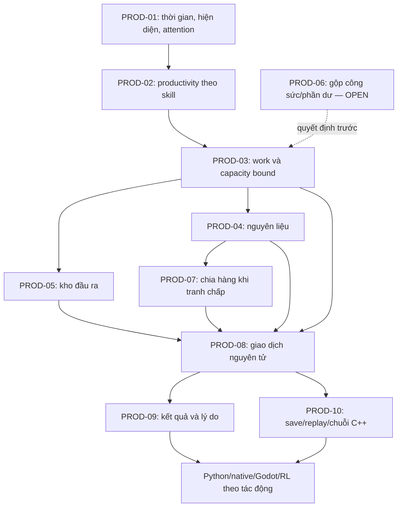

# PolyEc — blueprint bài toán sản xuất

Cập nhật 2026-10-23. Tài liệu này phân rã hệ thống sản xuất thành các bài toán nhỏ có thể được giao, cài đặt và kiểm tra độc lập. Mỗi bài toán được viết theo lối đặc tả thuật toán: đầu vào, ràng buộc, kết quả, quy tắc, trường hợp từ chối/biên và phép kiểm có kết quả mong đợi. Mục tiêu là để người triển khai không phải tự đoán luật từ tên class hoặc từ code cũ.

Tài liệu này cụ thể hóa [bản đồ dự án](PROJECT_MAP.md) §6–7, không thay luật sản phẩm đã duyệt trong [IMPLEMENTATION_PLAN](IMPLEMENTATION_PLAN.md) §25. Những chỗ luật hiện chưa quyết định được đánh dấu **OPEN — cần quyết định trước khi code nhánh đó**. Không được lấp chỗ trống bằng một giả định không ghi nhận.

## 1. Cách dùng và mức chắc chắn

Mỗi mã `PROD-*` là mã bài toán trong blueprint, không phải mã tiến độ hay tuyên bố đã có code. Phải ghép mã này với trạng thái bằng lời và report theo revision. Các tên module, lớp và API ở đây là **đề xuất ranh giới thiết kế**; chúng chưa khẳng định những tên đó đang tồn tại. Trước khi cài, người làm phải tra source hiện tại và ghi chính xác class/API đang có trong plan của lát.

Ba mức thông tin được phân biệt:

| Nhãn | Ý nghĩa | Cách dùng |
|---|---|---|
| Đã chốt | Được ghi trong IMPLEMENTATION_PLAN hoặc contract đang active | Cài đúng luật và viết oracle tương ứng |
| Trial có phiên bản | Hệ số tạm để chạy/kiểm một luồng; chưa được chứng minh cân bằng | Ghi tên phiên bản, đơn vị, miền, lý do và ví dụ; không gọi là cân bằng chuẩn |
| OPEN | Chưa có quyết định sản phẩm/thuật toán đủ để tạo kết quả duy nhất | Không code hành vi gameplay phụ thuộc điểm này cho tới khi plan ghi quyết định |

## 2. Bài toán cha: từ lệnh Work đến sản phẩm có sổ sách đúng

**Đề bài.** Cho một thế giới C++ tại thời điểm game xác định, danh sách cơ sở, người lao động, lịch/hiện diện, recipe, hàng trong kho, quyền Work và lệnh đã được cấp. Hãy tính đúng phần công sức được công nhận; quyết định số batch có thể sản xuất theo recipe, capacity, nguyên liệu và chỗ chứa; sau đó ghi đồng thời lượng hàng tiêu, hàng sinh, tiền/nghĩa vụ liên quan và watermark để load/replay không tạo kết quả hai lần.

**Kết quả đúng phải thỏa:** không tạo hàng từ tên vùng hoặc nhãn atlas; không dùng năng suất thay cho thời gian có mặt; không sản xuất nếu thiếu đầu vào; không vượt capacity; không để kho đầu ra vượt giới hạn đã duyệt; không mất/nhân đôi hàng hoặc tiền khi từ chối, lưu, nạp hay chạy lại cùng mốc. Các giới hạn chưa có luật cụ thể, đặc biệt xử lý kho đầu ra đầy, được đánh dấu OPEN ở bài toán tương ứng.


### Ký hiệu dữ liệu dùng chung

| Ký hiệu | Miền/đơn vị | Ý nghĩa |
|---|---|---|
| `tick` | Số nguyên game-time | Đơn vị thời gian mô phỏng; pause không làm tăng tick |
| `attention_raw` | Số nguyên attention unit | Mức chú ý thực sự được giao cho công việc sau khi kiểm hiện diện, đi đường, lịch và trần chú ý |
| `skill` | Số nguyên `[0,100]` | Năng lực sản xuất cá nhân theo trial T3.9 |
| `attention_prod` | Số nguyên tích lũy đã quy đổi | `attention_raw × (150 + skill)`, lưu dưới dạng tử số; ngưỡng trung tính cho một work unit tương ứng `16,000 × 200` |
| `work_unit` | Đơn vị công việc của recipe | Sản lượng công việc rời rạc; trial hiện dùng 16,000 raw attention ở skill 50 cho 1 unit |
| `batch` | Số nguyên không âm | Một lần áp dụng đầy đủ recipe; không tự suy batch từ số món đầu ra nếu recipe có tỷ lệ khác |
| `capacity_remaining` | batch/site/day hoặc đơn vị được recipe khai báo | Giới hạn sản lượng theo cơ sở trong kỳ; đơn vị phải khai báo rõ |
| `GoodId` | ID hàng hóa chuẩn | Khóa của từng hàng đầu vào/đầu ra; không thay bằng hàng cùng nhóm nếu không có quy tắc thay thế |
| `sequence` / watermark | ID hoặc số thứ tự bền vững | Ngăn xử lý trùng một lần công/production/settlement |

**Lưu ý phép quy đổi.** T3.9 lưu `attention_prod` theo tử số để không làm tròn mỗi tick: một phần chú ý `a` ở skill `s` đóng góp `a × (150+s)`; ngưỡng một work unit ở mức trung tính là `16,000 × 200`. Khi cộng các phần, so sánh tích lũy bằng số nguyên 64-bit đã kiểm overflow. Không làm tròn từng ngày hoặc đổi skill hiện tại để viết lại công sức cũ. Các hành vi cộng dồn qua nhiều lao động, chia phần dư giữa cá nhân/cơ sở/recipe và lưu phần dư trong save phải tuân contract hiện hành; nếu chưa được xác định, đánh dấu OPEN, không tự chọn.

### Giới hạn định lượng dùng chung và giới hạn còn thiếu

| Tham số | Giá trị/giới hạn hiện có | Trạng thái/ý nghĩa |
|---|---:|---|
| Số nhóm hàng / sản phẩm trong catalog mục tiêu | 16 nhóm / 27 sản phẩm | Quy mô mục tiêu của catalog, không có nghĩa mọi hàng đã có producer |
| Số game tick trong ngày | 64 | Thời gian mô phỏng; không phải 64 giờ thật |
| Trần chú ý một người trên một tick | 1,000 attention unit | Trial T3.3/ActivityEvaluator; chỉ attention giao ở đúng nơi mới tính cho worksite |
| Skill cá nhân | `[0,100]` | Miền `Person::skill` dùng ở trial T3.9 |
| Hệ số productivity | `(150+skill)/200`, tức `[0.75,1.25]` | Trial có phiên bản, chưa hiệu chuẩn |
| Ngưỡng trung tính một work unit | 16,000 raw attention ở skill 50 | Trial; recipe có thể có cấu hình công việc/capacity cụ thể nhưng không tự hiểu mọi món dùng cùng hệ số |
| Worker/site, establishment, recipe, demand trên một kỳ | Chưa có giới hạn chung được nêu ở §25 | Mỗi lát phải lấy giới hạn thật từ schema/config/code và nêu rõ; không tự đặt N để benchmark hoặc để hợp thức hóa cấu trúc dữ liệu |
| Lượng hàng/capacity tối đa | Chưa có một ngưỡng dùng chung được duyệt | Contract từng catalog/config phải nêu kiểu, max, đơn vị và overflow behavior trước code |
| Kích thước lưu trữ | Luật gameplay chưa chốt | PROD-05 đang OPEN; không gán số dung lượng tùy ý |

Đây là các constraint đã biết trên toàn nhánh và những lỗ hổng cần lấp. Khi một bài toán có giới hạn riêng, supporting plan phải ghi rõ `n`/`m` tối đa theo schema/config thật, miền từng giá trị và tổng work estimate. Nếu chưa có con số trong tài liệu/source, ghi “chưa xác định” thay vì đưa một ràng buộc giả theo kiểu đề thi.

## 3. Các bài toán nhỏ

### PROD-01 — Xác định thời gian lao động thực sự có thể dùng

**Đề bài.** Với một người, một khoảng game-time, các phiên Work, lịch chồng lấn, vị trí/đường đi, quyền làm việc và trạng thái cơ thể, tìm số tick và lượng attention thô được cấp cho từng cơ sở/công việc.

| Trường | Đặc tả |
|---|---|
| Đầu vào | Person ID; khoảng `[tick_start,tick_end)`; Schedule sessions (worksite, ưu tiên, mức attention yêu cầu); vị trí và travel state; Work authorization; body/activity limits; các sự kiện có thời điểm trong khoảng |
| Ràng buộc đã chốt | Chỉ tính thời gian game; pause không tiến lịch. `attention_raw` không quá khả năng chú ý ở từng đoạn. Người đang di chuyển/không ở worksite không tạo attention cho cơ sở đó. Lịch có thể cam kết nhiều hơn năng lực thực tế nhưng phần thiếu phải được ghi nhận, không được tự coi là đã làm đủ |
| Kết quả | Theo từng session: tick có mặt hợp lệ, `attention_raw` giao được, attention chưa giao, lý do thiếu (vắng, đi đường, lịch chồng lấn, cơ thể/giới hạn) |
| Reject | Person/session/worksite ID không tồn tại; quyền Work không hợp lệ; khoảng thời gian sai hoặc ngoài game-time hợp lệ |
| Biên cần kiểm | Session bắt đầu/kết thúc đúng biên; travel hoàn tất giữa đoạn; pause/resume; hai việc chồng lấn; người chết hoặc mất quyền giữa ngày; tick có sự kiện đổi vị trí |
| Oracle tối thiểu | Với `C=1000` attention/tick, một session hợp lệ trong 4 tick yêu cầu 800/tick phải nhận 3,200; session ngoài worksite nhận 0; hai session đồng ưu tiên cùng yêu cầu 800 không được tổng vượt 1,000/tick theo luật chia đã duyệt |
| Đề xuất ranh giới | Module `activity/work_allocation`; API kiểu `allocateWorkAttention(snapshot, interval) -> WorkAttentionResult` (tên minh họa, phải đối chiếu source) |
| Phụ thuộc | P4 thời gian → P5 phân bổ chú ý → P6 hiện diện/công sức |
| OPEN | Quy tắc chia chú ý cụ thể cho nhiều session đồng ưu tiên cần tra phần P5 và contract active; không tự dùng thứ tự ID hay ngẫu nhiên nếu chưa được duyệt |

### PROD-02 — Quy đổi chú ý thành công sức hiệu dụng theo năng lực cá nhân

**Đề bài.** Tính lượng công sức sản xuất do từng người tạo ra từ các đoạn attention hợp lệ, trong đó năng lực riêng có thể đổi theo thời gian nhưng không viết lại đóng góp lịch sử.

| Trường | Đặc tả |
|---|---|
| Đầu vào | Các đoạn `(person_id, tick range, attention_raw, skill_at_delivery)`, counter tích lũy trước đó, recipe/worksite và trạng thái watermark |
| Ràng buộc | Skill là số nguyên `[0,100]`; trial T3.9 `m(s)=(150+s)/200`, factor `[0.75,1.25]`; tính bằng tử số nguyên; attention giao ở thời điểm nào lấy skill tại thời điểm đó; `attention_raw` đồng thời vẫn dùng cho quy tắc gắng sức, không bị thay bởi attention sản xuất |
| Kết quả | Công sức quy đổi của từng người; số work unit nguyên đã hoàn thành; phần dư tích lũy; mức exertion thô không đổi so với input |
| Reject | Skill ngoài miền; counter âm/không hợp lệ; tick hoặc watermark cũ/trùng; checked arithmetic overflow |
| Biên cần kiểm | Đổi skill giữa chừng; skill 0/50/100; phần dư qua save/load; nhiều đoạn nhỏ tương đương một đoạn gộp; dừng/pause |
| Oracle | 16,000 raw attention ở skill 0/50/100 tương ứng 12,000/16,000/20,000 đơn vị attention quy đổi trước ngưỡng work unit. Ở skill 50, 16,000 tương ứng một work unit theo trial đang dùng. Kiểm bằng số nguyên, không float |
| Đề xuất ranh giới | `production/productivity`; API `accumulateWorkerEffort(previous, segments, recipeThreshold) -> EffortResult` |
| Phụ thuộc | PROD-01; P6.2; T3.3/T3.9 |
| Nguồn | [IMPLEMENTATION_PLAN §20.2, §25.1, §T3.3, §T3.9](IMPLEMENTATION_PLAN.md); [T3.9 plan](design/M5-T3.9-personal-work-skill-productivity-plan.md) |

Trial trên là hệ số kỹ thuật để kiểm luồng, chưa phải năng suất cân bằng đã được chứng minh. Không được mô tả game là đã hiệu chuẩn năng suất chỉ vì các oracle số học này qua.

### PROD-03 — Xác định recipe và số batch tối đa theo công suất

**Đề bài.** Từ recipe hợp lệ, work unit hoàn tất và capacity còn lại, tính số batch tối đa có thể xét trước khi giới hạn bởi vật tư/kho.

| Trường | Đặc tả |
|---|---|
| Đầu vào | Recipe ID/version; danh sách đầu vào `(GoodId, amount_per_batch)`; đầu ra `(GoodId, amount_per_batch)`; yêu cầu work; capacity của cơ sở theo kỳ; số work unit mới và batch đã chạy trong kỳ |
| Ràng buộc | Mỗi lượng phải không âm; batch recipe phải có đầu vào/đầu ra có ý nghĩa; không thay thế GoodId; capacity dùng đơn vị có khai báo. Pilot mặc định 1 batch/ngày khi scenario không chỉ định capacity; mỗi work unit tối đa tạo một batch theo luật hiện hành |
| Kết quả | `candidate_batches = min(work_batches, capacity_remaining)` cùng lý do giới hạn và lượng work chưa dùng theo quy tắc |
| Reject | Recipe/version không tồn tại; GoodId không hợp lệ; lượng/đơn vị tràn; capacity âm; recipe rỗng hoặc tự mâu thuẫn |
| Biên cần kiểm | Capacity bằng 0; vừa hết đúng một batch; nhiều work unit nhưng capacity một; capacity lớn hơn mọi input; thay version recipe khi save đang tồn tại |
| Oracle | Nếu có 3 work unit mới, capacity còn 2 batch/ngày, kết quả trước khi xét vật tư là 2; nếu capacity 0, kết quả 0 |
| Đề xuất ranh giới | `production/recipe` và `production/capacity`; query thuần `calculateCapacityBound(...) -> BatchBound` |
| Phụ thuộc | Catalog hàng, recipe, PROD-02; P3/P6/P7 |
| OPEN | Quan hệ tổng quát giữa `work_unit` và batch với mọi recipe, reset kỳ capacity, và việc nhiều worker có thể cộng công sức cho một batch chưa được tự suy ra ngoài contract từng recipe |

### PROD-04 — Giới hạn sản lượng khi thiếu nguyên liệu

**Đề bài.** Với candidate batch, recipe và lượng tồn kho có thể dùng tại cơ sở, tìm số batch tối đa mà mọi đầu vào đều đủ.

Với mỗi hàng đầu vào `g`, đặt `q_g` là lượng tồn khả dụng và `r_g` là lượng cần cho một batch. Nếu mọi `r_g > 0`, giới hạn vật tư là `floor(q_g/r_g)` nhỏ nhất trên các đầu vào; nếu recipe không cần đầu vào, phải dùng loại recipe riêng được cho phép chứ không được chia cho 0.

| Trường | Đặc tả |
|---|---|
| Đầu vào | Candidate batch; recipe đã xác thực; inventory theo GoodId; phần đã reserve cho nghĩa vụ khác; quyền sở hữu/khả dụng của mỗi lô |
| Ràng buộc | Không tiêu hàng không thuộc cơ sở hoặc đã reserve; không substitution mặc định; lượng tồn là số nguyên không âm; không sản xuất vượt min của mọi đầu vào |
| Kết quả | Số batch đủ vật tư; lượng mỗi hàng bị giữ/tiêu; thiếu hụt theo từng GoodId; công sức/capacity bị bỏ lỡ theo luật hiện hành |
| Reject | Inventory âm/hỏng; recipe không canonical; lô không thuộc chủ thể có quyền; overflow khi nhân `amount_per_batch × batches` |
| Biên cần kiểm | Thiếu một đơn vị ở đúng một đầu vào; nhiều đầu vào cùng là nút thắt; input dư; hai recipe cùng đòi một hàng trong cùng kỳ |
| Oracle | Recipe cần 2 Iron + 1 Fuel/batch; kho còn 5 Iron, 2 Fuel ⇒ tối đa 2 batch; tiêu 4 Iron và 2 Fuel, còn 1 Iron. Không được tiêu một phần nguyên liệu để tạo batch dở nếu recipe không định nghĩa dở dang |
| Đề xuất ranh giới | `production/material_planner`; pure function `limitBatchesByInputs(recipe, inventory, reservations, candidate) -> MaterialBound` |
| Phụ thuộc | PROD-03; P1/P3 quyền và sổ hàng; P7 quyết toán |
| Đã chốt hiện tại | Thiếu đầu vào làm mất cơ hội sản xuất; không tích lũy lao động để bù vào ngày sau; hàng hóa canonical, không tự thay thế |
| OPEN | Thứ tự ưu tiên giữa nhiều recipe/worksite cùng tranh một loại hàng và chính sách reserve phải được nêu rõ trong plan trước khi thêm producer cạnh tranh |

### PROD-05 — Kiểm tra kho đầu ra trước khi sản xuất

**Đề bài.** Trước khi tiêu nguyên liệu và công sức cho batch, xác định kho còn nhận được toàn bộ đầu ra hay không, theo giới hạn lưu trữ đã được định nghĩa.

| Trường | Đặc tả |
|---|---|
| Đầu vào | Kho hiện tại; giới hạn theo hàng/khối lượng/thể tích nếu có; đầu ra mỗi batch; số candidate batch; hàng đang reserve hoặc chờ nhập |
| Ràng buộc | Mọi lượng tồn sau commit không âm và không vượt giới hạn đã duyệt; không xóa, bán hoặc gửi hàng để tạo chỗ một cách ngầm định |
| Kết quả cần có | Số batch có thể nhận vào kho và lý do giới hạn; hoặc kết quả từ chối/lỗi rõ ràng trước khi thay đổi state |
| Trường hợp biên | Kho đầy đúng mức; một hàng đầy nhưng hàng khác còn chỗ; đầu ra nhiều loại; shipment đồng thời; dung lượng được nâng/hạ giữa hai kỳ |
| Đề xuất ranh giới | `inventory/storage_capacity`; query `limitBatchesByOutputStorage(...) -> StorageBound` |
| Phụ thuộc | PROD-03; dữ liệu kho/cargo/market; P3/P7/P9/P15 |
| OPEN — chặn code | IMPLEMENTATION_PLAN §25 hiện chưa quyết định kho đầy thì: chặn toàn batch, giữ output ở nơi tạm, dừng trước khi dùng effort/input, hay cho phép loại kho có overflow. Cũng chưa định nghĩa dung lượng theo unit nào, có giới hạn từng GoodId hay không, và shipment/market reserve được tính ra sao. Plan phải chọn một luật và migration/replay trước khi triển khai nhánh này. |

Không viết test mong đợi cho một trong các phương án OPEN như thể đó là hành vi được duyệt. Có thể kiểm tra invariant chung và hiện trạng; chưa thể xác nhận hành vi gameplay kho đầy.

### PROD-06 — Cộng năng lực riêng của nhiều lao động tại cùng một cơ sở

**Đề bài.** Mỗi người có thể giao số attention và có skill khác nhau. Hãy tính đúng tổng công sức sản xuất đủ điều kiện tại một cơ sở mà không lấy trung bình skill, không đổi skill cá nhân thành một giá trị chung, và không làm mất phần lẻ.

**Quy tắc trong T3.9 hiện hành.** C++ lưu tử số quy đổi theo cặp `(actor, establishment)`. Mỗi đoạn attention của người `i` được nhân với `150 + skill_i` tại lúc giao. ProductionManager chia lượng quy đổi theo mẫu `200 × 1.000 × ticks_per_unit`. Tài liệu này mô tả phép tổng hợp toán học tương ứng; trước khi đổi cách gom phần lẻ, chu kỳ hoặc attribution trong code, plan của lát phải đối chiếu lại source và report T3.9.

Với người `i` và các đoạn hợp lệ `k` trong một kỳ, đặt:

```text
weighted_numerator_i = Σ_k attention_raw[i,k] × (150 + skill_at_delivery[i,k])
weighted_numerator_establishment = Σ_i weighted_numerator_i
work_units_eligible = floor(
  (weighted_numerator_establishment + persisted_remainder)
  / (200 × 1,000 × ticks_per_unit)
)
```

Ở config chuẩn `ticks_per_unit=16`, mẫu là `3,200,000`. Các map theo actor/worksite giữ nguồn để kiểm skill và hiện diện riêng; tổng ở cùng cơ sở mới được đổi ra work unit theo rule của T3.9. Không được tính trung bình skill trước khi nhân attention: `Σ(attention_i × (150+skill_i))` là đúng phép tính, còn `Σ(attention_i) × (150+average_skill)` chỉ tương đương nếu trung bình được tính có trọng số đúng trên chính các attention segments.

**Ví dụ tính tay.** Hai người mỗi người được cấp 8,000 raw attention ở cùng cơ sở và kỳ: người A có skill 0, người B skill 100. A góp `8,000×150=1,200,000`; B góp `8,000×250=2,000,000`; tổng `3,200,000`, bằng đúng một work unit khi `ticks_per_unit=16`. Nếu lấy floor riêng từng người thì cả hai đều thành 0; cách đó làm mất công sức chung và không phù hợp phép tính tổng numerator được nêu trong T3.9.

| Trường | Đặc tả |
|---|---|
| Đầu vào | Các đoạn `(actor, establishment, attention_raw, skill_at_delivery)`; numerator/remainder đã lưu; `ticks_per_unit`; worksite/cơ sở và sequence |
| Ràng buộc | Skill `[0,100]`; từng attention segment chỉ thuộc một actor và một cơ sở; attention chỉ được tính khi đủ presence/authorization; kiểm overflow trước khi công bố |
| Kết quả | Numerator hiệu dụng theo actor/cơ sở; tổng work unit nguyên đủ điều kiện; remainder chính xác; raw attention riêng để tính exertion |
| Reject | Actor/cơ sở không hợp lệ; segment trùng; skill sai miền; remainder không hợp lệ; overflow; sequence đã xử lý |
| Trường hợp biên | Một người đổi skill giữa kỳ; hai người với skill khác nhau cùng đủ/mỗi người chưa đủ một ngưỡng; chuyển cơ sở; người chết/nghỉ việc; save giữa kỳ; `ticks_per_unit` đổi theo config version |
| Oracle | Ví dụ hai worker 8,000 attention với skill 0 và 100 cho numerator 3,200,000 và đúng 1 work unit ở kỳ 16; riêng skill0: 16,000 attention tạo 2,400,000, chưa đủ; riêng skill100: 12,800 attention tạo 3,200,000, vừa đủ |
| Đề xuất ranh giới | `production/productivity` giữ phép tính thuần; sổ/production manager gom counter theo cơ sở và commit watermark. Tên module/API là nhãn thiết kế, phải thay bằng source owner hiện tại trong plan |
| Phụ thuộc | PROD-01/02/03; quyền lao động; config version; save schema; P1/P6/P7/P15 |
| OPEN còn lại | Contract cần giữ chính xác cách remainder được nhóm theo actor/cơ sở, cách attribution/forfeiture khi một người chuyển cơ sở hoặc chủ thể mất quyền, và điều gì xảy ra khi config đổi giữa campaign. Không còn OPEN về việc phải dùng skill riêng của từng người trong phép cộng. |

### PROD-07 — Chọn và giữ hàng khi nhiều việc tranh cùng tồn kho

**Đề bài.** Khi nhiều recipe, Work order hoặc giao dịch hợp lệ cùng cần một kho trong một tick/ngày, phân bổ số hàng khả dụng xác định, công bằng theo luật game và có thể replay.

| Trường | Đặc tả |
|---|---|
| Đầu vào cần định nghĩa | Danh sách demand có ID ổn định, owner/authority, hạn, priority đã duyệt, recipe input; tồn kho và reservations |
| Ràng buộc chung | Tổng lượng phân bổ không vượt hàng khả dụng; cùng snapshot và cùng lệnh phải cho kết quả lặp lại; quyền sở hữu/consent được kiểm; checked arithmetic |
| Kết quả cần định nghĩa | Phân bổ theo demand, phần không được cấp và lý do; sau commit sổ kho khớp tổng phân bổ |
| Trường hợp biên | Hai demand ngang priority; ID insertion order khác nhau; một demand bị hủy; chủ kho chết/đổi đại diện; save sau reserve |
| Đề xuất ranh giới | `inventory/reservation_allocator`; API nhận snapshot + danh sách demand đã chuẩn hóa và trả plan thuần, sau đó transaction commit |
| Phụ thuộc | P1 quyền; P2 transaction; P3 inventory; P7 settlement; P15 save/load |
| OPEN | Luật ưu tiên producer, người lao động, household demand và market order không thể suy ra từ “cùng có nhu cầu”. Không chọn FIFO/ID order/priority tự đặt nếu chưa có spec. |

### PROD-08 — Commit nguyên tử tiêu đầu vào, ghi sản phẩm, tiền và watermark

**Đề bài.** Sau khi đã tính được sản lượng, thực hiện toàn bộ các thay đổi như một giao dịch: tiêu đủ đầu vào, thêm đủ đầu ra, ghi chi phí/thu nhập hoặc nghĩa vụ nếu có, cập nhật capacity và watermark. Nếu bất kỳ bước kiểm tra cuối nào lỗi thì không áp dụng một phần.

| Trường | Đặc tả |
|---|---|
| Đầu vào | Actor/authority; establishment; work order; batch plan; inventory snapshot/version; account; timestamp/sequence; save schema version |
| Kiểm trước commit | Quyền và consent; snapshot chưa stale; tồn đầu vào; dung lượng đầu ra theo luật; số học; ID và sequence chưa xử lý; mọi tài khoản đối ứng hợp lệ |
| Thành công | Sổ đầu vào giảm đúng `recipe_input × committed_batches`; sổ đầu ra tăng đúng `recipe_output × committed_batches`; cập nhật capacity/work watermark một lần; tiền/nghĩa vụ chỉ ghi theo contract |
| Reject | Validator sai, sequence duplicate/stale, snapshot cũ, thiếu hàng, overflow hoặc một tài khoản không hợp lệ ⇒ không đổi sổ nào, watermark hoặc fingerprint thế giới |
| Save/load | Save sau commit rồi load không chạy lại; save trước commit rồi load có thể chạy lệnh đúng một lần; migration khởi tạo watermark theo dữ liệu lịch sử mà không cấp thêm sản phẩm |
| Oracle | So sánh toàn bộ inventory/account/capacity/watermark trước và sau success; với reject so fingerprint và từng sổ; phát lại sequence đã commit không tăng output/lương lần hai |
| Đề xuất ranh giới | `production/transaction`; transaction/command trong C++ core là nơi duy nhất ghi; API minh họa `commitProduction(plan, expectedVersion, sequence)` |
| Phụ thuộc | PROD-03–07; P2/P3/P7/P15; cùng command pipeline cho UI và AI |

### PROD-09 — Phân biệt thiếu sản xuất, sai lệnh và lỗi thực thi

**Đề bài.** Trả kết quả đủ chi tiết cho người chơi, AI và report để phân biệt (a) lệnh bị từ chối vì sai quyền/dữ liệu, (b) lệnh hợp lệ nhưng sản lượng bằng 0 vì thiếu hiện diện/vật tư/capacity/kho, và (c) lỗi số học/hệ thống khiến giao dịch không thể commit.

| Đầu vào | `ProductionCommand`, snapshot của world, recipe, kho, kết quả PROD-01–08 |
| Đầu ra | Mã kết quả ổn định; lượng work/batch/input/output thực; từng nguyên nhân giới hạn; có thể retry hay cần lệnh khác; thông tin chỉ đưa vào view nếu người đọc có quyền |
| Ràng buộc | Không gọi thất bại hợp lệ là thành công; không cho UI/AI tự suy từ “0 output”; không tiết lộ kho/quyền riêng của chủ thể khác |
| Phép kiểm | Fixture riêng cho `NoAttendance`, `NoInput`, `CapacityExhausted`, `OutputStorageFull` (chỉ sau khi luật kho được chốt), `Unauthorized`, `StaleSequence`, `ArithmeticOverflow`; kiểm result và world fingerprint |
| Đề xuất ranh giới | Domain result type trong C++ core; binding chuyển nguyên nghĩa sang Python/native/Godot, không tạo bộ quy tắc thứ hai |
| Phụ thuộc | PROD-01–08; P2, P8, P10, P16 |

### PROD-10 — Đối chiếu chuỗi sản xuất qua thời gian và save/load

**Đề bài.** Chạy một chuỗi có nguồn hàng thật từ command đến sản phẩm, tiền/thị trường và tải lại save; kết quả khi có save/load phải tương đương chạy liền mạch.

| Đầu vào | Realm seed/config; establishment/owner; nguồn hàng đầu vào; recipe; worker/Work order; lệnh cấp Work; save ở các mốc trước/sau commit; commands market/shipment nếu thuộc lát |
| Kết quả | Chuỗi event/ledger đầy đủ; inventory theo GoodId; sản phẩm; account/obligation; watermark; view được phép; state fingerprint sau mỗi mốc |
| Ràng buộc | Nguồn phải được định danh và có quyền; hàng không tự sinh; command đi cùng transaction pipeline; pause không tiến giờ; load không nhân đôi sản lượng hoặc tiền |
| Oracle | Tính tay expected input/output/account theo batch; so chạy liên tục với save→load ở trước và sau commit; replay command duplicate phải không thay đổi kết quả lần hai |
| Chạy ngay | Core C++ production target + test chuỗi liên quan, theo hướng dẫn phạm vi ở [DEVELOPMENT_WORKFLOW](DEVELOPMENT_WORKFLOW.md) |
| Chạy ở mốc ổn định | Python/native/Godot adapter bị ảnh hưởng, RL nếu observation/action/reward/model thay đổi, performance và package theo M5 plan |
| Phụ thuộc | Các PROD-01–09; P16; M5.2/M5.4 theo producer/consumer |

## 4. Giới hạn số học và độ phức tạp cần khai báo

Đối với một hàm giới hạn batch trên `W` mặt hàng input, triển khai đơn giản phải chạy `O(W)` thời gian và `O(1)` bộ nhớ phụ, không tính danh sách kết quả. Khi phân bổ cho `N` work order và `W` loại hàng, giới hạn kỳ vọng ban đầu có thể là `O(NW)`; nếu thêm index/queue để tối ưu, phải chứng minh kết quả giống thuật toán tham chiếu. Không dùng số thực cho quantity hàng, tiền hoặc counter attention nếu contract khai báo số nguyên.

Mỗi plan phải ghi kiểu số, miền cực đại, phép nhân có kiểm tra trước commit, chính sách làm tròn và hành vi overflow. Tràn số là lỗi từ chối nguyên tử; không wrap, saturate hoặc bỏ batch một cách ngầm định. Các giá trị cực đại phải lấy từ schema/config/source thật, không đặt con số giới hạn tưởng tượng trong blueprint.

## 5. Sơ đồ phụ thuộc bài toán sản xuất



## 6. Ranh giới module/API: tên là đề xuất, trách nhiệm là điều bắt buộc

| Trách nhiệm | Ranh giới thiết kế gợi ý | Dữ liệu được ghi | Không được làm |
|---|---|---|---|
| Tính hiện diện và phân bổ attention | `activity/work_allocation` | Kết quả attention theo người/session/tick | Ghi hàng, trả lương hoặc chọn chiến lược NPC |
| Quy đổi năng lực và phần dư công sức | `production/productivity` | Counter theo contract và version công thức | Tính lại quá khứ bằng skill hiện tại |
| Recipe và giới hạn công suất | `production/recipe`, `production/capacity` | Recipe canonical/config có version; capacity kỳ | Tự tạo hàng thay thế hoặc bỏ qua capacity |
| Tính giới hạn vật tư/kho | `production/material_planner`, `inventory/storage_capacity` | Plan thuần, không sửa Realm | Tiêu hàng khi mới chỉ tính plan |
| Phân bổ cạnh tranh | `inventory/reservation_allocator` | Reservation có ID/owner/sequence | Phân bổ theo iteration order không đặc tả |
| Giao dịch sản xuất | command/transaction trong C++ Realm | Ledger, tồn kho, watermark, fact | Để Python, native hoặc UI ghi trực tiếp domain state |
| Bề mặt chỉ đọc | RealmView/PlayerView và adapter | Kết quả được phép quan sát | Tiết lộ số liệu bí mật hoặc biến UI thành luật |

Khi source đã có module tương ứng, plan phải thay tên gợi ý bằng đường dẫn và API thật. Khi refactor đổi API, cập nhật tài liệu này và class reference cùng lần đóng nhóm; test target phải nêu đúng consumer bị ảnh hưởng. Một API cụ thể phải định nghĩa tham số, đơn vị, quyền đọc/ghi, lỗi, thứ tự xử lý và dữ liệu bền vững; tên hàm đơn lẻ không phải hợp đồng.

## 7. Những quyết định cần được đóng trước từng nhánh

| Nhánh | Câu hỏi phải có đáp án trong contract trước code |
|---|---|
| PROD-01 | Quy tắc chia attention khi nhiều việc đồng thời/đồng ưu tiên; tick biên và sự kiện dịch chuyển |
| PROD-02 | Công thức/phiên bản và cách giữ phần dư/save; T3.9 hiện là trial chưa hiệu chuẩn |
| PROD-03 | Công thức work unit → batch theo recipe; reset capacity và kỳ tính |
| PROD-04 | Reservation, thứ tự cạnh tranh và số lượng khả dụng của hàng thuộc nhiều nghĩa vụ |
| PROD-05 | Đơn vị/giới hạn kho và hành vi khi đầu ra không chứa được |
| PROD-06 | Công sức cộng theo cá nhân hay work order/cơ sở; phần lẻ được giữ ở đâu, mang qua kỳ không |
| PROD-07 | Luật ưu tiên công bằng/tất định giữa các demand cạnh tranh |
| PROD-08 | Những tài khoản/nghĩa vụ nào phát sinh; schema/watermark/migration cụ thể |
| PROD-09 | Mã kết quả nào được công khai cho người chơi, policy và chủ thể có quyền |
| PROD-10 | Cấu hình nguồn, seed, vị trí save và adapter/replay sẽ kiểm ở mốc nào |

Quyết định nào đã nằm trong plan phải link đến đúng mục và không chép thành luật mới tại đây. Mọi thay đổi gameplay cần cập nhật [IMPLEMENTATION_PLAN](IMPLEMENTATION_PLAN.md) trước khi cài. Mọi kết quả code hoàn tất phải cập nhật tài liệu tương ứng theo quy tắc ở [DEVELOPMENT_WORKFLOW](DEVELOPMENT_WORKFLOW.md) §5.1.
