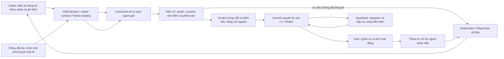
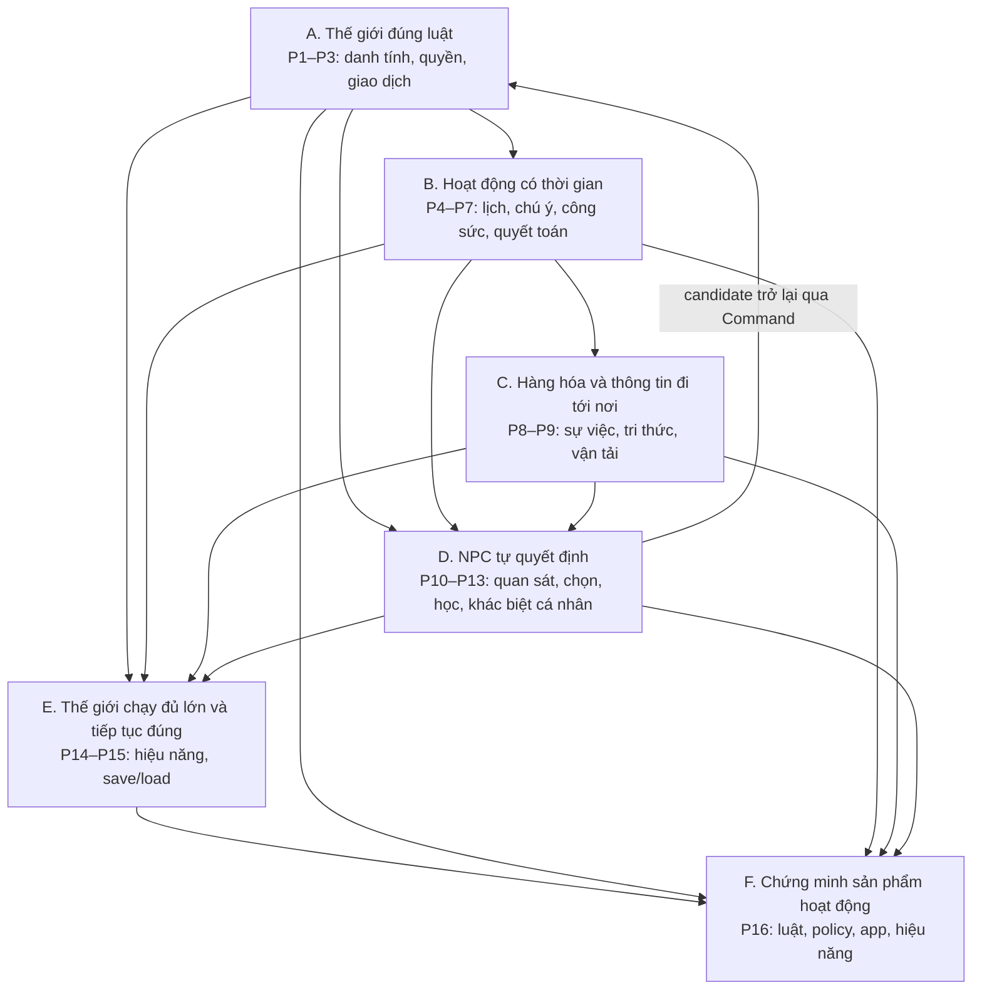
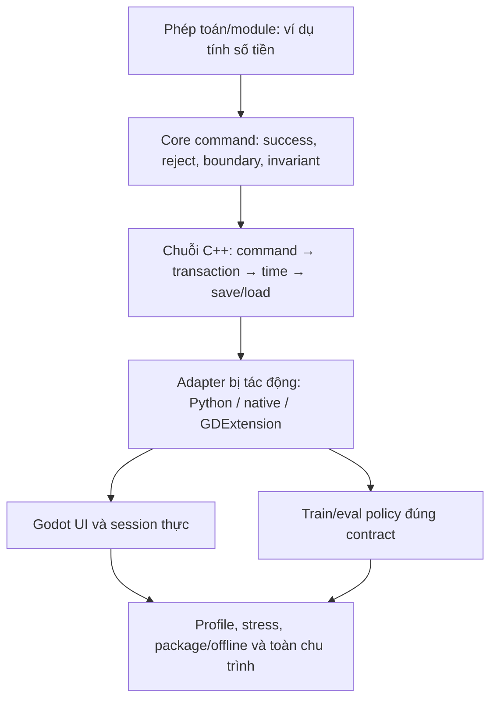

# PolyEc — sơ đồ dự án và cây phân rã tới mức triển khai

Cập nhật 2026-10-23. Tài liệu này giúp người đọc lần từ mục tiêu sản phẩm xuống những phần code cần có và cách chứng minh chúng đúng. Nó không thay thế luật trong [IMPLEMENTATION_PLAN](IMPLEMENTATION_PLAN.md), trạng thái trong [CURRENT_TASK](CURRENT_TASK.md), phương pháp trong [DEVELOPER_GUIDE](DEVELOPER_GUIDE.md), hay kết quả chạy trong [reports](reports/README.md).

## 1. Cách đọc sơ đồ

PolyEc có bốn loại mã. Mỗi loại trả lời một câu hỏi khác nhau; không dùng mã ở một loại để kết luận trạng thái ở loại khác.

| Mã | Trả lời câu hỏi | Ví dụ | Nơi có nghĩa chính thức |
|---|---|---|---|
| `M` | Mục tiêu sản phẩm đang ở giai đoạn lớn nào? | `M5.4` là phần quốc gia, thành thị, quân sự, ngoại thương và giao diện vua | [IMPLEMENTATION_PLAN §6](IMPLEMENTATION_PLAN.md#6-roadmap-toan-du-an) |
| `P` | Bài toán kỹ thuật nào phải được giải? | `P1` là danh tính/quyền; `P1.1` là giữ ID khi đổi hộ, nghề hoặc chức | [TECHNICAL_PROBLEMS](TECHNICAL_PROBLEMS.md) |
| `T` | Luồng kỹ thuật liên ngành nào đang được xây? | `T1–T3` nối lịch, hiện diện, công sức, quyết toán và cơ thể | [IMPLEMENTATION_PLAN §30](IMPLEMENTATION_PLAN.md#30-bao-phu-yeu-cau-phu-thuoc-va-dieu-kien-dong-m5) và task hiện hành |
| `R` | Một nhãn riêng trong một hệ thống nào? | `core refactor R1` là tách tính lương; `RL quality gate R1` là kiểm policy học được | [core refactor plan](design/core-architecture-refactor.md), [IMPLEMENTATION_PLAN §8](IMPLEMENTATION_PLAN.md#8-rl-va-ca-nhan-hoa) |

Các số như `save49`, `realm-v25` hoặc `observation2935` là phiên bản/cỡ dữ liệu, không phải số thứ tự milestone. Chúng luôn phải đi kèm tên hệ thống và ngữ cảnh.

**Một mã chỉ định vị nội dung; trạng thái phải viết riêng.** Ví dụ, `M5.4` không có nghĩa là đã hoàn thành. Câu báo cáo đúng phải nói rõ nhóm nhỏ nào của M5.4 đã triển khai, lớp nào đã kiểm, còn điều kiện nào chưa đạt và dẫn tới report có dữ liệu chạy.

## 2. Một vòng lệnh đi qua toàn hệ thống như thế nào?

Đây là đường đi chung cho người chơi và NPC. Godot và policy không được tự sửa tiền, hàng, người hoặc thời gian bên trong giao diện.



Lệnh hợp lệ có thể thất bại theo luật sau khi bắt đầu, chẳng hạn một chuyến hàng không tới nơi; chi phí/hệ quả đó phải được định nghĩa rõ. Lệnh bị validator từ chối thì không được để lại thay đổi dở dang. Một hệ thống duy nhất trong C++ quyết định kết quả; Python, native và Godot gọi/hiển thị cùng luật.

## 3. Phụ thuộc giữa sáu nhóm bài toán kỹ thuật



Mũi tên là quan hệ phụ thuộc, không phải thứ tự bắt buộc cho mọi file. Có thể triển khai một nhánh riêng nếu đầu vào và phép kiểm đã đủ; không được gọi toàn bộ sản phẩm xong chỉ vì một nhánh đã qua.

## 4. Roadmap sản phẩm: mục tiêu nào phải được xây?

| Mốc | Kết quả người chơi/dev phải có thể làm | Phụ thuộc kỹ thuật thường gặp | Điều mốc này tự nó chưa chứng minh |
|---|---|---|---|
| M0 | Chạy lõi native, bản đồ/đồng hồ, binding Python và thử model ONNX đầu tiên | P4, P10–P11, P14–P16 | Không chứng minh nền kinh tế, campaign hoặc policy đạt chất lượng |
| M1 | Sáu vùng, đất triều đình, hàng hóa đầu, chợ, tuyến, nợ, dự án, save | P1–P4, P7, P9, P15–P16 | Không chứng minh quyền xã hội đầy đủ hoặc quy mô quốc gia |
| M2 | Quyền, chính trị, thông tin, cá thể, trẻ em, hộ và vòng đời | P1–P3, P8, P10, P13, P15–P16 | Không chứng minh hành vi policy cá nhân hóa |
| M3 | Thử ba họ policy, PPO hồi quy, runner/curriculum và chẩn đoán | P10–P13, P16 | Pilot không phải learned policy phát hành |
| M4 | Một màn chơi dọc native với logistics, xưởng, hồ sơ vấn đề và nhiều phương án | P4–P9, P15–P16 | Không thay thế thế giới M5 có 27 khu |
| M5 | Nền xã hội đủ sâu và quốc gia 27 khu, 16 nhóm hàng, thành thị, quân sự, ngoại thương, Profile B | P1–P16, trọng tâm P1–P9 và P14–P16 | Không tự chứng minh model đã train/đạt chất lượng hoặc app đã đóng gói |
| M6 | Một đời vua có mở/lưu/tạm dừng/kết thúc, tutorial, thông tin và trải nghiệm hoàn chỉnh | P8, P10, P15–P16 và tích hợp app | Không thay kiểm policy sản phẩm của M7 |
| M7 | Huấn luyện/đánh giá production, export, parity, native regression và release | P10–P16 | Không được suy từ model xuất thành công sang policy chơi tốt |
| S | Khả năng vận hành một triệu cá thể | P14–P16, full-cycle workload | Không phải cam kết đã đạt; constructor hoặc một lượt chạy nhỏ không là benchmark |

Mốc là kết quả sản phẩm, không phải nhóm code hay lịch làm việc. Mỗi mốc có nhiều yêu cầu và phụ thuộc chéo. Bảng trên chỉ tóm tắt; đặc tả M0–M7 theo input/constraints/output/oracle, đặc biệt các mốc M0–M4, nằm trong [MILESTONE_BLUEPRINTS](MILESTONE_BLUEPRINTS.md). Xem [roadmap đầy đủ](IMPLEMENTATION_PLAN.md#6-roadmap-toan-du-an) và [điều kiện đóng M5](IMPLEMENTATION_PLAN.md#30-bao-phu-yeu-cau-phu-thuoc-va-dieu-kien-dong-m5).

### 4.1. Các phần con của M5

| Phần | Phạm vi cần có | Câu hỏi phân rã chính |
|---|---|---|
| M5.0/1 | Registry/schema/quyền; cá thể, hộ, giám hộ, đất, tài khoản và vòng đời | Ai sở hữu từng bản ghi/tài khoản? Người đại diện được làm gì? Save cũ được chuyển đổi ra sao? |
| M5.2 | Cơ sở, hợp đồng, học nghề, đủ 16 nhóm hàng, thị trường và vận tải | Nguồn hàng nào tạo ra? Ai sở hữu? Lệnh mua/bán/Work hạch toán như thế nào? |
| M5.3 | Tổ chức/chức, hôn nhân có consent, di sản, nợ/claim, giáo hội | Thành viên, quỹ, đại diện, quyền hưởng và thứ tự quyết toán được duy trì ra sao? |
| M5.4 | Quốc gia 27 khu, thành thị, quân sự, ngoại thương và giao diện vua | Luật nào đã hoạt động trong C++? Tiền/hàng/người nào đi qua tài khoản đối ứng? Người chơi nhìn thấy gì? |
| M5.5 | Profile B, stress, chạy dài, hiệu năng toàn chu trình và package Windows | Có chạy đúng tải đã nêu, có số đo đủ vòng và mở được offline không? |

M5.4 có nhiều nhóm chức năng, vì vậy báo cáo phải nêu cả tên nhóm, ví dụ “quỹ công trình đô thị thử nghiệm”, thay vì chỉ ghi “M5.4”. Trạng thái hiện hành chỉ lấy từ [CURRENT_TASK](CURRENT_TASK.md).

## 5. Cây bài toán kỹ thuật: mỗi nhánh được nối tới phần code nào?

`P1–P16` phân loại vấn đề kỹ thuật; chúng cắt ngang roadmap `M0–M7`. Một P có thể phục vụ nhiều milestone, và một milestone thường cần nhiều P. Các mục con chính và phương pháp nằm trong [TECHNICAL_PROBLEMS](TECHNICAL_PROBLEMS.md); bảng dưới đây chỉ làm rõ đường đi từ vấn đề tới kiến trúc/API và bộ tài liệu triển khai.

| Bài toán | Câu hỏi cần trả lời bằng hành vi | Thành phần/API đại diện để khảo sát | Nơi bắt đầu tra cứu và kiểm |
|---|---|---|---|
| P1 — danh tính, sở hữu, quyền | Ai là ai? Ai sở hữu tài sản? Ai được đại diện và trong điều kiện nào? | `Person`, ID/quan hệ, `HouseholdIndex`, kiểm tra tư cách trong Realm | [core class reference](design/core-class-reference.md) §§3–4, `core/include/polyec`, `core/src`; các contract M5.0/1 |
| P2 — lệnh trọn vẹn hoặc từ chối | Lệnh sai có để lại một nửa thay đổi không? Lệnh hợp lệ nhưng thất bại theo luật khác gì bị từ chối? | `RealmCommand`, kết quả lệnh, preflight, transaction/commit | `core/include/polyec/realm.hpp`, `core/src/realm*.cpp`, `core/tests`; P2 tests trong [TECHNICAL_PROBLEMS](TECHNICAL_PROBLEMS.md) |
| P3 — hạch toán | Tiền/hàng tăng ở đâu, giảm ở đâu, và phần dư được giữ thế nào? | `FinanceManager`, `PayrollPlan`, `MarketManager`, `ProductionManager`, các sổ tài khoản | `core/include/polyec/managers`, `core/src`; economy/market/production plans trong [design](design/) |
| P4 — thời gian | Mỗi tick/ngày/phase có chạy đúng một lần khi pause, chia nhỏ hoặc load không? | `RealmClockController`, lịch, `RealmDayPipeline`/điểm điều phối trong Realm | core clock, schedule và replay tests; [core class reference](design/core-class-reference.md) §§6, 12 |
| P5 — chú ý/lịch | Người có bao nhiêu thời gian cho các phiên hoạt động đang chồng lấn? | `ScheduleBook`, session/interval, `activity::evaluateActivity` | `core/include/polyec/schedule.hpp`, activity tests, T1/T3 plans |
| P6 — có mặt, công sức, cơ thể | Người có tới nơi không, được cấp chú ý bao nhiêu, đã tạo công sức/sản phẩm gì, cơ thể thay đổi ra sao? | activity result, Work/presence records, body/schedule counters, `WorkEvaluator` theo thiết kế | P6 trong [TECHNICAL_PROBLEMS](TECHNICAL_PROBLEMS.md), T2/T3 plans; `core/tests` |
| P7 — quyết toán | Việc nào đã hoàn thành? Ai phải trả/nhận? Sao chép hoặc load có trả hai lần không? | settlement watermark/record, payroll plan, account transfer, production commit | T2.2–T2.4 contracts, finance/production tests, save replay |
| P8 — sự việc và tri thức | Sự việc nào thực sự xảy ra? Ai biết điều gì, từ nguồn nào và vào lúc nào? | `Fact`, `Knowledge`, `Investigation`, `PlayerKnowledge`/view | [core class reference](design/core-class-reference.md) §4, `IMPLEMENTATION_PLAN` §§14, 21, tests quyền riêng tư |
| P9 — vận tải | Hàng nào thuộc ai, đi qua đường nào, chờ bao lâu, tới đâu và bị mất/huỷ khi nào? | `MapRoute`, `Cargo`, Campaign logistics và các lệnh shipment Realm | core class reference §7, atlas/logistics plans, Campaign/transport tests |
| P10 — observation và hành động hợp lệ | Nhân vật được biết gì và có thể chọn những hành động nào hợp lệ? | observation builder, `Candidate`, action mask, `RealmView`/binding | `IMPLEMENTATION_PLAN` §8, model contracts, Python binding checks, P10 plans |
| P11 — suy luận/lấy mẫu | Model nhận đúng input/memory/mask không, và quyết định một người có bị trộn với người khác không? | `RealmRuntime`, `NativePolicy`, `PolicyOutput`, recurrent memory | [core class reference](design/core-class-reference.md) §11, `native/`, `ai/tests/`, ONNX parity |
| P12 — dữ liệu và PPO | Rollout được tạo từ phiên bản luật/model nào? Train, validation, holdout có tách biệt không? | C++ environment qua binding, recorder/rollout, trainer/exporter | `ai/training/`, `ai/evaluation/`, `IMPLEMENTATION_PLAN` §§8, 28, run report/plot |
| P13 — khác biệt cá nhân | Capability, tính cách, cơ thể, tri thức và mục tiêu có làm hành vi khác đi đo được không? | capability/personality schema, per-person memory/sampling, observation | `IMPLEMENTATION_PLAN` §§3, 20, 23; paired evaluations và ablation |
| P14 — hiệu năng | Chậm ở bước nào trong toàn vòng? Dữ liệu/index có tăng theo tải không? | sparse indexes, bounded batches, phase profiling và end-to-end benchmark | P14, `IMPLEMENTATION_PLAN` §§9, 29, docs T5; workload manifest và benchmark |
| P15 — save/load | Tải save cũ/mới/hỏng có tiếp tục đúng hoặc từ chối mà không làm hỏng thế giới đang chạy không? | Realm/Campaign codec, schema migration, model manifest/contract guard | `core` serialization tests, `IMPLEMENTATION_PLAN` §§22, 29, save/replay contracts |
| P16 — bằng chứng sản phẩm | Luật, policy, app và performance đã được kiểm riêng bằng run nào? | CTest, Python parity, native contracts, Godot smoke/UI, profile/package | [DEVELOPMENT_WORKFLOW §4](DEVELOPMENT_WORKFLOW.md#4-evidence-du-de-nghiem-thu), reports và artifacts |

Tên class ở cột giữa là điểm tra cứu, không có nghĩa class đó đã đáp ứng toàn bộ nhánh. Thiết kế mục tiêu và code hiện có phải được ghi riêng; xem [core class reference](design/core-class-reference.md) để đối chiếu trạng thái từng class.

### 5.1. Ví dụ phân rã sâu: sản xuất

Sản xuất không phải một phép “đổi nguyên liệu thành sản phẩm”. Nó phụ thuộc vào thời gian người lao động có thể dùng, hiện diện, attention được giao, năng lực cá nhân, recipe, công suất cơ sở, nguyên liệu có quyền sử dụng, chỗ lưu đầu ra, cạnh tranh giữa các đơn, giao dịch và lưu/tải. [PRODUCTION_BLUEPRINT](PRODUCTION_BLUEPRINT.md) trình bày mỗi nhánh như bài toán độc lập có đầu vào, giới hạn, kết quả, trường hợp biên và phép kiểm. Những điểm chưa có luật—như kho đầu ra đầy, gộp công sức nhiều người, hoặc hai dây chuyền tranh cùng hàng—được đánh dấu OPEN để không biến giả định của người viết code thành luật game.

## 6. Phân rã tới một gói có thể viết code

Phân rã theo thứ tự sau. Dừng ở một gói chỉ khi một người triển khai có thể viết code và người khác có thể quyết định pass/fail từ hợp đồng đó mà không phải tự đoán gameplay.

```text
Mục tiêu sản phẩm
└── Năng lực người chơi/NPC cần có
    └── Bài toán P và điều kiện phụ thuộc
        └── Hành vi nghiệp vụ hoặc phép chuyển đổi
            └── API/module chịu trách nhiệm
                └── Trường hợp thành công, từ chối, thất bại hợp lệ và biên
                    └── Kiểm thử có oracle + save/adapter/model impact
```

Mỗi gói triển khai phải ghi đủ các mục sau trong plan/contract liên kết. Nếu thiếu một mục làm người viết code phải tự quyết luật, tách tiếp hoặc đánh dấu quyết định còn mở; không tự lấp bằng code.

1. **Kết quả và người dùng:** trước thay đổi chuyện gì xảy ra; sau thay đổi nhân vật/người chơi thấy gì.
2. **Dữ liệu:** tên/loại trường, đơn vị, miền hợp lệ, giá trị mặc định, nguồn chính thức và thời điểm cập nhật.
3. **Chủ sở hữu:** lớp/module duy nhất giữ dữ liệu; cái gì chỉ là chỉ mục/cache dẫn xuất; ai có quyền đọc/ghi.
4. **API:** lệnh/query, actor/capacity/target, tham số, kết quả, lỗi từ chối; người gọi nào (UI, AI, Python, native) đi qua API này.
5. **Chuỗi biến đổi:** điều kiện trước → kiểm quyền/invariant → chuẩn bị thay đổi → commit → facts/notifications/view; thứ tự thời gian và hành vi khi pause/load.
6. **Bốn kết quả:** thành công; reject nguyên tử; nỗ lực hợp lệ nhưng thất bại theo luật; trường hợp biên (ID chết/stale, thiếu tiền/hàng, overflow, cạnh tranh, ngày biên).
7. **Tính bảo toàn:** bảng tiền/hàng/nghĩa vụ trước–sau; ID không nhân đôi; không tiêu trùng; RNG và thứ tự xử lý không đổi ngoài đặc tả.
8. **Tính tiếp tục:** trường save/schema mới; migration cũ; dữ liệu sai; save giữa hoạt động; fingerprint/replay trước và sau khi load.
9. **Tích hợp:** tác động tới C++ API, Campaign, Python binding, action/observation/mask/reward/model contract, native ONNX, GDExtension/Godot/UI. Ghi “không đổi” có căn cứ khi không bị ảnh hưởng.
10. **Oracle:** ví dụ tính tay hoặc fixture ghép cặp; giá trị mong đợi từng trường; test success/reject/biên và invariant; lệnh/target chạy ngay và tại mốc tích hợp.
11. **Phụ thuộc và phạm vi:** P/M cha, contract trước, việc sau được mở; phần không làm và lý do.
12. **Bằng chứng:** commit/revision hoặc manifest, config/seed/workload, raw data và biểu đồ cho mọi lượt RL, report kết luận và giới hạn.

### 6.1. Năm cách tư duy để phân rã và giải bài toán

Đây là các công cụ suy luận để đi từ yêu cầu game tới lời giải có thể kiểm tra; chúng không thay thế luật gameplay. Ví dụ dùng nhánh sản xuất, xem đặc tả chi tiết ở [PRODUCTION_BLUEPRINT](PRODUCTION_BLUEPRINT.md).

| Phương pháp | Nghĩa trong dự án | Câu hỏi người thiết kế/engineer phải tự trả lời | Ví dụ sản xuất |
|---|---|---|---|
| **Phân rã (decomposition)** | Tách mục tiêu lớn thành bài toán nhỏ, mỗi bài có đầu vào/đầu ra và phụ thuộc xác định | Sản phẩm đến từ thời gian nào? Ai có mặt? Chú ý được chia sao? Công suất, nguyên liệu và kho giới hạn gì? Ai commit kết quả? | Tách `PROD-01` thời gian/attention → `PROD-02` năng suất → `PROD-03` capacity → `PROD-04` vật tư → `PROD-05` kho → `PROD-08` giao dịch |
| **Trừu tượng hóa (abstraction)** | Chỉ giữ dữ liệu và quy tắc cần cho câu hỏi hiện tại, đồng thời chỉ rõ điều bị bỏ qua | Đơn vị nào là luật mô phỏng? Điều gì là giao diện/cache? Cái gì chưa thuộc nhánh? | Bộ tính giới hạn batch chỉ cần recipe, hàng khả dụng và candidate batch; nó không cần biết màu scene Godot hay cách policy chọn lệnh |
| **Tư duy thuật toán (algorithmic thinking)** | Ghi thứ tự thao tác thành các bước tất định, nêu precondition, postcondition, invariant và lỗi | Kiểm gì trước? Có sửa state ở bước nào? Nếu bước cuối lỗi thì rollback ra sao? Cùng input có luôn cùng output không? | Đọc snapshot → kiểm quyền/version → tính min của work, capacity, vật tư, kho → checked arithmetic → chuẩn bị ledger → commit nguyên tử; trước commit lỗi thì world không đổi |
| **Khái quát hóa (generalization)** | Tìm quy tắc chung có thể dùng lại mà không xóa khác biệt có ý nghĩa | Các producer có thật sự chung đơn vị, quyền, kỳ, hao hụt và đầu ra không? Nếu khác nhau, phần chung dừng ở đâu? | Có thể dùng cùng hàm `floor(stock / input_per_batch)` cho recipe tiêu thụ lượng nguyên; không được từ đó kết luận khai mỏ, mùa vụ, sản xuất hàng loạt hay quyền rừng dùng chung luật nguồn |
| **Đánh giá định lượng (quantitative evaluation)** | Chuyển “đúng/nhanh/cân bằng” thành đại lượng đo được, giới hạn, oracle và phép so | Đếm gì, đơn vị gì, miền nào, baseline nào? Chấp nhận sai số bao nhiêu? Workload và seed nào? | Oracle 5 Iron/2 Fuel với recipe 2 Iron+1 Fuel cho đúng 2 batch; đo overflow/replay và tổng ledger; benchmark số recipe/work order cùng tăng nhưng không dùng benchmark thay correctness |

Trình tự áp dụng thực tế: viết câu kết quả người chơi cần thấy → tách bài toán và phụ thuộc → chọn dữ liệu tối thiểu có đơn vị → viết thuật toán cùng trường hợp success/reject/edge → tìm phần chung nhưng giữ khác biệt → tạo oracle số học và invariant → triển khai/test đúng module → cập nhật tài liệu/API/evidence khi code đổi. Nếu ở bất kỳ bước nào còn lựa chọn gameplay cho ra kết quả khác nhau, ghi OPEN và đưa quyết định vào IMPLEMENTATION_PLAN trước code.

### 6.2. Ví dụ phân rã đến hợp đồng code: chi tiền từ một quỹ

```text
Mục tiêu: một tổ chức có thể chi tiền cho hoạt động được phép
└── P1 quyền + P2 giao dịch nguyên tử + P3 hạch toán + P15 lưu/tải
    ├── Xác định chủ quỹ, người đại diện, loại hoạt động, hạn mức và thời điểm
    ├── API nhận command có actor, capacity, fund ID, recipient/use, amount, sequence
    ├── Preflight: quỹ tồn tại, actor có quyền, amount > 0, còn hạn mức,
    │   recipient hợp lệ, checked arithmetic, sequence mới
    ├── Reject: bất kỳ kiểm tra nào sai thì fingerprint và mọi sổ không đổi
    ├── Success: trừ quỹ đúng một lần, ghi tài khoản nhận/chi tiêu đúng đối ứng,
    │   ghi fact có nguồn và đưa vào view chỉ cho người có quyền
    ├── Save/load: giao dịch đã commit không chạy lại; save cũ khởi tạo quỹ theo contract
    └── Kiểm: success, actor sai, quỹ thiếu, số âm/0, số quá lớn, duplicate,
        stale view, save giữa hai lệnh, đối chiếu tổng tiền
```

Đây là cấu trúc đặt câu hỏi, không phải quyết định rằng mọi quỹ trong game dùng chung một API. Mỗi loại quỹ cần owner, quyền và giới hạn theo hợp đồng riêng.

## 7. Module code và bề mặt gọi

| Phần code | Vai trò và ranh giới | API/dữ liệu cần tra | Kiểm tối thiểu khi bị đổi |
|---|---|---|---|
| `core/` | Nguồn luật và trạng thái chính thức; validate, tính, commit, advance time, save/load | `Realm`, `Campaign`, `RealmCommand`, các manager/domain, `RealmView` | Target C++ cụ thể; success/reject/biên; command→transaction→time→save/load |
| `bindings/python/` | Cho Python gọi cùng C++ core | binding types, environment step, view/command mapping | binding checks và C++/Python parity nếu thay chữ ký/dữ liệu |
| `ai/training/` | Tạo rollout và huấn luyện policy offline | environment, action/observation, reward, model contract, exporter | trainer checks, dữ liệu/biểu đồ của run mới, contract consistency |
| `ai/evaluation/` | Đánh giá model/baseline trên seeds và tình huống khóa trước | selector, holdout, counterfactual/co-play, raw metrics | đánh giá trên seed phù hợp, ghép cặp và bất định; không dùng train để kết luận |
| `native/` | Chạy ONNX trong ứng dụng, cấp memory và action vào core | model manifest, `RealmRuntime`, native commands/views | runtime contracts, parity/invalid action guard; model cũ phải bị từ chối đúng |
| `gdext/` | Cầu giữa Godot và native/core | session, dictionary/view, command calls | build GDExtension và smoke API nếu chữ ký/UI đổi |
| `godot_project/` | Bản đồ, bảng điều khiển, luồng mở/lưu/tạm dừng và trải nghiệm | GDScript, scene, controls, model installation | smoke UI/runtime thật; quyền biết và save/session behavior |
| `scripts/`, CI, `licenses/` | Lệnh kiểm, đóng gói, automation và giấy phép | build/test/package scripts, CI workflows | chạy đúng lệnh/package target bị ảnh hưởng; không coi cấu hình build là test |

Lệnh người chơi và quyết định learned policy phải kết thúc tại cùng C++ command/transaction. Python không chứa luật kinh tế song song. Godot chỉ đọc view được phép và gửi command. Tên class cụ thể có thể thay đổi trong refactor; API contract và owner không được mơ hồ.

## 8. Dữ liệu RL được tạo và chứng minh như thế nào?

Đây là luồng dữ liệu đích để tránh nhầm “đã có model file” với “policy đã học tốt”. Công thức, trường dữ liệu và điều kiện hiện hành nằm ở [IMPLEMENTATION_PLAN §§8, 28](IMPLEMENTATION_PLAN.md#28-bo-du-lieu-rl-policy-va-tuong-thich-model); cách thiết kế thí nghiệm nằm ở [DEVELOPER_GUIDE §§6, 9](DEVELOPER_GUIDE.md).

```mermaid
flowchart LR
  LOCK[Khóa core/model contract, config và luật] --> SEEDS[Tạo world/scenario theo seed đã ghi]
  SEEDS --> CPP[Chạy tương tác qua C++ core dùng chung]
  CPP --> RAW[Lưu raw transition: observation, mask, action, log-prob, reward, outcome, time, reset/end]
  RAW --> SPLIT[Chia train / validation / holdout theo world seed trước chọn model]
  SPLIT --> TRAIN[Huấn luyện PPO trên train]
  TRAIN --> VAL[Chọn checkpoint bằng validation]
  VAL --> HOLD[Đánh giá khóa một lần trên holdout độc lập]
  HOLD --> PLOT[Lưu raw metrics, biểu đồ đúng run/version và giới hạn kết luận]
  HOLD --> EXPORT[Export ONNX với manifest/contract]
  EXPORT --> PARITY[So Torch và ONNX/native]
  PARITY --> GAME[Kiểm policy trong app; đây vẫn là gate riêng]
```



Dataset là chuỗi tương tác được ghi từ những world thật của core dùng chung: trạng thái quan sát hợp lệ → lựa chọn policy → lệnh qua luật C++ → hậu quả thực → phần thưởng và dấu kết thúc. Ghi thêm seed, world/config/model contract, người/nhóm policy, bước quyết định, game time, trạng thái memory, terminated/truncated và mọi lần reset. Không tạo nhãn bằng luật Python khác, không bịa outcome, không trộn rollout train với đánh giá holdout.

Mỗi lượt train/evaluate cần giữ file dữ liệu số gốc và ít nhất một biểu đồ của chính run/version đó. Biểu đồ training vẽ reward/return theo update hoặc quyết định; đánh giá policy vẽ riêng trên world seed độc lập, ghép với baseline/policy ban đầu và thể hiện phân tán hoặc khoảng bất định. Report phải nói rõ cách tạo dữ liệu, cách chia tập, checkpoint được chọn ra sao, điểm yếu nhìn thấy và phần chưa kiểm. Xem [quy tắc biểu đồ và đánh giá độc lập](DEVELOPMENT_WORKFLOW.md#ai-rl-bieu-do-de-chan-doan-danh-gia-doc-lap-de-ket-luan).

## 9. Kiểm chứng: từ một phép toán tới bản game



Chạy ở tầng thấp nhất đủ để phát hiện lỗi, rồi tăng phạm vi khi tính năng ổn định hoặc API/save/model/UI đổi. Pass core không chứng minh Python, native, Godot, RL hoặc package; build thành công cũng không tự là behavioral test. Các lệnh và quy tắc cụ thể trong [DEVELOPMENT_WORKFLOW](DEVELOPMENT_WORKFLOW.md).

## 10. Tài liệu nào sở hữu câu trả lời nào?

| Câu hỏi | Nguồn chuẩn | Tài liệu liên quan không được tự tạo bản sao |
|---|---|---|
| Game phải làm gì; luật nào đã duyệt; roadmap/budget nào? | [IMPLEMENTATION_PLAN](IMPLEMENTATION_PLAN.md) | PROJECT_MAP vẽ quan hệ; CURRENT_TASK dẫn việc đang làm |
| Bài toán cần giải và chia thành nhánh nào? | [TECHNICAL_PROBLEMS](TECHNICAL_PROBLEMS.md) + sơ đồ này | DEVELOPER_GUIDE giải thuật; plan triển khai chọn một nhánh |
| Code hiện có, class/API nào sở hữu dữ liệu? | [core class reference](design/core-class-reference.md) và source | PROJECT_MAP chỉ dẫn tới module, không khẳng định class đã hoàn thành |
| Việc nào đang làm, đã kiểm gì, kế tiếp là gì? | [CURRENT_TASK](CURRENT_TASK.md) | README/PROJECT_MAP không lưu status thay thế |
| Một lát cần sửa gì và test cụ thể nào? | Supporting contract trong [design](design/) khi CURRENT_TASK dẫn tới | File tồn tại không đồng nghĩa đã được duyệt hoặc active |
| Kết quả nào đã chạy trên revision/config nào? | [reports](reports/README.md), `artifacts/` | DEVELOPMENT_HISTORY tóm tắt; không chứng nhận code mới hơn |
| Nhánh nào có report và plan thực thi? | [IMPLEMENTED_BRANCH_CATALOG](IMPLEMENTED_BRANCH_CATALOG.md) | Mục lục chỉ dẫn; đọc kết luận report để phân biệt pass/fail/partial/deferred |
| Vì sao dự án đổi hướng hoặc có lỗi? | [DEVELOPMENT_HISTORY](DEVELOPMENT_HISTORY.md) | Không sửa/xóa kết quả cũ để làm trạng thái hiện tại đẹp hơn |
| Đọc để chơi hoặc làm việc thế nào? | [PLAYER_GUIDE](PLAYER_GUIDE.md), [DEVELOPMENT_WORKFLOW](DEVELOPMENT_WORKFLOW.md) | Không trộn giải thích cho người chơi vào contract core |

## 11. Quy tắc giữ sơ đồ đúng theo code

- Sơ đồ là chỉ mục cấu trúc, không có bảng trạng thái thứ hai. Khi nhóm việc đổi, cập nhật CURRENT_TASK; khi roadmap/luật đổi, cập nhật IMPLEMENTATION_PLAN; khi phân rã kỹ thuật đổi, cập nhật TECHNICAL_PROBLEMS và liên kết module.
- Mỗi thay đổi code phải có đường truy nguyên `M/P → contract → source/API → test/oracle → report`. Một module phục vụ nhiều P thì ghi rõ giao điểm; không ép ánh xạ một-một.
- Tài liệu nêu thiết kế tương lai phải gắn nhãn “thiết kế đích/đề xuất”; số thử nghiệm phải gắn tên trial, đơn vị, miền và giới hạn. Code hiện có phải được xác nhận bằng source/test/report theo revision.
- Không xóa `reports`, `artifacts` hoặc `archive` chỉ để cây ngắn. Có thể phân nhóm file khi cần nhưng phải giữ tên run, manifest, hash và liên kết; không sửa evidence cũ để khớp source mới.
- Khi thêm leaf mới, cấp ID theo dạng `P4.2.1` (bài toán → bài toán con → đơn vị triển khai), mô tả đầy đủ hợp đồng ở mục 6, rồi gắn nó với milestone và kiểm thử. Chỉ tạo ID khi cần theo dõi độc lập; không biến mọi helper thành milestone.

### Từ điển đầy đủ cho người mới

- **Command/lệnh:** yêu cầu có người gửi và nội dung; chưa có nghĩa là đã thành công.
- **Transaction/giao dịch:** nhóm thay đổi được kiểm đủ trước khi ghi nhận để tránh sửa một nửa.
- **Invariant/điều kiện luôn đúng:** quy tắc như tổng tiền được bảo toàn, một hàng không thuộc hai chủ hoặc người chết không nhận việc mới.
- **Observation/thông tin đầu vào của policy:** dữ liệu mà một nhóm NPC được phép biết tại thời điểm chọn.
- **Action mask/dấu hợp lệ:** cho biết phương án nào được luật cho phép gửi; nó không nói phương án nào có lợi.
- **Policy/chính sách quyết định:** model đã học chọn hành động; luật C++ vẫn kiểm quyền và thực hiện.
- **Rollout/chuỗi trải nghiệm:** các observation, hành động và hậu quả đã xảy ra trong một world run.
- **Holdout/tập kiểm tra độc lập:** world seed không dùng để cập nhật hoặc lựa checkpoint; chỉ dùng đánh giá cuối theo protocol.
- **Manifest/phiếu phiên bản:** ghi model, contract, config và nguồn tạo để xác định một file được dùng trong điều kiện nào.
