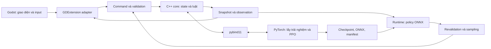

> LƯU TRỮ 2026-10-18. Snapshot trước hợp nhất; không thực thi prompt hoặc dùng trạng thái trong file này làm chỉ đạo hiện tại. Đọc [nguồn chuẩn](../../README.md).

# PolyEc: mô hình bài toán, kiến trúc phần mềm và nền tảng toán học của mô phỏng xã hội–kinh tế

**Loại tài liệu:** bài thuyết minh kỹ thuật dành cho developer.

**Ngày đối chiếu mã nguồn:** 15/10/2026.

**Phạm vi:** kiến trúc và implementation hiện có; tách riêng thiết kế tương lai. Các kết quả thực nghiệm được dẫn từ báo cáo của dự án, không phải phép đo mới của tài liệu này.

## Tóm tắt

PolyEc là dự án game desktop về cai trị một quốc gia giả tưởng. Người chơi đưa ra quyết định về nguồn lực, công trình và các vấn đề của lãnh địa. Các nhân vật trong thế giới cần có danh tính, nguồn sống, thông tin và khả năng lựa chọn. Hệ quả của quyết định phải được thể hiện bằng thay đổi cụ thể: tài khoản nào giảm, kho nào tăng, ai còn nợ ai, công trình đang mắc ở điều kiện nào và ai đã nhận được báo cáo.

Hệ thống phải đồng thời giải quyết tính đúng của luật, chất lượng hành vi nhân vật và chi phí tính toán. Dự án sử dụng C++20 để lưu trạng thái và thực thi luật; Godot để dựng giao diện native, tức ứng dụng cài đặt và chạy trên hệ điều hành; Python/PyTorch để huấn luyện policy bằng học tăng cường (Reinforcement Learning, RL); ONNX Runtime để chạy các model đã xuất trên CPU. Training gọi cùng lõi C++ với ứng dụng, thay vì viết lại luật bằng Python.

Tài liệu trình bày vấn đề từ yêu cầu sản phẩm tới từng bài toán kỹ thuật. Mỗi phần giải thích đầu vào, đầu ra, hướng xử lý, công thức và giới hạn. Môi trường thử nghiệm, gọi là sandbox, hiện có ba policy có bộ nhớ được huấn luyện bằng thuật toán Proximal Policy Optimization (PPO). Lát cắt gameplay ở mốc phát triển M4 dùng controller kiểm thử có nhãn cho các hành vi mới, chưa dùng các policy đó để quyết định toàn bộ gameplay M4. Hộ gia đình có thành viên thay đổi theo vòng đời, hôn nhân, thừa kế và hệ quyền đất đầy đủ chưa được triển khai.

**Từ khóa:** agent-based simulation, constrained state transition, resource accounting, partial observability, recurrent reinforcement learning, PPO, native game architecture.

## 1. Đặt vấn đề

### 1.1. Game cần thực hiện điều gì?

Xét một tình huống: vùng mỏ thiếu lương thực trong khi triều đình còn kho dự trữ. Người chơi có thể cấp hàng, cải thiện đường đèo hoặc xử lý quyền thu phí. Trong lúc đó, địa phương có một khoản nợ sắp đến hạn.

Để mô phỏng tình huống này, hệ thống cần trả lời được:

1. Ai có quyền ra lệnh xuất kho? Hàng thuộc kho nào và có bao nhiêu?
2. Mua hàng và vận tải lấy tiền từ tài khoản nào, trả cho tài khoản nào?
3. Đường đèo có đủ công suất không? Đoàn hàng tới vào ngày nào?
4. Xây đường cần vật tư, lao động và điều kiện pháp lý gì?
5. Nếu công trình chậm, khoản nợ có tiếp tục đến hạn không?
6. Địa phương biết vấn đề trước hay sau triều đình?
7. Nhân vật ngoài người chơi tự xử lý những quyết định nào?
8. Sau khi tải save, hàng có tiếp tục đúng hành trình và nghĩa vụ có giữ nguyên không?

Các câu hỏi này xác định yêu cầu về dữ liệu và thuật toán. Một thanh “độ ổn định” giảm rồi tăng trở lại không đủ để giải thích ai đã chi tiền, hàng đang ở đâu và nghĩa vụ nào được giải quyết.

### 1.2. Đầu vào và đầu ra

**Đầu vào ban đầu** gồm bản đồ, dân số, tài nguyên, số dư tài khoản, các nghĩa vụ đang có, quyền hạn, luật mô phỏng và seed ngẫu nhiên. Seed là số khởi tạo cho bộ sinh số giả ngẫu nhiên; nó hỗ trợ lặp lại cùng điều kiện thí nghiệm khi các điều kiện khác cũng được giữ nguyên.

**Đầu vào trong quá trình chạy** gồm command từ người chơi, hành động được bộ điều khiển NPC lựa chọn và các lần tiến thời gian.

**Đầu ra** gồm trạng thái mới, kết quả chấp nhận/từ chối lệnh, hoạt động đang diễn ra, sự việc phát sinh, thông tin mà người quan sát được xem, cùng dữ liệu lưu và đánh giá.

### 1.3. Các bài toán cần giải quyết

| Mã | Bài toán | Kết quả cần tạo ra |
|---|---|---|
| P1 | Biểu diễn thế giới và quyền sở hữu dữ liệu | Xác định được từng cá nhân, nguồn lực, nghĩa vụ và đối tượng liên quan |
| P2 | Thực thi quyết định nhất quán | Lệnh hợp lệ có đầy đủ hệ quả; lệnh lỗi không làm thay đổi một phần world |
| P3 | Hạch toán kinh tế | Đối soát được tiền, hàng, sản xuất, tiêu dùng, lương, thuế và nợ |
| P4 | Quá trình theo thời gian và vòng đời | Công việc, học tập, dự án, sinh–tử và deadline diễn ra theo ngày game |
| P5 | Địa lý và logistics | Tính được tuyến, lịch sử dụng công suất, chi phí và thời điểm giao hàng |
| P6 | Thông tin, quan hệ và hồ sơ | Phân biệt sự thật, điều đã biết và vấn đề cần xử lý |
| P7 | Ra quyết định của NPC | Chọn được một hành động hợp lệ từ quan sát và lịch sử cá nhân |
| P8 | Học hành vi | Cập nhật policy từ trải nghiệm, reward và đánh giá ngoài training |
| P9 | Vận hành nhiều cá thể | Giới hạn RAM, inference và truy vấn mà vẫn giữ danh tính cá nhân |
| P10 | Tương tác native | Bản đồ, input và thời gian giao diện phản ánh đúng core |
| P11 | Lưu, khôi phục và tái lập | Tiếp tục đúng nghĩa vụ, hành trình, RNG và bộ nhớ policy |
| P12 | Kiểm chứng | Phân biệt luật đúng, hành vi tốt và hiệu năng đáp ứng yêu cầu |

## 2. Thuật ngữ, phạm vi và các mốc phát triển

### 2.1. Thuật ngữ dùng trong tài liệu

| Thuật ngữ | Nghĩa trong PolyEc |
|---|---|
| Trạng thái, hay state | Tập dữ liệu mô tả world tại một thời điểm: người, kho, tiền, ngày, nợ, hoạt động và các record khác. Đây không phải một chỉ số đánh giá duy nhất. |
| Thực thể, hay entity | Một đối tượng cần được nhận diện và theo dõi, ví dụ cá nhân, khoản vay hoặc đoàn hàng. |
| Bản ghi, hay record | Nhóm trường dữ liệu mô tả một thực thể. Ví dụ một khoản vay có người vay, tài khoản cho vay, principal, interest, hạn trả và số đã trả. Không mặc định là một hàng trong database. |
| Định danh, hay ID | Giá trị dùng để tham chiếu đúng đối tượng. Tên hiển thị có thể đổi; ID của cùng đối tượng cần giữ ổn định trong vòng đời và qua save/load. |
| Actor | Đối tượng thực hiện một quyết định. NPC là nhân vật không do người chơi trực tiếp điều khiển. |
| Command | Yêu cầu thay đổi world, có actor, hành động và điều khoản. Command có thể bị từ chối. |
| Validator | Phần kiểm tra command có đủ quyền, tài nguyên và điều kiện để thực hiện hay không. |
| Snapshot/view | Bản dữ liệu được core tạo để đọc hoặc hiển thị. Sửa bản sao này không trực tiếp sửa world. |
| Invariant | Điều kiện phải luôn đúng, chẳng hạn số dư không âm hoặc tổng hàng phải đối soát được. |
| Controller | Thành phần lựa chọn hành động. Controller có thể là luật kiểm thử hoặc policy đã học; hai loại phải được phân biệt. |
| Policy | Hàm tạo phân phối hành động từ dữ liệu đầu vào của actor. Trong nhánh RL, hàm này là mạng neural có trọng số đã học. |
| Observation | Dữ liệu đầu vào mà một actor được cung cấp khi ra quyết định; không nhất thiết là toàn bộ state. |
| Feature | Một thành phần dữ liệu được đưa vào model, ví dụ tiền đã chia hệ số chuẩn hóa hoặc loại hành động được mã hóa. |
| Utility và reward | Utility đánh giá một trạng thái đối với actor; reward là tín hiệu số nhận sau một bước tương tác để học. Hai đại lượng có quan hệ nhưng không đồng nghĩa tiền trong game. |
| Training | Quá trình cập nhật trọng số mạng từ trải nghiệm mô phỏng. |
| Inference | Chạy mạng với trọng số đã có để tạo đầu ra, không cập nhật trọng số. |
| Runtime | Thành phần điều phối trong ứng dụng đang chạy: nạp model, dựng batch, inference, kiểm tra và commit. |
| Episode | Một lượt trải nghiệm huấn luyện có điều kiện bắt đầu và kết thúc xác định. |
| Fixture | Điều kiện đầu vào được chuẩn bị để kiểm tra một chức năng hoặc một lát cắt. Không phải diễn tiến bắt buộc của campaign sản phẩm. |
| Schema | Hợp đồng về cấu trúc và ý nghĩa dữ liệu. Đúng số chiều chưa đủ nếu ý nghĩa các trường đã đổi. |

### 2.2. Godot là gì và được dùng ở đâu?

Godot là game engine: phần mềm cung cấp cửa sổ, render, hệ thống input, bố cục giao diện và vòng lặp ứng dụng. PolyEc dùng Godot 4.5.x cho bản đồ và các màn hình native. GDScript là ngôn ngữ scripting của Godot, dùng để mô tả giao diện và phản ứng với input.

Godot gọi C++ qua GDExtension, cơ chế mở rộng native của engine. Thư viện `godot-cpp` cung cấp các kiểu và binding C++ để xây extension này. Luật kinh tế và state cá nhân không nằm trong scene hoặc widget Godot; chúng nằm trong core C++.

### 2.3. `Realm`, `Campaign` và những tên class liên quan

`Realm` và `Campaign` là tên class do dự án định nghĩa, không phải tên thư viện bên ngoài.

| Tên | Trách nhiệm hiện tại |
|---|---|
| `GameWorld` | World nền của prototype ban đầu: lãnh địa, lựa chọn vùng và ngày game. Không đồng nghĩa toàn bộ mô phỏng kinh tế. |
| `SimulationController` | Điều phối đồng hồ/pause của world nền. |
| `TradeWorld` | Môi trường thương mại nhỏ dùng trong giai đoạn curriculum ban đầu. |
| `Realm` | Đối tượng sở hữu dữ liệu mô phỏng kinh tế–xã hội: cá nhân, tỉnh, tiền/hàng, nợ, công việc, dự án, facts và knowledge. Nó cung cấp hàm tiến ngày và thực thi command. |
| `RealmBatch` | Tập world `Realm` độc lập được Python dùng để lấy nhiều trải nghiệm huấn luyện. |
| `RealmRuntime` | Điều phối các policy ONNX cho sandbox `Realm`, bao gồm memory và sampling từng người. |
| `Campaign` | Đối tượng của lát cắt M4. Nó chứa một `Realm` cùng dữ liệu tuyến đường, hàng đang đi, hồ sơ và các thao tác can thiệp M4. Tên này chưa chứng nhận campaign sản phẩm đã hoàn chỉnh. |
| `PolyEcSession` | Adapter C++ mà GDScript gọi để gửi command và nhận snapshot. |

Một instance là một đối tượng cụ thể được tạo từ class. Ví dụ `Campaign` là thiết kế kiểu đối tượng; một ván thử M4 seed 37 tạo một instance `Campaign` chứa world riêng.

### 2.4. M3, M4 và các ký hiệu roadmap

Chữ M viết tắt cho milestone, tức mốc phát triển. Đây là quy ước trong kế hoạch dự án, không phải tên thuật toán hoặc version model.

| Mốc | Ý nghĩa liên quan tới tài liệu |
|---|---|
| M0 | Xây nền công nghệ và kiểm tra khả thi primitive |
| M1–M2 | Phát triển các lớp kinh tế, chính trị và cá thể |
| M3 | Thử pipeline RL và sandbox: ba họ policy, native inference, đánh giá thăm dò |
| M4 | Vertical slice native: một phần nhỏ nhưng nối được vòng chơi từ vấn đề tới quyết định và hệ quả |
| M5–M6 | Mở rộng world, hoàn thiện luật/UX và đóng băng hợp đồng dữ liệu cho training cuối |
| M7 | Training production và quality gates sau khi feature set ổn định |

`realm-v6` là phiên bản hợp đồng/model thử nghiệm; nó không có nghĩa milestone M6. R1–R5 là các gate chất lượng RL trong plan, cũng không phải milestone triển khai.

Theo báo cáo hiện có, M4 đã được kiểm chứng Windows local. Linux của thay đổi M4 chưa được kiểm chứng. Các policy M3 vẫn là pilot; không suy ra chất lượng RL production từ việc lát cắt M4 chạy được [S1, S2].

## 3. Kiến trúc và tech stack

### 3.1. Phân chia trách nhiệm

| Lớp | Công nghệ | Bài toán đảm nhiệm |
|---|---|---|
| Mô phỏng | C++20, STL, class và value types | P1–P6: state, luật, transaction, lịch, graph, đối soát |
| Giao diện | Godot, GDScript | P10: bản đồ, widget, input, trình bày |
| Adapter native | GDExtension, `godot-cpp` | Đổi command và snapshot giữa C++ và Godot |
| Binding training | pybind11 | Cho Python gọi C++ và trao đổi dữ liệu dạng mảng |
| Huấn luyện | Python, PyTorch, NumPy | P7–P8: mạng policy, rollout, PPO, evaluation |
| Suy luận | ONNX, ONNX Runtime CPU | P9: chạy model đã xuất trong ứng dụng native |
| Build | CMake; Ninja/MSVC tùy cấu hình | Sinh và biên dịch core, binding, extension, launcher |
| Kiểm thử/đóng gói | CTest, Godot scripts, PowerShell/shell | P11–P12 và kiểm tra artifact ứng dụng |

ONNX là định dạng biểu diễn mạng và phép toán; ONNX Runtime là thư viện thực thi định dạng đó. PyTorch là framework tạo và huấn luyện mạng. Khi chơi, ứng dụng không cần chạy training Python.

### 3.2. Luồng phụ thuộc



Sơ đồ mô tả nhánh RL của sandbox. Trong M4, `Campaign::controller()` dùng lựa chọn Work theo luật kiểm thử; các action M4 mới chưa nằm trong model `realm-v6`.

### 3.3. Hai nghĩa của “sở hữu”

**Sở hữu trong mô hình game** trả lời ai có tiền, hàng hoặc quyền. Ví dụ `Person.cash` là tiền riêng của cá nhân; `Province.treasury` là ngân khố vùng. Sống trong vùng không biến tiền riêng thành tiền của lãnh chúa.

**Ownership trong phần mềm** trả lời đối tượng C++ nào giữ dữ liệu và quản lý việc cập nhật nó. `Realm` giữ các mảng cá nhân và lãnh địa. Godot được nhận dữ liệu đọc, không nhận quyền tự thay đổi số dư gốc.

Hai nghĩa này liên quan nhưng không đồng nhất: một object `Realm` sở hữu bộ nhớ chứa nhiều tài khoản, trong khi các tài khoản vẫn thuộc những chủ thể game khác nhau.

## 4. P1 — Biểu diễn cá nhân, nguồn lực và nghĩa vụ

### 4.1. Đề bài và ví dụ

Giả sử một vùng có hai người, mỗi người giữ 100 đồng. Chỉ lưu “vùng có 200 đồng” không đủ để biết người nào có thể trả một hóa đơn 150 đồng. Nếu không được tự động chia sẻ tiền, cả hai đều không đủ tiền trả riêng hóa đơn đó.

Tương tự, lưu “vùng có 200 đồng nợ” không cho biết ai phải trả, tài khoản nào được nhận, ngày nào đến hạn hoặc bao nhiêu đã được thanh toán.

Vì vậy, dữ liệu tổng hợp phục vụ báo cáo không thể thay thế dữ liệu về bên tham gia giao dịch.

### 4.2. Hướng biểu diễn

Một bản ghi cá nhân có thể gồm `id`, `cash`, `region`, `health`. Một bản ghi khoản vay có `id`, `debtor`, `creditor`, `principal`, `interest`, `due`, `paid`.

Ví dụ minh họa, không phải định dạng save thực tế:

```text
Person: id=41, cash=100, region=2
Person: id=87, cash=100, region=2
Loan:   id=900, debtor=41, creditor_account=2,
        principal=80, interest=4, due=180, paid=20
```

`debtor=41` là liên kết tới người có ID 41, không phải chép lại toàn bộ người đó vào khoản vay. Nếu người 41 chuyển vùng hoặc đổi tên, khoản nợ vẫn trỏ tới đúng người. Trong `Loan` hiện tại, `creditor` là chỉ mục tài khoản doanh nghiệp cấp tỉnh, không phải Person ID; quỹ hoàng gia có nhánh nguồn riêng. Ví dụ trên vì vậy không nên đọc là “người số 2 là chủ nợ”.

ID ổn định có nghĩa cùng đối tượng vẫn được nhận diện qua thay đổi trạng thái và save/load. Nó không có nghĩa mọi con số trong struct đều là ID cùng một loại. Tên trường, kiểu dữ liệu và validator phải thể hiện sự khác nhau đó.

### 4.3. Mô hình trạng thái

Để nói về toàn bộ mô phỏng, ký hiệu:

$$
S_t=(P_t,R_t,G_t,L_t,J_t,F_t,K_t,\Xi_t).
$$

Trong đó $t$ là ngày game; $P_t$ là dữ liệu cá nhân; $R_t$ là lãnh địa; $G_t$ là quan hệ và giao thông; $L_t$ là nghĩa vụ; $J_t$ là hoạt động đang diễn ra; $F_t$ là facts; $K_t$ là knowledge; và $\Xi_t$ chứa RNG/counter cần cho diễn tiến. Công thức là cách nhóm dữ liệu để phân tích, không khẳng định code có đúng tám class tương ứng.

Ví dụ khi một người nhận hàng, phần kho hoặc inventory thay đổi; khi người đó chỉ được biết một báo cáo mới, knowledge thay đổi mà lượng hàng không nhất thiết đổi.

### 4.4. Implementation và giới hạn

`Realm` lưu cá nhân, lãnh địa, cạnh quan hệ, khoản vay và các record khác trong collection C++. `Campaign` bổ sung record vận tải và hồ sơ. Dữ liệu nóng chủ yếu là các struct trong vector, nhưng chưa nên gọi toàn bộ implementation là một Entity Component System hoặc kiến trúc structure-of-arrays.

Hộ gia đình hiện còn đơn giản; một số logic giám hộ dựa vào nhóm ID khởi tạo. Household động, các quyền tài sản chồng lớp và gia phả pháp lý đầy đủ là phần cần thiết kế tiếp [S3, S4].

## 5. P2 — Thực thi command nguyên tử và chống lặp

### 5.1. Đề bài

Một người có 100 đồng yêu cầu mua hàng giá 120 đồng. Lệnh phải bị từ chối mà không mất tiền, không chuyển hàng và không tăng bộ đếm quyết định thành công. Nếu có đủ tiền, toàn bộ giao dịch phải được ghi nhận. Nếu cùng lệnh được gửi lại do double-click, nó không được thực hiện lần nữa.

### 5.2. Mô hình hình thức

Gọi $S$ là state trước lệnh, $c$ là command, `Valid` là kiểm tra điều kiện và $T$ là hàm áp dụng command:

$$
\operatorname{Valid}(S,c)=0 \implies T(S,c)=S.
$$

`Valid(S,c)=0` đọc là “command không hợp lệ”; dấu $\implies$ đọc là “kéo theo”; `T(S,c)=S` đọc là “state sau xử lý bằng state trước xử lý”. Do đó câu trên có nghĩa: **command không hợp lệ phải giữ nguyên state gameplay trong lần xử lý đó**.

Ví dụ mua quá số dư giữ nguyên cả tiền người mua, tiền người bán và lượng hàng. Thông báo lỗi của UI có thể đổi; nó không phải tài sản hay tiến trình gameplay được công thức yêu cầu giữ nguyên. Công thức cũng không nói world sẽ dừng tiến thời gian sau khi một command bị từ chối.

### 5.3. Thuật toán và kiểm tra tính mới

```text
Nhận actor + action + terms + sequence
→ kiểm tra actor và sequence
→ kiểm tra tuổi, quyền, vị trí, trạng thái hoạt động
→ kiểm tra mọi nguồn tiền, hàng, chỗ trống và thời hạn
→ nếu thiếu điều kiện: trả kết quả lỗi
→ nếu đủ: thực hiện chuyển giao và cập nhật record
→ ghi fact/result, tăng counter
```

Sequence number là số thứ tự quyết định. Nếu actor đã hoàn tất quyết định 17, lệnh tiếp theo phải mang số 18. Gửi lại số 17 hoặc số 18 sau khi nó đã commit đều bị loại. Revision là số phiên bản world/view dùng để phát hiện UI đang gửi lệnh dựa trên dữ liệu đã cũ.

Validation cần hoàn tất trước mutation, tức thay đổi state. Implementation không phải cơ chế rollback database tổng quát; bảo đảm của nó dựa vào việc kiểm đủ điều kiện trước và giữ logic thực thi nhất quán với validator.

### 5.4. Những đường command hiện có

Sandbox M3 sử dụng `RealmCommand` và `Realm::execute()` cho cả UI và policy. M4 có `CampaignCommand` và `Campaign::execute()` cho action mới; bên trong `Campaign` vẫn sử dụng `Realm` cho dữ liệu và các primitive kinh tế. Như vậy chưa có một enum/action schema duy nhất cho mọi màn hình và mọi milestone. Không nên mô tả kiến trúc hiện tại như một giao thức action production đã đóng băng [S3, S5, S8].

## 6. P3 — Hạch toán kinh tế có nguồn và đối ứng

### 6.1. Tiền: chuyển giao thay vì tạo/xóa ngầm

**Đề bài.** Triều đình chi 300 đồng làm đường thì phải biết tài khoản nào trả và tài khoản nào nhận.

Gọi $b_u,b_v$ là số dư hai tài khoản trước giao dịch; $\Delta$ là số chuyển; dấu prime là số dư sau giao dịch:

$$
b'_u=b_u-\Delta,\qquad b'_v=b_v+\Delta.
$$

Nếu ngân khố có 1.000 và bên nhận có 200, chuyển 300 tạo số dư 700 và 500. Tổng trước và sau đều bằng 1.200. Điều kiện cần kiểm trước là $\Delta\ge0$ và bên trả đủ tiền.

Tổng tiền toàn mô hình được đối soát bằng:

$$
M_t=M_0+E_t.
$$

$M_t$ là tổng tiền tại ngày $t$; $M_0$ là tiền đầu kỳ; $E_t$ là tổng khoản endowment bổ sung được khai báo. Nếu có quỹ khởi đầu do augment, nó phải vào vế $E_t$, không xuất hiện như doanh thu vô căn cứ. Đây là invariant của nền kinh tế hiện tại, không phải giả thuyết rằng mọi nền kinh tế lịch sử đều có cung tiền cố định.

### 6.2. Hàng: tính cả lượng đang đi đường

**Đề bài.** Xuất kho 100 đơn vị không làm 100 đơn vị đó lập tức có mặt ở đích hoặc biến mất.

Với một loại hàng $g$, đặt $I_g^0$ là hàng đầu kỳ, $P_g(t)$ là sản xuất tích lũy, $C_g(t)$ là lượng đã tiêu dùng, và $I_g(t)$ là tổng hàng còn trong kho, inventory cá nhân và manifest vận tải:

$$
I_g^0+P_g(t)=I_g(t)+C_g(t).
$$

Ví dụ đầu kỳ 100, sản xuất thêm 40; kho còn 70, cá nhân giữ 10, vận tải giữ 20 và đã tiêu dùng 40. Vế trái bằng 140; vế phải bằng $70+10+20+40=140$. Giao hàng chỉ đổi vị trí trong $I_g(t)$, không được cộng thêm vào sản xuất.

### 6.3. Sản xuất: đầu vào hữu hạn và lao động

**Đề bài.** Xưởng dệt cần người làm, xơ, nhiên liệu, công cụ và tiền. Chờ đủ thời gian không thay được các đầu vào đó.

Về mặt phân tích, mỗi quy trình có định mức đầu vào/đầu ra. Số mẻ thực hiện bị giới hạn bởi điều kiện thiếu nhất: đủ nguyên liệu cho 10 mẻ nhưng lao động chỉ đủ 4 mẻ thì không được làm quá 4. Đây là dạng production có ràng buộc đầu vào, gần mô hình Leontief ở mức khái niệm; code hiện dùng công thức cụ thể, không giải tối ưu input–output tổng quát.

M4 có quy trình xưởng dệt Bạch Khâu với tối đa sáu lao động trưởng thành, vốn và vật tư hữu hạn. Quy trình kiểm tra tiền trả lương/đầu vào trước khi biến đổi kho; bán hàng nhận tiền từ thị trường có số dư. Các khoản này cùng tham gia đối soát. Nó chưa phải bộ mô phỏng mọi loại doanh nghiệp, công nghệ và thị trường lao động.

### 6.4. Giá: phản ứng đơn giản với mức tồn kho

**Đề bài.** Thiếu hàng cần gây hậu quả tới chi phí sinh sống và cơ hội mua bán. Prototype chưa cần giải một hệ cân bằng kinh tế tổng quát.

Giá hiện tại trong `Realm` là:

$$
p=\operatorname{clip}\!\left(
\operatorname{int}\!\left[p_{\mathrm{ref}}\left(1.5-\frac{s}{800}\right)\right],
2,5p_{\mathrm{ref}}\right).
$$

Ở đây $p$ là giá, $p_{\mathrm{ref}}$ là giá tham chiếu, $s$ là tồn kho; `int` chuyển về số nguyên; `clip(x,a,b)` giữ giá trị trong khoảng $[a,b]$. Với giá tham chiếu 20, kho 400 tạo giá 20; kho 0 tạo giá 30. Ý nghĩa là khan hiếm tương đối làm giá tăng, trong giới hạn quy định.

Đây là heuristic định giá từ tồn kho. Hệ số 800 và 1,5 là tham số implementation, không phải hằng số kinh tế học. Chưa có auction, order book hoặc thuật toán tìm giá cân bằng cung–cầu.

### 6.5. Lương thiếu ngân sách và thuế làm tròn

**Đề bài lương.** Nhiều người được trả lương từ cùng tài khoản nhưng tiền không đủ. Trả hết cho ID nhỏ trước sẽ tạo ưu tiên lâu dài do thứ tự duyệt.

Gọi $d_i$ là lương phải trả cho người $i$, $D=\sum_i d_i$ là tổng nghĩa vụ, và $B\le D$ là ngân sách thực có. Phần chi trả ban đầu:

$$
w_i=\left\lfloor B\frac{d_i}{D}\right\rfloor.
$$

$\lfloor x\rfloor$ là làm tròn xuống. Ví dụ hai người cùng phải nhận 3 đồng, tài khoản chỉ có 5: mỗi người nhận trước 2, còn dư 1. Code phân phần dư theo thứ tự luân phiên. Kỹ thuật này giảm thiên lệch làm tròn, không chứng minh công bằng xã hội toàn mô hình.

**Đề bài thuế.** Nếu mọi lần thu nhỏ đều làm tròn xuống độc lập, tổng thuế có thể bị hụt đáng kể.

Gọi $W_t$ là khoản thu nhập chịu thuế lần $t$, $\tau$ là thuế suất phần trăm và $r_{t-1}$ là phần dư trước đó. Thuế và dư mới là:

$$
T_t=\left\lfloor\frac{\tau W_t+r_{t-1}}{100}\right\rfloor,
\qquad r_t=(\tau W_t+r_{t-1})\bmod100.
$$

Ký hiệu `mod` lấy phần dư phép chia. Với thu nhập 1 đồng mỗi lần, thuế 10%, phần dư tăng 10 sau mỗi lần; lần thứ mười thu được 1 đồng thuế. Không cần dùng tiền dạng float để giữ phần nhỏ.

### 6.6. Nợ và escrow

**Đề bài nợ.** Người vay nhận tiền nhưng đồng thời phát sinh nghĩa vụ, vì vậy `cash` tăng không đồng nghĩa giàu lên tương ứng.

Gọi $P$ là principal, $I$ là interest theo điều khoản, $R$ là tổng tiền đã trả. Dư nợ:

$$
L=P+I-R.
$$

Vay 200, lãi 8, đã trả 50 thì còn 158. Tại ngày đến hạn mà $L>0$, khoản vay bị đánh dấu quá hạn. Interest hiện là nghĩa vụ được xác định theo điều khoản, không phải mô hình lãi kép hay lãi suất nội sinh.

**Đề bài escrow.** Một đề nghị có tiền đặt trước phải giữ tiền ở nơi trung gian, để bên gửi không tiếp tục tiêu nó. Escrow là khoản giữ chờ điều kiện. Khi đề nghị được nhận hoặc hết hạn, tiền được chuyển/refund có đối ứng. `Proposal` hiện hỗ trợ những quy trình hữu hạn; chưa phải engine hợp đồng hiểu mọi điều khoản pháp lý [S3, S4].

## 7. P4 — Thời gian, hoạt động và vòng đời

### 7.1. Hoạt động có thời lượng

**Đề bài.** Một cá nhân không được vừa dùng toàn thời gian làm việc, vừa đi đường và học toàn thời gian. Công trình có thể đến hạn nhưng chưa đủ điều kiện hoàn thành.

Code dùng các trường như `busy_until`, `destination`, `due`, `completed`, `stalled`. Chúng biểu diễn máy trạng thái hữu hạn: một số trạng thái được định nghĩa trước, mỗi chuyển tiếp có điều kiện.

```text
Chưa bắt đầu → Đã cam kết nguồn lực → Đang thực hiện
                                       ├→ Hoàn thành
                                       └→ Đình trệ → Kiểm tra lại điều kiện
```

Đối với đường M4, có ngày dự kiến hoàn thành nhưng quyền đèo chưa giải quyết có thể làm công trình tiếp tục đình trệ. Ngày game là căn cứ cho việc kiểm tra; thời gian thực người chơi để game ở chế độ pause không làm deadline tiến lên.

### 7.2. Tiến trình dân số và nhu cầu

Tuổi tăng theo ngày; nhu cầu thực phẩm được dàn theo kỳ; học tập tạo kỹ năng khi hoàn tất; sức khỏe chịu ảnh hưởng của dinh dưỡng và một số luật vòng đời. Sinh và tử có các điều kiện, cùng phép thử ngẫu nhiên ở những đường tương ứng.

Phép thử ngẫu nhiên có thể viết:

$$
X\sim\operatorname{Bernoulli}(p).
$$

$X$ là kết quả 0 hoặc 1; $p$ là xác suất nhận 1 sau khi đã đủ điều kiện. Ví dụ $p=0.06$ có nghĩa mỗi phép thử có xác suất 6%, không có nghĩa chính xác 6 trên mọi nhóm 100 người sẽ sinh con. Đơn vị thời gian của phép thử phải được ghi cùng tham số; xác suất theo năm không thể dùng như xác suất theo ngày.

Các hệ số sinh–tử và nhu cầu hiện là luật prototype. Chưa có bằng chứng hiệu chuẩn đủ để gọi chúng là mô hình nhân khẩu học lịch sử. Một số tiền/hàng của người chết đã được xử lý, nhưng chưa có hệ thừa kế pháp lý đầy đủ.

### 7.3. Địa hình và thời tiết trong thu hoạch

**Đề bài.** Hai lãnh địa có cùng số dân không nhất thiết tạo cùng lượng thực phẩm. Địa hình và thời tiết cần ảnh hưởng đến nguồn cung thực.

Có thể diễn giải công thức thu hoạch như lấy sản lượng nền, nhân hệ số địa hình và hệ số thời tiết, rồi quy về số nguyên. M4 gắn hệ số địa hình với cùng dữ liệu địa lý được UI hiển thị. Weather được sinh xác định từ seed/kỳ/lưu vực trong phạm vi mô hình hiện có.

Đây là nhiễu tổng hợp có liên hệ theo vùng, chưa phải mô phỏng khí tượng, lưu vực thủy văn hay phương trình khí hậu. Cần đánh giá tác động dài hạn của tham số lên nguồn sống; giữ invariant không tự chứng minh mức thu hoạch hợp lý.

## 8. P5 — Đường đi và công suất vận tải

### 8.1. Đề bài và biểu diễn

Cần chuyển $Q$ đơn vị từ nguồn tới đích. Mỗi cạnh đường có thời gian, công suất và trạng thái. Lô khác có thể đã đặt chỗ. Kết quả cần gồm cả tuyến và lịch đi từng chặng, không chỉ khoảng cách trên màn hình.

Biểu diễn bằng graph $G=(V,E)$: $V$ là tập đầu mối/lãnh địa, $E$ là tập tuyến nối chúng. “Graph” ở đây là cấu trúc đỉnh–cạnh, không phải biểu đồ số liệu.

### 8.2. Số lượt tải và thời điểm đến

Trên cạnh $e$, gọi $C_e$ là công suất mỗi ngày. Số lượt tải cho lô $Q$:

$$
B_e=\left\lceil\frac{Q}{C_e}\right\rceil.
$$

Dấu $\lceil x\rceil$ là làm tròn lên. Hàng 200, công suất 80 cần 3 lượt, vì 2 lượt chỉ tải được 160.

Gọi $s_e$ là ngày bắt đầu dùng slot, $d_e$ là thời gian di chuyển và $\delta_e$ là độ trễ do trạng thái tuyến. Thời điểm đến theo quy tắc M4 có dạng:

$$
a_e=s_e+(B_e-1)+d_e+\delta_e.
$$

Ví dụ bắt đầu ngày 10, cần 3 lượt, đi 5 ngày và không có độ trễ bổ sung thì đến ngày 17. Trong quy ước này lượt đầu xảy ra ngay ngày bắt đầu. Nếu ngày 10 đã có đặt chỗ, $s_e$ phải dời sang khoảng khả dụng trước khi tính.

### 8.3. Thuật toán tìm đường

M4 dùng tìm đường kiểu Dijkstra theo thời điểm đến sớm nhất:

1. Gán thời điểm tại nguồn bằng ngày hiện tại, các đỉnh còn lại là chưa biết.
2. Chọn đỉnh chưa xử lý có thời điểm tới sớm nhất.
3. Với mỗi cạnh mở đi tiếp, tìm khoảng slot không giao nhau với đặt chỗ trước.
4. Tính thời điểm đến đỉnh kế tiếp; cập nhật nếu sớm hơn phương án đã biết.
5. Lưu đỉnh trước và lịch chặng để dựng lại tuyến.

Các slot là công suất dùng chung hai chiều. Chia một lô lớn thành nhiều lô không được tự nhân công suất. Hàng đã dispatch mang lịch riêng; nâng cấp tuyến không tự tính lại và “dịch chuyển” hàng đang đi nếu luật chưa quy định việc đó.

Ở graph nhỏ hiện tại, implementation chọn đỉnh bằng quét mảng và xét interval đặt chỗ; chưa dùng priority queue cho toàn bộ bài toán. Cách này không phải solver tối ưu luồng đa hàng hóa toàn quốc. Cần kiểm FIFO/tính đơn điệu của thời điểm tới nếu mở rộng quy tắc chờ để giữ điều kiện cho thuật toán tìm đường.

### 8.4. Manifest và đối soát

Manifest là bản ghi đoàn hàng: nguồn, đích, hàng, lượng, ngày đi/đến, tuyến và lịch các chặng. Hàng rời kho được tính vào manifest cho tới khi giao. Sau giao, kho đích tăng đúng lượng và manifest được đánh dấu hoàn tất [S5].

## 9. P6 — Thông tin, quan hệ và hồ sơ có căn cứ

### 9.1. Sự việc khác kiến thức

**Đề bài.** Một sự việc xảy ra ngày 10 không có nghĩa nhà vua hoặc mọi NPC đều biết ngày 10.

`Fact` ghi sự việc, gồm ID, ngày, loại, actor, vùng và tham chiếu nguồn `parent`. `Knowledge` ghi người quan sát, fact và ngày có thể nhận thông tin. Ví dụ người điều tra gửi báo cáo ngày 11, về triều ngày 14; quyết định ngày 12 không được lấy báo cáo đó làm thông tin đã biết.

`Realm::knows()` phân biệt một số trường hợp như actor trực tiếp, báo cáo công khai và fact bí mật đã điều tra. Chỉ mục observer–fact giúp truy cập các record đã biết. Đây chưa phải hệ nhận thức suy luận tùy ý; một số feature và màn inspect là dữ liệu sandbox, không phải trình bày bí mật campaign đã hoàn chỉnh.

### 9.2. Nối nguyên nhân và truy nguyên

Nếu fact B được tạo khi xử lý fact A, B có thể giữ `parent=A.id`. Điều này hỗ trợ đọc hồ sơ từ nguồn: xuất hàng nào dẫn tới lần giao hàng nào; công trình nào dẫn tới sự việc đình trệ.

Liên kết này là provenance, tức nguồn gốc do chương trình ghi. Nó chưa phải kết quả causal inference thống kê. Một nút chỉ giữ một `parent` cũng không biểu diễn đầy đủ mọi nguyên nhân đồng thời trong kinh tế.

### 9.3. Mở và đóng hồ sơ từ trạng thái

M4 dùng lượng lương thực còn đủ bao nhiêu ngày để phát hiện thiếu hụt. Với giả định một người dùng một đơn vị mỗi bảy ngày, số ngày dự trữ xấp xỉ là:

$$
\operatorname{cover}_r=\frac{7F_r}{\max(1,N_r)}.
$$

$F_r$ là lương thực vùng $r$, $N_r$ là số dân còn sống được dùng trong phép tính. `max(1,N_r)` tránh chia cho 0. Với 200 thực phẩm và 100 người, cover là 14 ngày. Đây là chỉ số theo luật tiêu dùng của lát cắt, không phải đơn vị dinh dưỡng lịch sử.

Hồ sơ mở khi có thiếu dự trữ, nợ quá hạn hoặc công trình mắc quyền. Đóng đòi hỏi điều kiện phục hồi, ví dụ đạt 21 ngày dự trữ và không còn nghĩa vụ/công trình gây mở hồ sơ. Dùng ngưỡng đóng lớn hơn ngưỡng mở là hysteresis: hạn chế mở–đóng liên tục khi kho dao động sát ranh giới.

Báo cáo hồ sơ có độ trễ. Không suy ra rằng mọi con số trong snapshot đều đã được phủ một lớp báo cáo bí mật tương đương; đó còn là giới hạn cần hoàn thiện.

### 9.4. Quan hệ thưa

**Đề bài.** Một triệu cá nhân không nên có một tỷ lệ lưu trữ buộc phải tạo đủ mọi cặp quan hệ.

Mô hình lưu những cạnh quan hệ cần có, thay vì ma trận tất cả cặp. Ký hiệu $N$ là số người và $E$ là số cạnh thực sự lưu: bộ nhớ cấu trúc cơ bản theo $O(N+E)$, thay vì $O(N^2)$. Chữ O mô tả tốc độ tăng chi phí khi quy mô tăng, không phải số byte đo được.

Ví dụ mỗi người có trung bình 20 cạnh thì số cạnh tăng gần tuyến tính với dân số, thay vì tăng theo bình phương. Nhưng chỉ mục và truy vấn vẫn có chi phí. Graph quan hệ hiện tại cũng không có nghĩa model đang là Graph Neural Network; policy nhận feature vector dựng sẵn.

## 10. P7 — NPC chọn hành động từ thông tin và lịch sử cá nhân

### 10.1. Đề bài học quyết định

Actor cần chọn làm gì dựa trên trạng thái của mình, cơ hội tiếp cận và mục tiêu. Hai actor ở cùng vùng không nhất thiết quyết định giống nhau. Engine phải kiểm luật, nhưng không được dùng một quy tắc chiến lược cứng cho NPC rồi gọi đó là hành vi đã học.

Một cách hình thức hóa là trò chơi Markov đa tác nhân có quan sát từng phần. “Markov” nghĩa trạng thái đầy đủ chứa dữ liệu cần cho bước tiếp theo; “quan sát từng phần” nghĩa mỗi actor chỉ được nhận một phần dữ liệu đó. Các actor còn làm thay đổi hoàn cảnh của nhau. Đây là cách phân tích bài toán, không có nghĩa implementation đã giải chính xác bài toán suy luận niềm tin hay tìm cân bằng trò chơi.

Đặt $O_i$ là hàm dựng quan sát cho actor $i$, và $K_t^i$ là thông tin actor đó biết:

$$
o_t^i=O_i(S_t,K_t^i).
$$

Ví dụ cùng có 100 đồng, người biết có chỗ học nghề và người chưa nhận tin đó có thể nhận observation khác nhau. Chất lượng che thông tin phải được audit trên từng feature; công thức không tự chứng minh code không lộ dữ liệu.

### 10.2. Ba họ policy và chia sẻ trọng số

Runtime sandbox có ba họ: Governance cho quyết định cai trị, Economic cho hoạt động kinh tế và Civilian cho cư dân. Đây là nhóm model theo loại quyết định, không phải ba đẳng cấp xã hội. Trường `Person.family` hiện có nghĩa họ policy, không phải dòng họ.

Mỗi họ dùng một bộ trọng số chung. Cá nhân giữ hidden state và sampling counter riêng. Trọng số là tham số dài hạn của mạng; hidden state là bộ nhớ tạm cập nhật sau mỗi quyết định. Người A học cùng “bộ quy tắc neural” với B nhưng có lịch sử đầu vào và chuỗi lấy mẫu khác nhau.

### 10.3. Observation và candidate

Model `realm_model.py` nhận 512 float:

$$
512=128+32\times12.
$$

128 phần tử đầu là context; phần sau là 32 candidate, mỗi candidate có 12 feature. Candidate là một hành động cụ thể kèm target/điều khoản, không chỉ động từ. “Mua xơ ở vùng hiện tại” và “Mua thực phẩm ở vùng hiện tại” có thể là hai candidate dù cùng loại Buy.

Context gồm biến cá nhân, goal, vai trò, giá công khai, kho cục bộ và một số tín hiệu khác. Feature candidate gồm loại, target, amount, term và mask. Input được chuẩn hóa bằng hệ số cố định rồi clamp trong mạng; clamp giới hạn mỗi phần tử vào [-10,10], không phải thuật toán chuẩn hóa thống kê học từ toàn bộ dataset.

Danh sách hiện cố định 32 slot và được core dựng theo luật. Đó không phải bộ tìm mọi đối tác/nghề/hôn nhân có thể có. Việc mở action space xã hội sẽ đòi hỏi thiết kế candidate retrieval và observation mới.

### 10.4. Encoder, GRU và scorer

Kiến trúc hiện tại:

```text
Context 128 → Linear(128,64) → tanh → GRU(64,64)
                                      ├→ Linear → value
                                      └→ ghép với 12 feature của từng candidate
                                           → Linear(76,64) → tanh → Linear(64,1)
                                           → 32 logits
```

Linear là phép biến đổi có trọng số và bias. `tanh` nén giá trị về khoảng $(-1,1)$. GRU, viết đầy đủ Gated Recurrent Unit, là mạng hồi tiếp dùng gate để quyết định mức giữ bộ nhớ cũ và mức nhận thông tin mới [A1]. Scorer là mạng chấm điểm cùng một công thức cho từng candidate.

Gọi $x_t$ là context 128 chiều; $W_e,b_e$ là trọng số/bias của encoder:

$$
e_t=\tanh(W_ex_t+b_e).
$$

$e_t$ là vector 64 chiều được học, không phải 64 khái niệm được gán tên thủ công. Một thay đổi về tiền hoặc sức khỏe có thể ảnh hưởng nhiều phần tử của vector này.

Để giải thích GRU, gọi $h$ là memory cũ, $r,z$ là hai vector gate có phần tử từ 0 đến 1, và $n$ là nội dung memory đề xuất. Các phép biến đổi affine $A_r,B_r,A_z,B_z,A_n,B_n$ dưới đây là các hàm tuyến tính có bias được học:

$$
r=\sigma(A_r(e_t)+B_r(h)),\qquad
z=\sigma(A_z(e_t)+B_z(h)),
$$

$$
n=\tanh(A_n(e_t)+r\odot B_n(h)),\qquad
h'=z\odot h+(1-z)\odot n.
$$

Hàm sigmoid $\sigma$ tạo giá trị gate trong $(0,1)$; $\odot$ là nhân từng phần tử; $h'$ là memory mới. Gate $r$ điều chỉnh ảnh hưởng của memory cũ khi tạo nội dung đề xuất. Gate $z$ quyết định giữ cũ hay nhận mới. Ví dụ ở một chiều, $h=0.8,n=0.2,z=0.75$ thì $h'=0.65$: giữ phần lớn giá trị cũ. Cách đặt reset gate phải khớp GRU PyTorch đang dùng, không tự đổi sang một biến thể đại số khác [A4].

Sau GRU, mỗi candidate $j$ có vector feature $c_j$. Ghép hai vector, ký hiệu bằng dấu chấm phẩy:

$$
\ell_j=w_2^\top\tanh(W_1[h';c_j]+b_1)+b_2.
$$

$\ell_j$ là logit, tức điểm thực chưa chuẩn hóa; $W_1,b_1,w_2,b_2$ là trọng số/bias scorer. Vector ghép dài $64+12=76$. Cùng một memory có thể cho điểm cao hơn cho Work so với Study tùy feature cơ hội; logit chưa phải xác suất hoặc tiền lời.

Critic là nhánh dự đoán value dùng trong training. Value là dự đoán reward tương lai còn lại, không phải hàm luật quyết định tiền thật trong world. Mạng có khoảng 38 nghìn tham số mỗi họ; đây là phép đếm theo kích thước layer, không phải benchmark năng lực.

### 10.5. Mask và categorical sampling

**Đề bài.** Policy không được mua hàng khi thiếu tiền hoặc gửi trẻ chưa đủ tuổi vào hành động bị luật cấm.

Core tạo mask $m_j$ bằng 1 nếu candidate hợp lệ, 0 nếu không. Với logits $\ell_j$, xác suất chọn:

$$
\pi_j=\frac{m_j\exp(\ell_j)}{\sum_k m_k\exp(\ell_k)}.
$$

$\exp$ là hàm mũ; mẫu số cộng trọng số của mọi candidate hợp lệ để tổng xác suất bằng 1. Ví dụ trọng số mũ là 2,3,5 nhưng candidate thứ hai bị cấm, xác suất trở thành 2/7,0,5/7. Mask là luật được core áp dụng, không chứng minh policy đã tự học mọi giới hạn pháp lý.

Categorical sampling là rút một hành động theo các xác suất này. Argmax là luôn chọn điểm cao nhất. Hai chế độ có thể tạo chất lượng khác nhau; runtime dùng sampling và có audit tương ứng. RNG cá nhân được xác định từ seed, ID và sampling counter đã lưu [S6, S7].

## 11. P8 — Học policy bằng recurrent PPO

### 11.1. Reward phải đo điều gì?

**Đề bài.** Game không có sẵn đáp án tốt nhất cho mọi quyết định. Cần một mục tiêu số để phân biệt kết quả tốt hơn/kém hơn, nhưng mục tiêu không được thưởng sai như chỉ tăng cash bằng cách vay vô hạn.

Utility $U_i(S)$ là hàm đánh giá state đối với actor $i$. Actor kinh tế quan tâm tài sản ròng, sức khỏe và dinh dưỡng; cư dân có thêm kỹ năng/xã hội; actor cai trị có dự trữ ngân khố, đời sống dân cư, bất mãn và hạ tầng. Đây là lựa chọn thiết kế, không phải định luật tự nhiên về con người.

Tài sản ròng được dùng trong một số utility:

$$
W_i=\operatorname{cash}_i+\sum_g p_g^{\mathrm{ref}}q_{i,g}-\operatorname{debt}_i.
$$

$q_{i,g}$ là lượng hàng cá nhân giữ; $p_g^{\mathrm{ref}}$ là giá dùng định giá; tổng chạy qua các loại hàng. Nếu có 100 tiền, hàng trị giá 50 và nợ 80 thì $W_i=70$. Vay 100 với tổng nghĩa vụ 104 làm cash tăng 100 nhưng tài sản ròng giảm 4, không tạo 100 utility tài sản miễn phí.

Ví dụ utility kinh tế hiện có:

$$
U_{\mathrm{economic}}=W_i/100+0.05H_i+0.01N_i-20\mathbf1_{\mathrm{dead}}.
$$

$H_i$ là health, $N_i$ là nutrition; $\mathbf1_{\mathrm{dead}}$ bằng 1 khi đã chết, 0 khi sống. Với $W=100,H=N=100$ và còn sống, utility bằng 7. Đây không phải 7 đồng; nó là điểm tổng hợp phục vụ learning.

Reward v6 là thay đổi utility chuẩn hóa:

$$
r_t=\frac{U(S_{t+1})-U(S_t)}{\max(1,|U(S_0)|)}.
$$

$S_0$ là state đầu episode; dấu trị tuyệt đối tránh chuẩn hóa bằng số âm; `max` tránh chia cho 0. Utility đầu kỳ 100 và tăng từ 120 lên 125 tạo reward 0,05. Vì mẫu số cố định, cộng reward hết episode sẽ bằng thay đổi utility cuối–đầu chia cùng mẫu số. Code dùng tính chất này để đối soát.

Đây là hiệu utility ở discount 1, không tự chứng minh mọi dạng potential-based reward shaping đều giữ nguyên policy tối ưu khi đổi luật, terminal condition hoặc mục tiêu.

### 11.2. Actor–critic và sai số TD

Actor tạo phân phối action. Critic dự đoán return còn lại. Gọi $V_t$ là dự đoán trước bước, $r_t$ là reward quan sát, $d_t$ bằng 1 nếu episode kết thúc, và $\gamma$ là hệ số discount:

$$
\delta_t=r_t+\gamma(1-d_t)V_{t+1}-V_t.
$$

$\delta_t$ là sai số temporal difference, tức kết quả tốt hơn/kém hơn dự đoán. Ví dụ chưa kết thúc, reward 2, value tiếp theo 8, value cũ 9 và gamma 1 thì delta bằng 1. Khi đã kết thúc, $1-d_t=0$, nên không nhận value tương lai từ episode kế tiếp.

### 11.3. GAE: phối hợp bằng chứng qua nhiều bước

GAE, Generalized Advantage Estimation, ước lượng advantage: một hành động tốt hơn mức kỳ vọng của policy bao nhiêu. Nó gom các sai số TD gần và xa bằng trọng số giảm dần [A2]. Công thức truy hồi:

$$
\widehat A_t=\delta_t+\gamma\lambda(1-d_t)\widehat A_{t+1}.
$$

$\widehat A_t$ là advantage ước lượng; $\lambda$ điều khiển đóng góp từ các bước sau. V6 dùng gamma 1 và lambda 0,95. Nếu delta hiện tại là 1 và advantage bước sau là 2, chưa terminal, kết quả hiện tại là $1+0.95\times2=2.9$. Tính ngược từ cuối rollout để có các giá trị này.

GAE hỗ trợ cân bằng độ nhiễu và độ lệch của ước lượng. Nó không lập cây kế hoạch tương lai cho NPC; nó là thuật toán xử lý trải nghiệm để cập nhật trọng số.

### 11.4. PPO: cập nhật có giới hạn động lực thay đổi quá mạnh

PPO, Proximal Policy Optimization, là thuật toán policy gradient dùng rollout từ policy cũ rồi tối ưu một mục tiêu surrogate qua nhiều minibatch [A3].

Gọi $\theta$ là trọng số đang cập nhật, $\theta_{old}$ là trọng số đã tạo rollout; $a_t$ là action đã lấy mẫu; và $z_t=(o_t,h_t)$ là context quan sát–memory. Tỷ lệ xác suất:

$$
\rho_t(\theta)=\frac{\pi_\theta(a_t\mid z_t)}{\pi_{\theta_{old}}(a_t\mid z_t)}.
$$

Xác suất cũ 0,2 và mới 0,3 cho ratio 1,5. Tỷ lệ này cho biết action trong dữ liệu đang được policy mới ưa hơn bao nhiêu, không phải lợi nhuận của action.

Mục tiêu actor được tối đa hóa:

$$
L^{clip}=\mathbb E_t\left[\min\left(\rho_t\widehat A_t,
\operatorname{clip}(\rho_t,1-\epsilon,1+\epsilon)\widehat A_t\right)\right].
$$

$\mathbb E_t$ là trung bình trên mẫu; $\epsilon=0.2$ trong v6; `min` lấy biểu thức nhỏ hơn. Với advantage dương bằng 1 và ratio 1,5, nhánh unclipped là 1,5 còn nhánh clipped là 1,2, nên chỉ nhận 1,2. Điều đó giảm phần lợi ích tối ưu nhận thêm từ việc tiếp tục đẩy action tốt lên quá mạnh. Advantage âm cần đọc cùng hai nhánh, không áp dụng lập luận chỉ cho advantage dương vào mọi trường hợp.

Clipping không phải ràng buộc cứng rằng mọi xác suất mới chỉ được thay đổi 20%; các tham số chung vẫn có thể tác động đến nhiều action. Nó cũng không bảo đảm hội tụ tới chiến lược tốt toàn xã hội.

### 11.5. Value loss, entropy và optimizer

Training đồng thời dạy critic và giữ mức khám phá. Mục tiêu tối thiểu hóa hiện tại:

$$
\mathcal L=-L^{clip}+0.5\operatorname{MSE}(V,\widehat R)-0.01\mathcal H(\pi).
$$

Ở đây MSE là trung bình bình phương sai lệch giữa value và target return $\widehat R$; target return trong code bằng advantage chưa chuẩn hóa cộng value cũ. Entropy $\mathcal H$ đo độ phân tán phân phối action. Dấu trừ entropy khuyến khích policy tránh trở nên tất định quá sớm. Các hệ số 0,5 và 0,01 là trọng số implementation.

Ví dụ critic dự đoán 3 còn target 5 thì sai số bình phương của mẫu là 4, đóng góp có hệ số là 2. Nếu entropy là 0,8 thì term entropy đóng góp -0,008. Các con số minh họa cách cộng loss, không phải một kết quả training.

Adam cập nhật trọng số bằng gradient có ước lượng moment bậc một và hai. Learning rate v6 là 0,0003; gradient norm bị clip ở 0,5 để hạn chế bước gradient quá lớn. Khởi tạo orthogonal áp dụng cho Linear trong model, không nên diễn giải thành mọi ma trận GRU đều đã được custom-initialize orthogonal.

### 11.6. Recurrent training và truncated BPTT

BPTT là Backpropagation Through Time: truyền gradient qua chuỗi tính toán hồi tiếp. Rollout 64 quyết định được chia thành đoạn 16 quyết định để giảm chi phí bộ nhớ. Hidden state khởi đầu đoạn được lấy từ rollout, và reset mask ngăn gradient/memory nối nhầm hai episode.

Giới hạn BPTT 16 là giới hạn chuỗi truyền gradient trong mỗi đoạn, không khẳng định NPC chỉ nhớ đúng 16 quyết định. Thông tin có thể đi qua hidden state lâu hơn, nhưng khả năng học phụ thuộc xa vẫn phải kiểm chứng.

| Tham số v6 | Giá trị đọc từ code/manifest |
|---|---:|
| Parallel worlds | 32 theo cấu hình phổ biến |
| Rollout | 64 quyết định |
| BPTT | 16 quyết định |
| Epoch trên rollout | 3 |
| PPO clip | 0,2 |
| Gamma / GAE lambda | 1 / 0,95 |
| Optimizer | Adam, learning rate 0,0003 |
| Value / entropy coefficient | 0,5 / 0,01 |
| Gradient norm clip | 0,5 |
| Họ policy | Governance, Economic, Civilian |
| Training seeds | 1, 2, 3 trong protocol v6 |

### 11.7. Partner và giới hạn multi-agent learning

`RealmBatch` tạo world nhỏ và chọn focal actor để train. Các actor khác dùng partner controller/sampling đã ghi nhãn trong training: civilian có Work/Study, các họ khác sample legal action theo protocol. Đây không phải bằng chứng mọi NPC đã cùng tự học hoặc đã đạt cân bằng game-theoretic. Khi runtime ghép cả ba learned policy, môi trường hành vi khác partner training; cần đánh giá co-play riêng.

## 12. Pipeline dữ liệu: từ code nguồn tới quyết định trong ứng dụng

### 12.1. Build pipeline

1. CMake đọc cấu hình và dependency để tạo project build.
2. Compiler C++ tạo thư viện core.
3. Nếu bật Python binding, pybind11 tạo module `polyec_env` mà Python import được.
4. Nếu bật app, build GDExtension để Godot gọi core.
5. Nếu bật AI, liên kết ONNX Runtime cho inference.
6. Package gom runtime Godot, resource pack, extension và dependency/model cần cho cấu hình đó.

Các option build có thể tắt AI. Bản M4 controller không cần ONNX để chơi lát cắt; không vì vậy mà nguồn sandbox RL bị thay thế hoặc được đánh giá lại.

### 12.2. Training data pipeline

```text
Seed + luật + initial condition
    ↓ C++ khởi tạo Realm
Observation + candidate + mask
    ↓ pybind11 → mảng dữ liệu → tensor PyTorch
Policy chọn action và lưu log probability/value/memory
    ↓ action trả về binding
C++ validate → execute → chạy 7 hoặc 30 ngày theo họ/protocol
    ↓ utility delta
Reward + terminal flag + observation tiếp theo
    ↓ gom rollout
GAE → đoạn BPTT → PPO/Adam → trọng số mới
    ↓ validation, selection lock và holdout
Checkpoint → ONNX → manifest → artifact runtime
```

Rollout là dữ liệu tương tác vừa thu: observation, mask, memory, action, reward, terminal flag, value và log probability policy cũ. PPO là on-policy: không dùng tùy ý một replay buffer lịch sử dài như một số thuật toán off-policy. Dataset chủ yếu sinh từ simulator, không phải danh sách nước đi “đúng” do con người gán nhãn.

Binding trả các mảng có shape xác định. Shape là kích thước các trục, ví dụ batch × observation. Tensor là cấu trúc mảng nhiều chiều được framework dùng để tính toán. `RealmBatch` nhả Python GIL trong phần xử lý world C++ và sử dụng worker theo cấu hình. Các world độc lập có thể chạy song song mà không cùng mutate một kho.

Curriculum tăng từ 1 tới 2 rồi 6 vùng. Training world nhỏ hơn profile 10.000 người trong ứng dụng; việc tăng số vùng training không tự chứng minh transfer dân số hoặc học đa thế hệ.

### 12.3. Selection và export

Checkpoint là bộ trọng số được lưu. Validation dùng để chọn checkpoint; test/holdout phải nằm ngoài quá trình chọn. Manifest ghi schema, model hash, số chiều, seed được chọn, thuật toán và trạng thái quality gate. Source lock ghi nguồn code của thí nghiệm để biết model được train bằng luật nào.

Actor export chỉ cần logits và next hidden; critic phục vụ training. Model được xuất ONNX với batch dimension động trong graph, nhưng runtime vẫn kiểm giới hạn batch. Model có đúng shape không có nghĩa đúng luật: đổi ý nghĩa action/observation hoặc reward vẫn cần version hóa và đánh giá lại.

Training evaluation v6 có đường dùng argmax để selection, trong khi runtime dùng categorical sampling. Repo đã có audit sampling riêng. Không lấy kết quả argmax làm kết luận thay cho chế độ thực chạy.

### 12.4. Runtime inference pipeline

1. Đọc và kiểm model bundle/schema/hash ở đường nạp thích hợp.
2. Tìm actor tới lượt, gom tối đa 128 người một batch.
3. Dựng observation và ghép hidden state của từng ID.
4. Chạy ONNX, nhận logits và hidden mới; kiểm shape/dtype/finite values.
5. Dựng lại candidate/mask theo world hiện tại.
6. Chỉ giữ candidate còn đúng các điều khoản đã quan sát; lấy mẫu và commit tuần tự.
7. Sau commit thành công, lưu hidden state và counter tương ứng.
8. Tiến ngày, xử lý quá trình world, dựng view cần cho UI.

Hai actor có thể cùng quan sát một chỗ học. Sau khi actor đầu nhận chỗ, mask của actor sau phải được kiểm lại. Đây là optimistic snapshot rồi revalidation, không phải transaction isolation database hoặc mutation song song an toàn tự động.

Các tensor runtime Realm có shape `obs=[B,512]`, `hidden=[B,64]`, `logits=[B,32]`, `next_hidden=[B,64]`. $B$ là số actor của batch, từ 1 tới 128. Khi một người đổi họ policy, runtime reset memory tương ứng để không dùng ngữ cảnh của model vai trò cũ như thể chưa đổi [S6–S9].

## 13. P9 — Tổ chức dữ liệu và tính toán ở quy mô lớn

### 13.1. Đề bài

Chi phí không chỉ là lưu một triệu người. Mỗi quyết định còn cần tìm cơ hội, dựng observation, inference, kiểm lại và commit; mỗi ngày còn có payroll, nhu cầu, deadline, graph, UI và save.

### 13.2. Shared weights và bộ nhớ cá nhân

Mỗi họ dùng chung trọng số, không cấp một neural network instance cho từng người. Memory float32 cá nhân cần:

$$
M_h=N\times H\times b.
$$

$N$ là số người, $H=64$ là số phần tử hidden state, $b=4$ byte cho float32. Một triệu người cần 256.000.000 byte, khoảng 256 MB thập phân, riêng hidden state. Đây là phép tính dung lượng thô, chưa tính allocator, world, graph hoặc buffer.

Giữ observation cho tất cả một triệu người sẽ cần $1.000.000\times512\times4=2.048.000.000$ byte. Batch giới hạn tránh giữ đồng thời mảng này. Nó không tự giảm chi phí dựng đủ observation qua cả chu kỳ.

### 13.3. Lịch actor và phần việc còn phải tối ưu

Actor được dàn theo cadence thay vì tất cả quyết định cùng ngày. M3 dùng kỳ 7 ngày cho Economic và 30 ngày cho các họ còn lại, cùng điều kiện tuổi/trạng thái của từng action. Busy và last-decision-day ngăn hành vi không đúng lịch.

Ví dụ 300 actor có cadence 30 ngày có thể được dàn khoảng 10 người/ngày theo phần dư ID. Cách dàn này chưa phải event queue: implementation vẫn quét dân số khi tìm actor due. Cũng còn các truy vấn khoản vay, candidate, view và save cần profile trước khi mở quy mô.

Với một triệu người, mỗi người quyết định một lần/30 ngày, tốc độ 1 ngày game/giây thực cần trung bình khoảng 33.333 quyết định/giây thực. Đó là yêu cầu throughput tính từ giả định, không phải benchmark đã đạt. Sốc tập trung còn có thể làm tải không đều.

## 14. P10 — Giao diện native và đồng hồ game

### 14.1. Bài toán tọa độ

UI cần chọn đúng vùng sau pan/zoom. Gọi $x_w$ là tọa độ world, $x_s$ là tọa độ màn hình, $z$ là mức zoom và $p$ là vector pan:

$$
x_s=z x_w+p,\qquad x_w=\frac{x_s-p}{z}.
$$

Ví dụ theo một trục, world 100, zoom 2, pan 30 tạo screen 230. Click 230 đổi ngược về 100 rồi dùng point-in-polygon để tìm lãnh địa. Trong 2D, công thức áp dụng cho hai thành phần vector.

Để zoom tại con trỏ mà không làm điểm đang xem trượt đi, gọi $m$ là tọa độ con trỏ, $z,z'$ là zoom cũ/mới, $p,p'$ là pan cũ/mới:

$$
p'=m-(m-p)\frac{z'}{z}.
$$

Với $m=230,p=30,z=2,z'=3$, pan mới bằng -70. Điểm world 100 vẫn xuất hiện tại $3\times100-70=230$. Overlay chỉ đổi cách tô/ghi dữ liệu, không thay polygon hoặc state mô phỏng.

### 14.2. Bài toán thời gian thực và ngày game

Render chạy theo frame, luật chạy theo ngày nguyên. Accumulator giữ phần thời gian chưa đủ thành một ngày. Gọi $A$ là phần tích lũy quy đổi, $\Delta t$ là số giây thực của frame, $v$ là tốc độ ngày game/giây thực:

$$
A\leftarrow A+v\Delta t.
$$

Nếu tốc độ là 1 ngày/giây và bốn frame cộng lại 0,8 giây, chưa tiến ngày; nhận thêm 0,2 giây mới đủ 1 ngày. Khi pause hoặc mất focus, bộ điều phối không tích lũy để chạy bù. Gap dài do sleep/debugger được xử lý theo giới hạn của màn/controller tương ứng.

Prototype nền dùng `SimulationController` C++; M4 có logic accumulator trong panel và guard trạng thái active ở adapter. Vì vậy không nên giả định mọi màn hình đã dùng một clock controller duy nhất. Tests cần bao phủ từng đường, đặc biệt Space khi nhập số, modal, focus và load.

### 14.3. View không đồng nghĩa quyền sửa

UI nhận view để hiện kho, route và hồ sơ. Một click xuất hàng tạo command; nó không trừ số kho trong GDScript rồi hy vọng C++ tự đồng bộ. Bản đồ M4 lấy polygon/topology từ dữ liệu core, giúp route preview và picking tham chiếu cùng lãnh địa. Trang trí núi/sông vẫn là render; tác động địa lý tới luật phải đến từ dữ liệu core, không từ việc đếm pixel [S8, S10].

## 15. P11 — Save/load, replay và tính tương thích

### 15.1. Đề bài

Save chỉ giữ tiền và vị trí sẽ làm mất khoản nợ, lô hàng đang đi, lịch đặt chỗ hoặc memory policy. Sau load, world có thể rẽ sang diễn tiến khác dù người chơi chưa ra lệnh.

State cần lưu gồm world, ngày, RNG, counter, nghĩa vụ, hoạt động, facts/knowledge; runtime RL còn cần hidden state và model bundle. M4 giữ lịch cargo, quyền/công trình, hồ sơ và workforce của lát cắt.

### 15.2. Thuật toán ghi và đọc

```text
Ghi: serialize trường tường minh → file tạm → flush/kiểm lỗi
     → giữ backup nếu có → thay file đích theo thao tác OS phù hợp

Đọc: kiểm size/checksum/schema/bundle/count
     → parse vào world tạm → kiểm invariant
     → thay live world khi thành công
```

Serialize nghĩa là đổi cấu trúc dữ liệu thành chuỗi/file. Định dạng hiện ghi các trường tường minh, không dump raw bytes của struct vốn có thể khác layout theo compiler. Checksum phát hiện sai lệch dữ liệu; nó không phải chữ ký xác thực chống người cố ý sửa save.

Tải thất bại phải giữ live world. Tải thành công không có nghĩa UI tự tiếp tục chạy thời gian; M4 quay về pause để người chơi kiểm tra. Cách thay file và mức chịu crash cần đánh giá riêng; không suy ra tính bền vững khi mất điện từ một lần lưu/đọc pass.

### 15.3. Replay và parity

Replay là tái chạy diễn tiến từ trạng thái/command đã lưu. Parity là so kết quả giữa hai implementation thực thi cùng mạng hoặc cùng transition, ví dụ PyTorch và ONNX C++. Cùng seed chưa đủ nếu đổi luật, thứ tự commit, model hoặc cách sampling. Float có thể khác nhỏ giữa backend; cần dung sai số và kiểm ảnh hưởng phân phối hành động.

Fingerprint là hash state để so sánh nhanh trong chẩn đoán. Nó không thay invariant, không phải bằng chứng không có collision và không nên được tính bằng serialize toàn world ở mọi thao tác UI nếu chi phí quá lớn.

## 16. Folder tree và ánh xạ bài toán vào source

```text
PolyEc/
├── core/
│   ├── include/polyec/
│   │   ├── types.hpp, command.hpp    Kiểu nền, command/view của prototype
│   │   ├── sim.hpp                   World/clock nền
│   │   ├── trade.hpp                 Môi trường thương mại ban đầu
│   │   ├── realm.hpp                 Domain kinh tế–xã hội M3
│   │   └── campaign.hpp              Domain lát cắt M4
│   ├── src/
│   │   ├── sim.cpp                   Clock và command nền
│   │   ├── trade.cpp                 Luật môi trường thương mại
│   │   ├── realm.cpp                 P1–P4, dữ liệu/luật và observation
│   │   ├── realm_court.cpp           Dự án, augment, đề nghị và escrow
│   │   └── campaign.cpp              P4–P6: logistics/case/can thiệp M4
│   └── tests/                       Test luật, đối soát và replay
├── bindings/python/
│   ├── module.cpp                    Module Python
│   └── realm_binding.cpp             RealmBatch, transition/reward training
├── ai/
│   ├── training/
│   │   ├── model.py                  Policy môi trường thương mại cũ
│   │   ├── realm_model.py            P7: encoder/GRU/scorer/critic
│   │   ├── realm_train_v6.py         P8: rollout, GAE, PPO, selection
│   │   └── realm_export.py           Export ONNX/manifest
│   ├── evaluation/                   P12: baseline, sampling và agency audit
│   └── tests/                        Binding, replay và parity
├── native/
│   ├── policy.cpp                    ONNX wrapper và tensor validation
│   ├── realm_runtime.cpp             P7/P9: batch, memory, sample và commit
│   ├── realm_contracts.cpp           Runtime contracts
│   ├── realm_replay.cpp              Native replay
│   └── realm_benchmark.cpp           Workload RL native
├── gdext/polyec_session.cpp           Cầu nối command/view tới Godot
├── godot_project/
│   ├── ui/
│   │   ├── main.gd                   Điều hướng màn hình
│   │   ├── prototype/map_canvas.gd   Bản đồ prototype
│   │   ├── labs/rl_lab.gd            Phòng thử policy kinh tế
│   │   ├── realm/realm_panel.gd      UI sandbox RL M3
│   │   └── campaign/                Bản đồ và tương tác M4
│   ├── models/                       ONNX và manifest runtime
│   ├── fonts/                        Font đóng gói
│   └── tests/                        Smoke, capture và kiểm tra UI
├── artifacts/
│   ├── models/                       Checkpoint, config, source lock, report
│   └── visuals/                      Evidence ảnh/profile đã ghi
├── scripts/                          Build/test/train/package
├── docs/                             Thiết kế, báo cáo, tài liệu developer
├── licenses/                         Giấy phép dependency/asset
├── third_party/godot-cpp/              Dependency binding Godot
└── CMakeLists.txt                     Cấu hình target và option build
```

Tree thể hiện nhóm đường dẫn liên quan, không liệt kê mọi file hoặc output. `build/` và `dist/` là kết quả tạo ra; checkpoint trong `artifacts/models/` phục vụ truy nguyên thí nghiệm, còn `godot_project/models/` chứa bundle mà app nạp. Có các phiên bản training cũ được giữ; không chọn file chỉ vì tên gần giống mà bỏ qua protocol/schema.

## 17. P12 — Thiết kế thực nghiệm và diễn giải kết quả

### 17.1. Ba câu hỏi độc lập

| Câu hỏi | Cách kiểm chứng | Điều không được suy ra |
|---|---|---|
| Luật có đúng không? | Invariant, atomic reject, duplicate/stale command, replay/save tests | Không suy ra NPC có chiến lược tốt |
| Policy có tốt không? | Holdout, baseline, survival/default, phân phối hành vi, multi-step task | Không suy ra app đạt FPS hoặc luật không có bug |
| Hệ thống có chạy được không? | Đo toàn chu kỳ, input, render, RAM và save trên máy cụ thể | Không suy ra xã hội cân bằng chỉ vì throughput cao |

### 17.2. So sánh ghép cặp và khoảng tin cậy

Cho policy và baseline chạy cùng seed/initial condition. Với tình huống $k$, gọi $J_k^P$ là kết quả policy và $J_k^B$ là kết quả baseline:

$$
d_k=J_k^P-J_k^B.
$$

$d_k$ dương nghĩa policy tốt hơn theo metric đã chọn. Ví dụ hai cặp có kết quả 10 so với 8 và 4 so với 5 tạo chênh lệch 2 và -1; trung bình chênh lệch là 0,5. Một tình huống tốt không đủ kết luận tổng thể.

Repo dùng paired bootstrap: lấy mẫu lại các chỉ số tình huống có hoàn lại, tính trung bình chênh lệch nhiều lần rồi lấy percentile để ước lượng khoảng tin cậy. “Có hoàn lại” nghĩa một tình huống có thể xuất hiện nhiều lần trong một mẫu bootstrap. Phép này đo độ bất định theo tập tình huống đã lấy, không chứng nhận mọi world chưa gặp.

Cần khóa metric, margin và selection trước khi xem test. Trong v6 có ngưỡng noninferiority -0,05 theo normalized utility: kiểm không kém baseline quá biên đã chọn. Gate đó không có nghĩa được phép giảm tùy ý 5% sống còn hoặc tiền, vì metric có đơn vị/định nghĩa riêng.

### 17.3. Kết quả hiện có và giới hạn suy luận

Báo cáo M4 ghi Windows local đã qua CTest, smoke native/UI/M4, shared-core Python và workload nhiều seed. Báo cáo cũng ghi profile render/input/save trên Intel i5-12450H, Intel UHD và RAM khoảng 16 GB. Đây là bằng chứng cho lát cắt controller M4 trên cấu hình được nêu; không chứa ONNX inference trong profile đó [S2].

WORK_STATUS và M3-evidence vẫn ghi R1 chưa đạt đầy đủ, R2 chưa chứng minh transfer học trẻ–người lớn, R3 chưa có benchmark chiến lược INT nhiều bước đủ kết luận, và xã hội dài hạn chưa chứng minh cân bằng [S1, S11]. M4 dùng controller có nhãn không giải quyết các gate RL đó.

Các test count thay đổi khi source tiếp tục phát triển. Để trích kết quả chính xác, dùng báo cáo và artifact được khóa theo lần chạy; tài liệu này không chạy lại build/test và không tạo kết quả benchmark mới.

## 18. Thảo luận: những bài toán chưa giải xong

### 18.1. Luật xã hội sâu hơn

Hôn nhân/thừa kế đòi hỏi xác định riêng người đề nghị, người chấp thuận, tài sản thuộc ai, quyền hưởng nào được chuyển, nghĩa vụ nào vẫn tồn tại và cơ quan nào công nhận. Địa vị, tài sản, nghề và chức vụ cần tách biệt. Ví dụ người được bổ nhiệm làm quan không vì thế tự sở hữu đất của cơ quan.

Hướng mô hình phù hợp là record quyền/nghĩa vụ có nguồn, đối tượng, chủ thể và thời hạn; các quá trình sử dụng máy trạng thái và transaction. Đây là hướng tiếp cận, chưa phải quyền đất và luật kế vị đầy đủ đã có trong code.

### 18.2. Cơ hội, matching và giới hạn candidate

Thị trường việc làm/học việc hoặc hôn nhân nhiều phía cần tìm đối tác khả dụng mà không cung cấp toàn tri. Index, lọc theo khả năng tiếp cận và matching có thể phục vụ bài toán tạo cơ hội. Tuy nhiên, tầng retrieval không nên luôn chọn sẵn “nghề tốt nhất” rồi để policy chỉ xác nhận. Cần audit cơ hội bị bỏ sót, đa dạng và thông tin bị lộ.

Chưa có cơ sở gọi implementation hiện tại là GNN, Transformer, LLM agent, solver pháp lý hay thuật toán cân bằng tổng thể. NPC runtime M3 dùng mạng GRU nhỏ; các công cụ coding hỗ trợ phát triển không phải bộ não của cư dân.

### 18.3. Luật đúng khác hành vi chân thật

Sinh–tử và hạch toán có thể đúng invariant trong khi xã hội vẫn thiếu ăn do khởi tạo nguồn sống thiếu, reward sai hoặc cơ hội quá hẹp. Cần phân biệt lỗi mô hình môi trường, lỗi objective và lỗi learning. Không nên gán mọi sụp đổ cho “NPC chọn sai”, cũng không nên xóa khó khăn bằng bơm tài nguyên không ghi sổ.

### 18.4. Chiến lược và ý nghĩa các stat

INT/ADM/ECO/DIP/INTG/MIL hiện có input và một số hiệu ứng cơ học như học kỹ năng, thời gian dự án, chuẩn bị/điều tra hoặc bất mãn. Đó là luật chuyển trạng thái. Để kết luận INT thể hiện năng lực chiến lược cần một nhiệm vụ nhiều bước, điều kiện kiểm soát và metric riêng; tăng tốc học hoặc đổi xác suất action đầu tiên chưa đủ.

## 19. Kết luận

PolyEc được phân rã thành một hệ luật có tài nguyên hữu hạn, một tầng chọn hành động và một giao diện native. Lõi C++ giữ dữ liệu và validation; recurrent policy học cách chọn trong tập cơ hội; Godot trình bày dữ liệu và chuyển input thành command. Training và runtime dùng chung transition core để giảm sai khác luật, nhưng vẫn cần kiểm chứng khác biệt partner, quy mô, sampling và backend.

Nền tảng toán học không nằm riêng trong neural network. Nó còn nằm ở định danh và liên kết dữ liệu, bảo toàn tài nguyên, máy trạng thái, lịch, graph logistics, quan sát từng phần và thiết kế thực nghiệm. Các mô hình này phải được diễn giải bằng hệ quả có thể kiểm tra trong game. Model đã train, luật chạy đúng và xã hội có hành vi đạt yêu cầu là ba kết luận riêng, chỉ được đưa ra khi có bằng chứng tương ứng.

## Tài liệu tham khảo

### Nguồn implementation và bằng chứng của dự án

- **[S1]** [WORK_STATUS.md](../../../WORK_STATUS.md): milestone và gate còn mở.
- **[S2]** [M4-evidence.md](../../reports/M4-evidence.md): phạm vi, controller, test/profile Windows và giới hạn.
- **[S3]** [realm.hpp](../../../core/include/polyec/realm.hpp), [realm.cpp](../../../core/src/realm.cpp): domain, validator, economics, observation và utility.
- **[S4]** [realm_court.cpp](../../../core/src/realm_court.cpp): augment, dự án, đề nghị và escrow.
- **[S5]** [campaign.hpp](../../../core/include/polyec/campaign.hpp), [campaign.cpp](../../../core/src/campaign.cpp): miền dữ liệu, logistics và hồ sơ M4.
- **[S6]** [realm_model.py](../../../ai/training/realm_model.py), [realm_train_v6.py](../../../ai/training/realm_train_v6.py): mạng và thuật toán huấn luyện v6.
- **[S7]** [realm_runtime.cpp](../../../native/realm_runtime.cpp), [policy.cpp](../../../native/policy.cpp): inference, batch, revalidation và sampling.
- **[S8]** [polyec_session.cpp](../../../gdext/polyec_session.cpp): API adapter Godot.
- **[S9]** [realm_binding.cpp](../../../bindings/python/realm_binding.cpp), [realm_export.py](../../../ai/training/realm_export.py): training transition/binding và export.
- **[S10]** [campaign_map.gd](../../../godot_project/ui/campaign/campaign_map.gd), [campaign_panel.gd](../../../godot_project/ui/campaign/campaign_panel.gd), [sim.cpp](../../../core/src/sim.cpp): UI và các đường đồng hồ.
- **[S11]** [M3-evidence.md](../../reports/M3-evidence.md), [realm_sampled.py](../../../ai/evaluation/realm_sampled.py), [realm_agency.py](../../../ai/evaluation/realm_agency.py): chất lượng RL và giới hạn bằng chứng.
- **[S12]** [implementation-plan.md](../design/implementation-plan.md), [simulation-complexity-scope.md](../design/simulation-complexity-scope.md): sản phẩm đích và đề xuất độ sâu; không thay trạng thái mã.

### Nền tảng thuật toán

- **[A1]** Cho et al. (2014), [Learning Phrase Representations using RNN Encoder–Decoder for Statistical Machine Translation](https://aclanthology.org/D14-1179/). Nguồn nền về gated recurrent unit; không phải nghiên cứu hành vi xã hội PolyEc.
- **[A2]** Schulman et al., [High-Dimensional Continuous Control Using Generalized Advantage Estimation](https://arxiv.org/abs/1506.02438). Nền tảng GAE; kết quả paper không chứng nhận các policy của dự án.
- **[A3]** Schulman et al. (2017), [Proximal Policy Optimization Algorithms](https://arxiv.org/abs/1707.06347). Nền tảng PPO; cần đọc cùng implementation và protocol cụ thể.
- **[A4]** PyTorch, [GRU documentation](https://docs.pytorch.org/docs/stable/generated/torch.nn.GRU.html). Định nghĩa phép tính của layer; version thư viện của từng thí nghiệm phải lấy từ manifest.
