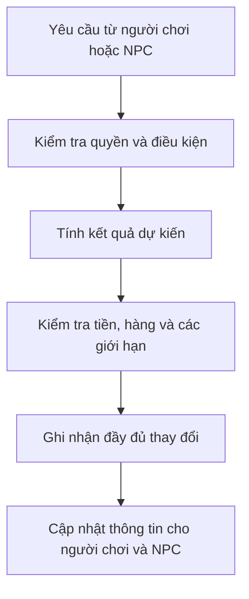

# Thiết kế lại phần lõi PolyEc — giải thích từ đầu

Muốn biết **từng class nghĩa là gì, chứa gì, không được làm gì, giá trị nào hợp lệ và liên hệ với class nào**, đọc [Hồ sơ từng class và quan hệ trong core](core-class-reference.md). Bản đó phân biệt code hiện có, điều kiện còn thiếu và thiết kế đích; tài liệu dưới đây giải thích hướng refactor tổng thể.

Cập nhật cách trình bày ngày 2026-10-19. Tài liệu này giải thích cách tổ chức lại code để giảm lỗi logic. Đây là thiết kế đích; việc sửa code được thực hiện từng bước và chỉ được ghi nhận hoàn thành sau khi kiểm tra.

**Ghi chú cập nhật tài liệu:** các nguyên tắc tổng quát về ownership, composition, giao dịch và kiểm chứng trong tài liệu này đã được đưa vào [DEVELOPER_GUIDE mục 2–3](../DEVELOPER_GUIDE.md). Bảng bước R0–R4 và chỉ dẫn triển khai phía dưới là kế hoạch lịch sử ngày 2026-10-19, không phải trạng thái hiện tại hay quy trình hiện hành. Xem [CURRENT_TASK](../CURRENT_TASK.md), [IMPLEMENTATION_PLAN](../IMPLEMENTATION_PLAN.md) và [DEVELOPMENT_WORKFLOW](../DEVELOPMENT_WORKFLOW.md) trước khi dùng làm căn cứ công việc.

Người dùng đã đồng ý thực hiện hướng thiết kế này. Việc viết lại tài liệu cho dễ đọc không thay đổi luật chơi, phạm vi M5 hay các điều kiện kỹ thuật đã đặt ra. Công việc đang giao và kết quả đã nghiệm thu vẫn được ghi tại [CURRENT_TASK](../CURRENT_TASK.md).

## 1. Chúng ta đang muốn sửa điều gì?

Về cách chuyển đổi core, thuật ngữ và thuật toán tìm/sắp dữ liệu, đọc [Truy vấn, sắp xếp và dữ liệu tra cứu](core-query-algorithms.md). Khuyến nghị là thay từng phần có kiểm chứng theo thiết kế chung; tài liệu này không đề xuất viết lại toàn bộ core cùng lúc.

**Core là phần lõi quyết định thế giới trong game hoạt động thế nào.** Nó giữ thông tin về người dân, tiền, hàng hóa, việc làm, thời gian và các quy tắc liên quan. Màn hình Godot hiển thị thế giới đó; các quyết định của NPC cũng phải được thực hiện qua cùng phần lõi.

Hiện nay, nhiều công việc tập trung trong `Realm`. Có thể hình dung đây là người quản lý vừa nhận yêu cầu, vừa tính lương, xử lý việc làm, tiến ngày, tạo báo cáo và lưu game. Khi một nơi làm quá nhiều việc, sửa một phần dễ ảnh hưởng sang phần khác.

Mục tiêu của lần thiết kế lại là **chia việc rõ ràng và kiểm soát cách các phần phối hợp**.

Ví dụ, khi đến lúc trả lương, ta cần biết chính xác:

- Ai có quyền quyết định người nào được nhận lương?
- Phần nào tính số tiền mỗi người được nhận?
- Phần nào thực sự trừ tiền của nơi trả lương và cộng tiền cho người nhận?
- Nếu có lỗi ở giữa thì những số tiền đã sửa được xử lý thế nào?
- Bài kiểm tra nào chứng minh kết quả đúng?

Refactor nghĩa là tổ chức lại code để trả lời rõ những câu hỏi đó, đồng thời giữ hành vi đã được duyệt. Code cũ được thay thế phải được bỏ khỏi đường thực thi. Chỉ thêm một class mới nhưng game vẫn chạy toàn bộ logic cũ thì chưa đạt mục tiêu.

## 2. Class, dữ liệu và quan hệ khác nhau như thế nào?

Một **class** là cách gom dữ liệu hoặc công việc có liên quan thành một thành phần trong chương trình. Tuy nhiên, không phải class nào cũng có cùng nhiệm vụ.

Ta chia thành ba nhóm:

| Nhóm | Ví dụ trong game | Nhiệm vụ |
|---|---|---|
| Thông tin đang tồn tại trong thế giới | Một người dân, một hợp đồng, một tài khoản | Ghi lại tình trạng hiện tại của đối tượng đó |
| Mô tả dùng chung | Loại nghề giáo viên, loại hàng lúa, công thức sản xuất | Cho biết một loại đối tượng có đặc điểm gì |
| Bộ phận xử lý công việc | Xử lý nhận việc, tính lương, lưu game | Áp dụng quy tắc và thực hiện thay đổi được phép |

Chẳng hạn, `TeacherJob` mô tả **nghề giáo viên**. Nó không phải là hợp đồng riêng của một giáo viên tên An. Hợp đồng riêng phải ghi An làm cho ai, ở đâu và trong thời gian nào.

Mỗi người có một mã nhận diện, gọi là **ID**. Hợp đồng tham chiếu tới ID của người đó. Nếu An đổi việc, An vẫn là cùng một người, giữ cùng ID và vòng đời; ta thay thông tin liên quan đến việc làm.

Cách ghép các thông tin này gọi là **composition**. Nó giúp tránh phải tạo các class như “người-vừa-là-giáo-viên-vừa-là-quan-chức-vừa-có-gia-đình”.

Thiết kế vẫn dùng C++20 và giữ dữ liệu gọn trong bộ nhớ. Chưa cần thêm cơ sở dữ liệu hoặc thư viện kiến trúc mới để làm được việc này.

## 3. Mỗi phần trong core sẽ làm việc gì?

Bảng dưới đây là cách chia trách nhiệm được đề xuất. Một số thành phần đã có, một số cần được tách dần từ code hiện tại. Tên class cụ thể sẽ được OpenCode trình trong kế hoạch trước khi sửa code.

| Thành phần | Giải thích bằng lời thường |
|---|---|
| `Realm` | Đầu mối nhận yêu cầu và điều phối công việc. Khi cần tính lương, nó gọi đúng bộ phận tính lương |
| `Person` và các bản ghi liên quan | Giữ thông tin từng người và các mối liên hệ của họ |
| `EmploymentDomain` | Xử lý nhận việc, đổi việc, hết hạn hợp đồng, bổ nhiệm và từ chức theo luật đã chốt |
| `Job` cùng ba lớp nghề hiện có | Cho biết vai trò là lao động thường, giáo viên hay quan chức được bổ nhiệm |
| `ScheduleDomain` | Quản lý việc thêm, hủy, đổi ưu tiên và kết thúc các phiên hoạt động |
| `activity::evaluateActivity` | Tính một người được phân bổ bao nhiêu khả năng chú ý trong khoảng thời gian đang xét |
| `WorkEvaluator` | Khi luật T2 được duyệt đầy đủ, tính phần công lao động thực tế |
| `PayrollRules` và `PayrollPlan` | Tính bảng lương, thuế, phần dư và các số tiền dự kiến sau khi trả lương |
| `SettlementDomain` | Tổ chức quyết toán các nghĩa vụ theo đúng thời điểm; kiểm soát việc một phần công có bị tính lại hay không |
| `Ledger` hoặc phần ghi nhận của từng nghiệp vụ | Thực hiện thay đổi tiền có đối ứng: tiền trừ ở đâu phải được cộng hoặc ghi nhận ở đúng nơi |
| `RealmDayPipeline` | Gọi các bước của một ngày theo thứ tự đã quy định |
| `RealmSaveCodec` | Chuyển dữ liệu thành file save và đọc dữ liệu từ file save |
| `RealmProjection` | Chuẩn bị thông tin mà người chơi hoặc NPC được phép nhìn thấy |
| `RealmRuntime` và phần kết nối Campaign | Đưa quyết định của policy vào core và quản lý phần riêng của Campaign theo đúng ranh giới sở hữu |

“Domain” trong các tên trên có nghĩa là **một nhóm công việc cùng lĩnh vực**, chẳng hạn lĩnh vực việc làm. “Evaluator” là **bộ phận chỉ tính kết quả**. “Plan” là **kết quả dự kiến trước khi ghi thay đổi**.

Một giới hạn quan trọng: phần tính lương không tự quyết định một NPC nên chọn nghề gì. Policy RL chọn hành động; core kiểm tra và thực hiện hành động theo luật.

Một class cần có công việc thực sự: giữ dữ liệu hoặc tài nguyên, thực hiện một phép tính có quy tắc rõ, hoặc bảo vệ tính đúng đắn của một nghiệp vụ. Không tạo trước tất cả class trong bảng, cũng không thêm class chỉ chuyển tiếp lời gọi mà không mang lại ranh giới hữu ích.

### 3.1. Dữ liệu chính thức được giữ ở đâu?

Mỗi thông tin phải có **một nguồn chính thức**. Ví dụ, tiền của một tài khoản không được đồng thời tồn tại thành hai số dư độc lập ở hai bộ phận.

`Realm` hiện sở hữu các tập dữ liệu của thế giới. Nếu cần tách một thành phần nội bộ tên `RealmState`, ta chuyển dữ liệu sang đó và để Realm tiếp tục sở hữu nó. Ta không tạo thêm một thế giới đang chạy song song.

Các danh sách phục vụ tra cứu nhanh, chẳng hạn “những người thuộc hộ này”, được xây từ dữ liệu chính thức. Chúng phải được cập nhật hoặc dựng lại đúng cách khi dữ liệu thay đổi.

Thông tin như `Employed/Idle` cũng được suy ra từ việc hoặc chức vụ còn hiệu lực, thay vì lưu thêm một cờ độc lập rồi quên cập nhật nó.

Màn hình và các phần kết nối Python chỉ đọc thông tin được phép và gửi yêu cầu qua core. Chúng không được lấy quyền sửa trực tiếp các tập dữ liệu bên trong.

### 3.2. Các phần khác của M5 áp dụng cách này ra sao?

Hộ gia đình, quyền sở hữu, tổ chức, hôn nhân, thừa kế, vận tải và pháp lý đều cần trả lời cùng bốn câu hỏi: **giữ dữ liệu gì, ai sở hữu, ai được sửa, và điều gì luôn phải đúng**.

Khi chuẩn hóa phần việc làm, hợp đồng lao động (`EmploymentContract`) sẽ liên kết người với cơ sở hoặc tổ chức. Việc bổ nhiệm (`OfficeAppointment`) ghi chức vụ và nghĩa vụ riêng. Lịch làm việc phải chỉ rõ nó liên quan tới việc nào.

Đây là mô hình đích. Việc chuyển từ các trường hiện có như `Person.job` và thông tin bổ nhiệm sang mô hình này cần kế hoạch riêng, tránh giữ hai bộ thông tin cùng có quyền quyết định.

Phạm vi và luật sản phẩm tiếp tục lấy từ [IMPLEMENTATION_PLAN](../IMPLEMENTATION_PLAN.md).

## 4. Một công việc phải được thực hiện theo trình tự nào?

Ta dùng việc trả lương để giải thích. Trong ví dụ này, chỉ xét nơi trả lương, hai người nhận và ngân khố; ban đầu nơi trả lương có 200 đồng, các bên còn lại có 0 đồng. Mỗi người được trả lương 100 đồng và thuế minh họa là 10%. Kết quả phải là: mỗi người nhận ròng 90 đồng, ngân khố nhận 20 đồng, nơi trả lương còn 0 đồng. Tổng tiền vẫn là 200 đồng.

Đây là ví dụ để giải thích cách kiểm tra phép tính, không bổ sung luật thuế mới cho game.

Ta thực hiện theo trình tự:

1. **Đọc và kiểm tra thông tin.** Người nhận có tồn tại không? Số tiền có hợp lệ không? Ai có quyền thực hiện?
2. **Tính kết quả trên giấy nháp.** Tính phần lương, thuế và số dư dự kiến, chưa sửa tiền thật trong thế giới.
3. **Kiểm tra toàn bộ kết quả dự kiến.** Có đủ tiền không? Phép tính có vượt giới hạn số không? Có tài khoản nào xuất hiện ở nhiều vai trò không?
4. **Chuẩn bị những thứ cần dùng khi ghi nhận.** Nếu phải cấp thêm bộ nhớ hoặc tạo sự kiện, phải biết lỗi có thể xảy ra ở đâu và xử lý ra sao.
5. **Ghi nhận đầy đủ các thay đổi.** Chỉ báo thành công khi những thay đổi thuộc cùng thao tác đã được hoàn tất.

Bước cuối thường được gọi là **commit**, nghĩa là chấp nhận và ghi kết quả thành trạng thái chính thức.

Nếu yêu cầu bị từ chối trước khi thực hiện, thế giới phải giữ nguyên theo quy định của lệnh đó. Ví dụ, phát hiện người nhận thứ hai không tồn tại thì không được để người thứ nhất đã nhận lương.

Một tình huống khác là hành động hợp lệ nhưng kết quả thất bại, chẳng hạn một nỗ lực có chi phí được luật chơi cho phép. Trường hợp này phải được mô tả riêng; không đánh đồng với yêu cầu không hợp lệ.

Việc lưu game đọc từ dữ liệu chính thức. Khi tải game, core kiểm tra một bản dữ liệu tạm trước; chỉ thay thế thế giới đang chạy khi dữ liệu đã hợp lệ. Bộ đọc save không được tự sửa luật kinh tế để che một file bị hỏng.

### 4.1. Những điều người viết code phải chứng minh

- Phải ghi rõ thao tác đọc thông tin nào, sửa thông tin nào, đơn vị đo và điều kiện được phép thực hiện.
- Trường hợp không có dữ liệu phải được biểu diễn rõ. Chẳng hạn, người không có việc phải trả về “không có việc”, không được mặc định thành lao động thường. ID sai hoặc loại dữ liệu không biết phải được xử lý đúng quy định của thao tác.
- Nếu dữ liệu thay đổi sau lúc tính nháp, phải kiểm tra lại trước khi ghi kết quả.
- Kết quả dự kiến phải do core tạo; bên ngoài không được gửi một bảng thay đổi tùy ý để bỏ qua kiểm tra.
- Nếu nói bước ghi nhận không thể thất bại, phải giải thích được cả chuyện cấp phát bộ nhớ, tạo sự kiện và cập nhật danh sách tra cứu.
- Nếu bước đó vẫn có thể thất bại, phải có cách hoàn nguyên những dữ liệu thuộc thao tác.
- Kiểm tra tràn số phải diễn ra trước phép tính nguy hiểm. Bắt lỗi ở cuối hàm hoặc thêm `noexcept` không tự làm cho thao tác an toàn.
- Không sao chép cả thế giới hàng triệu người mỗi lần trả lương. Ưu tiên chuẩn bị và bảo vệ đúng những dữ liệu bị tác động; đo chi phí của cách làm đó.
- Chưa cần một bộ giao dịch tổng quát cho mọi thứ. Bắt đầu bằng kết quả dự kiến riêng cho từng nghiệp vụ; chỉ rút thành phần dùng chung khi có nhu cầu thực.
- Khi từ chối lệnh, phải giữ nguyên cả dữ liệu, trạng thái sinh số ngẫu nhiên, số thứ tự lệnh và bản ghi theo dõi, theo đúng quy định của loại lệnh đó.

## 5. Vì sao phải ghi rõ các trường hợp khó?

Một quy tắc thường có vẻ đơn giản khi mọi việc diễn ra bình thường. Lỗi hay nằm ở lúc tình trạng thay đổi.

Ví dụ, với một người đang có việc:

| Tình huống | Câu hỏi phải trả lời trước khi code |
|---|---|
| Hợp đồng đến ngày kết thúc | Đúng ngày đó còn được tính là có việc không? |
| Người đó đổi việc giữa ngày | Phần công trước khi đổi thuộc về việc nào? |
| Một phiên hoạt động bị hủy | Phần đã thực hiện và phần chưa thực hiện được xử lý ra sao? |
| Người đó chết | Việc, chức vụ và phần công đang chờ được xử lý thế nào? |
| Lưu rồi tải game giữa phiên | Phải tiếp tục từ đâu để không bỏ mất hoặc tính lại phần đã làm? |
| Có chức vụ nhưng thông tin bổ nhiệm không đầy đủ | Đó là dữ liệu sai hay có một trạng thái hợp lệ được quy định riêng? |

Bảng liệt kê tình trạng ban đầu, thao tác và tình trạng sau đó gọi là **bảng chuyển trạng thái**. Nó giúp những người viết các phần khác nhau không tự hiểu luật theo các cách khác nhau.

Cần giữ các phân biệt sau:

- Sống/chết, có việc/không có việc, và đang thực hiện một phiên hoạt động là những thông tin khác nhau.
- Khả năng chú ý được phân bổ không tự động bằng công lao động hoặc sản lượng.
- Thời điểm trong game, thời lượng, đơn vị chú ý, đơn vị công, tiền và lượng hàng cần được đặt tên hoặc dùng kiểu dữ liệu phân biệt tại các phần kết nối mới.
- Lịch phiên hiện tính khoảng thời gian có đầu nhưng không có điểm cuối; hợp đồng việc hiện dùng điều kiện `busy_until >= day`, nghĩa là có tính ngày kết thúc. Refactor giữ đúng từng cách tính này cho đến khi có quyết định thay luật.
- Phần công trước khi chết/hủy và cách đổi công thành sản lượng vẫn là quyết định gameplay T2 cần được duyệt.

Với lệnh tiến nhiều ngày, cũng phải nói rõ: mỗi ngày được ghi nhận riêng hay cả yêu cầu phải cùng thành công. Việc bảo vệ từng đoạn thời gian không chứng minh rằng có thể hoàn nguyên toàn bộ yêu cầu.

## 6. Làm sao để phù hợp với thế giới có nhiều người?

Thiết kế rõ ràng vẫn phải giữ chi phí bộ nhớ và tính toán hợp lý.

Một triệu người không đồng nghĩa với một triệu model AI, một triệu đối tượng nghề được cấp phát riêng hoặc một triệu node Godot. Model và mô tả nghề có thể dùng chung; mỗi người giữ dữ liệu cá nhân cần thiết.

Các quan hệ được lưu khi có quan hệ thực, thay vì tạo một bảng đầy đủ cho mọi cặp người. Việc lưu lịch sử cũng cần chọn mức chi tiết và thời gian giữ phù hợp; không mặc định ghi mọi người ở mọi tick.

Một yêu cầu khác là **khả năng tái lập kết quả**: cùng trạng thái ban đầu và cùng các lệnh phải cho kết quả như đã quy định. Vì vậy, refactor phải giữ thứ tự các bước trong ngày, các lần lấy số ngẫu nhiên, danh sách yêu cầu trả lương và sự kiện. Thay cách duyệt dữ liệu có thể vô tình làm đổi kết quả game.

ID phải ổn định. Các danh sách tra cứu nhanh không được làm tăng tổng tiền, nhân bản người hoặc trở thành nguồn dữ liệu chính thứ hai.

Cách sắp dữ liệu trong bộ nhớ, chạy nhiều luồng hoặc thêm thư viện sẽ được chọn sau khi đo. Việc có thêm class hoặc sơ đồ đẹp không chứng minh game chạy nhanh hơn.

## 7. Chúng ta sẽ sửa code theo từng bước nào?

Ta sẽ sửa từng đường xử lý đang được game dùng, kiểm chứng xong rồi mới mở rộng. Những bước dưới đây hỗ trợ thực hiện M5; chúng không thay thế lộ trình sản phẩm.

| Bước | Việc cần làm | Làm sao biết đã đạt? |
|---|---|---|
| R0 — Chốt bản thiết kế | Xác định nơi giữ dữ liệu, trách nhiệm từng phần và cách đối chiếu kết quả | Phân biệt rõ code đang có với thiết kế đề xuất; ghi nhận các thay đổi đang dở |
| R1 — Trả lương | Tách việc tính bảng lương khỏi việc sửa tiền và thuế | Kết quả đúng số, bảo toàn tiền, từ chối không sửa dở, đường trả lương thật dùng code mới |
| R2 — Việc làm | Gom xử lý nhận việc, kết thúc việc, bổ nhiệm và từ chức vào đúng bộ phận | Các chuyển trạng thái và bộ đếm đúng; giữ ba mô tả nghề đã duyệt |
| R3 — Tiến thời gian | Tách việc điều phối một ngày khỏi các phép tính nghiệp vụ | Giữ thứ tự, pause, nút Một ngày và kết quả khi chia nhỏ thời gian |
| R4 — Dữ liệu, save và thông tin hiển thị | Tách các phần này khi các bước trên cho thấy cần thiết | Có một thế giới chính thức; lưu/tải tiếp tục đúng; phần kết nối vẫn hoạt động |
| T2 — Công thực tế và quyết toán | Xây trên nền đã tách rõ, sau khi chốt luật còn thiếu | Công, sản lượng, lương và nguyên liệu được tính đúng và không tính trùng |

Không bắt buộc hoàn tất mọi bước R rồi mới làm tiếp M5. Tab chính chọn phần thực sự cần làm trước, để tránh viết một cơ chế hai lần. Nếu đề xuất đổi thứ tự, phải nêu lý do và review kế hoạch trước khi code.

### 7.1. Bước đầu tiên: tách việc tính lương và trả lương

Hiện `FinanceManager::payroll` vừa tính chia lương, thuế và phần dư, vừa sửa số tiền trong dữ liệu người và địa bàn. Ta muốn tách thành hai việc:

**Việc thứ nhất: tính bảng lương dự kiến.** Bộ phận tính toán nhận thông tin chỉ đọc và trả về kết quả. Nó không sửa thế giới.

**Việc thứ hai: kiểm tra và ghi bảng lương.** Phần thực hiện kiểm tra dữ liệu cần thiết rồi ghi đầy đủ các thay đổi. Hàm trả lương hiện tại sẽ dùng đường xử lý mới này, tránh giữ hai công thức tính lương cùng tồn tại trong game.

Bước refactor này phải giữ:

- Thứ tự yêu cầu trả lương, cách chia phần lẻ theo ngày và cách tính thuế/phần dư từng người.
- Ngân sách dùng để chia lương được xác định trước khi thu thuế từ lần trả lương đó.
- Trường hợp ngân khố vừa là nơi trả lương vừa là nơi nhận thuế.
- `tax_receipts` chỉ đếm số thuế đã thu; không được cộng nó thêm lần nữa vào tổng tiền.
- Kết quả của các đầu vào hợp lệ hiện có. Nếu phát hiện cách xử lý dữ liệu sai hoặc tràn số chưa an toàn, sửa bằng một quy tắc từ chối có test; không cố giữ hành vi không xác định.

Các trường hợp cần kiểm tra gồm: danh sách rỗng, lương bằng không, thiếu tiền, người/địa bàn không tồn tại, nhiều khoản cho cùng người, tài khoản xuất hiện ở nhiều vai trò, tổng lương quá lớn, phép nhân khi chia tỷ lệ, cộng tiền nhận, cộng thuế và phần dư.

Không tự gộp các khoản của cùng người hay đổi thứ tự ưu tiên trả tiền để làm code đơn giản hơn. Nếu cần đổi kết quả kinh tế hợp lệ, phải quay lại review.

Bước này chưa thêm mã quyết toán được lưu trong save để chống trả trùng. Cơ chế đó thuộc hợp đồng thiết kế riêng của T2. File save không được đổi ngầm trong một bước tách code.

## 8. Kiểm tra thế nào để phát hiện lỗi thật?

Test là bài kiểm tra cho chương trình. Một bài kiểm tra tốt phải tạo được đúng tình huống cần xét và có kết quả đúng để đối chiếu.

Ví dụ, muốn kiểm nghề giáo viên thì trước hết phải chứng minh người mẫu thực sự là giáo viên. Nếu không tạo được giáo viên mà bài kiểm tra chuyển sang kiểm một người lao động thường, nó chưa kiểm điều mình định kiểm.

Tương tự, bổ nhiệm xảy ra trong thế giới A thì phải kiểm kết quả của A. Một điều kiện luôn đúng không chứng minh chương trình đúng.

Ta cần các nhóm kiểm tra sau:

| Nhóm kiểm tra | Ví dụ dễ hiểu |
|---|---|
| Kết quả tính tay | Tự tính lương, thuế và phần dư cho vài người rồi đối chiếu |
| Các điểm ranh giới | Ngay trước, đúng và sau ngày hết hạn; số 0; số rất lớn; ID không tồn tại; người chết; dữ liệu sai |
| Thao tác bị từ chối | Một người nhận không tồn tại thì không ai bị sửa tiền dở; kiểm các điểm có thể thất bại |
| Quy luật luôn đúng | Chuyển tiền nội bộ giữ nguyên tổng tiền; chia tiền không vượt ngân sách; đọc dữ liệu không sửa nó |
| Các cách thực hiện tương đương | Tiến thời gian một lần hoặc chia nhỏ cho kết quả tương đương trong phạm vi đã quy định |
| Lưu và tiếp tục | Lưu/tải giữa phiên cho kết quả tiếp diễn đúng |
| Chuỗi hành động | Nhận việc → làm → đổi/hủy việc hoặc chết → quyết toán vẫn giữ các điều kiện đã đặt ra |
| Đường chạy thật | Game thực sự gọi bộ phận mới, không chỉ bài kiểm tra gọi nó |
| Tương thích | Save, Python, native, Godot, dữ liệu quan sát, hành động, reward và các chốt tương thích model vẫn đúng trong phạm vi thay đổi |
| Chi phí chạy | Nếu sửa phần chạy thường xuyên, đo thời gian và bộ nhớ trên dữ liệu phù hợp |

“Kết quả đúng để đối chiếu” thường được gọi là **oracle**. Nó phải độc lập với phép tính đang kiểm: không gọi cùng một hàm ở cả hai phía rồi coi kết quả giống nhau là bằng chứng.

Test sinh nhiều đầu vào cũng hữu ích khi kiểm các quy luật như bảo toàn tiền. Có thể bắt đầu bằng bộ sinh có seed cố định, ghi lại seed gây lỗi; chưa cần thêm thư viện mới.

Test phải còn hoạt động ở bản Release. Kết quả CTest chỉ cho biết các bài đã chạy có pass hay không; nó không tự chứng minh rằng tình huống trong mỗi bài được dựng đúng.

Trước khi sửa, OpenCode trình kế hoạch ngắn. Codex review rồi mới giao code. Sau khi sửa, chạy test trực tiếp của phần đó, kiểm tra hồi quy core và các phần kết nối bị ảnh hưởng. Dùng lệnh và toolchain đã có trong build cache/CURRENT_TASK, không dò lại toàn bộ môi trường. Báo cáo phải ghi lệnh đầy đủ, kết quả thực, số kiểm tra và phần chưa chạy.

Một bước chỉ được nghiệm thu khi trách nhiệm đã chuyển thật sang chỗ mới, phần cũ đã được thay thế, các quy tắc vẫn đúng và bằng chứng kiểm tra đủ rõ.

## 9. Người viết code bắt đầu đọc ở đâu?

Phần này là bản đồ đối chiếu thiết kế với source, dành cho lúc triển khai.

| Nguồn | Đang chứa gì? | Điều cần chú ý khi tách |
|---|---|---|
| [realm.hpp](../../core/include/polyec/realm.hpp) | Realm, Person, Province và nhiều loại bản ghi | Tách trách nhiệm nhưng giữ một nơi sở hữu dữ liệu chính thức |
| [realm.cpp](../../core/src/realm.cpp) | Lệnh, xử lý ngày, lịch, dữ liệu quan sát và save | Ghi rõ thứ tự xử lý và phạm vi được ghi nhận cùng nhau |
| [finance_manager.hpp](../../core/include/polyec/managers/finance_manager.hpp) | Tính và trả lương trực tiếp | Điểm bắt đầu đề xuất cho R1 |
| [activity.hpp](../../core/include/polyec/activity.hpp) | Bộ tính chú ý nhận đầu vào chỉ đọc, trả kết quả rõ | Mẫu tham khảo tốt cho cách tách phép tính khỏi sửa state |
| [schedule.hpp](../../core/include/polyec/schedule.hpp) | Phiên hoạt động và các số liệu tích lũy | Chưa tự mang nghĩa công lao động |
| [realm_court.cpp](../../core/src/realm_court.cpp) | Xử lý court và lưu/đọc thông tin bổ nhiệm | Kiểm tra nơi lưu từng trường thực tế; không suy từ tên struct |
| [types.hpp](../../core/include/polyec/types.hpp), [sim.hpp](../../core/include/polyec/sim.hpp) | WorldState của nhánh GameWorld prototype | Khác dữ liệu Realm; chưa được coi là đã hợp nhất |
| [campaign.hpp](../../core/include/polyec/campaign.hpp) | Realm và dữ liệu riêng của Campaign | Giữ đúng nơi sở hữu hàng vận chuyển, clock và phần quyết toán riêng |

Phạm vi đọc ban đầu của R1: `finance_manager.hpp`, `core/src/finance_manager.cpp`, `Realm::payroll` và các nơi gọi nó, `core/tests/test_managers.cpp`, cùng CMake khi cần thêm file. Header/source mới phải nằm trong kế hoạch đã review.

Việc triển khai tiếp tục do tab chính điều hành qua OpenCode. Tab phụ sửa tài liệu này để người đọc hiểu rõ, không mở lượt sửa core cạnh tranh. Tab chính kiểm tra tiến trình và các thay đổi đang có, đưa lát được chọn vào CURRENT_TASK, review kế hoạch rồi mới code.

Những quyết định kỹ thuật nằm trong hướng refactor đã được cấp quyền thực hiện. Những luật gameplay còn thiếu vẫn cần người dùng duyệt bằng ngôn ngữ dễ hiểu. Sau nghiệm thu mới cập nhật CURRENT_TASK, HISTORY và báo cáo bằng chứng.

Nguồn tham khảo phương pháp: [bảo vệ những điều luôn phải đúng trong domain](https://learn.microsoft.com/en-us/dotnet/architecture/microservices/microservice-ddd-cqrs-patterns/domain-model-layer-validations), [tách việc lưu dữ liệu khỏi luật nghiệp vụ](https://learn.microsoft.com/en-us/dotnet/architecture/microservices/microservice-ddd-cqrs-patterns/infrastructure-persistence-layer-design). Các nguồn này giải thích nguyên tắc; PolyEc tiếp tục dùng C++ native.
