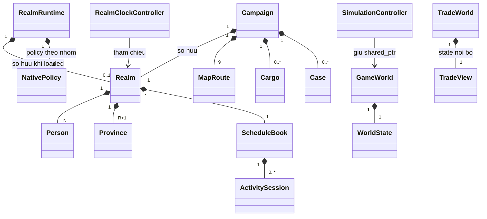
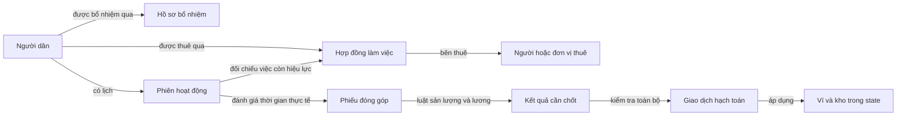

# Hồ sơ từng class trong phần lõi PolyEc

Ngày đối chiếu: 2026-10-19. Baseline Git: 6cc55ab, kèm thay đổi chưa commit trong checkout. Đây là tài liệu giải thích và đối chiếu thiết kế, không phải báo cáo nghiệm thu code.

Tài liệu bao phủ từng class, struct và enum khai báo trong core/include/polyec; bổ sung RealmRuntime, NativePolicy và PolicyOutput để giải thích chỗ nối với AI. Các lớp giao diện Godot, lớp chạy thí nghiệm trong native/lab và thư viện bên ngoài không thuộc danh mục core này. Kiểu phụ trợ nội bộ được ghi cùng lớp hoặc thuật toán sử dụng nó.

**Cách đọc:** bắt đầu từ mục 1 để hiểu bức tranh chung; đọc mục 3 về Realm và mục 7 về Campaign; sau đó tìm hồ sơ của từng tên. Phần [thiết kế tổng quan](core-architecture-refactor.md) giải thích lý do refactor. [CURRENT_TASK](../CURRENT_TASK.md) xác định công việc nào đang thực sự được giao.

## 1. Bốn khái niệm cần hiểu trước

**Class** là một kiểu thành phần trong chương trình. Một đối tượng là một trường hợp cụ thể của kiểu đó. “Person” là kiểu người; người có ID 129 là một đối tượng cụ thể.

**Struct** trong C++ cũng là một kiểu có thể chứa dữ liệu và hàm. Trong core hiện tại, struct thường được dùng như một phiếu thông tin: Person, Loan, Cargo… Từ “phiếu” chỉ giúp dễ hình dung; dữ liệu thực vẫn được lưu trong bộ nhớ máy tính.

**Sở hữu** nghĩa là chịu trách nhiệm giữ dữ liệu chính thức và vòng đời của nó. “Tham chiếu bằng ID” nghĩa là chỉ ghi mã của đối tượng khác, không sở hữu hay tạo bản sao đối tượng ấy.

**Điều kiện luôn phải giữ đúng**, còn gọi là invariant, là quy tắc mà một trạng thái hợp lệ không được vi phạm. Ví dụ: kho không được có số hàng âm; ID người dân không được trùng; người nhận việc phải tồn tại. Khi chuyển tiền nội bộ, tổng tiền trước và sau phải bằng nhau nếu không có khoản tạo mới hoặc tiêu hủy được phép.

**“Kiểm invariant” nghĩa là gì?** Hãy hình dung thầy cô kiểm lại bài: sau khi chương trình thực hiện một việc, nó đọc các số liệu liên quan để xem những quy tắc trên còn đúng không. Nếu kho có -3 bao gạo, phép kiểm báo lỗi. Phép kiểm giúp phát hiện lỗi; tự nó không sửa nguyên nhân gây ra -3 bao gạo. Một điều kiện được ghi trong thiết kế chưa có nghĩa code đã kiểm nó ở mọi nơi.

**Khác với kiểm yêu cầu đầu vào:** trước khi nhận lệnh chuyển 10 đồng, chương trình kiểm người gửi có đủ tiền và người nhận có tồn tại không. Sau khi thực hiện, kiểm lại người gửi giảm đúng 10, người nhận tăng đúng 10, tổng tiền không đổi. Đầu vào hợp lệ vẫn có thể bị một hàm viết sai xử lý thành kết quả sai, nên hai loại kiểm này bổ sung cho nhau.

**“Luôn đúng” được xét ở đâu?** Ở các trạng thái được công bố sau một thao tác hoàn tất. Bên trong thao tác có thể cần nhiều bước tính; không được để UI hoặc thao tác khác nhìn thấy một trạng thái đang sửa dở. Không nhất thiết quét toàn bộ thế giới sau mỗi lệnh: kiểm phần liên quan trong đường chạy thật, còn kiểm toàn bộ dùng ở những điểm phù hợp như tải save và bài kiểm thử.

Các thuật ngữ khác và phần thiết kế tìm kiếm dữ liệu được giải thích tại [Truy vấn, sắp xếp và dữ liệu tra cứu](core-query-algorithms.md).

Mỗi hồ sơ phân biệt ba mức:

- **Đã kiểm trong code:** chỉ rõ hàm hoặc lớp thực hiện kiểm tra.
- **Được đường tạo bình thường duy trì:** code tạo ra như vậy nhưng bộ đọc save hoặc invariant có thể chưa kiểm đầy đủ.
- **Đích thiết kế / còn thiếu:** yêu cầu cần thực hiện hoặc quyết định chưa chốt, không được tuyên bố đã có.

“Không được chứa” ở các hồ sơ nói về ranh giới trách nhiệm đích. Nếu code hiện còn chứa logic vượt ranh giới đó, tài liệu ghi đây là phần cần chuyển khi refactor.

### 1.1. Những thế giới có tên gần giống nhau

| Tên | Nghĩa trong dự án | Dữ liệu thế giới thuộc ai? |
|---|---|---|
| Realm | Một thế giới mô phỏng người dân, địa bàn, tiền, hàng, việc và thời gian | Realm sở hữu dữ liệu của thế giới đó |
| Campaign | Một chiến dịch chơi, bổ sung địa lý, vận tải, hồ sơ vấn đề và bộ điều khiển M4 | Campaign sở hữu một Realm cùng dữ liệu riêng của chiến dịch |
| GameWorld | Nhánh prototype ban đầu cho chọn lãnh thổ và điều khiển ngày | GameWorld sở hữu một WorldState riêng |
| TradeWorld | Bài toán kinh tế nhỏ phục vụ curriculum thương mại ban đầu | TradeWorld sở hữu TradeView dùng làm state nội bộ |

Không có quan hệ kế thừa giữa bốn class này. Campaign **chứa** Realm. RealmRuntime cũng có thể sở hữu một Realm khác cho chế độ chạy policy; không phải cùng instance với Realm trong Campaign.

GameWorld và TradeWorld không phải các phần tự động đồng bộ với Realm. Hợp nhất chúng là việc cần kế hoạch riêng, không được giả định chúng đang dùng cùng đồng hồ và số dư.

### 1.2. Ký hiệu và tập giá trị dùng chung

| Ký hiệu | Ý nghĩa chính xác |
|---|---|
| N | Số bản ghi Person trong một Realm, kể cả người đã chết |
| R | Giá trị Realm.regions(), chỉ nhận 1, 2 hoặc 6 khi tạo Realm |
| Địa bàn của Realm | Chỉ số từ 0 đến R, gồm R+1 bản ghi Province |
| Hàng hóa của bản core hiện tại | Chỉ số 0 đến 6; chưa phải danh mục 16 hàng của M5 đích |
| Tick của Realm | Một đơn vị thời gian game; 64 tick bằng một ngày |
| H | Giới hạn thời gian của Realm: 365000 × 64 = 23360000 tick |
| ID người | 1 đến N; 0 thường biểu diễn không có liên kết |
| int32 | Số nguyên từ -2147483648 đến 2147483647 |
| int64 | Số nguyên từ -9223372036854775808 đến 9223372036854775807 |
| uint64 | Số nguyên từ 0 đến 18446744073709551615 |
| bool | true hoặc false; bộ đọc cần tự kiểm giá trị biểu diễn khi format yêu cầu |

Một số nguyên lưu được trong int64 chưa chắc hợp lệ cho nghiệp vụ. Ví dụ, lượng hàng âm vẫn là int64 hợp lệ về mặt máy tính nhưng không phải lượng hàng hợp lệ trong kho.

Đơn vị chú ý, đơn vị công lao động, tick, ngày, tiền và lượng hàng là các đại lượng khác nhau. Không được đổi qua lại chỉ vì chúng đều dùng số nguyên.

## 2. Quan hệ giữa các thành phần lớn

Đường có hình thoi trong sơ đồ là **sở hữu/chứa**; đường mũi tên thường là **gọi hoặc sử dụng**.

Sơ đồ không khẳng định đang có ba Realm bên trong một Campaign: Campaign có Realm của nó; một RealmRuntime riêng có thể tạo Realm riêng. RealmClockController chỉ mượn tham chiếu, nên Realm được tham chiếu phải sống lâu hơn controller.

## 3. Hồ sơ thế giới Realm và các phiếu thông tin của nó

Nguồn: [realm.hpp](../../core/include/polyec/realm.hpp), [realm.cpp](../../core/src/realm.cpp), [realm_court.cpp](../../core/src/realm_court.cpp).

### 3.1. Realm — một thế giới mô phỏng

**Nghĩa tên:** “realm” là một cõi hoặc lãnh địa. Trong code, hiểu là một phiên bản thế giới đang được mô phỏng.

**Chứa:** các tập Person, Province, Edge, Loan, Project, Fact, Knowledge, Proposal, Investigation; một Draft, một ScheduleBook; trạng thái RNG, ngày, pause/revision; mạng đường đơn giản; quỹ tổ chức và các quỹ chung; số liệu nguồn/sản xuất/tiêu dùng để đối soát. Những loại được lưu trong vector thuộc Realm, không thuộc riêng Person.

**Giá trị/điều kiện:**

| Thành phần | Giá trị và nơi kiểm |
|---|---|
| regions khi tạo | Chỉ 1, 2, 6; constructor từ chối số khác |
| people khi tạo | 128 đến 1000000; constructor từ chối ngoài khoảng |
| day | 0 đến 365000 khi load; invariant yêu cầu bằng phần nguyên cursor/64 |
| cursor | 0 đến H; advance, load và invariant có kiểm |
| pause_revision | uint64; Pause/Resume kiểm tràn trước lần thay trạng thái |
| advance(days) | Chấp nhận 0 đến 36500, còn phải trong horizon; thời gian dương bị chặn nếu pause |
| advance_ticks(ticks) | ticks không âm; không vượt H; ticks dương bị chặn nếu pause |
| person(id) | id từ 1 đến N; sai thì ném lỗi, không trả một Person mặc định |
| Đường legacy policy | candidates/mask/observation bị chặn khi timeline_contract đã bật |
| Save | POLYEC_REALM_7, đúng bundle, dữ liệu không quá 256 MiB; parse tạm và kiểm trước thay live state |

**Được làm:** nhận và kiểm lệnh, điều phối các bước ngày, sở hữu dữ liệu và kiểm bảo toàn. Hiện Realm còn trực tiếp chứa nhiều công thức, thao tác việc làm, save và tạo observation; đây là phần cần tách theo thiết kế.

**Không được làm:** chứa Godot Node, tự mua tài nguyên, tự chọn chiến lược thay policy, cho UI/Python sửa trực tiếp vector nội bộ hoặc tạo số dư chính thức thứ hai.

**Quan hệ:** một Realm có nhiều Person; mỗi Person đang ở một Province theo region. Realm chứa lịch; lịch chỉ tham chiếu người bằng ID. Campaign là friend của Realm nên hiện có quyền truy cập private; đây là sự phụ thuộc mạnh hiện có, không phải mẫu quyền nên mở cho mọi class.

**Tình huống cần kiểm:** ID sai, stale sequence, người chết, tràn số, lệnh bị từ chối, tiến qua nhiều ngày, load hỏng, lưu giữa phiên, đồng bộ pause. Việc stage từng cửa sổ lịch chưa chứng minh mọi lệnh hoặc cả request nhiều ngày đều rollback nguyên khối.

### 3.2. Person — một người dân có danh tính riêng

**Ý nghĩa và owner:** một bản ghi cho một người, do Realm sở hữu. Chết không có nghĩa xóa bản ghi hay đổi ID. Person chứa mã tham chiếu tới địa bàn, hộ và người bổ nhiệm; không chứa bản sao của các đối tượng đó.

| Trường | Ý nghĩa | Giá trị/điều kiện và mức kiểm hiện có |
|---|---|---|
| id | Mã người | id bằng vị trí trong people + 1; invariant kiểm |
| household | Mã hộ hiện tại | 1..N; load/invariant kiểm. Là nhãn hộ, không phải số lượng thành viên |
| decisions, sampling | Số thứ tự lệnh và chỉ số lấy mẫu cá nhân | uint64; lịch có kiểm tràn; không suy mọi đường lệnh khác đã có cùng bảo vệ |
| region | Địa bàn đang ở | 0..R; load/invariant kiểm |
| age_days | Tuổi tính theo ngày | Bình thường không âm; invariant hiện chưa kiểm đủ miền tuổi |
| health | Sức khỏe | Bình thường tối đa 100; có thể xuống 0/âm khi chết; invariant chỉ kiểm cận trên |
| nutrition | Dinh dưỡng | 0..100; invariant kiểm |
| skill | Kỹ năng | Đường tăng kỹ năng giới hạn 100; chưa có kiểm tổng quát 0..100 trong invariant |
| job | Nơi gán việc | -1 là chưa gán; Work đặt bằng region. Không phải JobType hay ID một EmploymentContract |
| job_kind | Loại việc thường | 0 lao động, 1 giáo viên; invariant kiểm 0..1 |
| busy_until | Ngày kết thúc khoảng bận | Điều kiện chặn lệnh thường là lớn hơn ngày hiện tại; query việc dùng lớn hơn hoặc bằng |
| destination | Nơi đang đến | -1 là không đi; khi đi phải là địa bàn thật. Invariant chưa kiểm toàn bộ liên kết này |
| goal | Mã mục tiêu | Khởi tạo và scenario dùng 0..2; invariant chưa kiểm miền này |
| school_days | Số ngày học còn lại | Đường tạo dùng thời hạn dương rồi giảm về 0; chưa có invariant đầy đủ |
| social | Mức giao tiếp | Đường Social tăng tới 100; chưa có invariant đủ cận dưới/trên |
| organization | Mã nhóm/tổ chức pilot | 0 là chưa tham gia; 1..28 là nhóm theo địa bàn; invariant kiểm 0..28 |
| cash | Tiền cá nhân | int64 không âm; invariant kiểm |
| inventory | 7 lượng hàng cá nhân | Mỗi lượng không âm; invariant kiểm. Giới hạn 16 được kiểm ở lệnh Buy, không phải ràng buộc cấu trúc mọi lúc |
| tax_remainder | Phần lẻ thuế giữ lại | 0..99; invariant kiểm |
| family | Nhóm vai trò policy | Governance/Economic/Civilian; load kiểm enum 0..2 |
| stats | Sáu chỉ số | Xem hồ sơ Stats |
| taxing_authority, sovereign | Quyền thu thuế, vai trò tối cao | bool; không phải mọi Governance đều có quyền này |
| candidate, office, special_advisor | Được giới thiệu, đã bổ nhiệm, loại cố vấn | bool; không tự tương đương với EmploymentState |
| hired_by | ID người bổ nhiệm | 0 là không có; read_court kiểm không vượt N |
| salary_due, office_notice | Ngày trả lương chức vụ và mốc được từ chức | Ngày game; nguồn ghi/đọc là court extension |
| last_decision_day | Ngày gần nhất đã ra quyết định | -1 ban đầu hoặc ngày game; dùng để không chọn cùng người lặp trong ngày |

**Được chứa:** dữ liệu cá nhân và liên kết gọn. **Không được chứa:** toàn bộ Realm, model AI riêng, Godot Node riêng, quỹ hộ bị nhân bản hoặc logic quyết toán toàn nền kinh tế.

**Điều kiện việc làm:** describe_job trước hết loại người chết; chức vụ hợp lệ theo ba trường office/hired_by/family được ưu tiên; nếu không, chỉ nhận work job khi job >= 0, busy_until >= ngày và job_kind đúng 0 hoặc 1. Không có descriptor thì None/Idle.

**Quan hệ và giới hạn:** hộ được tra qua household và HouseholdIndex; guardian là query suy ra từ người lớn còn sống cùng hộ, chưa phải record Guardianship đầy đủ. organization hiện chỉ có mã và quỹ pilot, chưa phải một Organization hoàn chỉnh. Các trường bổ nhiệm được lưu qua write_court/read_court, dù khai báo trong Person.

**Ca kiểm:** sinh, chết, đổi hộ, thiếu người giám hộ, hết hạn việc, bổ nhiệm xóa việc trước, từ chức, cùng người nhận nhiều khoản, ID đối tượng tham chiếu không còn đúng.

### 3.3. Stats — sáu chỉ số của một người

**Chứa:** đúng sáu số int trong values; mặc định đều 50, khởi tạo bình thường trong các khoảng 25..85 tùy bước tạo. Đây là cấu trúc chỉ số pilot, không tự thành schema bắt buộc cho mọi NPC M5.

**Miền giá trị:** ý nghĩa gameplay thường dùng thang 0..100, nhưng struct và Realm::invariant hiện chưa kiểm toàn bộ các phần tử trong khoảng đó. Phải ghi đây là thiếu bảo vệ, không tuyên bố đã được đảm bảo.

**Được/không được:** giữ chỉ số, không giữ reward, tiền hoặc một policy. Realm đọc stats để tính học, chuẩn bị dự án, thương lượng, điều tra và huy động. Không tự đổi tên sáu chiều thành bộ tính cách mới khi refactor.

**Quan hệ:** Person chứa một Stats theo giá trị. Test cần chạm các cận chỉ số và đảm bảo phép tính dùng chỉ số đúng.

### 3.4. Province — dữ liệu kinh tế của một địa bàn

**Owner:** Realm có R+1 Province, liên kết với người và record khác bằng chỉ số, không bằng con trỏ sở hữu.

| Nhóm trường | Chứa gì và điều kiện |
|---|---|
| treasury, firm | Ngân khố và tài khoản doanh nghiệp tổng hợp pilot; không âm, invariant kiểm. firm là một số tiền, không phải đối tượng Establishment |
| stock[7] | Kho theo từng hàng; mọi lượng không âm, được đối soát toàn thế giới |
| price[7] | Giá theo từng hàng; prices() bình thường tạo trong 2..5×giá tham chiếu từng hàng; invariant Realm chưa kiểm giá đầy đủ |
| tax | Thuế suất nguyên; lệnh Tax chỉ cho 0..20; bộ đọc/invariant hiện không đảm bảo cùng khoảng cho mọi state |
| school, school_used | Sức chứa học và mức đang dùng; cần không âm và thống nhất số người học, chưa có invariant tổng quát đầy đủ |
| jobs, employed | Chỗ làm và bộ đếm người có việc; employed là số liệu dẫn xuất được cập nhật trong lệnh và đếm lại theo ngày |
| teachers, teacher_skill_sum | Số giáo viên và tổng kỹ năng giáo viên; được dùng khi tính học, không phải hai tập Person mới |
| road, unrest | Cấp đường và bất ổn; đường dự án bị giới hạn cấp 4, đường tạo bất ổn dùng thang tới 100; chưa có kiểm load tổng quát đủ các cận |
| charter | Quyền/điều kiện để áp dụng lệnh thuế, bool |
| sales_tax_remainder | Phần lẻ thuế giao dịch; 0..99, invariant kiểm |
| tax_receipts | Bộ đếm thuế tích lũy; không phải tài khoản tiền thứ ba |
| food_capacity | Sức chứa/ngưỡng kho thực phẩm được luật hiện có sử dụng |
| residents, health_sum | Số liệu tổng hợp; Realm::refresh_demography hiện đếm mọi bản ghi vào residents, còn health_sum chỉ cộng sức khỏe người sống |

**Không được chứa:** bản sao Person hoặc thêm một thế giới con có đồng hồ riêng. Province cũng không phải MapRegion: Province giữ kinh tế, MapRegion giữ hình dạng/địa lý.

**Lưu ý:** CampaignView sửa residents của bản view thành số người sống. Vì vậy không được coi mọi trường cùng tên residents ở mọi bề mặt đều có cùng cách đếm. Đây là điểm cần chuẩn hóa qua review, không tự sửa gameplay trong tài liệu.

**Ca kiểm:** địa bàn rỗng, thiếu hàng/tiền, sai chỉ số kho, counter lệch, tax_receipts bị tính hai lần, alias ngân khố trả lương và thu thuế.

### 3.5. Family — nhóm policy, không phải gia đình

**Tập giá trị:** Governance = 0 (quản trị), Economic = 1 (kinh tế), Civilian = 2 (dân thường). Lưu enum ngoài 0..2 bị load từ chối.

**Scope:** dùng để sinh lựa chọn, kiểm quyền, chọn policy/nhịp quyết định. Hộ gia đình dùng Person.household; hai người cùng Family không có nghĩa cùng hộ.

**Không được:** dùng thay JobType hoặc quyền sovereign/taxing_authority. Người thuộc Governance có thể không có chức vụ bổ nhiệm. Runtime phải đồng bộ bộ nhớ khi vai trò đổi.

### 3.6. Intent — loại hành động nghiệp vụ

**Tập giá trị theo thứ tự enum hiện có:** Hold=0, Buy=1, Sell=2, Travel=3, Borrow=4, Repay=5, Project=6, Hire=7, Tax=8, Aid=9, Investigate=10, Offer=11, Accept=12, Reject=13, Work=14, Study=15, Rest=16, Social=17, Join=18, Migrate=19, Support=20, Appoint=21, Mobilize=22, Resign=23.

**Ý nghĩa:** chỉ nói người đó định làm loại việc gì. Điều kiện hợp lệ nằm ở Realm::legal, không phải bản thân enum.

**Quan hệ:** Candidate chứa một Intent; slot action của policy chứa Candidate. Số slot action không nhất thiết bằng số Intent: ví dụ slot 15 của nhóm Governance có thể là Appoint, không phải Intent số 15.

**Ca kiểm:** enum không nhận biết, action index đúng nhưng terms đổi, Hold của người chết (legal hiện kiểm Hold trước kiểm alive). Không suy mọi Intent có cùng quy tắc tuổi/bận.

### 3.7. Candidate — một phương án hành động cụ thể

**Chứa:** kind, target, good, amount, term. Candidate là phiếu đề xuất; chưa có quyền tự mutate state.

| Trường | Giá trị phụ thuộc loại hành động |
|---|---|
| kind | Một Intent được nhận biết |
| target | Buy/Work thường là địa bàn 0..R; Support/Offer có thể là ID người; Accept/Reject là ID Proposal |
| good | Buy/Sell là hàng 0..6; Project là loại 0..3; Join là nhóm 0..3; Borrow/Offer còn dùng mã biến thể |
| amount | Lệnh thông thường kiểm 0..1000000 rồi kiểm riêng; nhiều loại cần >0, Work có thể dùng 0 |
| term | Work/Study/Rest/Social/Join/Mobilize dùng 1..30; Project 30..180; vay pilot 30..180 hoặc 1825 cho nguồn đặc biệt |

**Không được:** coi target luôn là Province hay good luôn là hàng hóa. Đây là kiểu có nhiều nghĩa theo discriminator kind; thiết kế đích có thể dùng kiểu rõ hơn sau migration.

**Ca kiểm:** actor sai vai trò, chưa đủ tuổi, quá thời hạn, sai địa điểm, đổi terms giữa observe và execute. Runtime phải thực hiện đúng Candidate policy đã quan sát và kiểm lại trước commit.

### 3.8. RealmCommand — phong bì gửi một Candidate

**Chứa:** actor (ID người), sequence (số thứ tự lệnh), action (Candidate). **Giá trị:** actor 1..N; sequence phải đúng Person.decisions + 1; action phải qua Realm::legal.

**Owner/quan hệ:** caller tạo command theo giá trị; Realm tiếp nhận, không lưu nó thành nguồn state thứ hai. Person.decisions cũng được ScheduleCommand dùng, nên hai loại lệnh chia sẻ số thứ tự.

**Không được:** cho command tự sửa cash hay tự đánh dấu đã thành công. Reject do ID/sequence/legal không được thực hiện lệnh. Cần audit tràn sequence trên từng đường, không chỉ đường lịch.

### 3.9. RealmResult — kết quả trả về của lệnh

**Chứa:** success bool, reason chuỗi, fact và session là uint64. **Nghĩa:** fact/session có thể là 0 khi không có; chúng là ID trong đúng tập record, không phải bản sao Fact/ActivitySession.

**Điều kiện:** thành công hay thất bại phải khớp thao tác; caller không được chỉ đọc reason để suy thành công. Clock command có thể thành công mà fact/session vẫn 0.

**Scope:** thông báo kết quả, không chứa mutable world hay model. Test phải kiểm state cùng với result; success=false tự nó chưa chứng minh rollback mọi lỗi runtime.

### 3.10. Draft — lựa chọn augment lúc mở thế giới

**Chứa:** tier, cards[3], seen (bitmask), chosen, rerolled. **Giá trị tạo bình thường:** tier 0..2; mỗi tier có bốn card trong 0..11; ba card ban đầu lấy từ cùng tier; chosen=-1 trước chọn hoặc là một card đang được chào; rerolled bool.

**Thao tác:** choose chỉ ở ngày 0, chưa chọn và card có trong cards; reroll nhận slot 0..2, ngày 0, chưa chọn, chưa reroll. **Thiếu kiểm:** load/invariant chưa kiểm đầy đủ mọi tổ hợp Draft như các đường thao tác này.

**Quan hệ:** Realm sở hữu một Draft; apply_augment có thể tác động quỹ, ứng viên và dự án. Draft không phải event campaign tương lai hay chiến lược RL.

### 3.11. RealmView — ảnh chụp thông tin để đọc

**Chứa:** day, regions, persons, alive, children, decisions, money; bản sao provinces, facts đã lọc và draft. **Điều kiện bình thường:** day/regions theo Realm; alive <= persons; children chỉ đếm người sống dưới 18 tuổi.

**Quan hệ:** được Realm::view(observer) tạo; sửa bản sao không sửa Realm. facts được lọc bằng knows. Đừng suy rằng mọi dữ liệu kinh tế trong provinces đã được kiểm quyền biết chi tiết: view hiện sao chép cả vector Province.

**Không được:** dùng RealmView như state chính thức để ghi ngược tiền hoặc tạo NPC mới. Test cần kiểm bộ lọc thông tin, copy isolation và số liệu sống/chết.

## 4. Các record về quan hệ, nghĩa vụ và thông tin

Các record sau đều do Realm sở hữu, trừ khi nói rõ đang là bản sao trong view. Chúng không tự chạy thời gian hay tự thực hiện nghiệp vụ. ID giữa các tập record không được mặc định là duy nhất trên toàn dự án.

### 4.1. Edge — một quan hệ giữa hai người

**Chứa:** from, to là ID người; kind là mã loại quan hệ. **Đã kiểm:** invariant yêu cầu hai đầu đều trong 1..N.

**Miền kind theo đường tạo hiện tại:** 0 cho liên kết hộ/cha-con trong các tình huống khởi tạo và sinh, 1 cho liên kết xã hội ban đầu, 2 khi nhận đề nghị. Invariant hiện không kiểm miền kind; không tự diễn giải kind=0 là mô hình pháp lý gia đình hoàn chỉnh.

**Quan hệ:** Person 1 → nhiều Edge đi/đến; mỗi Edge tham chiếu đúng hai người. Có thể có self-edge từ cách khởi tạo hộ hiện tại; validator hiện không cấm. Đây là quan hệ thưa, không phải ma trận N×N.

**Không được:** chứa thêm cash hoặc nhân bản người. Test cần phân biệt ID sai, loại không biết, liên kết với người chết và ý nghĩa self-edge trước khi đổi thiết kế.

### 4.2. Loan — khoản nợ

**Chứa:** id, debtor, creditor, due, principal, interest, paid, defaulted, royal_pool, cause.

| Trường | Tập giá trị và nghĩa |
|---|---|
| debtor | ID người vay, 1..N; invariant kiểm |
| creditor | Chỉ số tài khoản doanh nghiệp địa bàn, 0..R; KHÔNG phải ID người cho vay |
| principal | Tiền gốc 1..1000000; invariant kiểm |
| interest | Tiền lãi, >=0; invariant kiểm |
| paid | Đã trả, từ 0 tới tổng gốc và lãi; invariant kiểm |
| due | Ngày tới hạn, >=0; invariant kiểm |
| defaulted | bool đánh dấu vỡ nghĩa vụ theo xử lý ngày |
| royal_pool | bool: nguồn là quỹ tín dụng hoàng gia thay cho firm của Province |
| id, cause | Mã khoản nợ và tham chiếu Fact nguyên nhân theo đường tạo; kiểm toàn vẹn ID/cause còn hạn chế |

**Được làm/không được:** Loan ghi nghĩa vụ; nó không giữ thêm tiền gốc như một tài khoản. Khi vay/trả phải chuyển tiền giữa các tài khoản thật.

**Ca kiểm:** trả từng phần, trả hết, quá hạn, sai creditor index, tổng gốc+lãi tràn số, debtor chết. Không tự suy death làm xóa nghĩa vụ.

### 4.3. Project — dự án đang hoặc đã thực hiện

**Chứa:** id, owner, region, due, kind, budget; completed, engineer, stalled; cause.

**Giá trị tạo bình thường:** owner là ID người; region 0..R; kind 0 đường, 1 trường, 2 khóa học cho người đang học, 3 khóa đào tạo giáo viên; budget dương; lệnh khởi công có term 30..180. due là ngày hoàn thành sau khi tính năng suất và chuẩn bị, không phải lúc nào cũng bằng ngày bắt đầu cộng term.

**Chuyển trạng thái:** completed=false khi tạo; đến due thì hoàn thành nếu đủ đối tượng hưởng lợi/điều kiện. Khóa đào tạo chưa sẵn sàng có thể stalled=true và dời due thêm 7 ngày. engineer đánh dấu hỗ trợ chuyên môn theo augment hiện có.

**Quan hệ:** một người có thể sở hữu nhiều Project; mỗi dự án gắn một Province; cause dẫn tới thông tin nguyên nhân. ProjectManager chỉ đếm dự án, Realm hiện khởi công/hoàn thành.

**Không được:** giữ lại ngân sách như một tài khoản thứ hai sau khi tiền đã chuyển hoặc tự tạo vật tư. **Thiếu kiểm:** Realm::invariant chưa có bảng kiểm đầy đủ cho các trường Project. Test phải kiểm cả đường tạo và load hỏng.

### 4.4. Fact — một sự kiện đã xảy ra

**Chứa:** id, parent, actor, target, day, region, kind, amount, secret.

**Ý nghĩa:** “đã có người chuyển tiền”, “dự án hoàn thành”, “người chết”… là sự kiện, không phải một lời hứa hay câu chuyện định sẵn trong tương lai.

**Miền:** id được sinh dương theo từng luồng; parent=0 nếu không có nguyên nhân được ghi; day là ngày đã xảy ra; region là địa bàn liên quan; kind là mã sự kiện. amount và target có nghĩa tùy kind, không luôn là tiền và ID người. Trong Realm, target có lúc là địa bàn, session hoặc record khác.

**Quan hệ:** Fact có thể trỏ Fact nguyên nhân bằng parent; Knowledge tham chiếu Fact; Realm::knows quyết định ai biết. Journal Campaign cũng dùng struct Fact nhưng có dãy ID và mã sự kiện riêng.

**Giới hạn:** Realm giữ tối đa khoảng lịch sử gần, khi quá 8192 facts sẽ bỏ một phần cũ và dọn knowledge tương ứng. Vì vậy không thể yêu cầu mọi parent lịch sử luôn còn tồn tại nếu chưa có chính sách lưu trữ khác.

**Không được:** coi Fact là tài khoản hay để view đọc secret chưa được phép. Bộ đọc Realm hiện chưa kiểm mọi trường và quan hệ Fact như một cơ sở dữ liệu có khóa ngoại đầy đủ.

### 4.5. Knowledge — một người biết một Fact từ khi nào

**Chứa:** observer (ID người), fact (ID Fact), arrives (ngày người đó được biết).

**Điều kiện đích:** observer phải tồn tại, fact thuộc đúng luồng thông tin, arrives không trước những mốc được luật truyền tin cho phép. **Hiện trạng:** load ghi vào vector và dựng knowledge_index; không có bộ kiểm khóa ngoại/ngày đầy đủ cho mọi record.

**Quan hệ:** Person nhiều ↔ nhiều Fact thông qua Knowledge. Đây không phải một bản Fact thứ hai: nhiều người có thể biết cùng sự kiện ở các ngày khác nhau.

**Không được:** biến “thế giới đã xảy ra” thành “mọi NPC đều biết”. Test cần kiểm bí mật, trễ truyền tin, trùng record, fact bị bỏ theo retention và save/load.

### 4.6. Proposal — đề nghị có các bên và tài sản chờ xử lý

**Chứa:** id, from, to, amount, ready, due, resolved; kind; escrow; public_source, source_region; mediation; cause; parties[3], regions[3], pledged[3].

**Giải thích:** một đề nghị chưa phải chuyển giao đã hoàn tất. Tiền chờ xử lý được giữ trong escrow, nghĩa là một nơi giữ tiền thật tạm thời.

| Nhóm trường | Điều kiện |
|---|---|
| from, to | ID các bên theo loại đề nghị; to còn chuyển sang bên kế tiếp trong đề nghị nhiều bên |
| ready, due | Chỉ nhận/trả lời khi đã đến ready và chưa quá due; bản thường đặt due sau thời gian chuẩn bị |
| amount | Dương trên các đường Offer thường; giới hạn thêm tùy lệnh |
| escrow | Không âm; invariant cộng đúng một lần vào tổng tiền |
| kind | load chấp nhận 0..2; đường tạo đã quan sát dùng 0 cho thường và 2 cho liên kết ba bên. Ý nghĩa độc lập của 1 chưa được xác lập trong đường tạo, không tự đặt tên mới |
| source_region/public_source | Ghi nguồn để hoàn tiền đúng tài khoản ban đầu |
| parties/regions/pledged | Ba bên, địa bàn tương ứng và dấu đã cam kết; vật tư cam kết cũng phải được đối soát |
| mediation/resolved | bool cho biến thể hòa giải và trạng thái kết thúc |

**Chuyển trạng thái:** tạo → chuẩn bị → chờ trả lời → chấp nhận, từ chối hoặc hết hạn. Từ chối/hết hạn phải hoàn lại tiền và vật tư được giữ đúng nguồn.

**Không được:** tính escrow thêm một lần vào cash người đề nghị, dùng PersonId thay ProposalId khi trả lời, hoặc dùng nhãn resolved mà quên giải phóng tài sản.

**Giới hạn hiện có:** read_court kiểm kind, source_region, regions; không xác thực đầy đủ mọi ID bên/ngày/quan hệ. Test riêng cần xác nhận không nhận cùng đề nghị hai lần.

### 4.7. Investigation — cuộc điều tra trong Realm

**Chứa:** id, owner, cause, region, due, completed. **Nghĩa:** công việc điều tra do một người quản lý, đến hạn có thể giúp người đó biết các Fact bí mật liên quan.

**Điều kiện:** owner 1..N, region 0..R được read_court kiểm; ngày đến hạn và ID/cause chưa được kiểm đầy đủ ở mọi bề mặt. Lệnh Investigate kiểm vai trò, địa điểm, nguồn chi và số cuộc đang chạy.

**Quan hệ:** Realm sở hữu nhiều Investigation; một người có thể có nhiều trong giới hạn luật; hoàn tất tạo Knowledge. Nó khác Case của Campaign: Investigation là công việc điều tra, Case là hồ sơ vấn đề được theo dõi.

**Không được:** trực tiếp biến một cáo buộc thành Fact đã chứng minh hoặc cho tất cả NPC biết bí mật. Test: chưa đến hạn, đến hạn, nhiều cuộc đồng thời, owner chết và thông tin đến muộn.

## 5. Các class nghề nghiệp

Nguồn: [job.hpp](../../core/include/polyec/jobs/job.hpp), [worker_job.hpp](../../core/include/polyec/jobs/worker_job.hpp), [teacher_job.hpp](../../core/include/polyec/jobs/teacher_job.hpp), [office_role_job.hpp](../../core/include/polyec/jobs/office_role_job.hpp).

### 5.1. Job — giao diện mô tả một loại nghề

**Nghĩa:** lớp gốc trừu tượng; không tạo trực tiếp một Job hoàn chỉnh. **Chứa:** giao diện type(), name(), is_work_job(), destructor; không có state cá thể.

**Miền kết quả:** type trả JobType, name trả tên đọc được, is_work_job trả bool. Các hàm query không sửa state và không cấp một đối tượng riêng cho mỗi người.

**Quan hệ kế thừa:** WorkerJob, TeacherJob, AppointedOfficeJob là ba lớp con. Khác với “Campaign chứa Realm”, đây là quan hệ “WorkerJob là một loại Job”.

**Không được chứa:** lương riêng từng người, employer, ngày hợp đồng hoặc quyền tự sửa tiền/kho. describe_job(Person, day) chọn singleton phù hợp hoặc trả nullptr. Con trỏ đó không được đem delete.

### 5.2. WorkerJob — mô tả lao động thường

**Chứa:** không có trường riêng. Singleton dùng chung là kWorkerJob.

**Kết quả cố định:** type=Worker, name=Worker, is_work_job=true. **Điều kiện được resolver chọn:** Person sống, không có bổ nhiệm hợp lệ được ưu tiên, job >=0, busy_until >= ngày, job_kind=0.

**Quan hệ:** nhiều Person cùng tham chiếu một mô tả. **Không được:** tự tính sản lượng hay giữ tổng số người đang làm. Test cần bao gồm người chưa có việc, hết hạn và chết để không bị mặc định thành Worker.

### 5.3. TeacherJob — mô tả giáo viên

**Chứa:** không có trường riêng; singleton kTeacherJob. **Kết quả:** type=Teacher, name=Teacher, is_work_job=true.

**Điều kiện resolver:** tương tự Worker nhưng job_kind=1. **Điều kiện gán qua Work hiện tại:** người ít nhất 18 tuổi, skill >=20, còn chỗ giáo viên theo school và ngân khố đủ điều kiện hiện có. Resolver không tự tuyển người đủ kỹ năng thành giáo viên.

**Không được:** tự tăng skill học sinh hoặc tự rút lương. Test phải chứng minh việc đã gán là Teacher, không bỏ qua bằng nhánh Worker dự phòng.

### 5.4. AppointedOfficeJob — mô tả chức vụ được bổ nhiệm

**Chứa:** không có trường riêng; singleton kAppointedOfficeJob. **Kết quả:** type=AppointedOffice, name=AppointedOffice, is_work_job=false.

**Điều kiện resolver:** Person sống, office=true, hired_by khác 0, family=Governance. Hàm thuần chỉ có Person nên không tự kiểm người bổ nhiệm còn sống hoặc toàn bộ quyền bổ nhiệm; các kiểm đó thuộc nghiệp vụ/cross-reference.

**Quan hệ:** được suy ra từ các trường bổ nhiệm trên Person. **Không được:** dùng cùng lịch sản lượng/tiền công hằng ngày của Work chỉ vì cùng là Job. Lương bổ nhiệm vẫn theo lịch riêng đã chốt.

### 5.5. EmploymentState và JobType — hai câu trả lời khác nhau

**EmploymentState:** Idle=0, Employed=1. Câu hỏi: “người này hiện có việc hoặc chức vụ hợp lệ theo query không?”

**JobType:** None=0, Worker=1, Teacher=2, AppointedOffice=3. Câu hỏi: “đó là loại việc nào?”

**Quan hệ:** không có descriptor → None và Idle; có descriptor của một trong ba nghề → Employed. Người chết luôn None/Idle. Đây là kết quả query, không phải hai trường được lưu thêm trên Person.

## 6. Hoạt động và đồng hồ

Nguồn: [schedule.hpp](../../core/include/polyec/schedule.hpp), [activity.hpp](../../core/include/polyec/activity.hpp), [activity.cpp](../../core/src/activity.cpp), [realm_clock.hpp](../../core/include/polyec/realm_clock.hpp), [realm_clock.cpp](../../core/src/realm_clock.cpp).

### 6.1. ActivitySession — một phiên hoạt động được ghi trong thế giới

**Owner:** nằm trong ScheduleBook của Realm. **Chứa:** id, actor, begin/end, priority, demand_rate; requested, delivered, unmet, capacity_unmet, unresolved_unmet; retired, retired_tick, retired_cause.

| Trường | Giá trị và điều kiện |
|---|---|
| id | Dương, duy nhất trong toàn ScheduleBook; nhỏ hơn next_session_id |
| actor | 1..N và bằng khóa người trong map sessions |
| begin/end | 0 <= begin < end <= H; khoảng có đầu, không chứa điểm cuối |
| priority | Bất kỳ int32; số lớn được ưu tiên trước |
| demand_rate | 1..1000 đơn vị chú ý/tick |
| Các tổng chú ý | int64 không âm; delivered không vượt requested |
| unmet | Bằng requested trừ delivered |
| capacity_unmet/unresolved_unmet | Hai nguyên nhân thiếu, cộng lại bằng unmet |
| retired | bool; true nghĩa phiên đã bị dừng theo quy tắc retirement, không phải cứ qua end thì tự thành retired |
| retired_tick/cause | Nếu retired: tick nằm trong 0..cursor, cause khác 0. Nếu chưa retired: cả hai bằng 0 |

**Kiểm hiện có:** Realm invariant/load còn đối chiếu requested với demand_rate nhân phần thời gian đã xử lý, cắt theo begin/end và retirement.

**Không được chứa:** sản lượng, lương hoặc hợp đồng công việc giả định. delivered là chú ý được cấp, chưa phải số giờ làm. Submit phiên thành công bật timeline_contract, ảnh hưởng quyền dùng model pilot.

**Ca kiểm:** overlap, cùng ưu tiên, actor chết, không còn phiên, tràn tích lũy, load sai counter. Session chưa xử lý có thể bị hủy và bị xóa; không tuyên bố lịch hiện có lưu audit đầy đủ cho mọi lần hủy.

### 6.2. ScheduleBook — nơi giữ lịch và vị trí thời gian đã xử lý

**Chứa:** cursor int64, timeline_contract bool, next_session_id uint64, sessions là map từ actor ID tới vector ActivitySession.

**Điều kiện:** cursor 0..H; ngày Realm bằng phần nguyên cursor/64; next_session_id >=1 và lớn hơn mọi session ID; khóa actor hợp lệ; không giữ vector rỗng; ID session không trùng; timeline_contract=false thì sessions phải rỗng.

**Quan hệ:** một Realm chứa một book; một người có thể có 0..n session. Map chỉ có mục khi có phiên; không cấp lịch rỗng cho mọi NPC.

**Không được:** giữ thêm pause chuẩn độc lập hoặc tự tiến Realm::day. timeline_contract có thể vẫn true dù đã hủy hết phiên: đây là dấu semantics đã dùng, không đơn giản là “hiện có lịch hay không”.

### 6.3. ScheduleCommand — yêu cầu sửa lịch

**Chứa:** actor, sequence, operation, session, begin, end, priority, demand_rate. **Operation:** Submit=0, Cancel=1, Reprioritize=2; giá trị không nhận biết bị từ chối.

**Submit:** actor sống; sequence đúng; begin >= cursor; begin < end <= H; rate 1..1000; counter không tràn; evaluator kiểm phép tính trước. ID mới do core cấp, không lấy session do caller tự đặt.

**Cancel/Reprioritize:** session phải thuộc actor; không retired; begin không được trước cursor. Hủy/đổi ưu tiên giữa một phiên đã bắt đầu hiện bị chặn, không phải cơ chế tùy ý chỉnh phần tương lai của phiên.

**Không được:** sửa counter tích lũy từ UI hoặc nhận khoảng thời gian hồi tố. Sequence dùng chung Person.decisions với RealmCommand. Test cần kiểm wrong owner, stale, đúng begin=cursor, unknown operation và dữ liệu bị từ chối không đổi state.

### 6.4. activity::Horizon — cửa sổ tính toán

**Chứa:** begin và end là int64. **Miền được evaluator kiểm:** 0 <= begin < end.

**Nghĩa:** giới hạn đoạn thời gian cần tính, không phải thời lượng tính từ 0. Ví dụ begin=10,end=20 là đoạn 10 tới trước 20.

**Quan hệ:** truyền vào evaluateActivity cùng actor ID và SessionView. Evaluator thuần không biết số ngày hoặc horizon H của Realm; giới hạn thế giới do lớp tích hợp kiểm.

**Không được:** giữ cursor live hay tự cho begin=end là phiên rỗng hợp lệ.

### 6.5. activity::SessionView — thông tin phiên đưa vào bộ tính

**Chứa:** id, actor, begin, end, priority, demand_rate; không có counter tích lũy hoặc state retirement.

**Miền:** ID dương, không trùng trong toàn lời gọi; actor dương và bằng actor đang tính; khoảng hợp lệ không âm; priority int32; rate 1..1000. Một phiên nằm ngoài cửa sổ vẫn phải là đầu vào hợp lệ.

**Quan hệ:** được tạo từ các ActivitySession còn liên quan. Evaluator nhận const nên không sửa session thật. ID actor trong evaluator chỉ được kiểm dương/đồng nhất; chỉ Realm mới kiểm người thực có tồn tại và sống.

**Không được:** dùng view làm nguồn dữ liệu chính thức. Test cần kiểm duplicate ID cả khi phiên nằm ngoài horizon.

### 6.6. activity::SessionResult — phần kết quả cho một phiên

**Chứa:** id và năm tổng requested/delivered/unmet/capacity_unmet/unresolved_unmet của cửa sổ đang tính.

**Điều kiện:** các tổng không âm, delivered + unmet bằng requested, hai loại thiếu cộng bằng unmet; ID khớp input. Đây là phần tăng trong cửa sổ, không phải tổng tích lũy trọn đời phiên.

**Quan hệ:** EvaluateResult chứa nhiều dòng; Realm cộng đúng một lần vào ActivitySession tương ứng.

**Không được:** cộng đi cộng lại cùng cửa sổ, dùng delivered làm sản lượng hoặc tự sửa cash. Phiên bị cắt ra ngoài horizon vẫn có một dòng với các tổng 0 khi đầu vào hợp lệ.

### 6.7. activity::EvaluateResult — toàn bộ kết quả hoặc lý do từ chối

**Chứa:** ok bool, reason RejectReason, results vector SessionResult.

**Điều kiện:** ok=true khi và chỉ khi reason=None. Khi từ chối, results rỗng; khi thành công, một dòng cho mỗi input, sắp theo session ID tăng dần. Bộ tính không để kết quả dở.

**Quan hệ:** do evaluateActivity trả về. Đây là hàm thuần, không phải class có bộ nhớ thế giới.

**RejectReason:** None=0, InvalidHorizon=1, InvalidActor=2, InvalidSession=3, MixedActor=4, DuplicateId=5, Overflow=6. Từng loại cần fixture riêng chạm đúng validator.

**Chi tiết thuật toán nội bộ:** struct Item trong activity.cpp chỉ giữ chỉ số dòng, con trỏ const mượn tới SessionView và đoạn đã cắt. Nó không sở hữu phiên/người, không được tồn tại lâu hơn input và không là entity gameplay.

### 6.8. RealmClockCommand — lệnh điều khiển đồng hồ Realm

**Chứa:** operation và expected_pause_revision tùy chọn. **Operation:** Pause=0, Resume=1, StepOneDay=2.

**Miền:** expected không có nghĩa không yêu cầu so revision; nếu có, kể cả 0, phải bằng revision hiện tại. StepOneDay phải còn đủ 64 tick trước H.

**Hành vi:** Pause/Resume chỉ tăng revision khi thực sự đổi pause; gọi lại trạng thái đang có thành công mà không tăng revision. StepOneDay tiến đúng 64 tick và giữ nguyên trạng thái pause đang có.

**Không được:** coi đây là quyết định chiến lược NPC hoặc tăng Person.decisions. Đây là đường điều khiển riêng. Test cần phân biệt lệnh này với các helper step_day khác.

### 6.9. RealmClockController — đổi thời gian ngoài đời thành tick game

**Chứa:** tham chiếu Realm, speed, accum_ticks, active, seen_revision. Nó không sở hữu Realm và không lưu trong save.

**Giá trị kiểm trong code:** speed hữu hạn 0..8; dt hữu hạn và không âm; dt >0.25 giây gây pause và bỏ phần tích lũy; số tick thực thi trong một update bị giới hạn 512. Constructor đưa Realm về paused.

**Quan hệ:** gọi public clock command/advance_ticks; pause chuẩn nằm trong Realm. Khi mất focus hoặc active trở lại, không tự resume; đổi revision ngoài controller làm bỏ phần tích lũy cũ. reset_after_restore bỏ thời gian ngoài đời đang đợi.

**Không được:** giữ pause chính thức thứ hai, chạy bù sau máy ngủ hoặc cộng ngày trực tiếp.

**Khác biệt dễ nhầm:** RealmClockController::step_day hiện yêu cầu active và Realm không pause; nó khác RealmClockCommand::StepOneDay dùng cho bước thủ công có thể chạy khi pause. Đây là hiện trạng cần gọi đúng API, không tự đổi tên giống nhau thành cùng semantics.

## 7. Hồ sơ Campaign — lớp chiến dịch bao quanh Realm

Nguồn: [campaign.hpp](../../core/include/polyec/campaign.hpp), [campaign.cpp](../../core/src/campaign.cpp).

### 7.1. Campaign — một cuộc chơi có bản đồ và diễn biến riêng

**Nghĩa:** “campaign” là chiến dịch hoặc cuộc chơi kéo dài. Trong bản M4 hiện có, nó đặt bối cảnh lên Realm và theo dõi các hệ quả như vận chuyển cứu trợ, sửa đèo, nợ và xưởng.

**Chứa:** đúng một world_ kiểu Realm; routes, cargo, cases và journal; seed, revision, sequence, next_record; inspecting_until, surveyed, workshop_output và danh sách workers. Địa lý tĩnh lấy qua geography().

**Giá trị/điều kiện:**

| Nội dung | Ràng buộc hiện có |
|---|---|
| world_ | Realm với regions=6, tức bảy địa bàn; population theo giới hạn Realm |
| routes | Đúng 9 tuyến trong invariant |
| sequence | Bắt đầu 1; mỗi CampaignCommand phải đúng sequence hiện tại |
| revision | Số phiên bản view/chiến dịch; không thay thế pause_revision của Realm |
| actor được nhận lệnh | Chỉ người ID 1 còn sống |
| advance(days) | 1..30; bị chặn khi pause hoặc vượt horizon |
| step_one_day | Kiểm expected revision nếu có; controller, một ngày Realm, rồi settle_day |
| Pause/resume | Delegate xuống Realm, không có cờ pause chính thức thứ hai |
| Save | POLYEC_M4_1 chứa save Realm với bundle m4-controller-v1; kiểm tạm trước thay live Campaign |

**Được làm:** thiết lập điều kiện mở chiến dịch, quy tắc địa hình/vận tải, xử lý các CampaignAction và gọi Realm cho phần dùng chung. controller() hiện là bộ điều khiển M4 viết sẵn có nhãn, không phải chứng cứ policy RL đã học.

**Không được:** tạo nền kinh tế thứ hai, nhân bản tiền/hàng để phục vụ UI hoặc để Realm và Campaign cùng đếm một lô hàng trong hai kho. Hiện friend cho phép Campaign sửa trực tiếp dữ liệu Realm; refactor phải giữ hạch toán trong core và làm rõ đường phối hợp thay vì mở quyền cho caller bên ngoài.

**Quan hệ:** Cargo chưa đến thuộc Campaign và được đưa vào kiểm bảo toàn Realm như hàng đang vận chuyển. Campaign::settle_day khác Realm::daily; cả hai được gọi theo thứ tự, không phải hai tên của cùng hàm.

**Ca kiểm:** manual/automatic day tương đương theo contract, command khi pause, hàng đến đúng ngày, timeline save/restore, sửa tuyến đang có hàng, phí/quỹ bị tính trùng và trễ báo cáo.

### 7.2. MapPoint — một điểm trên bản đồ

**Chứa:** x,y kiểu double. **Scope:** tọa độ vẽ bản đồ, không phải ID hoặc thời gian.

**Miền đích:** hai số hữu hạn theo hệ tọa độ giao diện; hiện struct không tự kiểm và không quy định khoảng x/y toàn cục. Địa lý cố định được tạo bằng các điểm cụ thể trong geography().

**Quan hệ:** MapRegion chứa một center và nhiều boundary points. **Không được:** giữ kinh tế của Province hoặc suy chiều dài vận tải theo pixel. Test hình học/renderer riêng nếu cho người dùng nhập bản đồ.

### 7.3. MapRegion — hình dạng và mô tả một địa bàn

**Chứa:** name, terrain, center, boundary, harvest. harvest là hệ số năng suất theo địa hình trong tính mùa vụ hiện tại, mặc định 100; không phải lượng hàng đang có.

**Miền:** Campaign hiện dùng đúng 7 MapRegion tĩnh; chỉ số 0..6 khớp Province. Giá trị geography đang dùng cho harvest là 180,35,70,60,140,90,120 theo từng địa bàn. Chưa có API nhập map với validator tổng quát.

**Quan hệ:** center/boundary chứa MapPoint; liên hệ Province bằng cùng chỉ số. **Không được:** chứa bản sao tiền, dân số chính thức hay kho. Test phải giữ mapping index khi thay bản đồ.

### 7.4. MapRoute — một tuyến vận tải

**Chứa:** from, to, days, capacity, terrain, open, claimed, works_due.

**Miền được Campaign::invariant kiểm:** hai đầu 0..6 và khác nhau; days 1..30; capacity 1..10000; works_due >=0. open/claimed bool; works_due=0 là không có công trình chờ.

**Nghĩa:** claimed biểu diễn quyền thu phí/tranh chấp đèo theo kịch bản hiện tại, không đơn giản là “tuyến đã có owner entity”. capacity là khả năng bốc xếp theo ngày, dùng chung hai chiều.

**Quan hệ:** Campaign sở hữu tuyến; Cargo đặt chỗ trên các chặng tuyến; Realm còn có mạng bool connectivity được thiết lập từ tuyến. Đồng bộ hai cách biểu diễn phải được xem xét khi đổi đường.

**Không được:** tự sở hữu hàng trên tuyến hoặc cộng thêm một tài khoản phí. Test: đóng đường, đường vòng, chồng slot hai chiều, nâng cấp trong lúc đã đặt chỗ.

### 7.5. Cargo — một lô hàng đang hoặc đã vận chuyển

**Chứa:** id, cause, from/to/good, depart/arrives, quantity/cost, delivered; path, leg_starts, leg_ends, leg_arrivals.

| Nội dung | Miền/quan hệ được kiểm |
|---|---|
| id | Dương, không trùng trong tập ID Cargo/Case/journal của Campaign |
| from/to, good | Địa bàn 0..6; hàng 0..6 |
| quantity | 1..5000 |
| depart/arrives | arrives không trước depart |
| path | Ít nhất 2 đỉnh; đầu/cuối khớp from/to; mỗi cặp liên tiếp phải có tuyến |
| Các vector leg_* | Mỗi vector có path.size()-1 phần tử |
| Mốc chặng | Start không trước mốc trước; end >= start; arrival > end; arrival chặng cuối bằng arrives |
| delivered | Bằng điều kiện arrives <= ngày hiện tại sau xử lý ngày |
| cost | Chi phí đã ghi lúc tạo; không phải tài khoản hay tiền cất trong lô |
| cause | Tham chiếu sự kiện liên quan trong journal; kiểm nguyên nhân còn chưa đầy đủ |

**Bảo toàn:** hàng đã rời kho nguồn, chưa đến kho đích được đếm qua Cargo chưa delivered. Khi đến, cộng kho đích một lần rồi đánh dấu delivered. Record đã giao vẫn có thể được giữ để theo dõi.

**Không được:** đếm quantity đồng thời là hàng trong kho đích và hàng đang đi. Test: save giữa chặng, vector độ dài sai, tuyến không tồn tại, lịch slot chồng nhau và xử lý ngày lặp.

### 7.6. Case — hồ sơ vấn đề của chiến dịch

**Chứa:** id, cause, region, opened, reported, closed, evidence, title.

**Miền được invariant kiểm:** ID dương/duy nhất trong Campaign; region 0..5 (hồ sơ các địa bàn ngoài vùng triều đình); reported >= opened; closed âm nghĩa chưa đóng, khi closed >=0 thì không trước opened. Code khởi tạo thường dùng closed=-1.

**Nghĩa:** ghi nhận một vấn đề như thiếu lương thực, nợ hoặc đường bị vướng. evidence là cờ theo cơ chế điều tra M4, chưa phải một tập Evidence pháp lý hoàn chỉnh.

**Quan hệ:** cause trỏ journal Fact; update_cases đọc Province/Loan/MapRoute; view chỉ đưa hồ sơ đã đến reported.

**Không được:** coi Case chính là Investigation, đặt vấn đề mới không có nguyên nhân thế giới hoặc tự cho người chơi biết trước reported.

### 7.7. CampaignAction — loại can thiệp trong Campaign

**Tập giá trị:** Relief=0 cứu trợ, Road=1 sửa đường, Negotiate=2 thương lượng, Arbitrate=3 phân xử, Survey=4 điều tra/khảo sát, Refinance=5 xử lý nợ, Weave=6 cấp vốn xưởng dệt.

**Điều kiện riêng:** Relief chuyển lương thực từ địa bàn 6 tới địa bàn khác với quantity 1..5000 và đủ hàng/tiền/tuyến; Road/Negotiate/Arbitrate/Survey/Refinance hiện nhắm target=1; Weave target=2. Mỗi nhánh còn kiểm quyền, hồ sơ và tài nguyên.

**Không được:** áp tập giá trị Intent lên enum này; đây là hai loại command khác nhau. Enum không biết phải bị nhánh default từ chối.

### 7.8. CampaignCommand — một can thiệp kèm số thứ tự

**Chứa:** actor=1 mặc định, sequence=0 mặc định, action=Relief, target=1, quantity=200.

**Miền:** actor bắt buộc 1 và sống; sequence bằng sequence_ hiện tại; target 0..6 rồi qua điều kiện CampaignAction; quantity chỉ có nghĩa ở nhánh sử dụng nó. Command mặc định chưa chắc hợp lệ vì sequence thực bắt đầu 1.

**Quan hệ:** do UI/caller tạo; Campaign thực thi và trả CampaignResult. Sequence này khác Person.decisions và pause_revision.

**Không được:** sửa directly crown hoặc tự cập nhật revision. Test stale sequence, actor không có quyền, insufficient funds và unknown action.

### 7.9. CampaignResult — kết quả can thiệp

**Chứa:** success bool và reason chuỗi. **Miền:** thành công phải khớp thay đổi và sequence/revision của command, thất bại cần có lý do phù hợp.

**Scope:** không mang quyền sửa Campaign hay giữ tiền/hàng. Caller phải làm mới view sau thao tác thay đổi. Test kiểm cả số dư/record/counter, không chỉ success.

### 7.10. RoutePreview — dự kiến đường đi, chưa phải đặt chỗ

**Chứa:** reachable, days, fee, regions, leg_starts/ends/arrivals.

**Điều kiện:** preview nhận from/to 0..6, quantity 1..5000; đầu vào sai hoặc không có đường trả reachable=false. Dữ liệu đường chỉ được dùng sau khi kiểm reachable. from=to có thể là preview không cần chặng; nó khác manifest Cargo phải có ít nhất hai đỉnh.

**Quan hệ:** Campaign tính từ routes và Cargo hiện có; caller đọc để dự kiến, lệnh thật phải kiểm lại trước ghi vận chuyển.

**Không được:** coi preview là Cargo đã tồn tại hay tự giữ slot/tiền. Test phí/ngày, route thay đổi sau preview, không có đường và không mutate state.

### 7.11. CampaignView — ảnh chụp một chiến dịch

**Chứa:** RealmView, revision, bản sao regions/routes/cargo/cases/loans/journal; crown, workshop_cash, cloth, workshop_workers, inspecting_until, player_sequence, invariant, paused và pause_revision.

**Nghĩa giá trị:** crown và workshop_cash là số liệu đọc từ tài khoản thật; cloth là sản lượng xưởng đã tích lũy, không là một kho cloth mới. player_sequence là số để gửi command kế tiếp; invariant là kết quả kiểm, không phải nút sửa state.

**Quyền biết:** cases chỉ gồm hồ sơ đã đến reported; journal có trễ hiện tại 2 ngày. RealmView bên trong dùng bản sao, Campaign chỉnh residents trong view thành người sống.

**Không được:** chỉnh view rồi coi core đã đổi. paused chỉ là ảnh chụp trạng thái Realm, không là pause owner độc lập.

## 8. Các lớp hỗ trợ nghiệp vụ hiện có

Nguồn: [finance_manager.hpp](../../core/include/polyec/managers/finance_manager.hpp), [household_index.hpp](../../core/include/polyec/managers/household_index.hpp), [project_manager.hpp](../../core/include/polyec/managers/project_manager.hpp).

**Tình trạng R1:** CURRENT_TASK đã ghi nhận nghiệm thu payroll prepare/apply ngày 2026-10-19. Mô tả dưới đây đối chiếu code hiện có; bằng chứng và phạm vi nghiệm thu xem CURRENT_TASK. Việc nghiệm thu R1 không đồng nghĩa toàn bộ kiến trúc đích đã hoàn thành.

### 8.1. FinanceManager — tính và ghi nhận chuyển tiền/bảng lương

**Chứa:** các hàm static; không giữ world, người hay tài khoản lâu dài. Realm vẫn sở hữu Person/Province.

**Các công việc:** transfer chuyển giữa hai số dư tham chiếu; prepare đọc dữ liệu const và tính PayrollPlan; apply kiểm lại dữ liệu đã đọc rồi ghi các kết quả; payroll là wrapper gọi prepare rồi apply trên đường caller thật.

**Miền prepare đang kiểm:** empty claims trả noop sớm; nếu không rỗng, region phải có thật, claim ID 1..people.size, amount >=0, tổng không tràn. Nếu tổng bằng 0 trả noop. Đường có tiền còn kiểm nguồn/ngân khố/tax_receipts không âm, tax không âm, cash người nhận không âm, phần dư thuế 0..99 và các phép cộng/nhân có kiểm tràn.

**Không suy thêm:** giới hạn tax <=20 thuộc lệnh Tax; prepare hiện chỉ kiểm tax không âm và khả năng chi trả thuế. Ngày kiểu int không tự có validator không âm tại prepare. Đầu vào rỗng/tổng 0 có thứ tự early-return riêng.

**Quan hệ và công thức:** chia ngân sách theo claim, giữ thứ tự và phép làm tròn quay theo ngày, mô phỏng tuần tự khi một người có nhiều claim; ngân sách được chốt trước thuế. public_employer dùng treasury vừa làm nguồn vừa nhận thuế, nên không thể tính như hai tài khoản độc lập.

**Không được:** chọn nghề, tạo claim chiến lược, lưu thêm bản sao cash, tự thêm settlement ID vào save. transfer riêng vẫn chỉ có kiểm amount/đủ nguồn như đường cũ; không từ việc payroll có checked arithmetic mà suy mọi transfer trong core đã chống tràn đầy đủ.

**Ca kiểm:** thiếu tiền, trùng người nhận, thuế/phần dư, alias nguồn/đích, plan cũ, tràn, no-op, không ghi dở khi reject.

### 8.2. PayrollPlan — bảng thay đổi dự kiến của một lần trả lương

**Chứa:** ngày, region, public_employer, noop; thuế suất và số dư ban đầu; số dư cuối; danh sách ClaimPaid và Recipient. Các trường được giấu private, accessor chỉ đọc kết quả.

**Điều kiện apply:** nếu noop thì không ghi. Nếu có thao tác, ngày và read set phải khớp dữ liệu hiện tại: account, treasury, tax, tax_receipts, vị trí/ID người nhận, cash và tax_remainder. Sai bất kỳ điều kiện nào phải từ chối trước ghi.

**Quan hệ:** FinanceManager.prepare tạo dữ liệu plan; FinanceManager.apply dùng nó để sửa đúng những Person/Province liên quan. Plan chứa giá trị dự kiến/snapshot, không sở hữu tài khoản thật.

**Ranh giới:** constructor mặc định là private, chỉ FinanceManager được tạo và điền plan; caller đọc qua accessor và không sửa trực tiếp trường. Điều này không tự giải quyết mọi vấn đề copy/replay plan. Code không có settlement ID persistent; PayrollPlan không thay cơ chế chống trả công trùng của T2.

**Không được:** gửi plan tùy ý từ UI để bỏ kiểm quyền, ghi vào save như nghĩa vụ mới chưa được duyệt, hoặc mặc định plan luôn mới chỉ vì cùng kiểu dữ liệu.

### 8.3. PayrollPlan::ClaimPaid — kết quả cho một dòng yêu cầu

**Chứa:** id người nhận, paid (lương trước thuế được cấp), tax. **Miền tính bình thường:** số không âm, paid không quá claim; tax theo lương/phần dư/thuế suất và được kiểm đủ nguồn.

**Quan hệ:** plan có một ClaimPaid cho mỗi claim theo thứ tự; cùng PersonId có thể xuất hiện nhiều dòng. Các accessor paid/tax/claim_id kiểm index bằng vector.at.

**Không được:** coi mỗi dòng là một Person mới hoặc một tài khoản độc lập. Đây là chi tiết nội bộ, caller chỉ cần đọc để đối chiếu phép tính.

### 8.4. PayrollPlan::Recipient — ảnh chụp người bị tác động

**Chứa:** index, id, cash_initial, remainder_initial, final_cash, final_remainder.

**Miền:** index trỏ vị trí người được đọc; id dùng phát hiện thay/reorder container; cash không âm, remainder 0..99 trên đường chuẩn bị hợp lệ. Nhiều claim của cùng người dùng chung một Recipient để mô phỏng phần dư liên tiếp.

**Quan hệ:** 0..n Recipient trong plan; apply đối chiếu lại mỗi snapshot trước khi ghi. Đây không phải bản sao Person đầy đủ.

**Không được:** giữ con trỏ treo tới vector có thể đổi chỗ hoặc dùng ID đã không còn khớp vị trí. Test cần sửa ID/cash/phần dư sau prepare và kiểm apply từ chối không ghi dở.

### 8.5. HouseholdIndex — danh sách tra cứu thành viên hộ

**Chứa:** class không giữ state lâu dài; build nhận vector Person const, trả map household ID → vector member IDs đã sắp tăng và không thêm trùng cùng người trong một danh sách.

**Miền kiểm của helper:** household và Person.id khác 0; helper tự nó không kiểm tất cả cận trên/duy nhất ID thế giới. Realm kiểm thêm household consistency.

**Quan hệ:** nhiều Person cùng nhãn household tạo thành một nhóm; map được Realm giữ và dựng lại khi load. Người chết vẫn là bản ghi thành viên nếu chưa có lệnh đổi membership.

**Không được:** chứa quỹ hộ, chọn guardian theo một công thức riêng khác Realm hoặc coi các ID thành viên luôn liên tiếp. Sinh mới làm giả định “bốn ID liền nhau là một hộ” sai.

### 8.6. ProjectManager — helper đếm dự án

**Chứa:** active_projects_count(projects, region, kind), không giữ projects. **Quy tắc:** đếm record có completed=false, region và kind bằng tham số; dự án stalled nhưng chưa completed vẫn được đếm.

**Miền:** helper hiện so sánh đúng các giá trị nhận vào, không tự xác thực region/kind. Validator Project của Realm chịu trách nhiệm điều kiện lệnh.

**Quan hệ:** Realm::legal gọi helper để kiểm giới hạn dự án đang chạy. **Không được:** tự khởi công, thu tiền, tiêu vật tư hoặc hoàn thành dự án chỉ vì tên có chữ Manager.

## 9. Nhánh prototype GameWorld

Nguồn: [types.hpp](../../core/include/polyec/types.hpp), [command.hpp](../../core/include/polyec/command.hpp), [sim.hpp](../../core/include/polyec/sim.hpp), [sim.cpp](../../core/src/sim.cpp).

### 9.1. EntityId — mã đối tượng của nhánh prototype

**Chứa:** một uint64 tên value; có phép so sánh. **Miền dùng:** 0 biểu diễn chưa chọn/không có; Territory được thêm phải có ID khác 0 và không trùng.

**Quan hệ:** Territory và Command.target dùng EntityId; nó không tự biến thành PersonId của Realm. Hai con số giống nhau ở hai hệ không chứng minh là cùng đối tượng.

**Không được:** sở hữu Territory hoặc tự kiểm ID có tồn tại. Kiểm tồn tại nằm ở GameWorld.

### 9.2. GameDate — ngày của prototype

**Chứa:** một int tên day, mặc định 0; có cộng ngày và so sánh. **Miền tạo trong GameWorld:** bắt đầu 0, tiến từng ngày; AdvanceDay kiểm không vượt INT_MAX.

**Giới hạn:** bản thân GameDate(int) và operator+= không kiểm mọi số âm/tràn. Không được gọi chúng tùy ý rồi coi cùng an toàn như command.

**Quan hệ:** WorldState và PlayerView chứa GameDate. Nó không phải cursor tick của Realm.

### 9.3. Territory — hình chữ nhật lãnh thổ prototype

**Chứa:** EntityId id, name, x/y/w/h double. **Scope:** thông tin bản đồ/chọn vùng; không phải Province hoặc MapRegion của Campaign.

**Miền kiểm:** GameWorld::add_territory kiểm id dương và không trùng; hiện không kiểm đầy đủ name, số hữu hạn và kích thước w/h dương. Những giới hạn hình học đó là yêu cầu cần bổ sung nếu dùng input mở.

**Quan hệ:** WorldState sở hữu vector Territory; PlayerView nhận bản sao; selected chỉ tham chiếu ID.

**Không được:** tự giữ thêm cash/NPC hoặc có đồng hồ riêng.

### 9.4. WorldState — state chính thức của GameWorld prototype

**Chứa:** date, selected, territories, paused=true, pause_revision=0. **Điều kiện vận hành:** selected=0 hoặc ID lãnh thổ đã chọn; date tiến qua command; pause_revision tăng khi đổi pause.

**Quan hệ:** một GameWorld sở hữu một WorldState. Đây không phải RealmState đề xuất và không chứa toàn bộ dân số Realm.

**Không được:** trở thành bản sao live thứ hai của Realm. Snapshot của nó chỉ bảo vệ thế giới prototype nhỏ này, không chứng minh có thể snapshot triệu người mỗi lệnh.

### 9.5. Command và CommandType — lệnh của prototype

**Command chứa:** type, target EntityId. **CommandType:** SelectTerritory=0, AdvanceDay=1, SetPause=2, Resume=3, None=4.

**Điều kiện:** SelectTerritory yêu cầu target tồn tại; AdvanceDay yêu cầu không pause và ngày chưa ở INT_MAX; None/unknown bị từ chối. target không có nghĩa cho mọi loại lệnh.

**Quan hệ:** GameWorld::execute nhận Command; không nhận RealmCommand/CampaignCommand qua cùng kiểu này.

**Không được:** coi số enum hoặc EntityId thay thế được Intent/PersonId chỉ vì đều là số. Test từng loại reject và giữ nguyên state.

### 9.6. CommandResult — kết quả của GameWorld

**Chứa:** success, reason, date_version. **Miền:** date_version là số ngày hiện tại, không phải counter version độc lập bao trùm mọi thay đổi.

**Quan hệ:** do GameWorld.execute trả; nó khác RealmResult ở việc không có fact/session. **Không được:** dùng date_version làm bằng chứng mọi thao tác trong cùng ngày có cùng state.

### 9.7. PlayerView — bản sao cho giao diện prototype

**Chứa:** date, paused, selected và bản sao territories. **Miền:** dữ liệu phản ánh một WorldState tại thời điểm lấy view.

**Quan hệ:** GameWorld tạo, UI đọc. **Không được:** coi thay đổi bản sao là command đã commit. Nó cũng không phải RealmView/CampaignView.

**Ca kiểm:** sửa view không ảnh hưởng world; selection valid; pause/date đúng tại thời điểm snapshot.

### 9.8. GameWorld — chủ sở hữu prototype

**Chứa:** WorldState private. **Được làm:** add_territory, query, player_view, execute Command; snapshot/restore quanh xử lý lệnh.

**Điều kiện:** add_territory từ chối ID 0/trùng; execute từ chối selection không tồn tại, advance khi pause/ngày đầy và unknown command.

**Không được:** tự thành world kinh tế M5 chỉ bằng thêm vector người; ranh giới với Realm phải có migration rõ. Kiểm pause_revision tràn không đồng đều với Realm hiện tại, không suy hai implementation có cùng bảo vệ.

### 9.9. SimulationController — điều khiển thời gian prototype

**Chứa:** shared_ptr<GameWorld>, fake flag, time scale, số giây tích lũy, revision đã thấy. Constructor yêu cầu world khác null; shared_ptr giữ world sống, không tạo state thứ hai.

**Miền:** scale hữu hạn 0..4; dt hữu hạn >=0; khoảng gián đoạn >0.25 giây làm pause/bỏ thời gian; tối đa 8 ngày/update; 1× dùng quy ước 1 giây thực tương ứng 1 ngày game.

**Quan hệ:** pause thật trong GameWorld, controller gửi Command. step_day bị từ chối khi pause; khác API thủ công StepOneDay của Realm. set_fake_time chỉ là điều khiển thử nghiệm, không phải hệ luật kinh tế khác.

**Không được:** chạy bù sau ngủ hoặc tự tăng m_state.date ngoài command.

## 10. Nhánh TradeWorld — bài tập thương mại ban đầu

Nguồn: [trade.hpp](../../core/include/polyec/trade.hpp), [trade.cpp](../../core/src/trade.cpp).

### 10.1. Market — một thị trường trong bài tập trade

**Chứa:** firm_cash, household_cash; stock[7], price[7], geography[7].

**Miền:** hai số dư và stock không âm, price >=1 được TradeWorld::invariant kiểm. Đường tạo dùng stock 80..180; geography khoảng 0.65..1.45; geography là hệ số, không là tọa độ bản đồ.

**Quan hệ:** TradeView nội bộ chứa vector Market. **Không được:** coi Market là cùng instance với Province trong Realm hay nhân đôi nền kinh tế Campaign.

### 10.2. TradeView — state của bài tập trade và bản sao đọc ra ngoài

**Chứa:** day, decision, region, transit_days, destination; cash, carrier_cash, cargo[7]; markets; produced/consumed[7]; trades, travels, holds, done.

**Điểm đặc biệt:** tên View nhưng TradeWorld dùng một TradeView làm state nội bộ chính thức; hàm view() trả bản sao. Không suy cứ kiểu tên View là không thể làm state ở bên trong owner.

**Miền:** region/destination theo số thị trường 0..markets.size()-1 trên đường tạo/lệnh; tiền/kho không âm và hàng đối soát bởi invariant; command mua giữ cargo tối đa 16. decision tiến tới horizon, một step là 7 ngày.

**Không được:** đồng bộ ngầm số tiền TradeView vào Person.cash của Realm. Mọi sửa state thật phải qua TradeWorld.

### 10.3. TradeStep — kết quả một bước trade

**Chứa:** reward float, done bool, action int. **Miền:** action đã được chấp nhận trong 0..20; reward tính từ chênh lệch wealth theo quy tắc curriculum, không phải tiền vừa được phát thêm.

**Quan hệ:** TradeWorld.step trả kết quả sau một hành động và 7 ngày; done cho biết kết thúc horizon.

**Không được:** dùng reward làm nguồn tiền hoặc gọi action sai rồi mong step trả một result thất bại: step hiện ném lỗi khi commit thất bại.

### 10.4. TradeWorld — thế giới curriculum thương mại riêng

**Chứa:** TradeView state_, RNG, horizon, initial_stock và initial_money. **Miền config:** regions 1..6 (khác tập 1,2,6 của Realm), horizon 1..2048.

**Action:** 0 chờ; 1..7 mua; 8..14 bán; 15..20 đi vùng. Chỉ destination đang có thật mới được mask cho phép. Done hoặc đang đi thì hạn chế action theo mask.

**Được làm:** commit một hành động mà không tiến ngày; step thực hiện commit rồi 7 ngày; quản lý toàn bộ luật bài tập qua cùng C++ core cho training/app.

**Không được:** gọi quy tắc cố định trong curriculum là learned civilian strategy của M5. TradeWorld không tự là nền kinh tế thứ hai bên trong Realm; nó là nhánh bài tập riêng.

**Ca kiểm:** action ngoài miền, đang transit, đủ/thiếu tiền, giới hạn kho, terminal liquidation, tổng tiền/hàng và hình dạng observation 310 phần tử.

### 10.5. ScaleResult — báo cáo bài thử dữ liệu lớn

**Chứa:** persons, edges, bytes, checksum uint64; milliseconds double. **Nguồn:** citizen_primitive_spike(count, iterations).

**Miền hàm gọi:** count 1..1000000, iterations 1..100; kết quả edges=count×4, thời gian là đo của workload spike.

**Quan hệ:** struct Citizen cục bộ trong hàm chỉ là dữ liệu thử: id, tuổi, household/job dạng mã, health/skill/counter; không phải Person của Realm, không dùng đủ luật game.

**Không được:** coi persons=1000000 trong ScaleResult là chứng minh game hoàn chỉnh đã mô phỏng một triệu NPC với RL, thị trường và lifecycle. Đây là benchmark primitive có phạm vi riêng.

## 11. Phần nối core với learned policy

Nguồn: [realm_runtime.hpp](../../native/include/polyec/realm_runtime.hpp), [realm_runtime.cpp](../../native/realm_runtime.cpp), [policy.hpp](../../native/include/polyec/policy.hpp), [policy.cpp](../../native/policy.cpp).

### 11.1. RealmRuntime — vận hành một Realm bằng các model đã nạp

**Chứa:** unique_ptr<Realm>; ba NativePolicy cho ba Family; memories cá nhân dài 64 float và memory_roles; seed, bundle, error, loaded; bộ đếm/thời gian inference.

**Điều kiện:** loaded trước khi chạy; population theo Realm; action index 0..31; ngày chạy tự động 1..30, đã chọn Draft, chưa pause, không vượt horizon. Step thủ công dùng StepOneDay và có thể giữ pause.

**Quan hệ:** mỗi role dùng model shared, mỗi người có memory riêng. Quyết định theo thứ tự Governance → Economic → Civilian trước mỗi ngày. revalidate_snapshot kiểm lại Candidate/terms và mask sau inference, rồi gọi Realm.execute; không tự sửa tiền.

**Giới hạn hiện tại:** observation 512, 32 action, hidden 64; batch inference tối đa 128. Runtime hiện là đường model pilot và từ chối restore world có timeline_contract, không suy có thể chạy model cũ khi T2 đổi semantics.

**Không được:** tự viết thêm luật lương/kinh tế, giữ world duplicate để UI sửa hoặc gọi hardcoded strategy là RL đã học. Đổi role làm reset memory tương ứng theo sync_roles.

**Ca kiểm:** model chưa load/sai shape, terms đổi sau observation, invalid action, paused advance, manual day, memory non-finite, bundle mismatch và restore không thay live world khi reject.

### 11.2. NativePolicy — lớp chạy một model

**Chứa:** thông tin observations/actions, error và unique_ptr<Impl>. **Không chứa:** Person, tiền, quyết định pháp lý hoặc memory dài hạn riêng của mọi NPC.

**Điều kiện load:** ONNX Runtime API tương thích; model có hai input obs/hidden và hai output logits/next_hidden; tensor float hai chiều với chiều rộng đúng observations, 64, actions, 64.

**Điều kiện predict:** model đã load; batch 1..128; kích thước input đúng batch×observations và batch×64; mọi số hữu hạn. Output phải đúng kích thước và hữu hạn.

**Quan hệ:** RealmRuntime truyền observation/memory và nhận PolicyOutput; runtime còn phải mask/kiểm/commit. NativePolicy không tự bảo đảm hành động model chọn là hợp lệ trong thế giới.

**Kiểu phụ trợ NativePolicy::Impl:** sở hữu tài nguyên ONNX như Env, Session, options và MemoryInfo; là chi tiết runtime, không phải một entity gameplay. NativePolicy không copy được theo API hiện có.

### 11.3. PolicyOutput — đầu ra inference

**Chứa:** success, error, logits vector float, hidden vector float. **Miền khi thành công:** logits có batch×actions phần tử, hidden có batch×64, tất cả hữu hạn.

**Khi lỗi:** success=false, có thông tin lỗi, các vector bị dọn theo đường predict. **Không được:** coi logits là xác suất đã kiểm quyền hoặc coi hidden là state của nền kinh tế.

**Ca kiểm:** sai số lượng output, NaN/Inf, model hỏng và caller không dùng dữ liệu khi success=false.

## 12. Các class trong thiết kế đích: sẽ tách việc như thế nào?

Các tên trong phần này là **vai trò được đề xuất**, không phải danh sách class đã triển khai. Không cần tạo đủ từng tên cho đẹp sơ đồ. Một vai trò chỉ nên tách thành class khi có trách nhiệm và phép kiểm riêng. Chuyển code sang class mới nhưng vẫn để nhiều nơi tự sửa cùng dữ liệu thì chưa giải quyết được vấn đề.

### 12.1. RealmState — sổ ghi trạng thái thế giới

RealmState nghĩa là “trạng thái của Realm”. Nó giữ dữ liệu có thật tại một thời điểm: ngày giờ, người dân, vùng, tiền, hàng, hợp đồng và các hồ sơ còn hiệu lực.

Nó được chứa dữ liệu và cách tra cứu ID. Nó không được tự chọn nghề cho NPC, tự chạy ngày, tính chính sách thuế hay hiển thị giao diện. Một snapshot phải mô tả được một thế giới nhất quán; ID không trùng trong cùng loại đối tượng, quan hệ bắt buộc phải trỏ tới bản ghi phù hợp.

Hiện dữ liệu này chủ yếu nằm trong Realm. Tách RealmState là thay đổi ownership cần review, không phải lời khẳng định đã có class đó. Các mốc giới hạn hiện hành vẫn lấy từ Realm; không tự đặt thêm giới hạn mới khi chuyển dữ liệu.

### 12.2. EmploymentDomain — nơi quản lý quan hệ việc làm

Hãy xem đây là phòng nhân sự. Nó xử lý nhận việc, hết hạn, thôi việc, bổ nhiệm và kết thúc nhiệm kỳ. Nó trả lời “người này có việc gì còn hiệu lực?” dựa trên hồ sơ thế giới.

Nó được đọc tình trạng sống, tuổi, bên thuê, vị trí và điều kiện của hành động. Nó không được tự sinh tiền lương, tự tiêu nguyên liệu hoặc tự quyết định NPC nên xin việc ở đâu.

Điều kiện bắt buộc: người và bên liên quan phải tồn tại; thao tác bị từ chối không sửa một nửa quan hệ; kết thúc việc phải làm các cách đọc trạng thái thống nhất với nhau. Quy định ai được có nhiều việc cùng lúc chưa được suy ra từ tên class: phải giữ luật đã duyệt hoặc trình duyệt khi thay đổi.

Job hiện tại là một mô tả suy ra từ Person. Nó chưa thay thế một hồ sơ hợp đồng được lưu bền vững.

### 12.3. EmploymentContract và OfficeAppointment — hai loại hồ sơ quan hệ

EmploymentContract là “hợp đồng làm việc”: liên kết một người với nơi thuê và công việc, kèm khoảng hiệu lực và điều khoản đã được game chấp nhận. Dữ liệu tối thiểu cần xác định rõ ID hợp đồng, người làm, bên thuê, loại việc và thời hạn. Chính xác trường nào bắt buộc phải chốt trong lát triển khai.

OfficeAppointment là “hồ sơ bổ nhiệm”: liên kết người được bổ nhiệm, cơ quan hoặc bên bổ nhiệm, chức vụ và thời hạn. Tách hồ sơ này giúp không trộn chức vụ công với hợp đồng sản xuất.

Hai hồ sơ không sở hữu bản sao Person hoặc Province. Chúng tham chiếu qua ID. Chúng không chứa model AI, thanh toán đã tự cộng vào ví hay lịch Godot.

Các điều kiện cần thiết là đầu mối hợp lệ, khoảng thời gian hợp lệ và quy tắc kết thúc rõ ràng. Không tự thêm điều khoản sa thải, số việc đồng thời hoặc mức lương mới. Hiện đây là thiết kế đích; các trường job, hired_by, office và deadline của Person vẫn là hiện trạng cần chuyển đổi có kiểm chứng.

### 12.4. ScheduleDomain — nơi quản lý lịch

ScheduleDomain nhận yêu cầu thêm, hủy và đổi ưu tiên một khoảng hoạt động. Nó kiểm tra quyền của người gửi, thời gian và quan hệ với người thực hiện, rồi cập nhật lịch.

Nó chứa quy tắc tiếp nhận và truy vấn lịch; ScheduleBook chứa bản ghi lịch. Nó không tính tiền công, không chọn việc thay người dân và không coi “đã đặt lịch” là “đã làm xong”.

Khoảng hoạt động dùng đầu vào được tính và đầu ra không được tính: [begin, end). Không sửa phần quá khứ đã được xử lý. Cần giữ nguyên giới hạn tốc độ yêu cầu và quy tắc ưu tiên hiện có của activity evaluator khi tách class.

### 12.5. WorkEvaluator và WorkContribution — tính phần việc thực sự làm

WorkEvaluator đọc lịch, việc còn hiệu lực và kết quả phân bổ thời gian để tính người đó đã thực sự đóng góp bao nhiêu. WorkContribution là phiếu kết quả của phép tính đó.

Phiếu nên xác định người làm, việc hoặc hợp đồng liên quan, khoảng thời gian, lượng đóng góp và đơn vị đo rõ ràng. Lượng không âm; không vượt phần được evaluator cấp; chia nhỏ một khoảng rồi cộng lại phải cho kết quả phù hợp với quy tắc làm tròn đã chốt.

Evaluator không được cộng tiền hay hàng. Một người đặt lịch tám giờ chưa đương nhiên tạo tám giờ sản lượng: phải qua kiểm tra và phân bổ thực tế. Cách đổi đơn vị đóng góp thành sản lượng, và những hoạt động nào được tính cho từng nghề, vẫn cần contract được duyệt; tên class không quyết định gameplay đó.

### 12.6. PayrollRules — tính quyền được nhận tiền

Đây là vai trò tính danh sách khoản lương: ai được nhận, bao nhiêu, từ tài khoản nào, theo quy định nào.

Nó được tạo kết quả tính toán; không trực tiếp cộng ví. Phải xác định cách làm tròn, thiếu quỹ và thứ tự chia theo luật hiện có. Đầu ra phải khớp tổng và không tràn số.

R1 hiện đang đặt prepare/apply trong FinanceManager và dùng PayrollPlan. Không cần tạo thêm class PayrollRules nếu chưa có lợi ích rõ ràng. Điều quan trọng là ranh giới tính toán và ghi nhận được giữ đúng.

### 12.7. SettlementDomain và Ledger — ghi nhận tiền, hàng nhất quán

SettlementDomain nghĩa là “nơi chốt một giao dịch”. Nó kiểm tra toàn bộ thay đổi trước khi áp dụng. Ledger nghĩa là “sổ hạch toán”, cho biết tài khoản hoặc kho nào giảm, nơi nào tăng và lý do.

Chúng được chứa các dòng điều chuyển, nguồn, đích, số lượng, loại tài sản và dấu nhận diện giao dịch khi thiết kế có chống thực hiện lặp. Chúng không chọn người được ưu tiên hưởng lợi; quyết định đó thuộc luật tính toán đã duyệt.

Điều kiện cốt lõi: không chi vượt nguồn; không tràn số; tổng biến động khớp nguồn–đích; nguồn tạo mới hoặc tiêu hủy hợp lệ phải được nêu rõ; reject không thay đổi state. Chuyển cùng một khoản hai lần phải được ngăn bằng cơ chế xác định cụ thể, không chỉ bằng một comment.

Đây là đích thiết kế. PayrollPlan hiện tại chưa đồng nghĩa với một Ledger tổng quát và chưa chứng minh chống trả lặp sau lưu/tải.

### 12.8. RealmDayPipeline — người điều phối một ngày

Class này gọi các bước theo thứ tự đã duyệt: xử lý thời gian, hoạt động, kết quả, hạch toán và các bước khác của ngày hiện hành. Nó giữ thứ tự và điểm bàn giao, không ôm lại toàn bộ công thức của từng domain.

Không được đổi thứ tự chỉ vì thấy code mới gọn hơn. Ví dụ tính thuế trước hay sau lương có thể làm kết quả khác. Khi refactor, cùng đầu vào phải giữ kết quả đã được duyệt và bảo toàn cách sử dụng số ngẫu nhiên.

Pipeline không chứa UI và không chạy một bản luật kinh tế khác cho Python. Bước thất bại phải có phạm vi rollback hoặc cơ chế dừng rõ; không tự hứa rằng toàn bộ ngày đã atomic nếu code chỉ bảo đảm từng giao dịch nhỏ.

### 12.9. RealmSaveCodec — người đóng gói và đọc bản lưu

Codec chuyển state sang bản lưu và ngược lại. Nó được chứa quy tắc phiên bản, đọc/ghi trường, kiểm tra giới hạn và báo lỗi.

Nó không tiến ngày, không trả lương và không tự “sửa cho hợp lý” một save lỗi theo luật mới. Bản tải phải được dựng tạm, kiểm tra quan hệ và invariant rồi mới thay thế thế giới đang chơi. Phiên bản cũ chỉ được hỗ trợ bằng đường chuyển đổi được xác định rõ.

### 12.10. RealmProjection — người soạn bản thông tin để xem

Projection lấy dữ liệu lõi và tạo bản thông tin phù hợp cho người xem. Nó quyết định thông tin nào đã được phép biết theo luật hiện hành, và định dạng kết quả để UI hoặc observation sử dụng.

Nó không sở hữu thế giới thật và không cho phép sửa tiền qua bản view. Không mặc định tất cả dữ liệu trong core đều được đưa cho người chơi hoặc policy. Quy tắc quyền xem phải được kiểm tra riêng, không chỉ dựa vào tên “View”.

## 13. Quan hệ giữa các class: đọc như các mối liên hệ trong đời thật

Có ba loại mũi tên cần phân biệt:

- **Sở hữu:** A giữ và quản lý vòng đời của B. Xóa bản thế giới A thì các bản ghi B của nó không còn.
- **Tham chiếu:** A giữ ID của B để tìm tới B. A không có quyền tạo một bản sao B rồi coi đó là cùng đối tượng.
- **Kế thừa:** B là một loại A và phải đáp ứng giao diện của A. Đây không phải quan hệ “được thuê bởi” hoặc “sống trong”.

Số lượng 1:n nghĩa là một đầu có thể nối nhiều bản ghi ở đầu kia. Nó không tự động bảo đảm tính đúng đắn: code vẫn phải kiểm tra các đầu mối.

### 13.1. Bảng các quan hệ hiện hành

| Hai đầu liên hệ | Số lượng và trường nối | Ý nghĩa, điều kiện và giới hạn |
|---|---|---|
| Campaign → Realm | Một Campaign sở hữu đúng một Realm | Realm là thế giới mô phỏng của campaign đó; không phải một bản sao cập nhật độc lập. |
| Realm → Person | Một Realm sở hữu nhiều Person | Person.id xác định người trong Realm. ID hiện gắn vị trí mảng; người chết vẫn có hồ sơ. |
| Realm → Province | Một Realm sở hữu nhiều Province | Số vùng theo cấu hình Realm, gồm vùng 0. Không dùng chỉ số từ thế giới khác. |
| Person → Province | Nhiều người thuộc một vùng qua region | region phải trong miền vùng hợp lệ. Province không sở hữu một bản sao Person. |
| Person → nhóm hộ | Nhiều người cùng household | household là nhãn nhóm, chưa có class Household riêng. Family không phải hộ gia đình. |
| Person → người thuê | Nhiều người có thể trỏ một người qua hired_by | 0 là không có. Chỉ có ID không đủ chứng minh người thuê còn sống và quan hệ còn hiệu lực. |
| Person → mô tả Job | describe_job trả mô tả tùy trạng thái | Job không sở hữu Person; hiện chưa là hợp đồng bền vững. |
| WorkerJob / TeacherJob / AppointedOfficeJob → Job | Ba loại kế thừa | Thể hiện “là một loại việc”. Không biểu diễn quan hệ chủ–thợ bằng kế thừa. |
| Edge → Person, Person | Hai đầu tham chiếu người | Đây là quan hệ thưa; không tạo ma trận mọi người với mọi người. Hiện có self-edge trong khởi tạo. |
| Loan → Person và Province | debtor là người, creditor là chỉ số vùng | creditor không phải Person ID. Phải dùng đúng loại đầu mối dù cùng là số nguyên. |
| Project → Person và Province | owner là người, region là vùng | Một người/vùng có thể liên quan nhiều dự án. Điều kiện còn thiếu được nêu trong hồ sơ Project. |
| Knowledge → Person và Fact | Bản ghi nối observer với fact | Biểu diễn nhiều người biết nhiều sự kiện, kèm thời điểm đến. Không sao chép sự kiện thành một sự kiện mới. |
| Proposal → các bên và khoản giữ chỗ | Một đề xuất nối nhiều vai trò | Khoản escrow phải được tính đúng một lần; vật liệu cam kết phải phân biệt với hàng đã tiêu. |
| Investigation → người sở hữu và vùng | owner và region | Hồ sơ điều tra không đồng nghĩa với đã chứng minh kết luận. |
| ScheduleBook → ActivitySession | Một sổ sở hữu nhiều phiên, nhóm theo actor | actor của phiên phải khớp nhóm; session ID phải duy nhất toàn sổ. |
| ActivitySession → Person | Nhiều phiên có thể thuộc một người | actor là ID tham chiếu. Evaluator thuần không tự biết người đó còn sống. |
| SessionResult → SessionView | Ghép bằng session ID | Kết quả sắp theo ID; không ghép bằng vị trí đầu vào. |
| MapRegion → Province | Ghép bằng chỉ số trong Campaign | Một vùng bản đồ ứng với vùng mô phỏng; hình học không sở hữu nền kinh tế riêng. |
| MapRoute → hai vùng | Hai đầu tuyến hợp lệ, khác nhau | Cả hai chiều dùng chung tài nguyên tuyến theo quy tắc đặt chỗ. |
| Cargo → đường đi và hàng vận chuyển | Nhiều chặng, một hồ sơ chuyến | Hàng đang đi nằm ngoài kho Realm nhưng vẫn phải được tính vào tổng tài sản. |
| CampaignView / RealmView → state | Bản chụp được tạo từ state | Sửa bản chụp không được thay thế một Command. |
| PayrollPlan → dữ liệu gốc | Giữ giá trị đã đọc và chỉ số/ID người nhận | Apply phải kiểm tra các giá trị liên quan chưa đổi; kế hoạch không sở hữu ví của người nhận. |
| RealmRuntime → Realm và NativePolicy | Sở hữu thế giới cùng các model dùng chung | Memory của từng người tách riêng; không tạo model riêng cho từng NPC. |

### 13.2. Vì sao ID cần nói rõ loại?

Số 5 có thể là người số 5, vùng số 5, sự kiện số 5 hoặc một loại hoạt động. Chúng không thể thay thế nhau.

Một API tốt cần nêu rõ loại ID hoặc diễn giải trường theo loại hành động. Khi code còn dùng số nguyên chung, tài liệu và validation phải giữ ranh giới này. Đặc biệt Candidate.target và Fact.target không có một nghĩa duy nhất cho mọi trường hợp.

Khóa của Realm, khóa bản ghi Campaign và khóa của thế giới prototype là các miền riêng. Không nối chúng vì tình cờ có cùng số.

### 13.3. Những quan hệ dự kiến sau refactor

Đây là sơ đồ đích. Mỗi đường phải được chuyển thành trường dữ liệu hoặc tham số cụ thể khi triển khai; không được coi hình vẽ là bằng chứng các quan hệ đã có trong code. Quan hệ giữa lịch và hợp đồng, thời hạn, thay việc giữa ngày và quy tắc chốt là những điểm phải có contract và bài kiểm tra.

## 14. Đọc trạng thái và trường hợp biên qua ví dụ

### 14.1. Một người không chỉ có một “trạng thái” chung

Một người có thể còn sống, đang có việc, đang nghỉ và đang pause toàn game cùng lúc. Đây là các trục khác nhau:

| Trục | Câu hỏi | Không được suy ra nhầm |
|---|---|---|
| Vòng đời | Người này còn sống không? | Có hồ sơ trong mảng không có nghĩa còn sống. |
| Việc làm | Có việc hoặc vai trò còn hiệu lực không? | Đang không làm trong giờ này không có nghĩa thất nghiệp. |
| Hoạt động | Trong khoảng này thực sự làm gì, được cấp bao nhiêu thời gian? | Có lịch không có nghĩa đã hoàn thành. |
| Đồng hồ thế giới | Game đang pause hay chạy, ở tick nào? | Pause không xóa việc làm hay lịch. |
| Quyền hành động | Người này được thực hiện yêu cầu này không? | Có một ID hợp lệ chưa đủ được phép làm mọi việc. |

Idle trong phần việc làm cần được hiểu theo contract hiện tại: không có việc/vai trò hiệu lực. Nó không nên bị dùng lẫn với “đang rảnh trong một giờ” của lịch.

### 14.2. Hai kiểu mốc thời gian cần phân biệt

Việc cũ đang được đọc với điều kiện busy_until >= day: ngày kết thúc còn được tính. Phiên hoạt động dùng [begin, end): tick end đã nằm ngoài phiên. Dùng cùng một dấu so sánh cho cả hai sẽ gây lỗi lệch một mốc.

Khi chuyển hợp đồng sang timeline, phải xác định cách ánh xạ một cách rõ ràng và kiểm thử đúng tại đầu mốc, cuối mốc và ngay sau mốc. Không tự sửa đồng loạt thành một kiểu rồi gọi là giữ nguyên hành vi.

### 14.3. Những chuyển đổi phải kiểm tra cùng nhau

| Tình huống | Những phần phải đối chiếu |
|---|---|
| Người đang làm được bổ nhiệm | Work cũ, job, office, family, hired_by, kỳ lương và lịch liên quan phải cùng hiểu một trạng thái mới. Hiện Appoint có xóa các trường việc cũ; tương lai không được để hợp đồng cũ vẫn sinh sản lượng. |
| Người xin thôi chức | Kiểm tra hạn thông báo bằng game time; sau khi thành công, cách đọc việc và quyền không được còn báo giữ chức. |
| Người chết giữa khoảng có lịch | Hồ sơ Person vẫn còn; lịch và evaluator phải có quy tắc về phần còn hiệu lực. Hiện cơ chế retirement không nên bị hiểu là mọi luật chết–làm việc tương lai đã giải quyết. |
| Hủy phiên chưa bắt đầu | Hiện có thể xóa phiên hợp lệ trước xử lý; đừng gọi sổ lịch hiện tại là lịch sử kiểm toán đầy đủ. |
| Chốt lương với nguồn thiếu tiền | Tính theo luật đã duyệt; kiểm tra tổng, làm tròn và phần dư. Không để một lần reject trả được cho nửa danh sách. |
| Chuẩn bị xong rồi state đổi | Kế hoạch phải bị từ chối hoặc được tính lại theo contract. Không áp dụng kết quả dựa trên số dư cũ. |
| Bấm một ngày khi pause | Đường lệnh thủ công đã duyệt phải tiến đúng một ngày và giữ pause. Không dùng nhầm helper tự động hiện còn từ chối pause. |
| Lưu/tải giữa các bước | Chỉ lưu state hợp lệ; kế hoạch tạm không tự trở thành giao dịch đã thanh toán. Cần kiểm tra chống chạy lại nếu thiết kế yêu cầu. |

### 14.4. Ví dụ nối các lớp bằng một câu chuyện

Giả sử một người đang có việc hợp lệ và được đặt lịch làm trong ngày.

Person cho biết đó là ai. Mô tả Job hoặc hợp đồng cho biết việc nào còn hiệu lực. ScheduleBook giữ khoảng thời gian được yêu cầu. Activity evaluator tính phần thời gian được cấp. WorkEvaluator trong thiết kế đích đối chiếu phần thời gian đó với công việc để tạo phiếu đóng góp.

Luật sản lượng và lương đọc phiếu đóng góp để tính kết quả. Settlement kiểm tra nguồn hàng, tiền và tất cả đầu mối rồi mới ghi vào state. Projection lấy state đã chốt để hiển thị. SaveCodec lưu chính state đó.

Nếu người này không còn việc hiệu lực thì không được biến một dòng lịch cũ thành sản lượng một cách tự động. Nếu thiếu tiền thì phải dùng đúng luật thiếu quỹ đã duyệt. Ví dụ này giải thích trách nhiệm, không đặt thêm mức lương hoặc công thức sản lượng.

## 15. Đối chiếu với source và duy trì tài liệu

Các hồ sơ trên được đọc từ checkout tại thời điểm viết; source đang thay đổi bởi tác vụ chính. PayrollPlan và prepare/apply của R1 đã được CURRENT_TASK ghi nhận nghiệm thu; các vai trò đề xuất ở phần 12 vẫn là thiết kế đích.

Nguồn theo nhóm:

- Thế giới Realm và bản ghi: [realm.hpp](../../core/include/polyec/realm.hpp).
- Lịch và đồng hồ: [schedule.hpp](../../core/include/polyec/schedule.hpp), [realm_clock.hpp](../../core/include/polyec/realm_clock.hpp).
- Phân bổ hoạt động: [activity.hpp](../../core/include/polyec/activity.hpp).
- Campaign và bản đồ: [campaign.hpp](../../core/include/polyec/campaign.hpp).
- Việc làm: [job.hpp](../../core/include/polyec/jobs/job.hpp), [worker_job.hpp](../../core/include/polyec/jobs/worker_job.hpp), [teacher_job.hpp](../../core/include/polyec/jobs/teacher_job.hpp), [office_role_job.hpp](../../core/include/polyec/jobs/office_role_job.hpp).
- Các bộ phận hỗ trợ: [finance_manager.hpp](../../core/include/polyec/managers/finance_manager.hpp), [household_index.hpp](../../core/include/polyec/managers/household_index.hpp), [project_manager.hpp](../../core/include/polyec/managers/project_manager.hpp).
- Thế giới prototype: [types.hpp](../../core/include/polyec/types.hpp), [command.hpp](../../core/include/polyec/command.hpp), [sim.hpp](../../core/include/polyec/sim.hpp).
- Môi trường thương mại riêng: [trade.hpp](../../core/include/polyec/trade.hpp).
- Cầu nối native: [realm_runtime.hpp](../../native/include/polyec/realm_runtime.hpp), [policy.hpp](../../native/include/polyec/policy.hpp).

Khi sửa một class, người triển khai cần đối chiếu năm điểm: trách nhiệm có đổi không; trường và tập giá trị có đổi không; quan hệ nào bị ảnh hưởng; đường reject có để lại thay đổi không; bài kiểm tra nào chứng minh điều đó. Quyết định gameplay chưa chốt phải ghi rõ “chưa chốt”, không điền một con số tùy ý cho đủ tài liệu.

Tài liệu này giúp tìm và đặt câu hỏi đúng. Nó không thay thế [CURRENT_TASK](../CURRENT_TASK.md), không chứng minh mọi invariant đã được code kiểm tra, và không tự cho phép triển khai tất cả class đề xuất cùng lúc.
