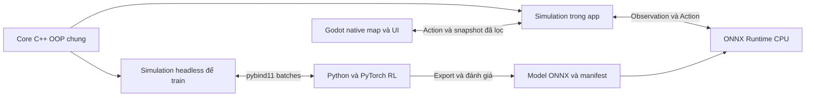

# Đại Bàn Cờ Vương Quyền — Implementation Plan

**Phiên bản:** 3.0 · 14/10/2026  
**Vai trò tài liệu:** Đặc tả sản phẩm và roadmap M0–M7. Đây là mục tiêu thiết kế, không phải bảng trạng thái triển khai. Trạng thái mã hiện tại nằm trong [WORK_STATUS.md](../WORK_STATUS.md); bằng chứng và các gate M3 nằm trong [M3-evidence.md](M3-evidence.md).
**Thể loại:** Mô phỏng cai trị, chính trị–kinh tế; thời gian thực có tạm dừng.  
**Sản phẩm đích:** App game desktop native cho Windows/Linux, RAM 16 GB, suy luận RL bằng CPU.  
**Phạm vi bản hoàn chỉnh đầu tiên:** Một quốc gia, 24 lãnh địa chư hầu, đất triều đình, một đời vua; quy mô đa thực thể có cổng kiểm chứng.

**Nguồn:** File `implementation_plan.md` bản 2.1 người dùng vừa gửi. Bản này thay thế hướng kế hoạch trước đó về game 4–6 vùng. Tài liệu đính kèm là nguồn thiết kế để sửa; các tuyên bố “đã chọn” trong nguồn không tự trở thành phê duyệt mới. Các yêu cầu trong tin nhắn hiện tại và câu trả lời của người dùng được ưu tiên.

Roadmap này vẫn là phạm vi đích của sản phẩm. Repo hiện đã có sandbox M3 và checkpoint/runtime RL; điều đó không có nghĩa mọi gate chất lượng RL hoặc campaign hoàn chỉnh đã đạt. Xem WORK_STATUS và báo cáo M3 để phân biệt phần đã làm với phần còn thiếu.

---

## 1. Tầm nhìn, yêu cầu và hướng thiết kế

Người chơi cai trị một quốc gia ở giai đoạn thương nghiệp phát triển: nông nghiệp nuôi phần lớn dân số, trong khi thương hội, tín dụng, xưởng thủ công và thương mại đường dài làm thay đổi cán cân quyền lực.

Trọng tâm là phát triển đất nước trong điều kiện quyền lực phân tán. Nhà vua phải hiểu tình hình, thương lượng, giao thực hiện và xử lý hệ quả. Các lãnh chúa và thuộc hạ tự có mục tiêu, nguồn lực và chính trị nội bộ; họ không đứng yên chờ người chơi.

### 1.1 Yêu cầu hiện tại và thiết kế kế thừa

| Nội dung | Quyết định |
|---|---|
| Sản phẩm — yêu cầu hiện tại | App game desktop cài và chạy trực tiếp, không phát hành dưới dạng web game |
| Máy đích — người dùng đã trả lời | Windows/Linux, RAM 16 GB, RL chạy bằng CPU; không yêu cầu GPU rời cho suy luận |
| Kiến trúc — yêu cầu hiện tại | OOP; ngôn ngữ C++/Python/TypeScript đều được. Mặc định đề xuất C++ cho game core, Python cho training |
| Hành vi NPC — yêu cầu hiện tại | Mạng học bằng RL chọn hành động; không dùng cây if/else hoặc utility viết tay để chọn chiến lược NPC trong sản phẩm |
| Sự kiện — yêu cầu hiện tại | Đa dạng, hình thành từ tương tác và biến động thế giới; không có lịch khủng hoảng hoặc chuỗi tình tiết định sẵn |
| Bản đồ — yêu cầu hiện tại | Dễ đọc, có địa hình/địa lí rõ, chọn/pan/zoom/layer/route hoạt động tốt; không chỉ là sơ đồ nút |
| Quy mô — người dùng đã làm rõ | Nhân vật chủ chốt bắt buộc ra quyết định cụ thể; thường dân và trẻ em cũng cần hành vi không định trước. Ý tưởng hàng triệu cá thể dạng ma trận cần kiểm chứng tính khả thi |
| Thể chế | Pha trộn đất triều đình, chư hầu thế tập và thành thị có đặc quyền |
| Mức can thiệp | Cai trị qua chư hầu; có thể thanh tra, phân xử và can thiệp xuống cấp dưới |
| Thời gian | Thời gian thực có tạm dừng và tăng tốc; hạn xử lý theo lịch trong game |
| Bối cảnh kinh tế | Nông nghiệp kết hợp thương nghiệp, tín dụng và thủ công nghiệp phát triển |
| Chiến dịch | Một đời vua; kết thúc khi chết, bị phế hoặc mất quyền cai trị |
| Thông tin | Sổ sách đáng tin cậy; động cơ, thái độ đối địch, âm mưu và bí mật quý tộc cần điều tra |
| Bản đồ | Thiết kế cố định trước; kiến trúc cho phép bổ sung bản đồ theo seed sau |
| Chủ thể kinh tế | Hộ dân, địa chủ, thương hội, chủ xưởng và chư hầu tự kinh doanh; vua định hướng |
| Đặc sản | Có nền tảng tự nhiên và năng lực tích lũy; có thể chuyển đổi theo thời gian |
| Quy mô mong muốn | 20–30 lãnh địa chư hầu khác biệt; kế hoạch này chọn 24 |
| Yếu tố game | Bổ sung draft augment khởi đầu và chỉ số nhân vật chủ chốt |
| Hướng AI NPC | RL là tiêu chí bắt buộc của bản hoàn chỉnh; Intelligence tạo khác biệt năng lực suy xét cần được đo, không chỉ khác hệ số thưởng |

### 1.2 Mặc định triển khai của bản kế hoạch

Các thông số dưới đây là lựa chọn thiết kế để triển khai, có thể điều chỉnh sau thử nghiệm: 24 chư hầu và 3 khu triều đình; 16 nhóm hàng; một ngày là bước mô phỏng; 4 nhóm quyền lực lớn mỗi lãnh địa nhưng có nhiều thành viên, tổ chức và đối tác; 6 vùng trong bản thử cơ chế. Tên vùng, số dân, diện tích, tốc độ và hệ số là dữ liệu giả tưởng phục vụ cân bằng.

Giao diện chính là bản đồ địa lí tự nhiên và bảng điều hành dễ đọc. CRT chỉ là một lựa chọn phong cách cho bảng/console; không phủ scanline hoặc bảng màu đơn sắc lên bản đồ địa hình mặc định. Chuột, bàn phím và command console thực hiện cùng Action; không bắt người chơi nhớ lệnh.

Bản 3.0 dùng **RL huấn luyện offline, chạy suy luận native trong game** cho các bên tự ra quyết định, kể cả đại diện hộ dân tổng hợp. Trọng số được chia sẻ theo nhóm vai trò; mỗi NPC có mục tiêu, quan hệ, thông tin và recurrent memory riêng. Không huấn luyện lại mạng trong mỗi save. Physics, hạch toán, quyền pháp lí và thi hành lệnh vẫn là luật engine; phần chọn hành động tự chủ thuộc policy. Model chưa đạt cổng đánh giá đồng nghĩa phần NPC RL chưa hoàn thành.

Stack đề xuất: **Godot 4.x native + C++20 OOP simulation core + ONNX Runtime CPU + Python/PyTorch training qua pybind11**. Chỉ khóa minor version và model architecture sau spike tương thích native ở giai đoạn 0. Mục 20 chuyển ý tưởng ma trận thành dữ liệu cá thể liên tục và đồ thị quan hệ thưa. Mốc đề xuất cho bản đầu là 100.000 cá thể thường dân/trẻ em; một triệu là mục tiêu mở rộng cần đo, không phải giới hạn đã được người dùng phê duyệt hay kết quả đã đạt.

### 1.3 Nguyên tắc thiết kế

1. Kết quả phải có nguyên nhân: nguồn lực, quyền lợi, năng lực, thông tin và quyết định.
2. Phát triển thay đổi phân phối quyền lực: người hưởng lợi có thêm khả năng gây sức ép.
3. Cấp dưới có tính chủ động và giới hạn thực tế; không tuân lệnh chỉ vì một chỉ số trung thành cao.
4. Chính sách phải đi qua quyền hạn, tài trợ, thi hành và thời gian; không biến thành hiệu ứng tức thì.
5. Sổ sách và lịch sử hành động giúp người chơi kiểm chứng; động cơ kín vẫn cần điều tra.
6. Mô phỏng dùng luật xác định và ngẫu nhiên có seed; không phụ thuộc LLM để vận hành.
7. Chiều sâu đến từ liên kết giữa hệ thống, không từ số lượng cảnh báo hay thao tác lặp lại.
8. Hành vi tự chủ do learned policy; engine chỉ giới hạn khả năng và thực hiện hành động, không bí mật chọn giúp NPC.
9. Mỗi nhân vật được mô phỏng riêng có ID, trạng thái và quá trình sống: sinh ra, lớn lên, học/làm việc, thay đổi quan hệ và qua đời. Quyết định của họ phải có hậu quả với bản thân hoặc các bên khác. Ví dụ một người chuyển việc làm thay đổi lao động và thu nhập của gia đình/xưởng. Một người xuất hiện trên bản đồ, trong hồ sơ và trong nhật ký vẫn chỉ là một người; pixel, điểm dựng hình và dòng nhật ký không phải NPC mới.
10. Sự kiện có nguyên nhân lưu được; cùng seed trên runtime tương thích có thể tái hiện mà vẫn là gameplay phát sinh, không phải cốt truyện định trước.

## 2. Vòng lặp chơi và mục tiêu một đời vua

### 2.1 Vòng lặp chính

**Quan sát → xác định vấn đề → thương lượng → ban hành và giao thực hiện → theo dõi → điều chỉnh.**

Ví dụ: giá gạo tăng tại vùng mỏ → xác định mất mùa hay tắc vận tải → thương lượng mở tuyến và mua dự trữ → giao quan phụ trách → theo dõi giá, kho, tiến độ → giải quyết phe mất phí đường hoặc lao động rời ruộng.

Ba khoảng thời gian cùng tồn tại:

- **Ngày–tuần:** tiếp kiến, báo cáo, thời hạn, sự cố và điều tra.
- **Tháng–mùa:** thuế, chi tiêu, sản xuất, buôn bán, đầu tư và thương lượng địa phương.
- **Năm:** dân số, kỹ năng, chuyển dịch ngành, công trình lớn, thể chế và di sản.

### 2.2 Mục tiêu và kết thúc

Không có một chỉ số duy nhất đại diện cho cai trị tốt. Báo cáo cuối đời vua đánh giá riêng:

- Thời gian và mức độ ổn định của triều đại.
- Đời sống dân cư: nhu cầu thiết yếu, tử vong, thu nhập thực, bất bình đẳng giữa vùng.
- Năng lực đất nước: sản xuất, thương mại, công trình và kỹ năng.
- Tài chính: nợ, khả năng trả nghĩa vụ, dự trữ và sức chịu khủng hoảng.
- Thể chế: khả năng thi hành luật, uy tín cam kết và quan hệ trung ương–địa phương.
- Cái giá chính trị: đàn áp, xung đột, mất đất, đặc quyền và lệ thuộc được để lại.

Chiến dịch kết thúc khi vua chết, bị phế thành công hoặc không còn giữ chính quyền trung ương sau xung đột. Khủng hoảng hay một chư hầu ly khai không tự động kết thúc game. Người kế vị có thể tồn tại như một nhân tố chính trị nhưng không mở chiến dịch đời tiếp theo.

Vua bắt đầu ở tuổi 30; tuổi thọ không cố định. Sức khỏe có nguy cơ theo tuổi, bệnh và điều kiện sống; không dùng sự kiện chết ngẫu nhiên không báo hiệu để thay thế gameplay. Bệnh nghiêm trọng có diễn tiến và lựa chọn xử lý. Khi kết thúc, hiển thị chuỗi nguyên nhân cùng dòng thời gian các quyết định quan trọng.

## 3. Bản đồ quốc gia và 24 lãnh địa

### 3.1 Cấu trúc bản đồ

24 lãnh địa chư hầu thuộc 6 cụm địa lý; thêm 3 khu đất triều đình. Thành thị đặc quyền là đơn vị lồng trong một lãnh địa hoặc khu triều đình, không được tính thêm vào tổng số lãnh địa.

Bản đồ kinh tế là đồ thị: nút là thủ phủ, thành phố hoặc điểm giao thương; cạnh là đường bộ, sông hoặc tuyến ven biển. Mỗi cạnh có chiều dài, thời gian đi, công suất, chi phí, an toàn, chủ quyền và phí đường. Không mặc định rằng hai vùng sát nhau có tuyến thương mại tốt.

### 3.2 Danh mục thiết kế ban đầu

Đơn vị dân số: nghìn người; diện tích: km². Đặc sản là sản phẩm danh tiếng ánh xạ vào nhóm hàng chung, không bảo đảm độc quyền.

| ID | Lãnh địa / cụm | Dân | Diện tích | Đặc sản | Lợi thế và nút thắt |
|---|---|---:|---:|---|---|
| L01 | Thanh Điền / lưu vực | 420 | 8.000 | Gạo nước | Đất màu, sông lớn; lũ và quyền thủy lợi tập trung |
| L02 | Liên Trạch / lưu vực | 210 | 5.000 | Cá khô | Đầm hồ, vận tải thủy; bệnh và thiếu đất khô |
| L03 | Phù Sa / lưu vực | 310 | 7.000 | Dầu hạt | Ruộng luân canh, gần chợ; phụ thuộc đê điều |
| L04 | Đông Viên / lưu vực | 260 | 6.000 | Vải gai | Đông dân, vùng nguyên liệu; năng suất ruộng thấp |
| L05 | Bạch Khâu / cao nguyên | 150 | 14.000 | Len trắng | Đồng cỏ; thiếu gạo và thợ dệt |
| L06 | Hắc Sơn / cao nguyên | 110 | 11.000 | Sắt rèn | Quặng tốt; đường đèo, nhập lương thực |
| L07 | Tùng Lĩnh / cao nguyên | 95 | 13.000 | Gỗ đóng tàu | Rừng, sông thả gỗ; tái sinh rừng chậm |
| L08 | Xích Nham / cao nguyên | 80 | 9.000 | Đồng thỏi | Mỏ đồng; cần nhiên liệu và vốn |
| L09 | Nam Cảng / duyên hải | 280 | 3.000 | Muối biển | Cảng lớn; phụ thuộc gạo nhập và an ninh biển |
| L10 | Hải Châu / duyên hải | 190 | 4.000 | Tàu đi biển | Thợ tàu, bến sâu; cần gỗ, sắt, vải buồm |
| L11 | Bạch Sa / duyên hải | 130 | 4.500 | Thủy tinh | Cát và thương nhân; tiêu hao nhiên liệu |
| L12 | Trầm Hải / duyên hải | 120 | 6.000 | Trầm hương | Rừng đặc hữu, hàng giá trị cao; cầu xa xỉ biến động |
| L13 | Vân Lụa / đông lộ | 240 | 6.000 | Lụa nhuộm | Thợ và mạng khách hàng; thương hội hạn chế gia nhập |
| L14 | Cẩm Giang / đông lộ | 230 | 5.500 | Giấy tốt | Sông, kỹ năng; tranh nước với ruộng và xưởng |
| L15 | Hồng Diệp / đông lộ | 160 | 8.000 | Trà | Khí hậu, thương hiệu; mùa vụ và phí đường |
| L16 | Bích Lò / đông lộ | 200 | 5.000 | Đồ sứ | Đất sét, thợ lò; cần nhiên liệu và vận tải ít hư hao |
| L17 | Bắc Mã / biên bắc | 90 | 20.000 | Ngựa chiến | Đồng cỏ, quân sự; dân thưa, phòng thủ đắt |
| L18 | Phong Ải / biên bắc | 120 | 15.000 | Da thuộc | Đàn gia súc, cửa ải; nguy cơ giao thương bị đóng |
| L19 | Hoàng Nguyên / biên bắc | 170 | 18.000 | Lúa mạch | Ruộng rộng; khô hạn và xa thị trường |
| L20 | Thiết Quan / biên bắc | 140 | 10.000 | Binh khí | Thợ quân giới, vị trí phòng thủ; lệ thuộc sắt và đơn đặt hàng |
| L21 | Dược Cốc / tây lộ | 100 | 9.000 | Dược liệu | Khí hậu đa dạng; khó tiếp cận, chất lượng không đồng đều |
| L22 | Lâm Mật / tây lộ | 115 | 10.000 | Sáp ong | Rừng và sản phẩm phụ; quyền sử dụng rừng tranh chấp |
| L23 | Thạch Kiều / tây lộ | 180 | 7.000 | Đá xây | Mỏ và nút giao; hàng nặng, phụ thuộc công trình |
| L24 | Ngân Khê / tây lộ | 85 | 8.000 | Bạc | Khoáng sản giá trị cao; dễ lệ thuộc thu nhập mỏ |

Ba khu triều đình: **Kinh Kỳ** (hành chính và tiêu dùng), **Hoàng Điền** (ruộng, kho dự trữ), **Trực Lộ** (hậu cần và xưởng nhà nước). Dân số và sản xuất của ba khu nằm trong tổng quốc gia, hạch toán riêng với chư hầu.

### 3.3 Các tuyến bắt buộc trong bản đồ đầu tiên

- Sông lớn: Thanh Điền → Phù Sa → Liên Trạch → Nam Cảng; có giới hạn công suất theo mùa.
- Tuyến đường cần cải thiện: Hắc Sơn → Bạch Khâu → Thanh Điền; nối ra Nam Cảng bằng sông.
- Tuyến ven biển: Nam Cảng ↔ Hải Châu ↔ Bạch Sa ↔ Trầm Hải.
- Tuyến đông: Thanh Điền ↔ Đông Viên ↔ Vân Lụa ↔ Cẩm Giang ↔ Hồng Diệp ↔ Bích Lò ↔ Hải Châu.
- Tuyến bắc: Bạch Khâu ↔ Bắc Mã ↔ Phong Ải ↔ Hoàng Nguyên ↔ Thiết Quan ↔ Hắc Sơn.
- Tuyến tây: Hắc Sơn ↔ Tùng Lĩnh ↔ Xích Nham ↔ Ngân Khê ↔ Thạch Kiều ↔ Dược Cốc ↔ Lâm Mật ↔ Phù Sa.
- Kinh Kỳ nối Thanh Điền và Trực Lộ; Hoàng Điền nối Thanh Điền và Phù Sa; Trực Lộ nối Thiết Quan.

Đây là mạng kết nối tối thiểu; chỉ bổ sung cạnh nếu có vai trò kinh tế hoặc chiến lược rõ ràng. Tọa độ, khoảng cách và sức tải được lưu trong dữ liệu bản đồ, không viết cứng trong luật kinh tế.

### 3.4 Những thuộc tính tạo khác biệt

Mỗi vùng có diện tích sử dụng được, sức chứa canh tác, nước, rừng, mỏ, năng suất nền, cơ cấu dân cư, kỹ năng, tài sản sản xuất, kho, đường, thị trường, nghĩa vụ phong kiến và cơ cấu quyền lực. Diện tích lớn không tự động tạo thu nhập lớn. Lợi thế địa lý chỉ có giá trị khi có nhân lực, vốn và kết nối để khai thác.

### 3.5 Bản đồ có địa lí thật trong thế giới giả tưởng

Phạm vi bản đầu là atlas 2D có địa hình và chiều sâu thị giác, không phải địa cầu 3D hoặc bản đồ Trái Đất chính xác. Mục tiêu là người chơi nhận ra núi, lưu vực, đồng bằng, rừng, đầm, bờ biển, cửa sông và vùng khô khi nhìn bản đồ; các đặc điểm đó có tác dụng trong mô phỏng.

- Dữ liệu nền gồm heightfield, độ dốc, biome, đất/nước, lưu vực, tài nguyên và polygon lãnh địa; tọa độ thế giới thống nhất theo km.
- Bản đồ 24 vùng vẫn được thiết kế thủ công để kiểm soát chất lượng. Seed thay mùa vụ/nhân vật/biến động, không tự đổi địa hình bản đồ này. Procedural map là mở rộng riêng.
- Dãy cao nguyên và biên bắc tạo địa hình cao; lưu vực có đồng bằng phù sa; duyên hải có cảng, vịnh và đầm; tây lộ có rừng/đèo. Không dán icon núi lên một nền phẳng rồi coi là đã mô phỏng địa lí.
- Sông theo lưu vực, đổ từ cao xuống thấp về hồ/cửa biển; trường hợp hồ hoặc đoạn thủy lợi có quy tắc rõ. Đường đi qua núi cần đèo, qua sông cần cầu/bến, không kéo thẳng qua mọi terrain.
- Terrain ảnh hưởng chi phí, thời gian, công suất vận tải, sản lượng phù hợp, dòng nước, bệnh và tiếp vận. Biên giới hành chính không tự chặn dòng sông.
- Tuyến thủy có chiều đi/ngược dòng và biến thiên mùa; cảng phụ thuộc chiều sâu/khả năng cập bến ở mức mô phỏng đơn giản. Không cần mô phỏng thủy động lực đầy đủ.
- Asset terrain, coastline và shader hillshade được đóng gói local, có nguồn/giấy phép rõ; game không tải map từ API lúc chơi.

### 3.6 Render, zoom và tương tác

Godot Node2D/Camera2D với terrain chunks, texture nền, polygon picking và layer đường/sông. Bắt đầu heightfield khoảng 2.048×2.048 samples; độ phân giải này phục vụ render/geography, **không được cộng vào số thực thể xã hội**. Độ phân giải cuối được chọn theo chất lượng và GPU tích hợp.

| Mức zoom | Nội dung chính | Thao tác |
|---|---|---|
| Quốc gia | Địa hình lớn, lãnh địa, thành phố, cảnh báo quan trọng | Chọn vùng, xem tuyến liên vùng, so sánh overlay |
| Vùng | Đèo/sông/đường, khu sản xuất, thành thị, công trình | Chọn facility/project, xem luồng hàng và quyền thu phí |
| Địa phương | Điểm dân cư, cụm hộ, lô hàng và người đang được theo dõi | Inspect/search cá thể, gia đình, hợp đồng, không bắt render mọi dân cư |

Pan/zoom liên tục, zoom giữ điểm dưới con trỏ; label không chồng lên nhau ở mức toàn quốc. Picking dùng world coordinate và spatial index, không thử mọi polygon/entity mỗi frame. Tooltip hiển thị vị trí, địa hình và dữ liệu đã biết với ngày cập nhật.

Overlay: địa hình, độ phì/nước, dân số, hàng hóa/giá, trade capacity, thẩm quyền, quyền lực và rủi ro. Mặc định một heatmap chính với legend + tuyến đang chọn; dùng pattern/nhãn hỗ trợ người khó phân biệt màu. Flow được tổng hợp khi zoom xa, chi tiết hóa khi zoom gần.

Chọn hai điểm để xem tuyến/cost/time/capacity; khi đề xuất đường/cầu, UI preview đoạn địa hình, quyền đất và vật tư trước khi tạo Project. Công cụ này không tự cấp quyền, tạo đường tức thì hoặc ưu tiên tuyến của vua vượt luật.

### 3.7 Mức chi tiết và thông tin bí mật

- Triệu người mô phỏng không đồng nghĩa triệu sprite/scene node. Vẽ density, cụm và icon đại diện ở xa; chỉ dựng visual cho đối tượng cần xem.
- Tên/chi tiết thường dân sinh khi inspect theo ID, không lưu một triệu chuỗi dài. Người được bookmark hoặc liên quan vụ việc giữ tên đã sinh.
- Vị trí và dòng hàng bí mật lọc qua PlayerKnowledge trước khi tạo overlay. Minimap, heatmap và tooltip không được rò plot vì render đọc world thật.
- Simulation fidelity không đổi khi camera rời vùng: người ở ngoài viewport vẫn có trạng thái và lịch quyết định. LOD ở đây là đồ họa, không thay họ bằng AI khác.

### 3.8 Gate bản đồ

Bộ dữ liệu kiểm thử chuẩn (fixture) là một trạng thái nhỏ được chuẩn bị sẵn để kiểm tra một chức năng, không phải diễn tiến định sẵn của campaign. Ví dụ hai vùng nối bằng một cây cầu, có một đoàn hàng đang đi; đóng cầu để kiểm tra đoàn hàng không đi xuyên qua và tuyến thay thế có chi phí đúng. Dùng các bộ tương tự để kiểm tra liên thông, sông/lưu vực, cầu/cảng và tác động của terrain. Native UI kiểm tra chọn đúng vùng sau pan/zoom, tìm cá thể, mở hồ sơ, overlay/legend và route preview. Người thử phải phân biệt được vùng mỏ, lưu vực, cảng và biên ải mà không đọc bảng ID. Bản đồ đẹp nhưng route/địa hình không ảnh hưởng mô phỏng chưa đạt yêu cầu.

## 4. Chính trị nhiều tầng

### 4.1 Các tầng mô phỏng

| Tầng | Chủ thể | Vấn đề tự xử lý |
|---|---|---|
| Trung ương | Vua, hội đồng triều đình, đại thần | Ngân sách, luật, nghĩa vụ, an ninh, dự án liên vùng |
| Lãnh địa | Lãnh chúa và bộ máy địa phương | Thu–chi, duy trì liên minh, thi hành, đầu tư, tranh chấp |
| Quyền lực địa phương | Gia tộc, thương hội, chủ mỏ/xưởng, quân sự, cộng đồng | Lợi ích tài sản, lao động, quyền hạn, hợp tác hoặc phản đối |
| Dân cư | Các nhóm hộ và nghề nghiệp | Tiêu dùng, làm việc, chuyển nghề, di cư, phản ứng tập thể |

Mỗi lãnh địa có 4 khối quyền lực lớn tại khởi đầu, chọn theo kinh tế địa phương; mỗi khối có một đại diện chính để người chơi theo dõi. Đây là lớp tổng hợp UI, không phải giới hạn chỉ 4 AI/vùng. Bên dưới có gia tộc, thương nhân, chủ xưởng, người cho vay, viên chức, chỉ huy và cá thể dân cư tự hành động. Có thể thêm tối đa 2 khối lớn nổi bật khi nền kinh tế đổi; thành viên có vòng đời độc lập. Household/Cohort là đơn vị gia đình hoặc tổng hợp dữ liệu, không thay thế danh tính các cá thể đã được mô phỏng riêng. Quy mô chi tiết ở mục 20.

### 4.2 Nhân vật và khả năng thi hành

Nhân vật có năng lực, tài sản hoặc quyền tiếp cận nguồn lực, chức vụ, quan hệ, mục tiêu, tính cách, danh tiếng, sức khỏe và hiểu biết riêng. Tách riêng:

- **Thiện chí:** có muốn giúp người ra lệnh không?
- **Lợi ích:** quyết định có lợi hoặc gây hại cho bản thân và liên minh không?
- **Khả năng:** có tiền, người, thẩm quyền và sự hợp tác cần thiết không?
- **Rủi ro:** hậu quả của tuân lệnh, trì hoãn hoặc chống đối là gì?

Không tồn tại trung thành tuyệt đối nhờ quê hương, học bổng hay huyết thống. Quan hệ tốt làm hợp tác dễ hơn nhưng không loại bỏ xung đột lợi ích.

### 4.3 Quyền hạn và nghĩa vụ

Mỗi lãnh địa có một hiệp ước nghĩa vụ xác định thuế/cống nộp, quân dịch, quyền bổ nhiệm, quyền thu phí và quyền kháng nghị. Thành thị đặc quyền có hiến chương phân chia quyền giữa hội đồng, lãnh chúa và vua.

Trên đất triều đình, vua quyết định thuế và nhân sự qua bộ máy của mình. Với chư hầu, vua yêu cầu hoặc thương lượng thay đổi nghĩa vụ; không có lệnh tăng thuế trực tiếp mọi hộ dân mà bỏ qua quyền địa phương. Trong tình trạng khẩn cấp, trưng thu vượt lệ có thể được ban hành, nhưng phải mô phỏng khả năng thi hành, phản đối và tiền lệ tạo ra.

Một vụ can thiệp tạo hồ sơ gồm căn cứ, phạm vi, người thi hành, thời hạn và kết quả. Tiền lệ ảnh hưởng kỳ vọng về những lần sau; không tự biến thành luật toàn quốc nếu chưa được ban hành.

### 4.4 Bộ hành động của NPC

Theo lịch của vai trò và khi có thông tin cần phản ứng, NPC cân nhắc các hành động hợp lệ: thương lượng, góp vốn, chi trả, trì hoãn, kiến nghị, kiện cáo, vận động liên minh, bảo trợ, giảm hợp tác và chống đối. Hành động bí mật gồm gặp gỡ, thỏa thuận kín, tài trợ phe hoặc chuẩn bị nổi loạn. Mỗi loại có nguồn lực và thời gian thi hành, không có nút tự sinh quân hoặc tự đạt đồng thuận.

Trong kiến trúc đích, policy RL đã huấn luyện chọn hành động dựa trên thông tin, ký ức, chỉ số, tính cách và mục tiêu của chính NPC. Engine chỉ sinh hành động khả dụng và thực hiện luật; không viết các nhánh chiến lược như “bất mãn trên 70 thì phản loạn”. Một bộ AI chấm điểm thủ công chỉ dùng làm baseline kiểm thử và đối thủ huấn luyện, không được quảng bá là RL. Mọi hành động phải tiêu tốn nguồn lực hoặc có điều kiện; NPC không được tự sinh tiền, quân hay bằng chứng. Thiết kế kỹ thuật đầy đủ ở mục 17.

Phần lớn việc địa phương tự kết thúc mà không cần vua. Chỉ đưa lên triều đình khi vượt thẩm quyền, cần trọng tài, ảnh hưởng nghĩa vụ hoặc có hậu quả liên vùng. Người chơi có thể mở hồ sơ xem quá trình bất kỳ lúc nào.

### 4.5 Liên minh, cam kết và ân huệ

Liên minh là tập hợp quan hệ và cam kết, không phải một thanh trung thành chung. Ân huệ có bên nợ, bên nhận, nguồn gốc, mức độ và điều kiện trả. Góp tiền tổ chức lễ hội không mặc định tạo một ân huệ nếu chưa có thỏa thuận.

Phản ứng khi thất hứa phụ thuộc thiệt hại, lý do, tiền lệ, bằng chứng và lựa chọn thay thế. Không dùng mức phạt cố định như giảm 40 trung thành. Danh tiếng giữ lời tác động tới chi phí vay, khả năng thương lượng và mức bảo đảm đối tác đòi hỏi.

### 4.6 Xung đột và thay thế quyền lực

Phản đối có nấc: kiến nghị → giảm hợp tác → liên minh gây sức ép → cưỡng chế hoặc nổi loạn. Không bắt buộc đi hết mọi nấc; một âm mưu có thể phát triển bí mật nhưng phải có người, nguồn lực và điều kiện.

Loại bỏ một lãnh chúa không tự chuyển toàn bộ đất, quân và sự ủng hộ cho vua. Phải giải quyết người kế nhiệm, quyền thừa kế, nhóm đang kiểm soát bộ máy và phản ứng của các chư hầu khác. Đảo chính là cuộc tranh quyền với lực lượng và liên minh thực tế, không chỉ một phép thử xác suất từ chỉ số bất mãn.

## 5. Sổ sách, thông tin và điều tra

### 5.1 Quy tắc thông tin

Các giao dịch thuộc sổ sách đã xác nhận là đáng tin cậy và không bị NPC tùy ý sửa lại. Báo cáo có ngày cập nhật, phạm vi, nguồn và độ trễ. Bản đầu không triển khai giả mạo kế toán; điều này giữ nền kinh tế có thể kiểm chứng.

Sổ sách công khai cho biết thu–chi công, nghĩa vụ, khoản đã nộp, kho công và tiến độ nghiệm thu. Tài sản tư nhân và hoạt động phi pháp không mặc định nằm trong sổ công. Thống kê toàn vùng như dân số hoặc sản lượng phi chính thức được ghi là ước tính; không trình bày như số kiểm toán chính xác.

Một khoản thất thoát đã được phát hiện vẫn là sự thật; người hưởng lợi hoặc động cơ có thể chưa rõ. Hệ thống bí mật không được thay đổi giao dịch quá khứ để hợp thức hóa tình tiết.

### 5.2 Dữ liệu người chơi được xem

| Loại | Ví dụ | Cách hiển thị |
|---|---|---|
| Đã xác nhận | Khoản nộp thuế, hợp đồng, chức vụ | Giá trị, nguồn và ngày cập nhật |
| Ước tính | Sản lượng chưa báo cáo đủ, lực lượng chưa kiểm kê | Khoảng ước tính và căn cứ |
| Hành vi công khai | Kiến nghị, bỏ phiếu, đóng cửa chợ | Sự kiện đã quan sát |
| Nghi vấn | Gặp đối thủ, mua lương thực bất thường | Dấu hiệu, giả thuyết, chưa kết luận |
| Bằng chứng bí mật | Thư, thỏa thuận, lời khai đã đối chiếu | Nội dung, nguồn, độ tin cậy và giới hạn |

### 5.3 Điều tra

Người chơi chọn đối tượng, vấn đề cần xác minh, người phụ trách và ngân sách. Phương thức gồm thanh tra, đối chiếu hồ sơ, tiếp kiến, thu thập tin từ thương nhân và theo dõi quan hệ.

Điều tra có thời gian, chi phí, khả năng bị phát hiện và xung đột lợi ích của người thực hiện. Kết quả là bằng chứng về một hành động hoặc mối quan hệ; không mở khóa toàn bộ suy nghĩ của nhân vật. Kết quả không tìm thấy bằng chứng phải phân biệt với đã chứng minh vô tội.

NPC có sổ hiểu biết riêng và có thể bị đánh lừa bởi lời cáo buộc. Giao diện chỉ lấy dữ liệu từ lớp thông tin của người chơi; trạng thái bí mật thật chỉ xuất hiện trong công cụ phát triển và kiểm thử.

## 6. Kinh tế, sản xuất và thương mại

### 6.1 Đơn vị và các chủ thể

Mỗi nhóm kinh tế có ngân quỹ, tài sản, lao động, hàng tồn, nợ và quyền sử dụng đất/tài nguyên. Tách riêng tiền triều đình, tiền chính quyền lãnh địa và tài sản tư của nhà vua, lãnh chúa, thương hội. Không coi toàn bộ sản lượng vùng là thu nhập của lãnh chúa.

Dùng đơn vị kế toán **đồng bạc** với số nguyên theo đơn vị nhỏ nhất; hàng hóa có đơn vị chuẩn riêng. Bạc khai mỏ thuộc hàng kim loại, không tự tạo tiền. Bản đầu giả định chế độ tiền ổn định; không triển khai đúc tiền, phá giá hay ngân hàng tạo tiền. Tín dụng là chuyển tiền có thật từ người cho vay sang người vay.

### 6.2 Mười sáu nhóm hàng

1. Lương thực khô; 2. Thực phẩm bổ sung; 3. Muối; 4. Gỗ; 5. Nhiên liệu; 6. Sắt; 7. Kim loại màu/quý; 8. Xơ sợi; 9. Vải; 10. Gia súc/ngựa; 11. Công cụ; 12. Quân nhu/vũ khí; 13. Vật liệu xây dựng; 14. Giấy; 15. Dược liệu; 16. Hàng xa xỉ.

Mỗi nhóm có thể có biến thể chất lượng hoặc công dụng. Ngựa chiến và gia súc thường không thay thế nhau trong quân dịch; sắt và đồng không thay thế tùy ý trong công thức. Các công thức chỉ nhận biến thể hợp lệ. Tàu là tài sản vận tải tạo bằng dự án, không là nhóm hàng tiêu dùng thứ 17.

Đặc sản ánh xạ vào nhóm và biến thể: len → xơ sợi; lụa → vải cao cấp; trà, trầm, thủy tinh trang trí và đồ sứ tốt → hàng xa xỉ. Sáp ong là biến thể nguyên liệu có công dụng xác định. Tên đặc sản giữ bản sắc, nhưng không tạo 24 cơ chế giá riêng không cần thiết.

### 6.3 Sản xuất và nhu cầu

Cơ sở sản xuất thuộc một chủ thể, có ngành, công suất, người làm, kỹ năng, nguyên liệu, tài sản và hao mòn. Sản lượng bị giới hạn bởi yếu tố thiếu nhất:

`sản lượng = công suất hiệu dụng × min(tỷ lệ lao động, tỷ lệ đầu vào, tỷ lệ tài nguyên khả dụng) × hệ số mùa vụ`

Các tỷ lệ bị chặn trong miền hợp lệ; mọi đầu vào được trừ đúng lượng. Nông nghiệp dùng lịch mùa: gieo trồng tạo sản phẩm dở dang, thu hoạch mới nhập kho. Mất mùa tác động đến vụ và kho; không tạo lương thực đều mỗi tháng.

Nhu cầu hộ dân theo quy mô dân số, mức sống và khả năng chi trả. Ưu tiên sinh tồn trước hàng xa xỉ. Tiền công, địa tô, lợi nhuận và thuế xác định phân phối thu nhập. Thiếu lương thực ảnh hưởng sức khỏe và lao động trước khi dẫn tới tử vong hoặc di cư; có cảnh báo và thời gian phản ứng.

### 6.4 Thị trường và giá

Mỗi vùng có chợ, tồn kho và giá theo nhóm hàng. Hộ và tổ chức lập nhu cầu mua trong ngân sách; người bán đưa hàng có thật. Khi thiếu hàng, phân bổ theo các vòng nhu cầu: nghĩa vụ hợp đồng đã bảo đảm bằng hàng, nhu cầu thiết yếu, sau đó nhu cầu còn lại; trong mỗi vòng phân bổ theo lượng đặt mua có khả năng thanh toán. Trưng thu là chính sách riêng, không mặc định mọi nhu cầu triều đình được ưu tiên.

Giá tháng sau điều chỉnh dần theo tỷ lệ cầu chưa đáp ứng và tồn kho so với mục tiêu. Dùng hệ số và biên độ thay đổi cấu hình được; mặc định giới hạn biến động mỗi tháng để tránh vòng lặp số học mất ổn định. Biên độ giá và mọi giới hạn kỹ thuật phải có trong cấu hình cân bằng, không rải trong mã.

Tách giá danh nghĩa và thu nhập thực. Giá tăng không đồng nghĩa quốc gia giàu hơn. Khi hiển thị tăng trưởng, có cả sản lượng thực và khả năng đáp ứng nhu cầu.

### 6.5 Thương mại và vận tải

Thương nhân có thông tin chênh lệch giá, vận tải, phí, hao hụt, thời gian và rủi ro; **policy kinh tế** quyết định có giao dịch, chọn thị trường và mức đặt mua/bán. Engine kiểm tra quyền, tiền, hàng và sức tải rồi thực hiện. Hàng đã mua chuyển sang trạng thái đang vận chuyển; chỉ nhập kho đích khi đến nơi. Giá cuối cùng có thể khác dự báo.

Tuyến có công suất dùng chung; lô hàng không được dùng quá sức tải còn lại. Engine tìm các tuyến khả thi theo mục tiêu dịch vụ mà NPC đã chọn (rẻ/nhanh/an toàn); đây là giải thuật thực hiện lệnh, không thay policy quyết định chiến lược. Đơn đã đặt được phân bổ theo hợp đồng, cơ chế thị trường và khóa phụ ổn định; không xếp ưu tiên bằng một AI lợi nhuận viết tay. Có thể đổi tuyến cho lô chưa khởi hành; lô đang đi chịu quy tắc gián đoạn cụ thể, không dịch chuyển tức thì.

Phí vận tải và cầu đường chuyển cho chủ thể cung cấp dịch vụ/quyền thu phí. Hàng hỏng hoặc bị mất có sự kiện và lượng tổn thất; cướp hàng chuyển sang bên nhận nếu có, không được đồng thời ghi mất và ghi chuyển.

### 6.6 Đầu tư và chuyển đổi đặc sản

Mỗi quý, policy kinh tế chọn mở rộng, lập ngành, thu hẹp, đóng cửa hoặc tiếp tục trên cơ sở lịch sử lợi nhuận, thông tin cầu, đầu vào, nhân lực, vốn, vận tải và chính sách. Mức dự phòng do policy chọn trong miền khả dụng; engine không dùng công thức ROI để tự chọn thay. Dự án chỉ bắt đầu khi có tài trợ thật và điều kiện luật phù hợp.

Mỗi vùng khởi đầu với một đặc sản, 2–3 ngành phụ và 2–3 hướng phát triển có điều kiện. Đây là các cơ hội ưu tiên, không phải cấm phát triển ngành khác nếu đáp ứng điều kiện chung. Công thức dự án quy định đầu vào, thời gian, lao động và năng lực cần thiết.

Ví dụ Bạch Khâu: chăn cừu → xưởng sơ chế len → dệt vải len. Xưởng dệt cần thợ, công cụ, vốn và đường tiêu thụ; có len rẻ là một lợi thế nhưng chưa đủ. Nhà vua có thể hỗ trợ đường, đào tạo, hợp đồng mua hoặc sửa thuế, không bấm một nút đổi đặc sản.

Danh tiếng đặc sản dùng cửa sổ 5 năm về sản lượng bán ra, chất lượng và thị phần; cập nhật hàng năm. Chỉ đổi khi ngành mới dẫn trước bền vững trong 3 lần đánh giá năm. Hai nhãn có thể tồn tại trong giai đoạn chuyển tiếp để tránh thay đổi đột ngột.

### 6.7 Nợ và phá sản

Khoản vay có người cho vay, người vay, gốc, lãi, kỳ hạn, lịch trả và bảo đảm nếu có. Vay mới chuyển tiền; trả gốc giảm cả tiền và nghĩa vụ; lãi là thu nhập của bên cho vay. Vỡ nợ tạo thương lượng gia hạn, chuyển tài sản hoặc phá sản; không xóa nợ miễn phí và không sinh tiền để bù.

Nợ chính quyền có thể tạo sức ép chính trị từ chủ nợ. Nhà vua cứu trợ sẽ chuyển rủi ro sang ngân khố và tạo kỳ vọng cho lần sau. Bản đầu không có thị trường chứng khoán hoặc tài chính phái sinh.

## 7. Phát triển đất nước và chính sách

### 7.1 Dân số, lao động và di cư

Dân cư có hai cách biểu diễn được phân biệt rõ: IndividualCitizen là một người có ID, tuổi, gia đình, nghề, nhu cầu, xu hướng và lịch quyết định riêng; Household/Cohort tổng hợp tiêu dùng, lao động và cư dân chưa được mô phỏng từng người. Những cá thể đã có ID không tiếp tục bị đếm vào dân số cohort nền. Policy thường dân chọn công việc, học tập, kế hoạch chi tiêu, giao tiếp, tham gia nhóm hoặc ý định di cư; quyền, tuổi, tiền và thời gian là ràng buộc thế giới. Trẻ em có tập hành động phù hợp giai đoạn sống và ngân sách gia đình; không sao chép toàn bộ tập hành động tài chính của lãnh chúa.

Nhóm kinh tế thuê lao động từ nguồn lao động có thật; quân dịch và công trường giảm lao động cho sản xuất. Một người không đồng thời được tính đầy đủ ở nhiều ngành. Tăng dân số cập nhật chậm theo sức khỏe và sinh–tử; đầu tư y tế không lập tức tạo lao động trưởng thành.

### 7.2 Các lĩnh vực đầu tư công

| Lĩnh vực | Lợi ích | Ràng buộc và hệ quả chính trị |
|---|---|---|
| Đường, cầu, cảng | Giảm chi phí, tăng sức tải | Mua đất, bảo trì, tranh quyền thu phí |
| Thủy lợi, đê | Tăng ổn định mùa vụ | Quyền dùng nước, bảo dưỡng, lợi ích thượng/hạ lưu |
| Kho dự trữ | Giảm mức độ thiếu hàng khi khủng hoảng | Chi phí tồn kho, hao hụt, tranh quyền phân phối |
| Giáo dục, học nghề | Tăng kỹ năng và năng lực hành chính | Mất thời gian, thay đổi quyền lực người giữ nghề |
| Y tế, nước sạch | Giảm bệnh và gián đoạn lao động | Cần nhân lực, vật tư và ngân sách thường xuyên |
| Tư pháp, hành chính | Hợp đồng đáng tin, thi hành tốt hơn | Đụng đặc quyền, tăng chi bộ máy |

Phát triển công nghệ qua năng lực và dự án tiếp thu: điều kiện kiến thức, nhân lực, vật liệu, thử nghiệm và áp dụng. Tránh cây nâng cấp chỉ cộng phần trăm toàn quốc. Công nghệ đã biết chưa đồng nghĩa mọi vùng đủ sức áp dụng.

### 7.3 Dự án và chính sách là đối tượng có vòng đời

Dự án: đề xuất → thỏa thuận/tài trợ → chuẩn bị → thi công → nghiệm thu → vận hành/bảo trì; có thể đình trệ, sửa phương án hoặc hủy. Chính sách: đề xuất → đạt thẩm quyền/cam kết → ban hành → thực hiện → đánh giá/sửa đổi.

Mỗi đối tượng ghi bên chịu chi phí, bên hưởng quyền, người thi hành, mục tiêu, hạn và nguồn tài trợ. Dự án được cấp đủ tiền nhưng thiếu nhân lực hay quyền sử dụng đất vẫn có thể chậm. Khoản chi đã thực hiện phải có đối ứng; số dư được hoàn lại khi hủy, chi phí chìm không hoàn lại.

### 7.4 Phát triển và quyền lực

Tài sản, thu nhập, việc làm phụ thuộc, chức vụ, tổ chức và quân lực đóng góp các loại sức mạnh khác nhau. Tiền có thể tài trợ vận động nhưng không trực tiếp chuyển thành quyền chỉ huy quân đội. Mỗi loại hành động kiểm tra nguồn lực liên quan.

Cảng mới có thể tăng quyền mặc cả của thương nhân; đường mới giúp triều đình thi hành nhanh hơn; trường học tạo nguồn quan lại ngoài các gia tộc cũ. Không quy định mọi sự phát triển đều có cùng một kết quả chính trị.

## 8. Quốc phòng, ngoại giao và khủng hoảng

Chiến tranh phục vụ mô phỏng nhà nước; bản đầu không có điều khiển chiến thuật từng đơn vị. Quân lực có chủ chỉ huy, nghĩa vụ, quân số, trang bị, tiền lương, lương thực và tuyến tiếp vận. Chư hầu có thể thiếu khả năng huy động dù muốn tuân lệnh; huy động làm giảm lao động và thu nhập địa phương.

Ba thế lực bên ngoài tạo quan hệ giao thương, đe dọa và điều ước. Trong bản đầu, họ là tác nhân kinh tế–ngoại giao tổng hợp có ngân sách, cung/cầu hữu hạn và trạng thái quan hệ; không mô phỏng đầy đủ lãnh địa nội bộ của họ. Ngoại thương phải hạch toán với khu vực bên ngoài, không trở thành nguồn mua vô hạn.

Thời tiết, bệnh, tranh chấp, tắc vận tải và xung đột hình thành từ trạng thái thế giới, hành động NPC và quá trình ngẫu nhiên theo không gian/thời gian. Không có lịch “năm thứ ba bắt buộc nổi loạn” hoặc một quota khủng hoảng phải sinh. Nội dung diễn giải sự kiện đã phát sinh và chuỗi nguyên nhân; không tạo nguyên nhân hồi tố. Khủng hoảng nghiêm trọng có thể tự pause theo thiết lập của người chơi. Kiến trúc sự kiện phát sinh và tiêu chí đa dạng ở mục 21.

Các hành động cưỡng chế như trưng thu, bắt giữ hoặc tước chức cần quyền thực hiện, người thi hành và chi phí. Không có tùy chọn ám sát miễn phí, phát hiện mọi âm mưu hoặc miễn nhiễm đảo chính. Hệ thống ám sát chủ động và chiến tranh chiến thuật nằm ngoài phạm vi bản đầu.

## 9. Giao diện và trải nghiệm chơi

### 9.1 Những màn hình chính

1. **Tổng quan quốc gia:** ngân sách, cung ứng thiết yếu, dự án, nghĩa vụ và tối đa 5 việc cần chú ý nhất.
2. **Bản đồ:** lớp địa lý, sản xuất, giá, thương mại, quyền lực và rủi ro; chọn vùng để mở chi tiết.
3. **Lãnh địa:** sổ sách, kinh tế, người nắm quyền, công việc đang xử lý, thông tin và điều tra.
4. **Triều đình và quan hệ:** chức vụ, cam kết, liên minh, tiếp kiến và vụ phân xử.
5. **Kinh tế quốc gia:** hàng hóa, dòng hàng, vốn, lao động, chênh lệch giá và nợ.
6. **Dự án/chính sách:** phương án, bên liên quan, tài trợ, tiến độ và hậu quả đã quan sát.
7. **Hồ sơ và lịch sử:** báo cáo có nguồn, bằng chứng, giao dịch và chuỗi nguyên nhân.

### 9.2 Trình bày quyết định

Mỗi quyết định cho biết mục tiêu, chi phí biết chắc, điều kiện còn thiếu, bên chịu tác động, thời gian và dự báo có bất định. Cho phép mở chi tiết để hiểu vì sao một dự báo được đưa ra; không hiển thị ý định bí mật làm dữ liệu chắc chắn.

Ví dụ thông báo: “Đường Hắc Sơn chậm hai tháng. Ngân sách đủ; quyền sử dụng đất chưa giải quyết. Lãnh chúa đang thương lượng với gia tộc giữ đèo.” Nút thao tác: xem hồ sơ, tiếp kiến, phân xử, theo dõi. Điều tra chỉ cần thiết khi có vấn đề chưa rõ.

Luồng tin gộp việc thường lệ thành báo cáo tháng. Có bộ lọc quan tâm và đánh dấu lãnh địa theo dõi. Người chơi không phải xử lý mọi tranh chấp; mặc định người có thẩm quyền tiếp tục tự xử lý nếu vua không can thiệp.

### 9.3 Điều khiển và phong cách

- Bản đồ 2D có địa hình và đổ bóng tạo cảm giác chiều sâu; bảng điều hành theo phong cách atlas/lịch sử. CRT xanh/hổ phách/cyan chỉ là theme tùy chọn cho panel/console.
- Pan bằng kéo chuột/nút giữa hoặc WASD; zoom quanh con trỏ bằng wheel; click chọn vùng/đối tượng; ESC bỏ chọn/đóng panel. Có legend, tìm kiếm và nút về thủ đô.
- Chuột và bàn phím thực hiện cùng hành động; CLI là đường thao tác nhanh.
- Phím Space tạm dừng; tốc độ 1×/2×/4×/8×. Mặc định 1× = 1 ngày game/giây thực, điều chỉnh sau kiểm thử.
- Game khởi đầu tạm dừng; tự dừng khi cửa sổ mất focus/thu nhỏ hoặc mở quyết định quan trọng theo thiết lập. Không chạy bù thời gian khi trở lại hoặc máy thức dậy.
- Âm thanh tùy chọn và tắt nhanh; hỗ trợ giảm chuyển động, tương phản và cỡ chữ.

RL chạy bằng CPU không đồng nghĩa đồ họa không dùng GPU tích hợp. Mục tiêu desktop dùng renderer Compatibility của Godot và iGPU hỗ trợ OpenGL phù hợp; không yêu cầu GPU rời, CUDA hay Vulkan làm đường chạy bắt buộc. Cấu hình tham chiếu thực tế phải được ghi trước benchmark.

Lệnh mẫu: `map`, `inspect L06`, `ledger L06`, `market iron`, `petition <id>`, `project <id>`, `investigate <case_id>`, `speed 4`, `pause`, `help`. Mọi lệnh thay đổi trạng thái phải đi qua cùng bộ kiểm tra quyền và điều kiện như giao diện.

### 9.4 Khởi đầu chiến dịch

Hướng dẫn trong game dùng một vụ nộp thuế chậm và một dự án nhỏ để dạy sổ sách, quyền hạn và giao việc. Không bắt đầu bằng nhiều tối hậu thư. Có ba mức hỗ trợ về thông tin/gợi ý và độ khắc nghiệt của điều kiện ban đầu; không cho NPC gian lận tài nguyên ở độ khó cao.

Sau khi xem quốc gia và hồ sơ vua, người chơi draft một augment khởi đầu trong ba lựa chọn cùng cấp sức mạnh. Augment tạo lợi thế, khả năng riêng và các hướng phối hợp với nhân sự/chính sách; không miễn nhiễm phản loạn hoặc tạo trung thành tuyệt đối. Luật draft và danh mục ở mục 15; hồ sơ nhân vật ở mục 16.

### 9.5 Bảng hướng dẫn mở trong lúc chơi — yêu cầu bổ sung của người dùng

Luôn có nút **Hướng dẫn** trên thanh điều khiển và phím **F1** để mở bảng. Người chơi không phải thoát chiến dịch hoặc đọc tài liệu bên ngoài. Bảng có tìm kiếm, mục lục, thuật ngữ dễ hiểu và ví dụ thao tác; hỗ trợ cả chuột lẫn bàn phím. Khi mở toàn bộ bảng, game tự pause; đóng bảng giữ nguyên pause để người chơi chủ động tiếp tục. Trợ giúp nhỏ trong tooltip không tự pause.

| Mục trong bảng | Nội dung và cách dùng |
|---|---|
| Bắt đầu | Mục tiêu đời vua, đọc tổng quan, những việc nên kiểm tra đầu tiên; cho chạy lại tutorial riêng mà không sửa campaign |
| Điều khiển | Pan/zoom/chọn vùng, đổi lớp bản đồ, pause/tốc độ, mở hồ sơ, console và phím tắt |
| Hiểu bản đồ | Địa hình, tuyến, công suất, lớp giá/dân số/quyền lực; legend và ngày cập nhật |
| Kinh tế và sổ sách | Tiền của ai, thu/chi, kho, sản xuất, giá, vận tải, nợ; ví dụ lần theo một khoản thu |
| Cai trị và giao việc | Thẩm quyền, nghĩa vụ, tiếp kiến, thương lượng, dự án và người thi hành |
| Nhân vật và thông tin | Năng lực, tính cách, gia đình, quan hệ; phân biệt sự thật, ước tính, nghi vấn và bằng chứng |
| Xử lý vấn đề | Cách tìm nguyên nhân thiếu hàng, chậm dự án, thiếu tiền, tranh chấp; liệt kê hướng xử lý có điều kiện, không hứa một đáp án luôn đúng |
| Lệnh nhanh | Command có cú pháp, tham số, ví dụ, chi phí/điều kiện và nút mở màn hình liên quan |
| Lưu và kết thúc | Save/load, autosave, tiếp tục, kết thúc chiến dịch và cách đọc di sản |
| Thuật ngữ | Giải thích các từ trong game bằng tiếng Việt; không đưa thuật ngữ phát triển như fixture vào UI người chơi |

Các panel kinh tế, bản đồ, nhân vật và dự án có nút **?** mở đúng mục hướng dẫn; command sai dẫn tới phần cú pháp tương ứng. Bảng giải thích cơ chế công khai nhưng không lộ ý định NPC, bí mật hoặc tương lai chưa xảy ra. Ví dụ giả định được đánh dấu rõ, không giả làm dữ liệu campaign hiện tại.

Nội dung hướng dẫn phải cập nhật cùng phiên bản luật/command. Kiểm thử native: F1/nút mở được trong campaign, focus bàn phím đúng, tìm kiếm và link theo ngữ cảnh hoạt động, clock không tiến khi bảng mở, và đóng bảng không tự resume ngoài ý muốn. Đây là yêu cầu của bản hoàn chỉnh, không chỉ tutorial một lần lúc đầu.

## 10. Kiến trúc triển khai

### 10.1 Nền tảng

**Kiến trúc đích được đề xuất:**

| Thành phần | Công nghệ | Vai trò |
|---|---|---|
| App, map và UI | Godot 4.x desktop native | Scene, camera, render, input, âm thanh, font và export Windows/Linux |
| Simulation core | C++20, OOP; CMake/Ninja | World, economy, politics, dân cư, clock, RNG, command, save |
| Godot adapter | GDExtension C++ + godot-cpp | Kết nối core, snapshot, Action và app lifecycle |
| Inference | ONNX Runtime C++ CPU Execution Provider | Chạy policy offline theo batch; không gọi dịch vụ AI |
| Training | Python, PyTorch, pybind11 | Dùng chính C++ engine qua Python binding; không viết lại luật game |
| Kiểm thử | CTest/Catch2, pytest, Godot integration | Invariant, parity, RL evaluation, native UI và đóng gói |

Ứng dụng phát hành có executable và resource/model cần thiết, mở trực tiếp từ hệ điều hành. Không yêu cầu Node, Python, trình duyệt hoặc web server trên máy người chơi. Python là công cụ phát triển/huấn luyện; Godot UI có thể dùng script mỏng nếu tiện, nhưng luật và chiến lược không được rải vào scene script.

C++ core là library độc lập Godot và ONNX để chạy headless nhanh. `PolicyRuntime` là dependency qua interface; training, inference và replay dùng adapter khác nhau. Chỉ core mutation owner được sửa world. Render và inference có thể làm việc song song trên dữ liệu bất biến; không sửa scene tree từ worker.

So sánh lựa chọn: Python-only giảm thời gian prototype RL nhưng hạn chế throughput và đóng gói khi tiến đến hàng triệu cá thể; TS + Electron tạo app desktop nhưng giữ runtime web và thêm lớp bridge tới engine native. C++ + Godot đòi hỏi quản lí build/plugin nghiêm túc hơn nhưng phù hợp mục tiêu map tương tác và mô phỏng lớn. Đây là đề xuất kiến trúc, không tuyên bố đã benchmark thắng các lựa chọn khác.

Pin cùng minor Godot, godot-cpp, ABI/compiler, ONNX runtime và pybind11 sau spike. Phát hành Windows x86-64 và Linux x86-64 đầu tiên; macOS/mobile nằm ngoài target hiện tại. Gói thử phải chạy trên máy không có môi trường dev.

### 10.2 Các đối tượng dữ liệu cốt lõi

| Đối tượng | Trách nhiệm |
|---|---|
| WorldDefinition | Vùng, tuyến, hiệp ước ban đầu, ngành, hàng và thông số cân bằng |
| GameState | Ngày, thực thể, trạng thái RNG, hàng đợi và phiên bản dữ liệu |
| IndividualCitizen / Household | Danh tính cá thể, tuổi/gia đình/nghề, nhu cầu, quyết định và quyền sở hữu; phân biệt với dân số tổng hợp |
| CitizenStorage / EntityRegistry | State cá thể liên tục trong bộ nhớ, ID/generation và handle OOP; không cấp một scene node cho mỗi người |
| Territory / Settlement | Dân cư, địa lý, tài sản, thị trường và thẩm quyền |
| Actor / PoliticalGroup | Nhân vật, tổ chức, mục tiêu, nguồn lực và quan hệ |
| HouseholdCohort | Dân số, sinh kế, kỹ năng, tiêu dùng và lao động |
| Account / LedgerEntry | Số dư và giao dịch có đối ứng, nguồn gốc và ngày |
| Facility / Inventory | Công suất, đầu vào, đầu ra, hàng hiện có và hàng giữ chỗ |
| TradeRoute / Shipment | Công suất tuyến, chi phí, hành trình và quyền sở hữu hàng |
| Loan / Contract | Khoản vay, nghĩa vụ giao hàng, điều kiện và thực hiện |
| Obligation / Charter | Nghĩa vụ phong kiến, đặc quyền và quyền can thiệp |
| Project / Policy | Vòng đời, tài trợ, tiến độ, cơ quan thi hành |
| PoliticalCase / Commitment | Tranh chấp, thương lượng, cam kết và kết quả |
| KnowledgeRecord / Evidence | Người biết, nguồn, thời điểm, độ chắc chắn và nội dung |
| Investigation | Phạm vi, nguồn lực, tiến độ, kết quả và rủi ro lộ |
| CausalEvent | Hành động, thay đổi trạng thái và liên kết nguyên nhân |
| AugmentDefinition / DraftState | Điều kiện xuất hiện, cấp sức mạnh, lựa chọn, reroll và các hiệu ứng |
| CharacterStats / Personality | Năng lực, tính cách, chuyên môn, kinh nghiệm và mức độ đã biết |
| PolicyManifest / AgentMemory | Phiên bản model, chuẩn hóa đầu vào, bộ nhớ riêng và lịch quyết định |
| DecisionTrace | Observation đã lọc, hành động được cân nhắc, kết quả chọn và thông tin kiểm thử |

Tất cả thực thể dùng ID ổn định, không tham chiếu chéo bằng tên hiển thị. Tiền dùng số nguyên; lượng hàng và dân số có độ chính xác quy định; kiểm tra tràn số và giá trị không hữu hạn. Không đưa trạng thái giao diện vào GameState.

**OOP là ranh giới nghiệp vụ, không phải một cây kế thừa khổng lồ:**

- `GameWorld` sở hữu EntityRegistry và các subsystem; `Actor`, `Territory`, `Household`, `Facility`, `Contract`, `Project` có trách nhiệm và invariant rõ.
- Value object: EntityId, Money, Quantity, GameDate, Location, LegalAuthority. Tài khoản và Inventory chỉ chuyển tài sản qua transaction đã kiểm tra.
- `IPolicy`, `IObservationBuilder`, `IActionValidator`, `IWorldProcess`, `IEventObserver`, `ISaveCodec` là các interface tách dependency và kiểm thử.
- Ưu tiên composition: NPC có profile, knowledge, memory và policy binding; không tạo subclass cho mọi tổ hợp nghề × tính cách × tuổi.
- Trạng thái hàng trăm nghìn người lưu thành các mảng record/column liên tục. `Citizen` là đối tượng truy cập qua handle, không bắt buộc mỗi người có heap allocation, string tên hoặc virtual dispatch ở mỗi tick. Đây vẫn là OOP với storage phục vụ hiệu năng.
- Worker không giữ con trỏ có thể bị mất hiệu lực khi compact storage; dùng ID có generation và ownership rõ.
- Bộ render có node/tile/chunk cho phần nhìn thấy; số Node của Godot không bằng số thực thể mô phỏng.

### 10.2a Bố cục mã nguồn dự kiến

| Thư mục | Nội dung |
|---|---|
| `core/include`, `core/src` | Domain classes, storage, engine, economy, politics, society, geography, events |
| `core/tests`, `tools/headless` | Test native, benchmark và scenario runner |
| `bindings/python` | pybind11 environment binding và parity tests |
| `app/godot`, `app/native` | Godot project, scenes/UI/map và GDExtension adapter |
| `ai/training`, `ai/evaluation` | Reward, curriculum, recurrent PPO, configs và holdout reports |
| `ai/runtime`, `models` | ONNX adapter, model manifest, normalizer và kiểm thử parity |
| `data/world`, `data/content` | 24 lãnh địa, địa lí, recipe, charter, augment, stat và presentation templates |
| `docs`, `packaging` | Luật chơi, command, build/run và cấu hình export Windows/Linux |

Không tạo những thư mục này trong bước plan. Chỉ khóa cách chia trách nhiệm để bước code có một engine chung cho app và training.

### 10.3 Giao tiếp giữa UI và engine

Hợp đồng nội bộ gồm `initialize(world, seed)`, `dispatch(command)`, `advance(days)`, `getPlayerView()`, `serialize()` và `load(save)`. Đây là interface C++ nội bộ qua adapter, không yêu cầu máy chủ hoặc API mạng.

Command có ID, ngày phát hành, loại hành động và tham số. Engine trả thành công/thất bại kèm lý do, không thay đổi một phần trạng thái khi kiểm tra thất bại. Các command hợp lệ tạo sự kiện và được ghi log. Simulation owner xử lý tuần tự; UI command dùng snapshot version nhưng luôn kiểm tra lại state khi commit. Confirmation gắn đúng action, mục tiêu, quyền và dự toán; không tái sử dụng token cũ cho quyết định khác.

Snapshot cho người chơi chỉ chứa thông tin được biết. Debug có API riêng chỉ bật trong bản phát triển. Lịch sử nguyên nhân của UI cũng phải lọc bí mật; không để tooltip vô tình tiết lộ âm mưu.

Luồng render lấy snapshot đọc-only theo lớp/viewport cần dùng, không copy một triệu records mỗi frame. C++/Godot trao đổi batch hoặc buffer có ownership, không một lời gọi bridge cho từng người. Policy jobs có decision ID, ngày và batch ID; engine commit theo thứ tự định sẵn sau decision barrier, không theo thread nào xong trước.

### 10.4 Thứ tự mô phỏng

Một bước cố định là một ngày game, không phụ thuộc số khung hình. Lịch giả tưởng dùng 12 tháng × 30 ngày = 360 ngày/năm; mùa và tuổi theo lịch này. 1× là một ngày/giây thực, 8× là tám ngày/giây; deadline luôn là ngày game. Pause cho xem và ra lệnh nhưng không tiến cooldown, sức khỏe, deadline hoặc công trình. Hàng ngày: nhận lệnh → tiến hành vận tải/công việc/điều tra → cập nhật sức khỏe/thời tiết/sự kiện đến hạn → quyết định NPC đến lịch → tạo thông báo. Cuối tháng chạy một chu kỳ theo thứ tự cố định:

1. Chốt hàng đến và snapshot dùng cho quyết định kỳ này.
2. Xác định lao động, nguyên liệu và các nghĩa vụ đã đặt trước.
3. Sản xuất/thu hoạch, hạch toán đầu vào–đầu ra và thu nhập tương ứng.
4. Lập nhu cầu, mua bán tại chỗ và giao dịch thương mại mới; thanh toán và giữ chỗ công suất.
5. Tiêu dùng, hao hụt, thuế, trả nợ và bảo trì theo các hợp đồng đã chốt.
6. Cập nhật giá cho kỳ sau, sức khỏe, lao động và thống kê.
7. NPC đến lịch quyết định dựa trên thông tin đã nhận; quyết định mới có hiệu lực kỳ tiếp theo hoặc theo thời gian hành động. NPC đã quyết định trong phase ngày không bị gọi lại cùng decision ID.
8. Cập nhật vụ việc chính trị, quan hệ, báo cáo và kiểm tra bất biến.

Hợp đồng vận tải xuất phát cuối tháng đến nơi theo lịch ngày; không được bán cùng lô hàng ở cả nguồn lẫn đích. Thuế tránh đánh trùng cùng căn cứ nếu luật không quy định. Thứ tự này phải được kiểm chứng bằng các tình huống nhỏ trước khi thêm cơ chế.

Các công việc lớn có thể chia thành work chunks trong cùng phase để UI không bị khóa; không đổi thứ tự nghiệp vụ vì frame budget. Population/production được cập nhật ở lịch phù hợp, không lặp mọi hệ thống trên mọi người mỗi ngày. Nếu chưa xong decision barrier, clock chờ và UI hiện tốc độ thực tế; không âm thầm skip NPC để giữ 8×.

Mỗi hệ thống có luồng RNG riêng; sampling cá thể dùng seed/counter keyed theo EntityId, decision ID và ngày để thứ tự batch không làm đổi hành vi. Lưu seed, trạng thái RNG, phiên bản engine, model, bộ nhớ NPC và log lệnh. Tái hiện qua suy luận chỉ cam kết trên runtime native tham chiếu đã test, cùng phiên bản engine/dữ liệu/model. Không hứa bit-identical giữa mọi CPU/OS/backend ONNX. Replay khác runtime dùng kết quả Action đã ghi ở cửa sổ replay; xem mục 17.10.

### 10.5 Lưu và tải

Save là file local `.polysave` có version: manifest, domain records, citizen buffers và model binding, dùng binary encoding có schema và nén theo chunk. Không dùng pickle hoặc serialize nguyên con trỏ/object C++. Settings lưu JSON nhỏ tại thư mục user data của app; không cần IndexedDB/LocalStorage.

Save chứa kết quả draft, hiệu ứng augment, kinh nghiệm/chỉ số, ID/hash model, memory của NPC chủ chốt, trạng thái/rng-counter của dân cư, lịch quyết định và các nghĩa vụ đã giải quyết. Model binary nằm trong bộ model cài cùng app theo hash. Không tự thay model giữa chiến dịch; thiếu model tương thích thì pause và hướng dẫn cài bộ tương ứng, giữ nguyên save.

Autosave mỗi tháng và trước quyết định quan trọng, ba bản luân phiên. Snapshot tại phase barrier; writer ghi file tạm, kiểm tra checksum rồi atomic replace theo nền tảng. World tiếp tục chỉ sau khi snapshot dữ liệu cần thiết đã chốt; không copy toàn bộ world mỗi frame. Load được validate về version, size/range và reference trước khi thay phiên hiện tại, luôn mở ở pause.

Giới hạn journal thường lệ và tổng hợp lịch sử theo tháng/năm; giữ evidence/causal chain của vụ việc đang mở. Replay mặc định giữ cửa sổ gần đây có checkpoint và action records đầy đủ trong cửa sổ đó; không hứa full replay 50 năm của một triệu người trong một save nhỏ. Dev có thể stream full trace riêng để chẩn đoán, với dung lượng và thời gian được báo cáo.

## 11. Lộ trình xây dựng và các gate

**Công cụ coding agent người dùng đã chọn: OpenCode.** Xem [bộ giao việc OpenCode](opencode-handoff.md) để thiết lập quy tắc, spec và prompt M0a. OpenCode là công cụ phát triển, không là dependency của app; provider/model và quota chưa được cấu hình trong bước plan. M0 được chia M0a (native core/map/clock) và M0b (Python/ONNX/scale spike), vẫn phải đạt cả hai trước khi đóng M0.

Mỗi giai đoạn tạo phần chạy được và đo được. Bản thử với baseline phải ghi rõ AI chưa đạt RL; không gắn nhãn game hoàn chỉnh. Số người lớn không thay cho việc họ có tương tác thật. Các mốc dưới đây chưa có thời hạn cam kết; training và đồ họa phải được đo trước khi ước lượng lịch.

| Mốc | Công việc | Gate để tiếp tục |
|---|---|---|
| M0 — Khóa công nghệ và đo sớm | C++ core tối thiểu, CMake/CTest, Godot native shell/GDExtension, pybind11, model ONNX thử shape/GRU, compact citizen storage; spike sparse graph và synthetic batch ở 10k/100k/1m | Native app chạy Windows/Linux thử; C++/Python cùng transition; ORT CPU operator/shape đúng; có số đo primitive throughput/RAM, chưa coi model thử là AI đã học |
| M1 — Kinh tế tự vận hành | 6 vùng + khu triều đình; bắt đầu 7 hàng lương thực/xơ/vải/sắt/nhiên liệu/công cụ/ngựa; production, season, labor, market, routes, ledger, loan, project và save cơ sở | Sandbox kinh tế chạy 20 năm nhiều seed không tạo tiền/hàng sai; chênh lệch giá/gián đoạn tuyến có hậu quả; loại command lỗi nguyên tử |
| M2 — Chính trị/thông tin/cá thể | Lãnh chúa, nhóm quyền lực, charter, knowledge, evidence; IndividualCitizen/Child/Household, sparse relations, births/age/jobs; internal baseline để kiểm tra hành động | Quyền/lợi ích/khả năng khác nhau có kết quả khác; cư dân có ID và vòng đời; không lộ bí mật; profile A giữ invariant |
| M3 — RL có bằng chứng | Ba họ policy, reward/versioning, training runner chung core, curriculum 1/2/6 vùng; hỗ trợ draft 12 augment và sáu stat | R0–R3 tại mục 18 đạt hoặc lỗi được chẩn đoán; không coi script train/checkpoint random là model đạt |
| M4 — Vertical slice native có bản đồ | Map terrain 6 vùng, pan/zoom/layers/picking/route, terminal tùy chọn; đường Hắc Sơn, nghề dệt Bạch Khâu, mất mùa, nợ và tranh chấp có thể phát sinh; RL native, save/load | Người chơi hoàn thành dự án bằng nhiều phương án thật; thông tin/địa hình giải thích kết quả; app dùng learned policies; map/input/native parity pass |
| M5 — Quốc gia và scale B | 24 chư hầu + 3 khu triều đình; đủ 16 hàng, thành thị/quốc phòng/ngoại thương; 100k cá thể đề xuất, tối đa khoảng 2k bên phức tạp; train/re-evaluate trên quy mô mới | R4/R5 và profile B quality/performance đạt; tất cả vùng có vai trò; công dân không bị duplicate với cohort nền |
| M6 — Một đời vua và UX | Tuổi/sức khỏe, kết thúc/di sản; tutorial và bảng Hướng dẫn F1 trong game, save version/backup, event aggregation, accessiblity, map art hoàn thiện | New/load/pause/continue/end chạy; hướng dẫn tìm kiếm/theo ngữ cảnh hoạt động và pause đúng; nguyên nhân kết thúc xem được; notifications không buộc vua xử lý mọi người |
| M7 — Đóng gói và bàn giao | Build release Windows/Linux, bundle native libraries/model/assets, CI native/core, regression, docs; cài thử máy sạch/không mạng | App offline chạy không cần Python/Node; test count/benchmark/report đầy đủ; các gate release đạt |
| S — Một triệu cá thể | Benchmark tương tác thực và tối ưu profile C; đánh giá citizen sampling, sparse graph, society/market saturation, memory/save | Gate C đạt trước khi đưa vào release; nếu chưa đạt ghi phạm vi experimental và nút thắt cụ thể |

Mốc S có spike từ M0 và được đánh giá lại sau M5; không phải lời hứa có một triệu người thông minh ngay trong prototype. Nếu người dùng chọn một triệu làm số tối thiểu phát hành, S trở thành release gate thay vì mục tiêu mở rộng.

Thứ tự cần giữ: luật/invariant ổn định → học policy có bằng chứng → native parity → scale chất lượng/hiệu năng → release. Map rendering làm sớm song song với việc xây dữ liệu, nhưng không cần art quốc gia hoàn chỉnh trước khi biết core và RL khả thi. “Song song” ở đây là luồng công việc dự án, không yêu cầu tự tạo sub-agent.

### 11.1 Tooling dự kiến cho bước code

- Top-level CMake với preset Debug/Release; build flags cho tests, Python binding và Godot adapter.
- CTest/Catch2 cho native unit/integration; pytest cho observation/reward/ONNX parity và evaluator.
- CLI headless dùng cùng core, xuất benchmark JSON có counts, seed, profile, model/hash và invariant failures.
- Godot integration scene/harness cho input, map, pause, save và smoke app; không dùng Playwright làm test runner chính của native app.
- GitHub CI: core/tests trên Windows/Linux, binding tests, artifact export. Training dài không tự chạy trong mỗi PR; checkpoint release có báo cáo và manifest riêng.
- Sau khi có code, chạy lệnh setup thật và lưu reusable config nếu workflow cần. Bước sửa plan chưa cài Godot/compiler/lib hay sửa draft môi trường.

**Điều kiện phát hành:** NPC chủ chốt chọn hành động bằng RL đạt chất lượng; citizen policy và profile đã công bố đạt kiểm chứng; events có nguyên nhân; map địa lí/native UX hoạt động; save và offline packaging ổn định. Nếu thiếu model đạt hoặc scale chưa đủ cho profile công bố, báo phần chưa hoàn thành; không thay bằng heuristic để đóng gate.

## 12. Kiểm thử và tiêu chí nghiệm thu

### 12.1 Các bất biến bắt buộc

- Tiền chuyển giữa chủ thể có đối ứng; thay đổi tổng tiền chỉ qua nguồn/đích đã khai báo, kể cả khu vực ngoại quốc.
- Hàng xuất hiện từ sản xuất/nhập; biến mất do tiêu dùng, đầu vào, hao hụt hoặc xuất có hạch toán.
- Không dùng hai lần cùng hàng, vốn, lao động hoặc sức tải.
- Không âm kho, dân số hoặc dư nợ vì làm tròn; không NaN/Infinity.
- Không thực hiện hành động vượt quyền hoặc không đủ nguồn lực mà thiếu quy trình cưỡng chế rõ ràng.
- NPC chỉ dùng thông tin mình biết; giao diện không lộ trạng thái bí mật.
- Pause không tiến lịch; đổi tốc độ không đổi kết quả nếu cùng lệnh tại cùng ngày.
- Lưu/tải giữa chiến dịch không đổi trạng thái kinh tế, RNG hay công việc đang chạy.

### 12.2 Tình huống kiểm thử hành vi

| Tình huống | Kết quả cần kiểm tra |
|---|---|
| Mất mùa Thanh Điền | Kho giảm, giá/nhập khẩu/tiêu dùng phản ứng; hậu quả theo mức dự trữ và kết nối |
| Đóng tuyến ra Nam Cảng | Hàng đang đi được xử lý nhất quán; vùng cô lập không nhận hàng tức thì |
| Đường mới mở | Lợi ích khác nhau theo người sở hữu, phí và nguồn tài trợ; có bảo trì |
| Mở xưởng khi thiếu thợ | Chậm/đắt hoặc không khả thi; không tăng sản lượng miễn phí |
| Mọi thương nhân cùng mở xưởng | Dư cung có thể giảm giá/lợi nhuận; cơ chế tránh dao động số học vô hạn |
| Chư hầu thiện chí nhưng yếu | Có thể không hoàn thành nghĩa vụ; vua thấy nút thắt và lựa chọn xử lý |
| Chư hầu đối địch nhưng bị ràng buộc | Có thể vẫn tuân thủ vì lợi ích và rủi ro |
| Điều tra không thấy bằng chứng | Không tự kết luận trung thành hoặc vô tội |
| Thay lãnh chúa | Chức vụ đổi; liên minh, tài sản và quyền thừa kế được giải quyết riêng |
| Nhà nước không trả nợ | Tái thương lượng, tác động chủ nợ và chính trị; không xóa nghĩa vụ tùy ý |
| Hủy công trình | Hoàn phần chưa chi, giữ chi phí chìm và hệ quả cam kết |
| Vua không xử lý việc thường lệ | Cấp dưới tiếp tục hoạt động; không phát sinh bế tắc do UI |

### 12.3 Cân bằng và hiệu năng

Chạy ít nhất 30 seed biến động trên bản đồ cố định trong công cụ không giao diện, tối đa 50 năm hoặc đến campaign ending; sandbox longevity có metadata riêng nếu cần tiếp tục kiểm tra world. Ghi số ngày, actor-decisions và kết quả thực tế. Đây là kiểm tra ổn định và phân bố, không phải bằng chứng mọi chiến dịch đều cân bằng. Theo dõi tiền, kho, giá, dân số, đầu tư, phá sản, khủng hoảng và số việc cần người chơi.

Ngân sách native theo profile ở mục 20 là chuẩn hiệu năng, đo tổng dựng observation + inference + luật + commit, kèm p95 input, FPS và peak RAM/save. Đo từ M0 primitive spike, M4 vertical slice và M5 world đầy đủ; không lấy benchmark dữ liệu rỗng làm bằng chứng một triệu người có agency. Lịch sử cũ được tổng hợp theo tháng/năm, giữ giao dịch và bằng chứng của vụ việc đang mở.

Kiểm thử chơi yêu cầu người thử trả lời được: vì sao thu nhập thay đổi, vì sao lệnh không được thực hiện, ai được lợi từ dự án và điều gì còn chưa biết. Nếu không, sửa khả năng giải thích trước khi thêm tính năng.

## 13. Những thay đổi so với bản 2.1 người dùng vừa gửi

| Bản 2.1 | Bản 3.0 |
|---|---|
| Web React/TypeScript, Vite, Worker | App native Godot, core C++ OOP, GDExtension, Python training |
| ONNX Runtime Web/WASM | ONNX Runtime native C++ CPU, đóng gói model offline |
| Bridge Node–Python | pybind11 dùng chính engine C++, có parity gate |
| IndexedDB/LocalStorage | Save file versioned/chunked, settings trong user data |
| SVG/sơ đồ vùng | Terrain atlas có núi, lưu vực, bờ biển; pan/zoom/picking/overlay/route |
| Khoảng 130–170 bên quyết định | Chủ chốt sâu + cư dân cá thể nhẹ; profile 10k/100k/1m để đo, không hứa số tối đa trước test |
| Hộ tổng hợp chọn lao động/di cư bằng luật | Policy learned cho ý định thường dân/trẻ em; aggregation chỉ thực thi/thống kê |
| Thương nhân chọn theo phép chấm lợi nhuận | Policy chọn thương mại/đầu tư; pathfinding/clearing chỉ thực hiện lựa chọn |
| Sự kiện điều kiện + random mô tả ngắn | World processes + NPC choices + causal graph + propagation; không lịch tình tiết |
| Budget 100 ms core, 500 ms Web inference/tháng | Budget tổng native theo profile, gồm dựng input/inference/commit/save và peak RAM |
| Mọi chiều sâu gắn vào chủ chốt | Danh tính/gia đình/nghề/quan hệ sparse và agency của ordinary people được thêm |

Giữ nguyên hướng thiết kế tốt của nguồn: một đời vua; 24 chư hầu + ba khu triều đình; 16 hàng; quyền hạn nhiều tầng; sổ sách đáng tin, bí mật qua điều tra; dự án có vòng đời; 12 augment và sáu stat. Không nhập lại sáu perk miễn nhiễm hoặc chuỗi crisis của plan cũ 4–6 vùng.

## 14. Phần mở rộng sau bản đầu

- Bản đồ theo seed qua cùng WorldDefinition; cần bộ sinh địa hình, kết nối, tài nguyên và kiểm chứng khả năng sinh tồn kinh tế. Chưa hứa hẹn mọi seed đều cân bằng.
- Mở rộng bộ augment, xuất thân và tổ hợp sau khi bộ draft đầu tiên đã cân bằng.
- Nhiều biến thể thể chế, mở rộng quan hệ gia tộc và ngoại quốc.
- Mô phỏng sâu hơn tài chính, chiến tranh hoặc sản phẩm nếu thử nghiệm cho thấy tăng chất lượng quyết định.

Không đưa chiến dịch nhiều đời vua vào phạm vi hiện tại. Không cần AI sinh hội thoại, đồ họa tạo sinh, multiplayer hoặc backend để hoàn thành bản chơi đầu tiên.

## 15. Augment khởi đầu và các yếu tố tạo hướng chơi

### 15.1 Mục tiêu

Mỗi chiến dịch có một lựa chọn tạo khác biệt rõ ngay đầu game: người chơi nhìn ba thẻ, chọn một, rồi xây đội ngũ và chính sách tận dụng nó. Lấy cảm hứng từ trải nghiệm chọn augment, không sao chép tên, hình ảnh hoặc bộ thông số của TFT. Bản đầu chỉ có draft khởi đầu; không tự thêm các đợt nhận augment giữa đời vua.

Augment là quy tắc gameplay có giải thích trong thế giới, không bắt buộc tất cả đều phải có bất lợi tương xứng. Chi phí cơ hội là bỏ hai thẻ còn lại; những thẻ liên quan liên minh hoặc tín dụng còn có nghĩa vụ thực tế. Hiệu ứng mạnh tạo cơ hội, không bảo đảm thành công hoặc buộc NPC đồng ý.

### 15.2 Luật draft

1. Khởi tạo bản đồ, vua, nhân vật và sổ sách nền; game tạm dừng. Cho xem tổng quan và tài nguyên trước khi chọn.
2. Chọn cấp draft theo seed: Bạc 50%, Vàng 35%, Kim cương 15%; ba thẻ cùng cấp. Chế độ thử nghiệm cho chọn cấp, được ghi vào metadata chiến dịch.
3. Lấy ngẫu nhiên ba augment khác nhau đủ điều kiện, thuộc ba hướng khác nhau. Pool bản đầu có bốn thẻ mỗi cấp, đều có thể dùng trên bản đồ cố định.
4. Người chơi được đổi **một thẻ đúng một lần**. Thay bằng thẻ hợp lệ chưa thấy cùng cấp; giữ hai thẻ còn lại. Reroll không dùng tiền trong game.
5. Chọn một thẻ, hiển thị đầy đủ nguồn lực/cam kết được tạo rồi áp dụng nguyên tử. Thẻ và seed draft lưu ngay; tải lại save không sinh bộ mới.
6. Các tỷ lệ xuất hiện và hệ số là thông số cân bằng, chưa được chứng minh tương đương sức mạnh. So sánh chiến dịch theo cấp draft và độ khó; không trộn tất cả vào một bảng xếp hạng công bằng giả định.

Augment là của triều đại người chơi. NPC có trait, chỉ số, xuất thân và lợi thế tài sản; không tự được nhận bản sao thẻ của vua. Policy phải được huấn luyện với các biến thể augment mà nó có thể quan sát qua hiệu ứng công khai.

### 15.3 Bộ 12 augment ban đầu

`R0` là tổng thu ngân khố triều đình trong một năm cơ sở, tính từ dữ liệu khởi đầu trước augment và đóng băng làm đơn vị cân bằng. Các phần trăm dưới đây là giá trị thử đầu tiên.

| ID / cấp | Tên | Hiệu ứng triển khai | Hướng phối hợp và giới hạn |
|---|---|---|---|
| A01 / Bạc | Sổ Bộ Chuẩn Mực | Giảm 20% thời gian tổng hợp báo cáo công; +10 Administration hiệu dụng cho bộ máy kiểm kê triều đình, chặn ở 100 | Thông tin đến nhanh, không nhìn được sổ tư hoặc bí mật |
| A02 / Bạc | Lò Đào Tạo Hoàng Gia | Giảm 15% thời gian đào tạo nghề tại dự án triều đình tài trợ | Vẫn cần giáo viên, lương thực và trả chi phí; không tạo lao động mới |
| A03 / Bạc | Người Đứng Giữa | Mỗi 180 ngày mở một phiên hòa giải bổ sung ngoài công suất tiếp kiến thường lệ; giảm 20% thời gian chuẩn bị hồ sơ phiên này | Tăng cơ hội thương lượng; bên tranh chấp có thể từ chối |
| A04 / Bạc | Kho Thóc Tiền Triều | Hoàng Điền bắt đầu có thêm kho đủ chứa 3 tháng nhu cầu thiết yếu của dân đất triều đình, chứa đầy một lần | Nguồn là tài sản khởi đầu ghi sổ; vẫn hao hụt và cần bảo trì |
| A05 / Vàng | Liên Minh Công Thương | Tạo đề nghị tín dụng từ liên minh thương hội tới 0,5×R0, trả trong 5 năm, lãi bằng 75% lãi chuẩn khởi đầu | Tiền nằm trong tài khoản quỹ khởi đầu đã hạch toán; vay tùy chọn, có chủ nợ và nghĩa vụ |
| A06 / Vàng | Đoàn Công Trình Hoàng Gia | Bắt đầu có một đoàn kỹ sư; +20% năng suất lao động xây đường/cầu khi được phân công | Chỉ một dự án cùng lúc; không giảm yêu cầu vật tư, quyền sử dụng đất và lương |
| A07 / Vàng | Môn Sinh Khắp Chốn | Ba ứng viên quan chức có chuyên môn khác nhau xuất hiện trong danh sách tuyển; mỗi người có một skill nghề 70–80 | Phải trả lương, có tính cách/gia tộc riêng; không trung thành tuyệt đối |
| A08 / Vàng | Mạng Lưới Thư Trạm | Giảm 25% thời gian chuyển tin trên đường do triều đình kiểm soát; thêm một điều tra đồng thời | Điều tra vẫn cần nhân lực/ngân sách; không tự có bằng chứng |
| A09 / Kim cương | Ngân Quỹ Kiến Quốc | Khởi đầu thêm quỹ công hạn chế mục đích bằng 1×R0 để đồng tài trợ hạ tầng tối đa 50% mỗi dự án | Là tài sản ban đầu khai báo; không dùng trả nợ hay mua chuộc; hết quỹ không tái tạo |
| A10 / Kim cương | Hiến Ước Liên Lãnh | Ba chư hầu liền kề đã ký khung thương lượng chung và mở chức năng dự án liên lãnh chung một hồ sơ | Chọn bộ ba trong dữ liệu; mỗi dự án vẫn cần đóng góp và chấp thuận; các bên có quyền kháng nghị |
| A11 / Kim cương | Học Viện Bách Nghệ | Bắt đầu có học viện cấp nền; hai dự án chuyển giao nghề cùng lúc, tăng 25% tốc độ huấn luyện giảng viên | Cần ngân sách vận hành, điều kiện đầu vào và người học; không nhân đôi mọi công nghệ |
| A12 / Kim cương | Hội Đồng Khai Quốc | Có hai chức vụ cố vấn đặc biệt với hai ứng viên chuyên môn cao; mỗi cố vấn có thể chịu trách nhiệm một vụ việc bổ sung | Chiếm ngân sách lương và tạo hai nhóm bảo trợ có lợi ích riêng |

Mọi tài sản “được thêm lúc bắt đầu” được ghi là endowment của kịch bản trước bước mô phỏng đầu tiên; hiển thị trong bảng tài sản mở sổ. Không cộng tiền/hàng âm thầm vào nền kinh tế sau khi game đã chạy. Quỹ A05 cần có số dư thật trước khi giải ngân.

### 15.4 Kết hợp và kỹ năng chủ động

Tổ hợp hình thành giữa augment, nhân sự, vùng và chính sách. Ví dụ: Đoàn Công Trình + quan giỏi hành chính + tuyến vùng mỏ giúp triển khai tốt hơn, nhưng vẫn cần lãnh chúa giải quyết quyền thu phí. Môn Sinh + học nghề ở Bạch Khâu có thể đẩy nhanh ngành dệt; nguồn cầu và vốn vẫn quyết định có nên đầu tư.

Mặc định chỉ một augment nên không cần cộng dồn vô hạn. Modifier chỉ áp dụng cho trường và phạm vi đã khai báo. Với nhiều nguồn cùng loại, cộng phần trăm rồi chặn: giảm thời gian tối đa 40%, tăng năng suất do trait/augment tối đa 50%; chất lượng tài sản và lao động vẫn tính riêng. Không giảm thời lượng dưới một ngày.

Thẻ có năng lực chủ động hiển thị mục tiêu, cooldown, người phụ trách và chi phí. Cooldown tính theo ngày game; pause không làm nó hồi. UI cho xem so sánh trước–sau, không giấu hệ số quan trọng sau lời mô tả mơ hồ.

### 15.5 Dữ liệu augment

`AugmentDefinition` gồm ID, cấp, nhóm hướng chơi, điều kiện, mô tả, modifier, tài sản khởi đầu, quyền/hợp đồng được tạo, năng lực chủ động, tag loại trừ và phiên bản. Dùng danh sách kiểu hiệu ứng được engine hỗ trợ; không cho thẻ chạy mã tùy ý. `DraftState` ghi pool, ba lựa chọn, lịch sử reroll, lựa chọn cuối và hash cấu hình.

Kiểm thử từng thẻ độc lập và mọi cặp thẻ có thể xuất hiện trong cùng bộ; endowment chỉ áp dụng một lần, load không nhân đôi. Tỷ lệ chọn thẻ là tín hiệu cân bằng, không phải bằng chứng sức mạnh ngang nhau.

## 16. Chỉ số và cá tính nhân vật chủ chốt

### 16.1 Sáu chỉ số năng lực, thang 0–100

| Stat | Tên hiển thị | Ảnh hưởng gameplay | Không quyết định |
|---|---|---|---|
| INT | Trí lược | Năng lực dự báo có điều kiện, khai thác ký ức và ngân sách cân nhắc; chi tiết mục 17 | Lòng tốt, tham vọng hoặc quyền biết bí mật |
| ADM | Hành chính | Điều phối công việc, mức tải hồ sơ và chậm trễ trong phạm vi được giao | Tự có nhân sự/vật tư hoặc quyền vượt hiến chương |
| ECO | Kinh tài | Độ chính xác dự toán ngành, khả năng tổ chức mua sắm và tài chính | Tiền miễn phí, giá mua luôn thấp hơn thị trường |
| DIP | Ngoại giao | Chuẩn bị thương lượng, độ rõ của đề nghị và giảm ma sát giao tiếp | Ép đối phương chấp nhận thỏa thuận bất lợi |
| INTG | Mưu lược | Chất lượng tổ chức điều tra/bảo mật, xử lý nguồn tin và che giấu hành động | Đọc suy nghĩ hay sửa sổ sách đã xác nhận |
| MIL | Quân sự | Chuẩn bị huy động, điều phối tiếp vận và thực hiện kế hoạch quân sự | Đổi lính thiếu đói thành quân vô địch |

INTG được dùng làm mã riêng cho Intrigue để không nhầm với INT. Các chỉ số vật chất như tài sản, uy tín, quyền lực, quân số và sức khỏe được hiển thị riêng, không cộng vào “tổng sức mạnh” của nhân vật.

Mặc định tạo nhân vật chủ chốt với trung bình 45–60, một chuyên môn mạnh 65–85, ít nhất một điểm yếu dưới 45. Dùng ngân sách chỉ số cùng seed và vai trò; không để mọi lãnh chúa đều có bộ stat cân bằng giống nhau. Nhân vật xuất chúng hiếm được kiểm soát bằng nội dung kịch bản, không gán một mô hình mạng lớn riêng cho họ.

### 16.2 Tách năng lực, tính cách và quan hệ

Tính cách dùng sáu trục 0–1: tham vọng quyền lực, vụ lợi tài sản, quan tâm cộng đồng, trọng cam kết, mức chấp nhận rủi ro và kiên nhẫn. Đây là đầu vào mục tiêu và hành vi, không là phần thưởng/phạt đạo đức dành cho người chơi. Một người INT cao có thể mưu lợi ngắn hạn vì hoàn cảnh; người INT thấp vẫn có thể giữ lời và làm tốt công việc quen thuộc.

Quan hệ là từng cặp: tin cậy, ân nghĩa, xung đột, ràng buộc và lịch sử. Không dùng stat trung thành cố định. Trait nội dung giới hạn hai mỗi người, ví dụ “Lão luyện thủy lợi”, “Có mạng lưới thương hội”, “Trọng danh dự”; trait chỉnh khả năng/mục tiêu cụ thể và đi vào quan sát của policy khi nhân vật đó biết.

### 16.3 Ai được biết chỉ số?

Vua thấy chính xác chỉ số của bản thân và các đánh giá nghề nghiệp đã kiểm chứng. Nhân vật mới thường có khoảng ước tính kèm nguồn; làm việc, thẩm định và điều tra thu hẹp khoảng. Không cần tình báo để biết một vị quan đã quản lý tốt nhiều công trình công khai.

Stat trí lược hoặc ngoại giao cao không tiết lộ đối địch. Tham vọng, âm mưu và quan hệ kín không hiện chính xác khi chưa có bằng chứng. Giao diện chân dung tách “năng lực đã biết” và “nhận định tính cách”, luôn có ngày đánh giá.

### 16.4 Kinh nghiệm và nhiệm vụ

Nhân vật tích lũy XP theo công việc thực chất hoàn thành, độ khó và mức tham gia. Một nhiệm vụ không phát XP lặp lại khi mở/đóng hoặc đổi người phụ trách. Mỗi stat tăng tối đa 3 điểm/năm từ kinh nghiệm; có lợi suất giảm, đánh giá cân bằng sau chơi thử. INT chỉ tăng tối đa 1 điểm/năm từ dự án học tập dài hạn; không tăng vì spam thương lượng.

Chuyên môn nghề mở đặc tính theo mốc 40/60/80, ví dụ xử lý thêm một hồ sơ hoặc tổ chức khảo sát chi tiết; không biến số cao thành quyền pháp lý mới. Sức khỏe và stress có modifier tạm thời, UI tách chỉ số nền/hiệu dụng. Không tăng XP cho policy model: XP thay đổi input và khả năng trong môi trường, không huấn luyện lại mạng ngay trong save.

Mức năng lực bộ máy phụ thuộc người chủ trì, nhân sự và tải. Dùng hệ số chuyên môn thử đầu `0,75 + 0,005 × stat`, miền 0,75–1,25, cho tốc độ phần công việc hành chính tương ứng; không nhân toàn bộ sản lượng vùng. DIP và INTG dùng trong thời gian/chất lượng quy trình, không cộng thẳng vào xác suất “đồng ý” hoặc “phát hiện mọi âm mưu”.

### 16.5 Ví dụ hai lãnh chúa

**Lãnh chúa Hắc Sơn:** INT 78, ADM 48, ECO 62, DIP 35, INTG 67, MIL 55; tham vọng cao, kiên nhẫn cao. Có thể chọn liên minh có lợi lâu dài nhưng cần quan giỏi hành chính thực hiện, đồng thời dễ gây căng thẳng khi tiếp kiến.

**Lãnh chúa Thanh Điền:** INT 56, ADM 82, ECO 66, DIP 74, INTG 32, MIL 28; trọng cam kết và quan tâm địa phương. Có thể điều hành cứu đói hiệu quả nhưng cần người điều tra khi đối thủ vận động kín. Đây là hành vi mong muốn để đánh giá policy, không kịch bản bắt buộc cho mọi tình huống.

## 17. NPC bằng reinforcement learning: kiến trúc native

### 17.1 Luật thế giới và bộ chọn hành vi

RL học cách chọn Action bằng trải nghiệm và reward. Luật mua hàng, chuyển tiền, sức khỏe, quyền pháp lí, vận tải và chiến tranh vẫn phải được lập trình để Action có ý nghĩa. Không có nhánh chiến lược trong bản phát hành như “bất mãn >70 thì phản loạn”, “ROI cao nhất thì luôn mở xưởng” hoặc “trẻ em luôn học khi trường còn chỗ”. Policy quyết định ý định; engine kiểm tra và thực hiện.

Stochastic không đồng nghĩa tùy tiện: lựa chọn được lấy mẫu từ phân bố policy phụ thuộc thông tin, tuổi, mục tiêu và ký ức. Cùng hoàn cảnh có thể có hành vi khác nhau; người đói không được chọn mua một món không đủ tiền. Một mạng có trọng số random, một bảng xác suất viết tay hoặc chỉ imitation từ heuristic chưa đạt yêu cầu learned RL policy.

### 17.2 Hai mức quyết định, ba họ policy

| Họ | Đối tượng | Hành động | Model khởi điểm để thử |
|---|---|---|---|
| governance | Lãnh chúa, đại thần, chỉ huy, đại diện phe, ngoại bang | Thỏa thuận, nghĩa vụ, bổ nhiệm, điều tra, huy động, liên minh và tranh quyền | Encoder MLP 128, GRU 64, action heads có mask |
| economic | Thương nhân, chủ xưởng/mỏ, địa chủ, chủ nợ | Đặt mua/bán, dự trữ, đầu tư, vay/trả, tuyển dụng và vận tải | Context MLP 128, GRU 64, target/amount/term heads |
| civilian | Thường dân, trẻ em và người phụ thuộc | Ý định lao động/học tập, chi tiêu, quan hệ, hỗ trợ gia đình, tham gia nhóm và di cư | MLP 2 lớp 32 hoặc 64; input compact, memory tóm tắt nếu cần |

Các kích cỡ là phương án thử, chưa có checkpoint. Trọng số được chia sẻ trong mỗi họ; mỗi người có state, mục tiêu, sampling counter và ký ức riêng nếu policy dùng recurrent state. Một triệu người không cần một triệu file model.

Trẻ em là age/life-stage input với tập khả năng theo tuổi và gia đình. Khi trưởng thành, giữ ID, quan hệ và lịch sử; chuyển action mask và role. Không ghi sẵn tương lai nghề nghiệp hoặc “đến tuổi này sẽ phản loạn”. Sinh/tử và năng lực sinh học là world processes, không bắt policy tự chọn mỗi nhịp tim.

Nhân vật chủ chốt phải chọn Action cụ thể có đích, nguồn lực và thời hạn. Thường dân được chọn ý định phù hợp độ chi tiết: “tìm việc tại cụm X”, “xin vào trường Y”, “chuyển gia đình sang vùng Z”. Bộ thi hành tìm đường, xếp lịch, ghép việc hoặc clearing thị trường theo quy tắc công khai; không thay ý định bằng một mục tiêu khác.

### 17.3 Lịch và pipeline quyết định

1. Nhận thông tin đến hạn, cập nhật KnowledgeRecord của actor.
2. Dựng observation từ chính phần actor biết; các giá trị chưa biết có missing flag và tuổi dữ liệu.
3. Cập nhật memory một lần/decision ID; không cập nhật riêng cho mỗi candidate chunk.
4. Tạo action mask từ quyền/khả năng, tài sản khả dụng và đối tượng đã biết. Có hold/continue là lựa chọn thật.
5. Suy luận batch theo họ/shape; lấy mẫu bằng RNG riêng gắn actor và decision ID.
6. Tạo Action, kiểm tra lại khi commit; tài sản bị actor khác dùng trước thì trả thất bại có nguyên nhân.
7. Áp dụng giao dịch nguyên tử và duration; ghi action/result, thông tin mới đến qua cơ chế báo cáo.

Lịch khởi điểm: governance quyết định thường theo tháng, economic theo tuần, civilian theo tháng hoặc khi đổi việc/học/nhà; mọi họ có phản ứng khi nhận đề nghị cần trả lời. Đây là nhịp cơ hội, không là lịch hành động định sẵn. Lịch được dàn theo ID/ngày sinh; cùng ngày gộp thông tin mới và tối đa một quyết định thường + một phản ứng khẩn/actor. Không có vòng thương lượng vô hạn trong một ngày.

Một triệu dân đồng loạt suy luận mỗi frame không thuộc thiết kế. Birth, trưởng thành và chuyển chỗ ở chỉ đánh dấu những record có liên quan; policy không chạy lại toàn dân vì một tooltip đổi. Cư dân ngoài viewport tiếp tục dùng cùng lịch và policy.

### 17.4 Observation và action space có thể mở rộng

Governance/economic nhận: tài sản và nghĩa vụ bản thân, budget đã cam kết, quan hệ được biết, giá/lịch sử thị trường, cơ hội đang mở, nhiệm vụ, stat/personality, tin mới và deadline. Context dùng encoder chia sẻ và pooling/attention trên **tập liên quan có giới hạn**, không attention đầy đủ trên toàn quốc.

Civilian nhận vector nhỏ: giai đoạn tuổi, sinh kế/kỹ năng, sức khỏe, nhu cầu chưa đáp ứng, tình trạng gia đình, tài sản được sử dụng, trường/công việc đã biết, đặc điểm vùng và các khuynh hướng cá nhân. Không nhận toàn bộ sổ quốc gia hoặc future event seed.

Action cấu trúc gồm family, target, amount/intensity, term và source account/role. Mức số tiền ban đầu 10/25/50/100% nguồn khả dụng hoặc giá trị hợp đồng chính xác; term 1/3/6/12 tháng khi luật cho phép. Policy chọn các thành phần; engine không sinh hợp đồng đã tối ưu lợi nhuận thay NPC.

Để tránh 2.000 actor × 1.024 candidates × nhiều target mỗi vòng, dùng heads phân cấp: loại hành động → target đã biết → mức/term. Target context khởi điểm tối đa 64, dựa trên địa bàn hoạt động, các liên hệ đã biết và hồ sơ cần xử lý; giới hạn là khả năng tiếp cận công khai, không top-ROI viết tay. NPC có Action tìm đối tác/thu thập tin để mở lựa chọn xa hơn. Test hoán vị ID và tình huống đối tác ở xa nhằm tránh giới hạn biến thành thiên vị.

Nếu prototype cần flat candidates, chỉ dùng mức nhỏ và đo chi phí; không khóa kiến trúc release vào việc liệt kê tích Descartes của mọi người, hàng và vùng. Action mask không dựa vào bí mật như “đối tượng thật sự có âm mưu”; NPC được thử điều tra và nhận kết quả chưa chắc chắn.

### 17.5 Reward và chống khai thác

Không thưởng mọi NPC vì vua thua hoặc GDP tăng. Mỗi actor có trọng số mục tiêu theo vai trò/tính cách: tồn tại, gia đình, tài sản ròng, quyền lực, phúc lợi nhóm, giữ lời và mục tiêu cụ thể. Civilian có sức khỏe/nhu cầu, sinh kế, học tập, an toàn, quan hệ và mức chấp nhận rủi ro; trẻ em không dùng reward vay nợ/chiếm chức.

- Tài sản đánh giá theo giá tham chiếu và nợ; vay không tính là thu nhập, tự tăng giá không làm giàu trên reward.
- Chi phí thực, mất thời gian, vi phạm cam kết và tổn thất có đối ứng; ký/hủy hay chuyển tiền vòng không farm điểm.
- Hoàn tất mục tiêu/thu được evidence dùng ID để thưởng một lần.
- Reward shaping nếu dùng phải khai báo dạng potential với discount và terminal/truncation rõ.
- Reward ẩn có thể dùng khi train critic nhưng không nhập ngược vào observation như một thiết bị phát hiện bí mật.
- Theo dõi agent bị mất chức: họ có thể tiếp tục hoạt động nếu còn nguồn lực. Chỉ terminal khi chết/rời mô phỏng; hết đời vua là kết thúc campaign có bootstrap/di sản đã định.

Reward specification là deliverable phải version hóa cùng luật; chỉ tăng reward không chứng minh NPC chơi đúng.

### 17.6 Training dùng chính C++ core

Python/PyTorch gọi core qua pybind11; observation/action mask/transition từ cùng engine chạy trong app. Không bridge TypeScript–Node, không dịch lại kinh tế sang Python.

Thử recurrent PPO với parameter sharing cho governance/economic; PPO feedforward cho civilian. Phong cách MAPPO/centralized training, decentralized execution: critic dùng summary/graph toàn cục có pooling giới hạn khi train, actor chỉ biết dữ kiện riêng. Không xây critic có input cố định bằng số người của thế giới, không xuất critic đặc quyền vào app.

Runner `DecisionBatchEnv` tiến world tới decision barrier, trả các actor đến hạn, rồi nhận Action batch. Với lịch không đều, trajectory lưu deltaDays; discount được định theo thời gian game, ví dụ gamma^(deltaDays/30), không coi một quyết định một ngày và một tháng là cùng thời lượng. Terminated và truncated có bootstrap riêng. PettingZoo có thể bọc scenario đồng bộ để thử nghiệm, nhưng không giả định Parallel API tự xử lý mọi lịch bất đồng bộ và agent sinh/tử.

Curriculum:

1. Một thị trường/gia đình: tiêu dùng, công việc, trường học, ngân sách và nhu cầu hữu hạn.
2. Một lãnh địa: sản xuất, nghĩa vụ, đầu tư và tín dụng, vài chục bên.
3. Hai vùng: vận tải, cạnh tranh, thương lượng, household chuyển việc/di cư.
4. Sáu vùng: nhiều phe, thông tin trễ, trẻ em trưởng thành, thay chức vụ và điều tra.
5. Quốc gia 24 vùng: ngoại thương, dự án, shock và đời vua; tăng số actor từng bậc.
6. Scale populations với cùng hợp đồng địa phương, kiểm tra congestion/saturation và chính sách trên quy mô holdout lớn hơn tập train.

Đối tác gồm baseline gắn nhãn, checkpoint cũ và vua có nhiều phong cách. Baseline là công cụ test/training, không xuất làm AI release. Có thể warm-start bằng imitation, nhưng model hoàn chỉnh phải có RL training và báo cáo thể hiện tác dụng.

Chạy CPU smoke trước; đo rollout throughput, learner throughput và RAM. Thời gian dự kiến = số agent-decisions / throughput đo được + thời gian update/evaluate. Không lấy số triệu thực thể làm số môi trường train chạy đồng thời. GPU training là nhu cầu tài nguyên phát triển có thể phát sinh sau đo; **người chơi vẫn chạy model CPU**, và bước plan không thuê tài nguyên.

Split train/validation/test theo seed, shock, actor distributions, biến thể geography và phong cách vua; test không chọn checkpoint. Có ít nhất ba training seeds cho đánh giá model. Manifest giữ environment/reward/schema/library/hyperparameter, dữ liệu warm-start và seed. Đánh giá sau mỗi khoảng agent-decisions đã cấu hình; early stop không phải bằng chứng policy đã đủ tốt.

### 17.7 Intelligence và các stat

Giữ INT/ADM/ECO/DIP/INTG/MIL trong mục 16. Stat và mục tiêu là input; training phải có đủ dải năng lực. Khác biệt intelligence thể hiện qua kết quả trên nhiệm vụ dự báo/đánh đổi nhiều bước, không qua đổi số lớp mạng cho từng người hoặc làm người yếu chọn hành động phá hoại ngẫu nhiên.

Forecast head chỉ dùng lịch sử biết; đánh giá sai số và calibration theo stat. INT cao không nhận tương lai thật; personality ích kỷ không trở thành vị tha. Conditioning INT không bảo đảm tự hình thành thứ bậc: nếu ablation không chứng minh khác biệt, hệ “trí lược ảnh hưởng quyết định” chưa đạt.

### 17.8 Planner tùy chọn

Sau policy-only đạt, thử learned dynamics/belief-state planner cho **một số quyết định quan trọng của chủ chốt**, không cho mọi thường dân. Cùng model, khác ngân sách tìm kiếm theo INT; không rollout world thật chứa bí mật hoặc dùng RNG tương lai thật.

Planner có gate riêng: tăng chất lượng trên holdout, không phá tính cách và đạt CPU budget. Không phải điều kiện thay thế RL; nếu chưa đạt thì release policy-only với mô tả đúng. Cấu hình planner gắn campaign version; không âm thầm đổi mức thông minh theo máy người chơi.

### 17.9 Native inference, batching và lỗi

Xuất ONNX actor/heads/recurrent state, dynamic batch và mask. Dùng ONNX Runtime C++ CPU làm backend tham chiếu; model ONNX phải chạy thử operator và shape thật. Không dùng Runtime Web/WASM/WebGPU làm đường phát hành.

- Batch theo họ và shape; tái sử dụng buffers, giới hạn số thread để ORT không chiếm hết core dành cho render và simulation.
- Quantization INT8 là tối ưu có gate parity/hành vi, không bật mặc định chỉ vì file nhỏ.
- Policy civilian có thể cache phân bố trên **observation đã lượng tử hóa theo schema**; các người tương đương reuse inference, nhưng sample và kiểm tra Action riêng. Không cache theo vùng rồi bỏ tuổi/kỹ năng/hoàn cảnh cá nhân; cache không được là bảng hành vi tự viết.
- Grouping/precision là fidelity configuration của campaign, được train và evaluate đúng. Camera/auto quality không tự đổi fidelity simulation.
- Lỗi model, schema hoặc output không hữu hạn đưa game về pause với lý do/retry; không tự đổi sang rule-based hoặc khiến NPC chờ mãi mà không báo.
- Model đóng gói trong app, manifest/hash và giấy phép rõ. Không cần Internet/API key để chơi sau khi cài.

Mục tiêu thử đầu: tổng ONNX actor bundle khoảng ≤32 MB và citizen policy nhỏ riêng. Peak memory và throughput quan trọng hơn kích thước file. Budget p95 theo profile ở mục 20; không giữ mục tiêu 500 ms/tháng cũ khi số agent đã thay nhiều lần.

### 17.10 Tái hiện và giải thích

Manifest ghi model hash, observation/action/reward schemas, normalizer, stat range, augment support, population/fidelity profile và runtime tham chiếu. Save gắn đúng bundle; model mới không tự vào campaign cũ.

Action đã chọn, sampling counter, memory và result được lưu đủ để tiếp tục. Replay cửa sổ gần đây dùng checkpoint + committed actions, không suy luận lại trên CPU khác. Full trace dev có thể stream file riêng; không giữ mọi observation của một triệu người trong RAM hoặc ép vào autosave.

Log cho người chơi là chứng cứ và lời tuyên bố có nguồn, không đọc thẳng reward vector để nói chắc về động cơ. Causal chain lọc quyền biết. Forecast/counterfactual gắn nhãn ước tính. Debug có thể ghi observation/mask/logits trong sampling trace giới hạn để tìm lỗi policy; không trộn vào UI release.

Mọi Action RL dùng cùng validator và transaction với người chơi. Nhân vật giỏi không có tài nguyên miễn phí, toàn tri hoặc thời gian phản ứng vượt luật.

## 18. Cổng khả thi và kiểm thử bổ sung

### 18.1 Gate RL và cá thể

**R0 — Engine/môi trường học:** core qua pybind11 và app headless cùng seed/Action cho cùng transition; observation không lộ bí mật; random/baseline dùng test chạy được nhiều quyết định không phá invariant. Đo decisions/s, days/s và peak RAM. Baseline không là release policy.

**R1 — Learned policy sáu vùng:** ít nhất ba training seeds, holdout ít nhất 100 tình huống ghép cặp. So sánh objective utility, nghĩa vụ, sống sót, bankruptcy, chất lượng thương lượng và tỉ lệ hold với baseline/initial policy. RL phải thể hiện cải thiện trên bài kiểm tra chiến lược đã định, không chỉ farm reward hoặc bắt chước dữ liệu rồi đổi nhãn.

**R2 — Civilian/child agency:** cùng state và nhiều sampling seeds có phân bố hành vi hợp lí; đổi tuổi, household budget, job/school availability hoặc nhu cầu tạo thay đổi policy có thể đo. Không hành động vượt khả năng, không chỉ ra cùng nghề/tuyến tương lai cho tất cả trẻ em. Independent IDs và sampling counters giữ danh tính; batch/cache không ép cả nhóm làm cùng action.

**R3 — Stat và mục tiêu:** giữ tài sản, thông tin và tình huống; đổi INT/chuyên môn trên nhiệm vụ tương ứng. Trên tập nhiệm vụ nhiều bước, nhóm INT cao cần cải thiện trung bình với paired 95% CI không chứa 0 nếu công bố INT ảnh hưởng trí lược. Goal/personality khác cho policy khác trong xung đột lợi ích; không tăng tài nguyên để giả kết quả stat.

**R4 — Toàn quốc/scale transfer:** đủ 24 vùng, 12 augment, stat cực trị, shock, sinh/tử, đổi nghề và vua khác phong cách. Ít nhất 100 scenario holdout ngắn; 30 campaign hoặc sandbox dài tối đa 50 năm. Nếu campaign kết thúc trước, ghi thời gian/count thực; sandbox tiếp tục thế giới để test economy có metadata riêng, không coi vua đã sống 50 năm.

Metric chính theo từng họ phải khóa trước chọn checkpoint: không kém baseline vượt biên 5% trên thang chuẩn hóa đã định, có ít nhất một cải thiện chiến lược đáng tin và không reward hack. Model học được ở vài chục người chưa tự đạt ở trăm nghìn/một triệu; congestion và social-network scale cần test riêng.

**R5 — Native ONNX:** kiểm tra output/logits/mask/recurrent state giữa PyTorch và ONNX C++ trong dung sai số đã định; kiểm tra action distribution và invalid probability. Golden test ban đầu float32 dùng tolerance tham chiếu 1e-5 absolute/1e-3 relative, điều chỉnh chỉ có giải trình theo operator/scale. Quantization có gate hành vi riêng. Lỗi model pause, không fallback heuristic.

### 18.2 Gate OOP, scale và map

**S0 — Cấu trúc:** domain ownership/invariant được encapsulate; UI/renderer/Python không sửa tùy ý tài sản hoặc CitizenStorage. Mutation qua Action/transaction. Không có inheritance explosion hoặc một scene node/heap object lớn cho mỗi người.

**S1 — Profile A:** 10k cá thể với economic/political interactions, không chỉ rows rỗng. Thu thập số người thật, actor, accounts, graph edges, facilities, shipments, decisions và hàng đợi; knowledge/save hợp lệ.

**S2 — Profile B:** thử 100k cá thể trên map đủ, tải bình thường và stress (shock, nhiều đề nghị, migration/market). Đạt budget RAM/input/simulation trong mục 20, không tăng queue vô hạn; capture FPS và peak khi save. 8× phải báo tốc độ đạt thực, không skip NPC.

**S3 — Profile C:** tăng tới một triệu với cùng luật/fidelity đã công bố; đo CPU/graph/inference/action execution/save. Kiểm tra interdependence, per-person variation và long-run data size. Thất bại ở C không phủ nhận B đã đạt nhưng chặn tuyên bố “một triệu cá thể đã hoạt động”.

**G — Geographic map:** terrain recognizability, river/road/bridge consistency, zoom/picking, route preview, overlays và secrecy. Chạy trên iGPU/reference window 1080p. Art-only demo không qua gate nếu terrain không ảnh hưởng engine.

**P — Desktop package:** Windows/Linux release mở trực tiếp, đầy đủ `.dll`/`.so`/resource/model; không gọi CDN/backend. Chạy thử không có môi trường Python/Node và không mạng. Kiểm tra close/reopen, mất focus, sleep/resume, save path và lỗi quyền ghi.

### 18.3 Kiểm thử chống khai thác và đa dạng

- Vay/đảo nợ không tạo net wealth hoặc reward; chuyển tiền có đối ứng, stock không được dùng hai lần.
- Ký/hủy/gia nhập/rời liên minh lặp không farm reward/XP.
- Policy không phá sản đối tác để làm benchmark dễ đạt rồi nhận thưởng tăng trưởng từ nền thấp.
- Mask, thông báo lỗi, critic hoặc reward không truyền bí mật ngược vào actor.
- Hoán vị ID và đổi geography/resources không làm policy chỉ ghi nhớ L06 là mỏ.
- Đổi chức vụ, trưởng thành, chết và spawn không nhân tài sản, lộ memory người trước hoặc tái sử dụng action ID đã resolve.
- Dự trữ/route khác làm hậu quả shock khác; không có script ép một chuỗi sự kiện mặc định.
- Civilian policy ablation/untrained comparison chứng minh learned distribution có tác dụng; random noise không là bằng chứng xã hội emergent.
- Cache và inference không cache có chất lượng gần nhau trong biên đã khóa; boundary mask vẫn đúng với từng người.

### 18.4 Augment và UX

- Ba thẻ cùng cấp, khác nhau; reroll một lần; load không reroll hoặc áp endowment hai lần.
- Pool đủ ít nhất bốn thẻ hợp lệ; validator báo lỗi khi không tạo draft đúng luật.
- Modifier/cooldown có phạm vi, nguồn tài nguyên và được pin version.
- Thay người phụ trách làm quy trình khác có thể quan sát, không gắn stat cao như lời quảng cáo.
- Chơi thử có ít nhất ba hướng hạ tầng–thương mại, nhân sự–thể chế, thông tin–thương lượng.
- Map/pan/zoom/focus, console, input, autosave và pause không gây double action hoặc tiến thời gian ngoài ý muốn.

### 18.5 Deliverable chứng minh hoàn thành

1. C++ core + tests, OOP/domain/storage documentation, Godot native app và Python binding dùng cùng engine.
2. World/terrain/24 vùng, ledger/cases/knowledge và causal event presentation.
3. Actor/citizen action schema, reward specification, curriculum, training config và frozen evaluation splits.
4. Learned ONNX bundles của ba họ, manifest/hash/normalizer, native parity report; ghi planner bật/chưa bật.
5. Báo cáo A/B/C có counts và cấu hình máy; báo đúng profile nào đã đạt, chưa dùng triệu record rỗng làm minh chứng.
6. Windows/Linux artifact, save compatibility, offline smoke và tài liệu chạy/build/test.

Tất cả là deliverable tương lai. Bản kế hoạch không tạo model, không xác nhận chất lượng RL, không chứng minh RAM/throughput và không thay thế việc thử game.

## 19. Tài liệu kỹ thuật tham khảo cho hướng RL

Các nguồn dưới đây hỗ trợ lựa chọn kỹ thuật, không xác nhận thông số riêng của trò chơi đã hiệu quả:

- [Proximal Policy Optimization Algorithms](https://arxiv.org/abs/1707.06347): cơ sở thuật toán PPO để thử policy gradient; kiến trúc recurrent/multi-agent cụ thể trong kế hoạch là phần triển khai cần kiểm chứng.
- [A Closer Look at Invalid Action Masking in Policy Gradient Algorithms](https://arxiv.org/abs/2006.14171): cơ sở masking hành động không hợp lệ; vẫn cần xử lý riêng việc mask không rò thông tin ẩn.
- [Godot GDExtension C++](https://docs.godotengine.org/en/stable/tutorials/scripting/gdextension/gdextension_cpp_example.html): adapter native; cần khóa đúng Godot/godot-cpp và thử ABI.
- [Godot thread-safe APIs](https://docs.godotengine.org/en/stable/tutorials/performance/thread_safe_apis.html): giới hạn scene/render và worker; không cho core sửa scene tree tùy ý.
- [ONNX Runtime C++](https://onnxruntime.ai/docs/get-started/with-cpp.html) và [CPU Execution Provider](https://onnxruntime.ai/docs/execution-providers/CPU-ExecutionProvider.html): inference native; operator, GRU, thread count và throughput phải đo.
- [pybind11](https://pybind11.readthedocs.io/en/stable/): binding C++–Python để app và training dùng cùng luật.
- [PettingZoo documentation](https://pettingzoo.farama.org/index.html): tham khảo AEC/Parallel; chỉ dùng adapter phù hợp lịch, không giả định giải quyết sẵn dynamic population.
- [Information-Theoretic Bounded Rationality](https://arxiv.org/abs/1512.06789): cơ sở ý tưởng quyết định dưới giới hạn tài nguyên tính toán; bảng INT/ngân sách ở đây là thiết kế gameplay riêng.

---

## 20. Ma trận, danh tính cá thể và tính khả thi của hàng triệu người

### 20.1 Diễn giải ý tưởng người dùng

Yêu cầu chắc chắn: nhân vật chủ chốt phải tự đưa ra quyết định cụ thể. Mong muốn tiếp theo: thường dân, trẻ em và các nhân vật ít quan trọng cũng có lựa chọn không được viết sẵn. Một ma trận lớn là cách biểu diễn dữ liệu, chưa tự tạo ra khả năng suy xét hoặc tương tác.

| Biểu diễn | Ví dụ một triệu người | Bộ nhớ thô | Nhận định |
|---|---|---:|---|
| State N×F | 1.000.000 hàng × 64 thuộc tính float32 | 256 MB | Có thể chứa phần state; chưa gồm model, quan hệ, đồ họa, lịch sử và overhead |
| Quan hệ dense N×N | Một float32 cho mọi cặp người | 4 TB | Không phù hợp RAM 16 GB; nhiều loại quan hệ còn nhân dung lượng |
| Quan hệ sparse | 20 quan hệ/người × 12 byte/quan hệ | Khoảng 240 MB + index | Có cơ sở để thử; phải đo cập nhật, locality và lịch sử |
| Một triệu model riêng | Mỗi người một bản neural network | Phụ thuộc model, rất lớn | Không dùng; trọng số shared, state/memory riêng |

Số MB/TB trên dùng đơn vị thập phân. Ma trận N×F cũng có thể dùng mixed types: uint16 tuổi/kỹ năng, int64 tiền, ID, enum và float nhỏ, không bắt buộc mọi cột float32. Không dùng cột “đối tượng khác” cho mỗi người.

### 20.2 Biểu diễn đối tượng bằng OOP và storage liên tục

- `IndividualCitizen` có ID, ngày sinh, family/home/work references, state nhu cầu, kỹ năng, khuynh hướng, dấu thời gian và sampling counter.
- CitizenStorage dùng arrays hoặc record compact; Citizen facade/handle cung cấp phương thức nghiệp vụ. Không bắt mỗi người thành Python object, Godot Node, string tên hoặc một map động.
- Một người chủ chốt giữ thêm KnowledgeBase, recurrent memory, nhiệm vụ và quan hệ phong phú. Người bình thường có history summary nhỏ và liên hệ có thật; thông tin không quan trọng không thành hồ sơ lớn.
- Sparse graph lưu gia đình, bạn bè/quen, người thuê lao động, tổ chức và cam kết. Neighbor list/index có phần delta để thêm/xóa mà không dựng lại graph toàn dân mỗi tick.
- Spatial grid, settlement index và organization membership giúp tìm đối tượng liên quan. Không xét tất cả cặp người để tìm bạn, việc, bệnh hoặc đối tác.
- Lô hàng, cơ sở, tài khoản, hợp đồng và dự án là thực thể miền riêng. Data field, render vertex, log row hoặc bản copy snapshot không được đếm như thực thể độc lập.

### 20.3 Mức độ cá thể hóa và dân số bản đồ

Dân số 24 vùng ở mục 3 là tổng người trong thế giới. Một cá thể mô phỏng riêng đại diện đúng một người, không được gọi 100.000 cá thể là một triệu NPC bằng multiplier.

Bản đầu có thể biểu diễn một phần dân số bằng individual records và phần còn lại bằng cohorts có đại diện RL. UI và benchmark ghi rõ ba số: dân số thế giới, số cá thể có ID và số actor policy. Người đã có ID bị trừ khỏi population aggregate tương ứng. Cohort không được giả làm tập người có ký ức cá nhân đầy đủ.

Sinh, trưởng thành, chết, chuyển nghề, di cư, lập gia đình và được bổ nhiệm có vòng đời. Cá thể chuyển thành chủ chốt giữ ID, tài sản, quan hệ và facts đã biết; mở memory/policy vai trò thích hợp, không tự nhận toàn bộ knowledge của chức vụ. Bản đầu chưa mô phỏng di truyền/gia phả vô hạn.

### 20.4 Chi phí quyết định, không chỉ chi phí chứa state

Một triệu người quyết định một lần mỗi tháng tại 8× tạo khoảng **266.667 quyết định/giây thực** nếu dàn đều trong 30 ngày. Một lần mỗi tuần là khoảng 1,14 triệu/giây; một lần mỗi ngày là 8 triệu/giây. Mỗi quyết định còn cần dựng input, inference, sampling, validation và thực hiện hậu quả.

Do đó không cam kết triệu người suy nghĩ như lãnh chúa mỗi ngày trên CPU desktop. Thiết kế cho phép:

- Policy chủ chốt có context sâu và phản ứng khi cần.
- Policy dân cư nhẹ, hành động có duration, giữ kế hoạch hiện tại đến cơ hội quyết định tiếp theo.
- Dàn lịch và event-driven activation; không gọi lại toàn dân mỗi frame.
- Batch inference và cache cho observation tương đương đã khai báo; mỗi người vẫn sample/commit riêng.
- Tiêu dùng/thuế/thị trường có thể gom lệnh đồng dạng theo hộ/địa bàn để thi hành, nhưng giữ ownership và phân phối kết quả tới đúng cá thể.

Batch không được gộp mọi cư dân thành một lựa chọn bắt buộc chung. Người cùng hoàn cảnh có thể chọn khác; quan hệ, tài sản và phản ứng cá nhân được lưu. Cache approximation phải được đánh giá khác biệt hành vi, không dùng bảng luật thủ công núp dưới tên policy.

### 20.5 Các profile đề xuất để thảo luận và thử

| Profile | Chủ chốt/actor phức tạp | Cá thể thường dân/trẻ em | Mục đích và trạng thái |
|---|---:|---:|---|
| A — Cơ chế | 128–256 | 10.000 | Proof of concept 6 vùng, kiểm chứng học và định dạng cá thể |
| B — Bản hoàn chỉnh đề xuất | 512–2.048 | 100.000 | 24 vùng, 16 nhóm hàng, một đời vua; chỉ khóa số cuối sau benchmark |
| C — Mở rộng | Khoảng 2.048 | 1.000.000 | Gate nghiên cứu hiệu năng, RL/interaction quality; chưa cam kết release |

Đây là đề xuất để có bước tiến đo được, không phải yêu cầu số lượng người dùng đã duyệt. Máy đích đã chốt Windows/Linux, 16 GB RAM, CPU inference. Nếu B chưa đạt, tối ưu và báo kết quả trước khi thay mục tiêu; không tự giảm số hoặc dùng heuristic rồi gọi đã hoàn thành.

Số actor phức tạp bao gồm lãnh chúa, đại thần, phe, chỉ huy, đại diện ngoại bang và một phần economic decision makers. Số “policy invocations” khác số người; một người nhiều chức vụ không nhân bản tài sản hoặc được tính thành nhiều người độc lập.

### 20.6 Ngân sách hiệu năng và bộ nhớ cần đo

| Chỉ tiêu | Profile B đề xuất | Profile C |
|---|---|---|
| RAM resident của app | Mục tiêu ≤6 GB, peak ≤8 GB cả save | Phải giữ trong máy 16 GB với OS; chưa có kết quả |
| Render map | Mục tiêu 60 FPS ở viewport 1080p đại diện trên iGPU; tối thiểu ổn định 30 FPS | LOD đồ họa, không render triệu sprite |
| Phản hồi input | p95 <100 ms khi simulation/inference đang chạy | Đo cùng stress workload |
| Ngày thường: core + inference + commit | p95 ≤80 ms trên cấu hình tham chiếu | Benchmark riêng; không suy từ B tuyến tính |
| Kỳ tháng có clearing lớn | p95 ≤500 ms, có work chunks và UI vẫn phản hồi | Đo peak, hàng đợi và tốc độ game thực |
| Mục tiêu tốc độ game | Giữ 1×–4× ổn định; 8× có gate trên workload đầy đủ | Không bảo đảm 8× trước đo |

Các ngân sách là mục tiêu mới thay cho phép đo web cũ. Báo cáo ghi CPU model/core, RAM, OS, Godot/render backend, resolution, ORT threads, model hash, population, decision cadence và số giao dịch thực. P95 của luật riêng không thay cho tổng chu kỳ gồm AI.

Memory report phải tách citizen hot/cold data, graph, household/account/inventory, knowledge/history, ONNX weights/activations, render resources và snapshot/write buffers. Không nhân vector observation lớn lên một triệu rồi giữ cả batch trong RAM; dựng từng batch bounded.

### 20.7 Gate lên một triệu và phương án khi không đạt

Chỉ nâng từ A→B→C sau khi qua invariant, RL quality và performance của profile trước. C cần có tương tác thực: sản xuất, hộ gia đình, thị trường, đổi nghề, quan hệ và sự kiện có hậu quả; triệu record chỉ nằm yên không chứng minh đạt.

Nếu CPU/RAM không đủ, báo nút thắt cụ thể và thử giảm kích cỡ policy, cải thiện batch/index, transaction aggregation hoặc cadence được thiết kế lại. Đổi cadence/fidelity cần re-evaluate và version hóa, không tự làm thường dân “vô tri” hoặc bỏ qua vùng ngoài camera. Không chuyển sang dense N×N vì kỳ vọng GPU tự giải quyết.

Phạm vi thêm có thể bàn sau số đo: tăng máy đích, giảm số cá thể độc lập, tăng tỉ lệ population cohorts, hoặc phát hành profile lớn như chế độ experimental. Cần ghi đúng phần cá thể và phần tổng hợp; không xem cả một triệu người có agency sâu là chắc chắn chỉ vì state vector vừa RAM.

## 21. Sự kiện phát sinh và tương tác đa đối tượng

### 21.1 Nguồn phát sinh

| Nguồn | Cơ chế | Ví dụ |
|---|---|---|
| Quá trình thế giới | Thời tiết theo lưu vực, chu kỳ mùa, dịch theo tiếp xúc, tuổi/sức khỏe | Thiếu nước hạ lưu, dịch đi theo tuyến thương mại |
| Hành động learned policy | Đề nghị, đầu tư, chuyển việc, vận động, rút hợp tác, quyết định logistics | Thương nhân đổi nơi mua; lãnh chúa tìm liên minh |
| Hệ quả kinh tế/thể chế | Thiếu đầu vào, nghĩa vụ đến hạn, congestion, tranh quyền hoặc mất khả năng thi hành | Xưởng ngừng, nợ quá hạn, dự án đình trệ |
| Tương tác cá thể | Gia đình, cơ hội học/nghề, cùng tổ chức, tiếp xúc và migration | Một nhóm thợ rời xưởng, người mới tham gia phe |

Không có deck khủng hoảng rút theo thời gian để bù đủ quota. Template chỉ trình bày facts hoặc khung hồ sơ, không tự tạo người, quân, tiền hay động cơ chưa có. Tutorial có tình huống đặt trước riêng để dạy, được gắn nhãn và không nằm trong campaign emergent.

### 21.2 Exogenous process có ngẫu nhiên nhưng liên kết địa lí

WeatherProcess dùng trường khí hậu/mùa và nhiễu có tương quan theo không gian/thời gian; không roll hạn/lũ độc lập hoàn toàn từng ngày từng vùng. HydrologyProcess cập nhật ảnh hưởng mưa, hồ/đê/thủy lợi và lưu vực ở mức đơn giản; không cần CFD. DiseaseProcess dùng exposure, môi trường, di chuyển, y tế và incubation.

Khi dùng hazard, xác suất theo bước thời gian có thể tính p = 1 − exp(−lambda × deltaTime), lambda phụ thuộc trạng thái hợp lệ. Cần hiệu chuẩn và test theo cadence; không lấy “mỗi tháng 20% crisis” làm mô hình cho mọi thiên tai. Ngẫu nhiên có seed giúp tái hiện, không tạo lịch tình tiết bắt buộc. Từ cùng seed, hành động khác phải thay đổi diễn tiến.

Nhà vua bệnh nghiêm trọng có dấu hiệu/diễn tiến và lựa chọn can thiệp. Luật không phát một event chết tức thì chỉ để làm lượt chơi khó; sinh–tử của dân cư vẫn có xác suất theo điều kiện và tuổi trong world process.

### 21.3 Facts trước, thông báo sau

1. World/Action tạo thay đổi thực và CausalEvent có ID, participants, location, tick/day và parent causes.
2. Observer cập nhật vụ việc, obligation, tổn thất hoặc nhu cầu điều tra dựa trên thay đổi đó.
3. Knowledge propagation xác định ai biết khi nào; cùng một vụ không mặc định hiện ngay trên HUD vua.
4. Presentation composer chọn cách diễn đạt từ facts đã biết; cho xem hồ sơ và hành động hiện đang khả dụng.
5. Người chơi hoặc NPC tiếp tục tương tác; hậu quả tạo facts mới, không “nhận option xong là đóng câu chuyện” khi nghĩa vụ còn tồn tại.

Một hồ sơ biết chủ đề nhưng chưa biết thủ phạm phải hiển thị như vậy. Không dùng logits của NPC hay world secret làm lời tường thuật chắc chắn.

### 21.4 Ví dụ chuỗi phát sinh, không phải script campaign

Mưa ít tại lưu vực → thu hoạch giảm → giá thực phẩm tại Hắc Sơn tăng → một thương nhân chọn chuyển hàng từ vùng khác → tuyến đèo đầy → xưởng thiếu nhiên liệu và không trả đủ lương → vài người lao động chọn tìm việc → chủ xưởng xin vay → chủ nợ yêu cầu bảo đảm → lãnh chúa thương lượng quyền thu phí → một nhóm bị mất lợi ích vận động phản đối.

Chuỗi này là **kịch bản kiểm thử mong đợi có thể xuất hiện**, không đoạn diễn tiến phải chạy mỗi lượt. Có kho dự trữ, tuyến khác, policy ít tham vọng hoặc quyết định vua can thiệp sớm thì chuỗi có thể dừng hoặc rẽ. Test tạo điều kiện và kiểm tra khả năng/hạch toán; test stochastic đo phân bố trên nhiều seed, không ép policy phải chọn đúng một câu chuyện.

### 21.5 Vai trò của thường dân và trẻ em

- Mỗi cá thể có cơ hội chọn các ý định như học, tìm việc, giúp gia đình, mở rộng quan hệ, tham gia cộng đồng hoặc đề nghị di cư trong khả năng hiện có.
- Quyết định có duration và cost; đổi nghề cần đào tạo, xin trường cần chỗ, di cư cần chỗ ở/đi lại. Không dịch chuyển dân số ngay khi một mẫu action xuất hiện.
- Các cá thể có thể chọn khác dù chung vùng; trait, household constraints, lịch sử và sampling riêng tạo khác biệt.
- Nhiều lựa chọn nhỏ được thực hiện theo batch nhưng hậu quả phân lại đúng người. Việc tăng tổng nhu cầu, thiếu nhân lực hoặc tham gia tổ chức làm thay đổi cơ hội của các bên khác.
- Người chơi không xử lý hàng nghìn đơn xin học. Nhà trường, chủ xưởng và gia đình tự điều phối; chỉ vấn đề vượt quyền hoặc ảnh hưởng nghĩa vụ mới lên triều đình.

Không cần mỗi người có cuộc hội thoại sinh bằng LLM hoặc animation riêng để có agency. Tên, hồ sơ và timeline cá nhân được inspect khi cần; cơ chế cho họ tự chọn phải tồn tại dù chưa ai mở hồ sơ.

### 21.6 Đa dạng và kiểm chứng

Đa dạng được đo bằng họ nguyên nhân, ngành/vùng/actor liên quan, chuỗi hậu quả, hình thức thương lượng và kết quả; không chỉ đếm số đoạn văn. Theo dõi action entropy trong bối cảnh phù hợp, mức tập trung chính sách, tỉ lệ hold và tương tác liên nhóm; entropy cao nhưng vô nghĩa không phải chất lượng.

Các thử nghiệm bắt buộc:

- Không can thiệp: các bên vẫn giao dịch và xử lý việc thường lệ, không chờ vua/UI.
- Cùng world/shock, vua chọn khác: dòng hàng/quyền lực/kết quả khác theo causal chain.
- Cùng objective nhưng tuổi/nguồn lực khác: Action phù hợp khả năng; key character đưa quyết định rõ.
- Cùng state, nhiều sampling seed: có biến thiên hợp lí; chưa cần tất cả hành vi đều khác.
- Đóng tuyến/đổi phí: tác động lan qua inventory, hợp đồng, lao động và quan hệ; không chỉ trừ điểm một vùng.
- Không có yêu cầu “mỗi năm phải đảo chính”; nếu không ai tổ chức và không đủ lực lượng, không có coup tự sinh.
- Kiểm tra propagation dài có backpressure để không tràn queue hoặc gộp mất khoản chi.

### 21.7 Causal graph và giảm tải thông báo

Causal graph là graph thưa của facts có liên quan, không một ma trận mọi event × mọi event. Giữ chain/evidence đang cần xử lí; tổng hợp facts thường lệ thành báo cáo ngày/tháng và giữ provenance của tổng hợp.

UI mặc định tối đa năm việc nổi bật, filter theo vùng/chủ đề và bookmark. Auto-pause chỉ áp cho mức độ người chơi chọn. Việc không hiện trên màn hình vẫn được mô phỏng/ghi vào hồ sơ thích hợp; backpressure không được xóa payment, bỏ Action hay làm cohort mất quyền sở hữu.

## 22. Chốt phạm vi và tiêu chuẩn bàn giao

### 22.1 Quan hệ giữa app và huấn luyện

Đây là hai instance simulation dùng cùng library, không huấn luyện trên world đang chơi và không chuyển policy đang học vào save. Model chỉ vào bản phát hành sau quality/parity gate. App không cần Python trên máy người chơi.

### 22.2 Definition of Done của bản hoàn chỉnh

- Executable Windows/Linux chạy offline; native libraries, terrain, fonts và model được bundle, không cần trình duyệt/web server/API key.
- Lõi C++ OOP có ownership, transaction và invariant; UI, Python adapter và AI không trực tiếp sửa tiền/hàng/state bất hợp lệ.
- 24 chư hầu + ba khu triều đình, 16 hàng, quyền hạn phân tầng, thông tin/điều tra, dự án, 12 augment, sáu stat và một đời vua hoạt động đúng luật đã công bố.
- Chủ chốt ra Action cụ thể bằng learned RL; citizen/child choices có learned distribution và sampling riêng. Baseline hoặc neural network chưa train không được gọi là AI hoàn chỉnh.
- Bản đồ thể hiện địa hình, địa lí và tuyến hợp lí; chọn/pan/zoom/overlay/route tốt; geography ảnh hưởng production/logistics/risks.
- Sự kiện đa dạng có facts và chuỗi nguyên nhân, thay đổi theo tương tác; không có quota/cốt truyện định sẵn ép khủng hoảng vào campaign.
- Profile phát hành ghi rõ số người có ID, số actor, số population tổng hợp và cadence/fidelity. B là mục tiêu đề xuất; C chỉ được công bố đạt khi qua gate một triệu.
- Core tests, binding/ONNX parity, native integration, package smoke và RL evaluation thực sự chạy, có counts và kết quả; chưa chạy không đánh dấu pass.
- Pause/focus/sleep/load không chạy bù hoặc đổi RNG/nhận augment lặp; save lỗi không mất file tốt, model/hash tương thích được giữ.
- Bảng Hướng dẫn mở bằng nút/F1 ngay trong campaign, có bảng điều khiển/luật/thuật ngữ/lệnh, tìm kiếm và trợ giúp theo ngữ cảnh; mở bảng pause, đóng bảng không tự resume.
- Benchmark gồm core, observation, inference, action execution, FPS, input latency, peak RAM và save trên máy tham chiếu 16 GB; không chỉ đo matrix allocation.
- Tài liệu và artifact bàn giao nêu rõ model nào, version nào, test nào, profile nào đạt/chưa đạt, planner có/chưa có. Không dùng model placeholder hoặc prototype art như bằng chứng hoàn thành.

### 22.3 Những gì đã quyết định và còn cần chứng minh

**Đã nhận từ người dùng:** app game; OOP; chủ chốt dùng RL cho quyết định; thường dân/trẻ em có hành vi không định trước; map chân thật/dễ tương tác; Windows/Linux, 16 GB RAM, CPU inference; mong muốn khám phá mức hàng triệu cá thể.

**Đề xuất trong plan:** Godot + C++ + Python; trọng số shared với state riêng; sparse graph; ba họ policy; profile 100k làm mốc bản đầu và một triệu làm mốc mở rộng. Có thể thay công nghệ/số lượng khi spike cung cấp bằng chứng, nhưng giữ yêu cầu native/OOP/RL/agency/map.

**Chưa chứng minh:** native plugin/model compatibility, throughput training, learned behavior quality, map art/usability, profile B/C và gói cài đặt. Đây là việc của các mốc code/test, không hoàn thành bằng tài liệu.

**Bước code bắt đầu:** M0 với core C++ nhỏ, native map prototype, Python binding, ONNX shape test và benchmark sparse citizen data. Gate này nhằm quyết định khả năng mở rộng trước khi đầu tư xây toàn bộ quốc gia.

**Tiêu chuẩn thiết kế cuối cùng:** người chơi thấy đất nước và cư dân tự vận hành, hiểu giới hạn quyền lực, can thiệp bằng quyết định có cơ sở, rồi quan sát hệ quả lên kinh tế, xã hội và chính trị. Số lượng lớn chỉ có giá trị khi các đối tượng thực sự tác động lẫn nhau.
