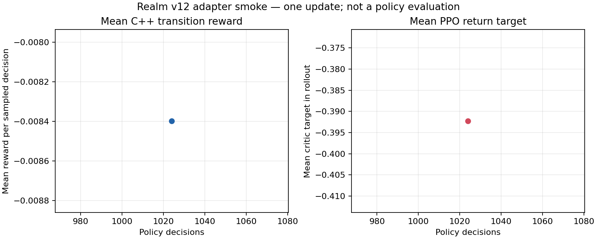

# Báo cáo M5 — adapter RL khớp Realm hiện hành và lượt smoke PPO

Ngày: 2026-10-23. Phạm vi: model v12, môi trường co-play Python gọi Realm C++ qua `polyec_env`, một lượt PPO ngắn để kiểm tra tích hợp, khôi phục checkpoint và hình/dữ liệu của đúng lượt đó. Đây chưa phải quá trình huấn luyện candidate, chọn model, đánh giá policy độc lập hay nghiệm thu M5.

## Kết luận dành cho người đọc

Policy v12 hiện đọc đủ 295 giá trị trạng thái của Realm và chấm điểm 220 hành động do C++ cung cấp. Mask hợp lệ do Realm trả về chặn mọi lựa chọn không được phép; bước chơi, ngày mô phỏng và phần thưởng vẫn do cùng C++ core tính. Python không có một bản mô phỏng kinh tế riêng.

Một lượt kiểm tra đã chạy đúng hợp đồng timeline v32: 16 world, mỗi world nhận 64 quyết định từ policy, tổng 1.024 quyết định, rồi một update PPO. Các nhân vật khác tạo 28.042 quyết định peer trong thời gian world tiến bảy ngày sau mỗi quyết định focal; peer ở lượt này dùng controller phát triển có nhãn, không dùng policy đã học. Lượt rollout mất 69,05 giây; cả update mất 71,27 giây; bộ nhớ tiến trình cao nhất là 551.616.512 byte, xấp xỉ 526 MiB. Đây là phép đo của cấu hình một vùng được chọn cho smoke, không phải benchmark Profile B hay ước lượng thời gian train ba seed.

Kết quả đủ chứng minh kích thước dữ liệu, lấy hành động hợp lệ, gọi transition/reward C++, cập nhật optimizer và đọc lại trạng thái world trong checkpoint. Nó **không** chứng minh policy đã học hữu ích. Đây chỉ là 1 update trên các world nhỏ; reward trung bình trong rollout là -0,00840 và độ lệch chuẩn 0,02441. Reward rollout không phải điểm đánh giá độc lập. Không có tập train nhiều seed, validation, selector hoặc holdout trong công việc này.

Hình có một điểm tại quyết định 1.024, không phải đường xu hướng. Panel trái là reward trung bình của transition C++ được lấy mẫu trong rollout; panel phải là giá trị return mục tiêu mà critic học trong cùng rollout. Hai số mô tả dữ liệu dùng trong update này, không so sánh policy với baseline và không dự báo kết quả campaign. Dữ liệu JSON tạo hình nằm cạnh ảnh; log update đầy đủ nằm trong run directory.

## Contract và thay đổi trong source

- Realm schema/model hiện hành: `realm-v27`; state 295; 220 hành động; mỗi hành động có 12 đặc trưng; observation là `295 + 220 × 12 = 2.935` số.
- Model hiện hành trong lượt smoke: `realm-worksite-payroll-goods27-config-v32`; reward `realm-v13-person-enterprise-equity-v1`; config fingerprint `9633945641032033385`.
- Model v12 dùng encoder nhận toàn bộ 295 trường state, GRU 64 phần tử cho lịch sử từng actor và một scorer dùng chung cho 220 candidate. Legal mask không đi vào scorer như nguồn quyền hạn: sampler áp dụng mask của C++ để chọn candidate đang hợp lệ.
- Co-play v12 dựng và gọi `polyec_env`/C++ cho focal lẫn peer; controller peer chưa có bundle đúng contract được đánh dấu là dev baseline. Mã chẩn đoán Intent bao phủ cả `BuyMilitaryRations`, `ShipMilitaryRations`, `FundMunicipal` và `ForeignTrade`.
- Để mọi world mang đúng timeline contract v32, fixture phát một generic schedule hợp lệ dài đúng một tick rồi hết hạn. Fixture được ghi version `one-tick-generic-schedule-v1` trong identity, manifest và trạng thái môi trường. Đây là bước khởi tạo deterministic để bật contract timeline của C++ cho smoke, không phải hành động do policy chọn và không được xem là cơ chế gameplay mới. Nhóm future training vẫn phải kiểm tra tác động fixture này đối với tình huống mở màn trên profile đầy đủ.
- Cùng version fixture, model contract, fingerprint, reward và curriculum được khóa khi lưu/khôi phục co-play. Metadata v11 không tương thích không được tự nâng cấp hoặc dùng lại.

Source chính:

- Model: `ai/training/realm_model_v12.py`.
- Môi trường và peer: `ai/training/realm_coplay_env_v12.py`.
- PPO trainer: `ai/training/realm_train_v12.py`.
- Controller phát triển có nhãn: `ai/training/realm_dev_baseline_v12.py`.
- Kiểm tra tensor: `ai/tests/realm_model_v12_checks.py`.
- Kiểm tra binding, mask, transition và resume: `ai/tests/realm_coplay_v12_checks.py`.
- Script hình: `scripts/plot_realm_v12_smoke.py`.

## Dữ liệu được tạo như thế nào

Đây là rollout on-policy được sinh trực tuyến, không phải bảng dữ liệu offline có sẵn. Khi trainer khởi động, seed `20261024` được đặt cho PyTorch, NumPy và Python. Từ seed đó trainer tạo seed C++ gốc bằng `2^32 + seed × 10.000.000`; batch tăng seed đó tuần tự cho 16 world độc lập. Mỗi world dùng cấu hình `regions=1`, horizon tối đa 128 quyết định focal, role 1 (Economic) và timeline fixture ở trên. Chỉ số `regions=1` là profile nhỏ để kiểm adapter; đây không phải world Atlas27 đầy đủ.

Ở từng bước rollout, policy tính logits cho 220 candidate từ observation 2.935 giá trị và trạng thái bộ nhớ recurrent của focal actor. C++ tạo action mask; sampler gán xác suất bằng không cho mọi candidate ngoài mask rồi lấy một hành động hợp lệ. Lời gọi `world.step(actor, action)` chuyển lệnh vào Realm C++; sau đó world tiến bảy ngày theo nhịp của vai trò Economic. Trong các ngày này, các actor khác đến hạn được điều khiển bằng bundle peer nếu có bundle đã qua gate; smoke không có bundle như vậy nên họ dùng dev baseline có nhãn. Mỗi hành động peer cũng lấy từ observation/mask của C++ và được xác nhận hợp lệ trước khi bước tiếp.

Trainer luân phiên 64 lần giữa 16 world, thu 1.024 transition của focal actor vào buffer trong RAM. Reward của mỗi transition là thay đổi utility cá nhân do `Realm::utility`/C++ trả về, chuẩn hóa bằng utility mở màn của actor; không được Python tự dựng lại thu nhập, giá, nợ hoặc sản lượng. PPO tính advantage và return trên batch này, chia thành các chuỗi 16 bước để giữ bộ nhớ recurrent, rồi chạy ba epoch với một nhóm minibatch 64 chuỗi. Một lần optimizer hoàn thành tạo update 1.

Mỗi decision không đồng nghĩa với một episode hoàn chỉnh: horizon là 128 quyết định focal, trong khi lượt smoke chỉ lấy 64 quyết định mỗi world, nên không quan sát đủ vòng đời 128 quyết định. Không có episode chết sớm được dùng làm kết quả đánh giá. Batch dùng một seed duy nhất cho mục đích adapter, không chia thành train/validation/holdout. Không có ghép cặp baseline-versus-policy, bất định giữa seed hay selector.

Rollout đầy đủ của 1.024 transition chỉ tồn tại trong RAM cho đến khi PPO update xong; chương trình **không** ghi từng observation/action/reward thành trajectory file dài hạn. File `history.jsonl` lưu các tổng hợp của update, bao gồm phân phối reward/advantage/return, số quyết định theo Intent, thời gian, số quyết định peer và bộ nhớ đỉnh. `checkpoint.pt` lưu trọng số ban đầu đã cập nhật, optimizer, trạng thái 16 Realm, trạng thái bộ nhớ focal/peer và các bộ sinh số ngẫu nhiên để có thể tiếp tục một run cùng identity. `manifest.json` ghi contract và điều kiện smoke. `run-v2-smoke.json` là nguồn dữ liệu chọn trường cho biểu đồ từ đúng manifest/history của run; nó không ghép dữ liệu các lượt khác.

## Phát hiện chẩn đoán — không phải đánh giá policy

Trong 1.024 quyết định, policy khởi tạo ngẫu nhiên trước update chọn: WorkAtSite 269; AuthorizeWorkAtSite 247; Hold 127; CreateEstablishment 103; Work 67; Travel 38; Borrow 33; Buy 28; Hire 27; TransferEstablishmentGoods 17; Sell 14; Marry 44; Offer 5; Repay 4; Project 1. Tổng là 1.024. Dữ liệu này cho biết đường chẩn đoán có thể phân loại action theo Intent, không chứng minh những hành động trên có lợi hay model đã học cách chọn chúng.

18 nhóm Intent không có candidate hợp lệ ở batch nhỏ này, trong đó có Tax, Aid, Appoint, Mobilize, BuyMilitaryRations, FundMunicipal và ForeignTrade. Đây là dấu hiệu để kiểm tra độ phủ tình huống: role Economic, profile một vùng, horizon ngắn và không có scenario ngoại thương/đô thị/quân sự vốn không tạo cơ hội cho những lệnh đó. Không thể kết luận policy bỏ quên các hành động ấy vì chúng không xuất hiện như lựa chọn hợp lệ trong dữ liệu. Trước khi train phát hành, cần các tình huống gameplay đúng quyền, vùng và nhu cầu để những hành động này có thể xuất hiện; sau đó chart độ phủ/đánh giá phải tách riêng và có seed độc lập.

Reward rollout trung bình là `-0.00839755`, độ lệch chuẩn `0.02441340`, nhỏ nhất `-0.15818182`, trung vị `-0.01000000`, lớn nhất `0.07363636`. Giá trị return target trung bình là `-0.39227543`, độ lệch chuẩn `0.14911051`. Hai đại lượng không cùng nghĩa: reward là tín hiệu transition quan sát từ C++, return là mục tiêu critic ước tính trên chuỗi rollout. Critic explained variance `0.20317` là chẩn đoán một update, không phải chất lượng hành vi hoặc chất lượng policy.

## Kiểm tra đã chạy và kết quả

1. `python -m py_compile` cho model v12, dev baseline, co-play, trainer, hai bài kiểm Python và script hình: thành công.
2. `python ai/tests/realm_model_v12_checks.py`: thành công; tensor đầu ra `[2,220]`, value `[2]`, hidden `[2,64]`, sequence `[2,16,220]`; sampler chỉ chọn mask hợp lệ và từ chối mask rỗng.
3. `PYTHONPATH=build/windows/Debug python ai/tests/realm_coplay_v12_checks.py`: thành công. Bài kiểm gọi binding C++ hiện có, xác nhận schema/mask, thực hiện candidate hợp lệ qua `world.step`, rồi serialize/restore và so từng observation/mask. Metadata fixture sai bị từ chối; manifest peer v11 với 129 hành động/1.676 observation cũng bị từ chối trước khi mở file trọng số.
4. Trainer v12 một update: thành công với 1.024 quyết định, reward và optimizer cập nhật; checkpoint/run manifest ghi `run_kind=smoke_only`, `smoke_only=true`, `policy_candidate=false`, `policy_selection_eligible=false`, `release_eligible=false`, `complete=false`, `smoke_update_complete=true`. Run không sinh `policy.pt` và không đủ điều kiện đưa vào runtime.
5. Đọc `checkpoint.pt` vào batch C++ mới cùng identity: thành công; xác nhận update 1, hợp đồng/fingerprint khớp manifest, fixture version đúng, khôi phục trạng thái 16 world, observation `[16,2935]`, mask `[16,220]` và contract v32 trên mỗi world.
6. `python scripts/plot_realm_v12_smoke.py ...`: thành công; tạo hình và JSON từ đúng một dòng update của run-v2. Hình đã được mở kiểm tra trực quan.

Không build lại C++/Python extension ở lát này vì binding source và ABI không thay đổi; smoke gọi extension `build/windows/Debug/polyec_env.cp312-win_amd64.pyd` đã được dựng cho checkout hiện tại. Không build Godot/native game hoặc chạy full suite do chỉ sửa adapter/model Python. Cũng chưa chạy evaluator v12, selector, test nhiều seed, replay Python/Godot, performance Profile B hoặc package.

Một lượt smoke sơ bộ `run/` đã hoàn tất trước khi phát hiện metadata `trained_with_rl=false` không diễn đạt đúng việc đã thực hiện một PPO update. Không xóa lượt đó. Trainer được sửa để phân biệt rõ “đã dùng PPO” với “được phép xem là candidate”; run-v2 được chạy lại từ seed `20261024`? Không: run-v2 dùng seed `20261024` và là bằng chứng được chọn ở đây; lượt sơ bộ dùng seed `20261023`. Các artifact v1 vẫn được giữ để truy nguyên nhưng không dùng trong chart hay kết luận chính. Sự đính chính này không sửa history/checkpoint của run sơ bộ.

## Bằng chứng và hash

Artifact chính nằm tại `artifacts/m5-current-contract-rl-adapter-smoke-2026-10-23/`:

- Run directory `run-v2/`: manifest, log tổng hợp update, checkpoint optimizer/world và policy khởi tạo.
- Biểu đồ: `run-v2-smoke.png`.
- Dữ liệu chart: `run-v2-smoke.json`.

SHA-256 của các artifact run-v2 tại lúc lập báo cáo:

| File | SHA-256 |
|---|---|
| `run-v2/manifest.json` | `5ED6E24FC61922451F3D1F7A7177CAFA9FF59D68091AB508C41CD023467C8AA5` |
| `run-v2/history.jsonl` | `B1B489E27F3705DA7945C1A8D8611089AA13A7B4A57DBB7AD102E9670DFBA14F` |
| `run-v2/checkpoint.pt` | `21384E2B6A5F50CA84B8F9FF80F528B206BBBFD75ADF7F7CB9E9E8E8672ACA48` |
| `run-v2-smoke.png` | `A54A3C02DF277C87354A38E0071E363E33E1B0D0FE606C416E6041E545D0E170` |
| `run-v2-smoke.json` | `3F2C1A2A8D2F853963EF58D5E30A9B6FF999BE6AF2751C332FD5B3C2F849CE72` |

## Phần còn thiếu và bước sau

Adapter v12 smoke đã chứng minh đường C++→Python→PPO update và khôi phục checkpoint. Chưa có bộ RL hoàn chỉnh: chưa tạo ba seed/family sau khi gameplay ổn định, chưa có validation-only selector, chưa có holdout paired evaluation, chưa đánh giá độ bất định, chưa xuất candidate hay chạy policy qua UI. Chưa được gọi model này là policy game đã học xong.

Theo backlog M5.4, nhóm kế tiếp là chốt và kiểm luật **đưa đơn vị volunteer đã tập kết vào triển khai quân sự**: người có quyền ra lệnh là ai, phạm vi điều động theo lãnh địa/đơn vị nào, thời điểm bắt đầu/kết thúc, ảnh hưởng lên nghĩa vụ hiện có và lương thực, phản ứng khi thiếu người hoặc thiếu hàng, cùng điều kiện từ chối nguyên tử và save/load. Chưa viết chiến đấu hoặc xác suất thắng/thua trước khi contract đó xác định nguồn lực và cách luật hiện hành giải quyết hậu cần. Hạng mục chiến đấu/chỉ huy chưa được báo cáo là hoàn thành.

Kế hoạch adapter được cập nhật tại [plan](../design/M5-current-contract-rl-adapter-plan.md); audit nguồn cũ tại [readiness audit](M5-current-contract-rl-readiness-audit-evidence-2026-10-23.md); tiêu chí RL cuối tại [M5 integration gates](../design/M5-integration-and-tuning-gates.md).
