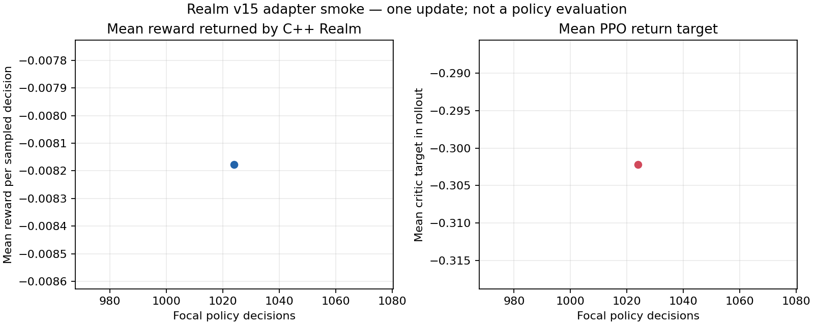
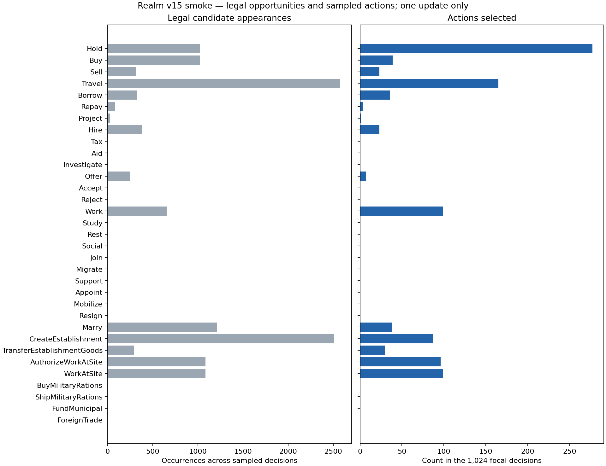

# Báo cáo: PPO smoke theo contract Realm v15 hiện hành

Ngày chạy: 2026-10-23  
Mục đích: xác nhận model/trainer hiện hành gọi đúng Realm C++ và đo một update nhỏ trước khi dự toán các lượt training nhiều seed.  
Kết luận ngắn: adapter v15 hoàn tất một update PPO qua binding C++; **đây không phải policy đã học đủ, không phải kết quả đánh giá độc lập và không được chọn hoặc đưa vào game**.

## 1. Điều người đọc cần biết

Realm hiện hành cung cấp cho một actor 3.550 số quan sát và 264 lựa chọn, trong đó mỗi lựa chọn có 12 đặc trưng. Model v15 nhận đủ 382 giá trị trạng thái cố định, xử lý lịch sử qua bộ nhớ recurrent 64 phần tử, rồi chấm điểm các lựa chọn. Realm C++ vẫn quyết định lựa chọn nào hợp lệ, thực hiện giao dịch/ngày mô phỏng và trả reward; Python gọi core này để thu các transition mới rồi thực hiện một PPO update.

Run dùng 16 thế giới sáu vùng; mỗi thế giới cung cấp 64 quyết định Economic, tổng 1.024 quyết định focal. Các actor còn lại trong cùng các thế giới tiếp tục hoạt động qua dev baseline có nhãn. Run hoàn thành trong 18,60 giây, dùng CPU, bộ nhớ đỉnh 629.510.144 byte (xấp xỉ 600,5 MiB). Đây là số đo cho workload smoke đã định nghĩa, không phải benchmark toàn game hoặc dự báo thời gian training nhiều seed.

Manifest ghi rõ `run_kind=smoke_only`, `policy_candidate=false`, `policy_selection_eligible=false`, `release_eligible=false`, `complete=false`; không có `policy.pt` để phát hành. Vì vậy thành công ở đây chỉ chứng minh đường dữ liệu và thao tác optimizer chạy được trên đúng contract. Reward trung bình âm trong rollout không cho biết model tốt hay xấu khi so với baseline; cần validation ghép cặp trên nhiều seed để trả lời câu đó.

## 2. Nguồn dữ liệu và cách tạo rollout

Đây không phải bảng dữ liệu cố định tải sẵn. Trainer bắt đầu từ trọng số khởi tạo mới và sinh các tương tác trực tiếp với C++ Realm:

1. Cùng seed `20261024` được đặt cho PyTorch, NumPy và bộ sinh số của Python. Trainer tính seed C++ đầu là `2^32 + seed × 10.000.000 = 202.614.534.967.296`; 16 environment dùng seed liên tiếp từ đó. Mỗi Realm dùng cấu hình sáu vùng, 128 cá thể và role Economic. Mỗi world chọn một draft card bằng `seed % 3` theo quy tắc co-play hiện tại.
2. Fixture gọi một lệnh lịch tổng quát dài một tick để bật đúng model contract timeline v34; đó là điều kiện khởi tạo kỹ thuật đã version hóa `one-tick-generic-schedule-v1`, không phải hành động của policy hay luật gameplay được thêm.
3. Trước mỗi quyết định focal, C++ trả observation dài3.550 và mask dài264. Model tính điểm hành động từ observation cùng bộ nhớ actor; bộ lấy mẫu chỉ chọn một slot được mask C++ đánh dấu hợp lệ. Lệnh được gửi vào C++ `Realm::step`.
4. Sau mỗi quyết định Economic, mô phỏng tiến bảy ngày game. Các actor khác đến lượt cũng lấy observation/mask C++ và hành động qua controller dev baseline phiên bản `realm-v15-observation-dev-v1`, vì không có peer policy nào đã vượt qua các bước chọn/đánh giá để đưa vào run này. Những peer này không phải learned policy.
5. Reward transition do C++ trả về được tính theo thay đổi utility của actor chia cho giá trị utility mở đầu, có chặn mẫu số tối thiểu là1. Python không tự dựng lại luật mua bán, tiền, nợ, sản lượng, payroll hoặc nghĩa vụ.
6. Trainer luân phiên qua16 worlds trong64 bước focal, giữ observation, mask, action, xác suất action, giá trị critic, reward, cờ kết thúc và bộ nhớ recurrent trong RAM. PPO xử lý batch này trong ba epoch với chuỗi dài16 và minibatch64 chuỗi rồi ghi checkpoint tại ranh giới update.

Do chỉ lấy64 quyết định trong khi horizon Economic của cấu hình là512, đây không phải một episode đủ vòng đời. Chỉ có một seed và một update; không chia train/validation/holdout, không có run lặp để đo phân tán giữa seed, không có candidate/baseline paired evaluation, và không có selector.

## 3. File nào được lưu, file nào không

Thư mục run: `artifacts/m5-current-realm-v15-smoke-2026-10-23/run/`.

- `manifest.json`: seed, family, kích thước model, contract `realm-v30`/timeline v34, config fingerprint, reward version, fixture, cấu hình PPO và cờ smoke/eligibility.
- `history.jsonl`: một dòng tổng hợp update, gồm reward/advantage/return distributions, tốc độ, số quyết định peer, Intent hợp lệ/được chọn, chỉ số optimizer và peak RSS. Tệp này không chứa observation/action/reward của từng transition.
- `initial.pt`: weights khởi tạo dùng cho run.
- `checkpoint.pt`: weights sau update, optimizer, identity, 16 C++ world save states, recurrent hidden state, trạng thái seed của NumPy/PyTorch/Python và trạng thái peer. Đã đọc checkpoint và xác nhận update1, schema `realm-v30`, contract v34, đủ16 world.
- Không có `policy.pt`, vì trainer đánh dấu smoke là không đủ điều kiện candidate.
- Rollout chi tiết 1.024 transition chỉ nằm trong RAM cho tới khi update xong. Hình và JSON cạnh đó được tạo từ `manifest.json` và chính dòng update của `history.jsonl`; không ghép dữ liệu từ run khác.

## 4. Kết quả định lượng của đúng run này

| Số đo | Giá trị | Ý nghĩa và giới hạn |
|---|---:|---|
| Họ actor | Economic | Chỉ kiểm đường của một họ actor. |
| Realm | 6 vùng, 128 cá thể/world | Workload smoke; không phải Atlas đủ27 vùng hoặc Profile B. |
| Environment | 16 | Cùng 16 world được luân phiên qua rollout. |
| Quyết định focal | 1.024 | 16×64; không đồng nghĩa với 1.024 episode. |
| Quyết định peer | 29.842 | Governance/Civilian do dev baseline có nhãn điều khiển; không dùng policy học. |
| Rollout | 17,58 giây | Thời gian thu transition. |
| Update PPO | 0,92 giây optimizer; 18,60 giây tổng | Thời gian một update với cấu hình này. |
| Tốc độ focal | 55,05 quyết định/giây | Đo trong workload này, không suy thành toàn game. |
| Bộ nhớ đỉnh | 629.510.144 byte (600,5 MiB) | Peak working set của tiến trình. |
| Reward rollout | Trung bình−0,008177; độ lệch chuẩn0,026171; nhỏ nhất−0,193636; p05−0,045455; trung vị−0,010909; p95 0,032727; lớn nhất0,072727 | Reward transition dùng PPO; không phải score đánh giá độc lập. |
| Return target của critic | Trung bình−0,302205; độ lệch chuẩn0,078882 | Mục tiêu critic trên rollout, khác nghĩa với reward từng transition. |
| Explained variance critic | −0,216543 | Chẩn đoán một update; không phải chất lượng hành vi/policy. |



Biểu đồ có đúng một điểm ở1.024 quyết định. Không thể đọc độ dốc, xu hướng học hoặc tiến bộ từ một điểm; return target là tín hiệu critic, không phải kết quả người chơi nhận được.

### Cơ hội hợp lệ và hành động được lấy mẫu

Biểu đồ dưới đây đếm số lần mỗi Intent xuất hiện như candidate hợp lệ trong các observation và số lần sampler lấy Intent đó trong1.024 quyết định. Một candidate có thể xuất hiện nhiều lần ở các quyết định khác nhau; đây không phải số actor duy nhất. Các Intent có0 cơ hội không thể được xem là bị policy từ chối.



| Intent | Candidate hợp lệ xuất hiện | Số lần lấy mẫu |
|---|---:|---:|
| Hold | 1.024 | 277 |
| Buy | 1.022 | 39 |
| Sell | 313 | 23 |
| Travel | 2.574 | 165 |
| Borrow | 329 | 36 |
| Repay | 85 | 4 |
| Project | 30 | 1 |
| Hire | 386 | 23 |
| Tax | 0 | 0 |
| Aid | 0 | 0 |
| Investigate | 0 | 0 |
| Offer | 249 | 7 |
| Accept | 0 | 0 |
| Reject | 0 | 0 |
| Work | 655 | 99 |
| Study | 0 | 0 |
| Rest | 0 | 0 |
| Social | 0 | 0 |
| Join | 0 | 0 |
| Migrate | 0 | 0 |
| Support | 0 | 0 |
| Appoint | 0 | 0 |
| Mobilize | 0 | 0 |
| Resign | 0 | 0 |
| Marry | 1.214 | 38 |
| CreateEstablishment | 2.512 | 87 |
| TransferEstablishmentGoods | 293 | 30 |
| AuthorizeWorkAtSite | 1.086 | 96 |
| WorkAtSite | 1.086 | 99 |
| BuyMilitaryRations | 0 | 0 |
| ShipMilitaryRations | 0 | 0 |
| FundMunicipal | 0 | 0 |
| ForeignTrade | 0 | 0 |
| **Tổng hành động đã lấy** | — | **1.024** |

Trong run nhỏ này không có candidate hợp lệ cho18 Intent, gồm thuế/cứu trợ, lifecycle xã hội, huy động/quân nhu, quỹ đô thị và ngoại thương. Một actor Economic tự nhiên trong một thế giới sáu vùng và rollout64 quyết định không được dựng sẵn các tình huống đó. Do đó cần evaluator/validation có tình huống và seed đại diện trước khi kết luận policy có dùng được các quyết định này hay không. Đường action diagnostics đã ghi nhận cơ hội riêng biệt; smoke không thể trả lời câu hỏi cân bằng hoặc độ phủ hoàn chỉnh.

## 5. Biểu đồ, dữ liệu nguồn và định danh

Hai hình và hai JSON được tạo trực tiếp từ một dòng history của run:

- [Reward và return target](../../artifacts/m5-current-realm-v15-smoke-2026-10-23/run-v15-smoke.png) · [JSON nguồn](../../artifacts/m5-current-realm-v15-smoke-2026-10-23/run-v15-smoke.json)
- [Candidate hợp lệ và hành động lấy mẫu theo Intent](../../artifacts/m5-current-realm-v15-smoke-2026-10-23/run-v15-smoke-intents.png) · [JSON nguồn](../../artifacts/m5-current-realm-v15-smoke-2026-10-23/run-v15-smoke-intents.json)
- Script chỉ nhận manifest schema `realm-v30`, observation3550, actions264, cờ `smoke_only` và đúng1.024 quyết định: [plot_realm_v15_smoke.py](../../scripts/plot_realm_v15_smoke.py).

SHA-256 tại thời điểm lập báo cáo:

| File | SHA-256 |
|---|---|
| `run/manifest.json` | `E87D2750F2EEB2F5EA51547F6EDBEEEEB5BC6464FE396D98C6692C074059A860` |
| `run/history.jsonl` | `06AF029DA415246801FF04781DB769DAF1AF18C871547F1FF47B0E10487AFFC7` |
| `run/checkpoint.pt` | `72A2DA5B246821EA51D78FB38D1CA00C79262232118EE3B94A45EE743AF8488D` |
| `run-v15-smoke.png` | `FEEABF95425A68842594CD4C2CE633D472476F1E59B544B940566AA017136914` |
| `run-v15-smoke.json` | `C9CF586481FE91A6FEC2A690FFAA59750B0ABB76E66014B8B1E03A603C887CF3` |
| `run-v15-smoke-intents.png` | `D12974016AA861DE5FEFA9F9DBBAED271646347C4E5EEF53D2F73790ACD83ADD` |
| `run-v15-smoke-intents.json` | `93ADFCE644FB6B32E04A6C8FFBA7A54774C739515D9D7FC358CA740CA9DED277` |
| `scripts/plot_realm_v15_smoke.py` | `500B8E916E0D6F7985091721EA3956AF70D095C2CB37255911655E7D40FA6A69` |

## 6. Lệnh đã chạy và kết quả

Binding Release có sẵn tại `build/m5-python-ai/Release/polyec_env.cp312-win_amd64.pyd`; không rebuild nó vì nhóm không sửa binding hoặc C++ ABI. Các lệnh:

```powershell
python -m py_compile scripts/plot_realm_v15_smoke.py
$env:PYTHONPATH='C:\prc\PolyEc\build\m5-python-ai\Release'
python ai/training/realm_train_v15.py --role 1 --seed 20261024 --output artifacts/m5-current-realm-v15-smoke-2026-10-23/run --regions 6 --envs 16 --rollout-steps 64 --updates 1 --smoke-only --seconds 300
python scripts/plot_realm_v15_smoke.py --run artifacts/m5-current-realm-v15-smoke-2026-10-23/run --output artifacts/m5-current-realm-v15-smoke-2026-10-23/run-v15-smoke.png
```

Trainer kết thúc thành công với `update=1`, `decisions=1024`, `peer_decisions=29842`, rollout17,58 giây, update18,60 giây và peak RSS629.510.144 byte. `py_compile` thành công; script tạo hai cặp PNG/JSON. Đã mở cả hai hình để kiểm tra nhãn/giá trị. Checkpoint được đọc lại và xác nhận đúng contract, update1, 16 world, manifest vẫn không đủ điều kiện dùng làm policy.

Không chạy lại C++ suite, không build lại native/GDExtension/Godot vì nhóm này chỉ thêm script vẽ và tạo run Python qua binding đã có; C++/API không đổi. Không có phiên bản Godot executable trong environment baseline, nên không tuyên bố UI chạy. Các check adapter v15 đã chạy ở nhóm trước; lần này smoke trực tiếp còn xác nhận binding đúng shape/current contract và transition/reward có thể thực hiện.

## 7. Việc tiếp theo và giới hạn

Chưa chạy training candidate ba seed, chưa validation, chưa selector, chưa holdout, chưa paired evaluation với baseline và initial; do đó chưa có policy để đưa vào runtime. Một update mất18,60 giây chỉ là cơ sở ban đầu để dự toán; tốc độ có thể khác theo family, số vùng, scenario và cấu hình. Lượt nhiều seed cần dự toán tổng số quyết định, update, thời gian, bộ nhớ và dung lượng output trước khi bắt đầu; không mua GPU/cloud.

Bước kế tiếp là tạo evaluator/selector hiện hành cho Realm v15: khóa contract, config/reward, seed train/validation/holdout tách biệt, budget cố định, metrics người chơi và quy tắc chọn chỉ từ validation; evaluator holdout chỉ chạy sau khi bundle được khóa. Chọn policy phải xét utility ghép cặp với baseline và policy ban đầu, sống sót, nợ/khả năng thanh toán, nghĩa vụ và hành động phù hợp, có độ bất định giữa world seeds. Holdout không được dùng để thay checkpoint. Sau RL vẫn phải chạy app/UI với cùng model contract, Profile B, stress/performance và package Windows trước khi gọi M5 hoàn tất.
