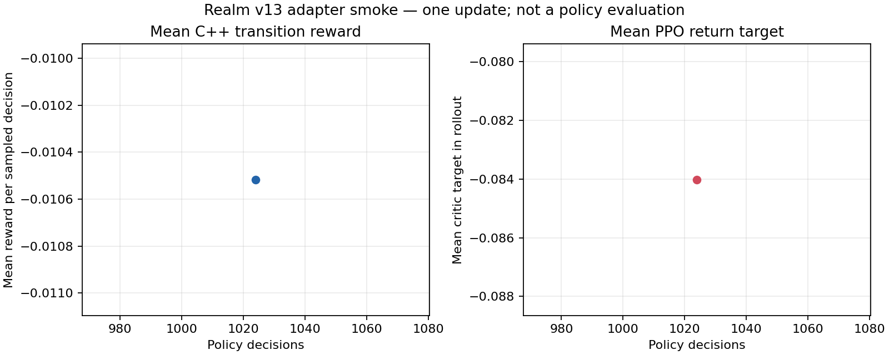

# M5.4 — Ba sổ đối tác ngoại thương tại Nam Cảng

Ngày kiểm: 2026-10-23. Báo cáo này ghi lại source đã sửa, hành vi người chơi có thể thấy, phép kiểm đã chạy, dữ liệu PPO smoke được tạo và các phần còn chưa được kiểm chứng trên game đang chạy.

## Kết quả người chơi nhận được

Ở bản đồ Atlas đầy đủ, nhân vật Economic tại Nam Cảng có thể chọn nhập DryFood hoặc xuất Salt với một trong ba sổ có tên **Đối tác A**, **Đối tác B** và **Đối tác C**. Mỗi sổ có tiền, hàng và sức chứa riêng. Khi mở hồ sơ thương nhân, màn hình liệt kê ba số dư, lượng DryFood còn bán, chỗ nhận Salt còn lại và từng chuyến hàng đang đi kèm đối tác nhận/gửi hàng.

Đây là ba tài khoản mô phỏng tổng hợp đặt ở cùng một cảng. Chúng không đại diện cho quốc gia hay thành phố có thật, không có chính phủ hoặc chính sách riêng, và không tạo ba tuyến vận tải. Màn hình nói rõ endowment là số thử, không phải số liệu lịch sử.

Giá và điều kiện hiện hành được giữ nguyên: mỗi DryFood nhập có giá24 đồng; mỗi Salt xuất có giá28 đồng; thuế là5% giá trị hàng; phí cảng là2 đồng/món; phí tuyến hiện do hồ sơ route cung cấp. Một ngày toàn cảng chỉ nhận một lệnh mới, tối đa8 món. Cả ba đối tác, hàng nội địa và kho công vẫn dùng chung lịch công suất tuyến.

Với một món nhập, người phát lệnh giữ25 đồng làm ký quỹ gồm giá24 và thuế1, trả phí cảng và phí tuyến theo luật cũ, đồng thời giảm một DryFood trong đúng sổ đối tác. Khi tàu tới, 24 đồng được trả cho đúng đối tác, 1 đồng thuế vào ngân khố vùng và hàng vào kho Nam Cảng. Với một món xuất, hệ thống giữ28 đồng trong sổ đối tác đã chọn, giữ một Salt của người bán và một đơn vị sức chứa của sổ đó; khi tới nơi, người bán nhận27 đồng sau thuế, ngân khố nhận1 đồng thuế và Salt được ghi vào đúng sổ nhận hàng. Nếu người bán đã chết, tiền xuất được ghi vào estate thay vì mất hoặc trả nhầm người.

## Thay đổi trong source

- C++ giữ sáu candidate của A ở slot32–37, thêm sáu slot cho B ở220–225 và sáu slot cho C ở226–231. Tổng tăng từ220 lên232; ý nghĩa slot cũ không đổi. Operation của command mã hóa riêng partner và chiều nhập/xuất; order ghi partner ID tường minh.
- Mỗi partner giữ tiền, ký quỹ, DryFood và sức chứa Salt độc lập. Các invariant kiểm tra số dư không âm, ký quỹ khớp với order đang đi, hàng Salt cộng sức chứa cộng hàng xuất đang đi bằng32 trên từng sổ, và tổng hàng/tiền được hạch toán. Partner ID ngoài0–2 bị từ chối.
- Sáu số mới được nối ở cuối state cũ, từ vị trí295 đến300: mỗi partner B/C có ba giá trị gồm DryFood, sức chứa Salt và tiền. Chỉ nhân vật Economic đủ điều kiện ở Nam Cảng thấy số liệu này; người khác nhận0. State tăng295→301, mỗi candidate giữ12 đặc trưng, observation tăng từ2.935 lên3.085 (=301 + 232×12).
- Realm model schema tăng v27→v28; household contract v30→v31; timeline contract v32→v33; reward không đổi. Native loader yêu cầu đúng schema, kích thước và model contract mới, nên checkpoint v27/v12 không được nhận nhầm.
- Save tăng schema51→52. Save cũ giữ tài khoản và order đang đi ở A; order cũ được gán partner ID0. Migration thêm đúng một lần 10.000 đồng và64 DryFood cho B/C vào ledger tổng/endowment. Save52 không thêm lần nữa. Profile không phải Atlas không có ledger đối tác và save/load của profile đó bắt buộc ledger trống.
- Python binding thêm `foreign_trade_partners`, và từng order trả `partner_id`. Native manifest và GDExtension snapshot trả contract mới cùng ba ledger/order. Godot panel đã đổi để trình bày A/B/C, mô tả nhãn tổng hợp và phân biệt lệnh nhập/xuất theo partner.
- Model, baseline, co-play và PPO trainer v13 được thêm thành bộ file mới. File v12 vẫn được giữ nguyên lịch sử. Loader v13 từ chối cả manifest v11 lẫn v12; test hiện kiểm trực tiếp manifest v12 (`realm-v27`, observation2935, action220) không thể ghép với model v13.

Kế hoạch và ranh giới gameplay: [M5.4 multiple foreign counterparties plan](../design/M5.4-multiple-foreign-counterparties-plan.md). Không thêm tên địa lý, nguồn lịch sử, ngoại giao, chiến đấu, nguồn hàng vô hạn hay tự nạp lại endowment.

## Kiểm tra đã chạy

### Core C++ và save

- Build Debug các target C++ bị ảnh hưởng, gồm Realm, ngoại thương, vận tải quốc gia, vận tải Realm và các test có assertion kích thước observation/model/save. Không chạy `ALL_BUILD` hoặc toàn bộ suite Release.
- `foreign_trade_tests`: **50 checks pass**. Bài kiểm mới gửi một lệnh nhập cho B, xác nhận chỉ sổ B giảm hàng/giữ ký quỹ; khi tàu tới chỉ sổ B nhận tiền và xóa ký quỹ. Các test hiện có kiểm mask/candidate, actor được quan sát sổ, reject nguyên tử, route dùng chung, order đang đi, settlement, hàng và save/load.
- CTest nhóm ổn định gồm Realm, land title, organization territory, establishment transfer, foreign trade và household fund: **6/6 pass**; Realm test hoàn chỉnh mất264,25 giây. Nhóm quốc lộ/vận tải gồm national transport và Realm transport: **2/2 pass**. Các test Tea Garden, Incense Works, Warhorse Stable, Weapon Forge, Court và Realm transport đã build lại với dimension/schema mới và pass trong những lượt CTest theo nhóm; phần dùng helper migration cũ được cập nhật để xử lý schema52.
- Native `runtime_contracts`: **1/1 pass**, chấp nhận manifest v28/3085/232/v31 và từ chối schema cũ.

Trong lúc mở rộng kiểm tra, test ban đầu phát hiện reader schema52 buộc profile bản đồ nhỏ phải có sức chứa đối tác Atlas dù profile đó không có ledger. Điều kiện reader đã được sửa theo profile; roundtrip co-play profile nhỏ pass, còn profile Atlas vẫn áp dụng kiểm tra sức chứa đầy đủ. Một số test trước đó còn giữ số kích thước295/220/2935 hoặc tên schema51/model v30/v32; các assertion hiện hành đã được nâng lên theo contract mới, không đổi hành vi của những ngành đó.

### Python, native và GDExtension

Đã build lại module `polyec_env` và chạy các binding checks liên quan. Các kết quả ghi trong output: Copper Mining20; gameplay config/replay49 với7 checkpoint C++/Python khớp; foreign trade22; model contract20; Incense Works23; military ration17; Organization Territory14; Paper Mill28; Realm binding273 trong replay64 ngày/2.048 quyết định; Realm Clock175 với7 checkpoint; Saltworks23; Tea Garden22; Silver Mining22; Timber Forestry21; Urban Civic Fund27; Warhorse Stable21; Weapon Forge21. Model v13 tensor/mask pass; co-play v13 kiểm current C++ contract, transition hợp lệ, lưu/khôi phục chính xác, ba ledger Atlas và từ chối bundle v11/v12 pass.

GDExtension target `polyec` đã build thành công trong cấu hình Debug của CMake tree. Godot engine không có trên PATH và không tìm thấy ở các thư mục cài đặt người dùng/Program Files đã dò; vì vậy chưa chạy được Godot headless editor, script smoke hoặc thao tác UI thật. Source UI đã sửa nhưng chưa được tính là đã kiểm trên game đang chạy. Đây là phần còn thiếu trước khi báo tích hợp full app.

### PPO smoke trên Atlas và cách dữ liệu được tạo

Đây là một PPO smoke một update để xác nhận đường chạy model v13 qua binding C++ trên bản đồ có các ledger. Nó **không phải** policy đã huấn luyện đủ, so sánh policy, validation, holdout hay đánh giá độc lập.

Trainer đặt seed `20261025` cho PyTorch, NumPy và Python. C++ seed đầu được tính bằng `2^32 + seed × 10.000.000`, tức `202614544967296`; 16 world tiếp theo nhận seed tuần tự từ đó. Mỗi world có profile Atlas `regions=26` (27 lãnh địa, ID0–26), 128 người, vai trò Economic, horizon64 quyết định và timeline fixture `one-tick-generic-schedule-v1` để bật contract v33. Fixture là một lịch hợp lệ một tick, không phải quyết định của policy hay cơ chế campaign.

Ở mỗi bước, trainer lấy observation và legal-action mask từ `polyec_env`/C++ core. Policy dùng bộ lấy mẫu categorical với mask để chỉ chọn action C++ cho phép. Core C++ thi hành transition và trả reward; peer Governance/Civilian không có checkpoint đúng contract nên dùng `realm-v13-observation-dev-v1`, được ghi rõ là baseline phát triển. Chỉ actor Economic là focal policy. Mỗi bước lưu tạm trong RAM observation, mask, bối cảnh curriculum, action, log probability, critic value, reward và cờ kết thúc. Sau rollout, trainer tính advantage GAE (`gamma=1.0`, `lambda=0.95`) và return, thực hiện3 epoch PPO, chia thành64 chuỗi ngắn, mỗi chuỗi16 bước. Không có reset curriculum cho xưởng trong lượt này.

Batch có16 world ×64 bước = **1.024 quyết định focal**. Peers tạo thêm **28.624 quyết định** bằng cùng core. Rollout mất82,742 giây; update đầy đủ85,270 giây; tốc độ12,009 quyết định/giây; đỉnh RAM576.012.288 byte. Reward trung bình mỗi quyết định trong rollout là−0,010518, độ lệch chuẩn0,025346; return mục tiêu critic trung bình−0,084029, độ lệch chuẩn0,124258. Đây là thống kê của rollout dùng để train, không phải điểm policy sau train.

Chẩn đoán candidate ghi nhận51 cơ hội ForeignTrade hợp lệ trong batch nhưng policy khởi tạo chưa chọn action đó lần nào. Đây là dấu hiệu adapter đưa được candidate/mask vào model, đồng thời cho biết policy chưa thể hiện hành vi ngoại thương trong smoke. Bước kiểm phù hợp về sau là train đủ theo gate, rồi thống kê riêng phân bố hành động trên validation seed và so sánh với baseline/initial policy; không kết luận từ smoke này.

Rollout từng bước không được ghi thành bộ dữ liệu offline; nó nằm trong RAM khi update rồi được giải phóng. Files của đúng run giữ manifest, history tổng hợp một update, checkpoint để kiểm tra resume, weights khởi tạo, chart và JSON dữ liệu chart. Không có train/validation/holdout split trong run này; 16 seed là các world trong cùng batch train, không được gọi là tập kiểm tra độc lập. Không có selector, paired evaluation hay khoảng bất định policy.

Biểu đồ dưới đây có một điểm ở1.024 quyết định; không làm mượt vì chỉ có một update. Nó chỉ vẽ mean reward từ transition C++ và mean PPO return target để chẩn đoán rollout.

- [Dữ liệu chart JSON](../../artifacts/m5-multiple-foreign-counterparties-2026-10-23/atlas-smoke/atlas-smoke.json)
- [History update đầy đủ](../../artifacts/m5-multiple-foreign-counterparties-2026-10-23/atlas-smoke/history.jsonl)
- [Manifest run](../../artifacts/m5-multiple-foreign-counterparties-2026-10-23/atlas-smoke/manifest.json)
- [Checkpoint smoke](../../artifacts/m5-multiple-foreign-counterparties-2026-10-23/atlas-smoke/checkpoint.pt) và [weights khởi tạo](../../artifacts/m5-multiple-foreign-counterparties-2026-10-23/atlas-smoke/initial.pt)

SHA-256 để đối chiếu đúng run:

| Tệp | SHA-256 |
|---|---|
| manifest.json | `A84C2F66E46226058F2ADEAA88E78006BB78D2ABB529E46120DA43F13A2D6DB4` |
| history.jsonl | `2D4F325A6BBD75520CB118CC37860A1217F96575AC63C329D0F667C74C4C269D` |
| checkpoint.pt | `F371963DADFB7E7D285E010E1F4F13893109F199244876CE66A3201862A0AFE4` |
| initial.pt | `34AD4A4C16AC6F8391E803DF06362453D3A406031AF4BD7D1A14C08A80AB8987` |
| atlas-smoke.png | `1F4C5A6F71C35E364311D1A836C6D0D5B7A889007A51E44CE9A91F795D59052C` |
| atlas-smoke.json | `8A091061BABE50BAAB8A3D01A62AF489DC916DFA64D1925794C3E54888A5A316` |

Hai cấu hình rollout nhỏ hơn đã bị trainer từ chối ở bước kiểm batch trước khi dựng dữ liệu: batch cần bội số16 world và đủ64 chuỗi minibatch. Run cuối dùng16×64 như manifest, không bỏ qua kiểm tra nào.

## Còn thiếu và bước kiểm kế tiếp

1. Chạy Godot editor headless và UI smoke trên binary engine khi có sẵn để xác nhận player panel thật hiển thị A/B/C và tạo được lệnh cho mỗi partner. Việc build GDExtension thành công chưa thay thế bước này.
2. Trước khi gọi M5 hoàn chỉnh, vẫn cần learned policy v13 được train theo gate, selector trên validation, paired evaluation độc lập trên holdout, profile hiệu năng/stress và package Windows. Smoke một update ở trên không đáp ứng các yêu cầu đó.
3. Ba account không có hành vi ngoại giao hoặc sản xuất. Endowment vẫn là giá trị trial đã ghi, chưa được chứng minh cân bằng. Không có kết luận rằng policy biết chọn partner nào.
