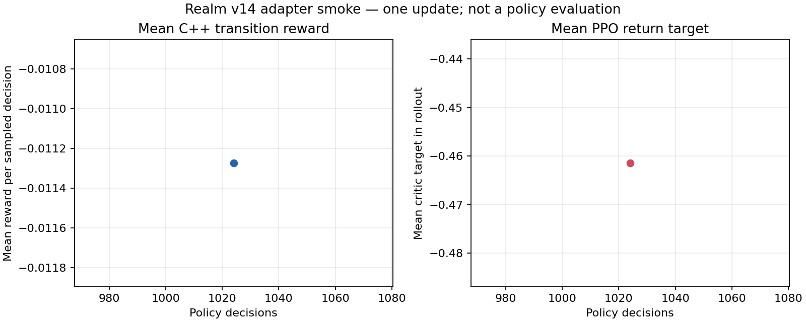

# Báo cáo bằng chứng: quân nhu SupplementaryFood

Ngày: 2026-10-23  
Trạng thái: phạm vi source/core/adapters của nhóm đã hoàn tất; chưa đóng M5.4 hoặc M5. Godot UI runtime và đánh giá policy nhiều seed vẫn thuộc các mốc sau.

## 1. Thay đổi người chơi sẽ thấy

Kho quân nhu công lưu DryFood và SupplementaryFood ở hai ngăn riêng. Governance có thể mua từng loại từ hàng chợ thật bằng ngân khố vùng, rồi gửi qua cùng route và công suất vận tải đã có. Hồ sơ vùng cho thấy riêng số lượng hai món. Chuyến hàng giữ nguyên GoodId của nó nên hàng tới đúng ngăn; hủy chuyến chỉ hoàn phần chưa được tải theo luật shipment hiện hành.

SupplementaryFood là phần tăng cường, không thay bữa cơ bản. Một volunteer đang phục vụ, hoặc đã tới đúng vùng tập kết mà người nhận nghĩa vụ chấp thuận, chỉ được nhận một món bổ sung khi lần ăn theo lịch bảy ngày của họ đã thực sự cấp được DryFood. Món bổ sung cộng10 điểm nutrition, không cộng health và không tạo thêm ngày ăn. Không có DryFood thì không tiêu SupplementaryFood. Luật không đổi sự đồng ý phục vụ, thời hạn, lương, quyền di chuyển, roster, quân số hay chiến đấu.

Hệ số `volunteer-supplementary-ration-trial-1` là giá trị thử để kiểm chuỗi dữ liệu; chưa có đánh giá nhiều seed hoặc bằng chứng cân bằng. Atlas bắt đầu với32 món SupplementaryFood trong stock chợ công của vùng2, đúng vùng specialty đã có trong World Atlas. Đây là hàng thị trường, không phải hàng miễn phí trong kho quân nhu: Governance vẫn phải mua bằng treasury và trả giá/thuế do MarketManager tính. Các profile nhỏ không được cấp lượng khởi đầu này. Save cũ không được tự sinh SupplementaryFood.

## 2. Thay đổi hợp đồng dữ liệu

- Realm model schema đổi `realm-v28` → `realm-v29`.
- Observation đổi từ3.085 lên3.484 giá trị; phần tăng27 là tồn SupplementaryFood từng vùng.
- Action đổi từ232 lên263; bốn candidate mua lượng1/4/16/64 và27 candidate gửi tới vùng đích.
- Realm state đổi từ301 lên328. Reward giữ `realm-v13-person-enterprise-equity-v1`.
- Save đổi schema52→53. Section kho quân nhu v2 ghi hai loại hàng. Migration schema52 giữ nguyên DryFood, bắt đầu ngăn SupplementaryFood bằng0; shipment hiện có giữ nguyên loại hàng, chủ sở hữu và lịch giao.
- Python model/trainer mới mang phiên bản v14. Model v13 không được đổi nhãn và trainer v14 từ chối bundle có shape cũ.
- Binding Python và GDExtension snapshot xuất riêng tồn kho hai hàng; native manifest và Godot panel nhận shape v29. Godot executable không có trong môi trường, vì vậy phần UI chưa được chạy trong engine.

Các chi tiết lựa chọn trước code, miền hợp lệ, migration và trường hợp biên nằm trong [kế hoạch nhóm](../design/M5.4-supplementary-military-rations-plan.md). Các file implementation tiêu biểu gồm `core/include/polyec/realm.hpp`, `core/src/realm.cpp`, `core/src/realm_military.cpp`, `core/src/realm_transport.cpp`, `core/src/realm_lifecycle.cpp`, `core/src/realm_save.cpp` và codec section trong `core/include/polyec/military_ration_depot_section_codec.hpp`; consumer tương ứng gồm Python binding, native contract, GDExtension, Godot panel và model/trainer v14.

## 3. Kiểm tra C++ core

Đã build có mục tiêu thư viện `polyec_core` cùng các executable liên quan. Runner vận tải trực tiếp báo **190 checks passed**. Bao gồm kiểm riêng hai loại stock, action mua/gửi, chuyến đi giữ hàng đúng loại, tải giữa chuyến, migration save52 không sinh SupplementaryFood, roundtrip save53, dữ liệu kho âm bị từ chối nguyên tử, và hai nhánh ăn ghép cặp: khi DryFood tới được thì volunteer nhận phần tăng cường; khi tuyến/bữa DryFood thất bại thì SupplementaryFood vẫn còn trong kho. Nhánh thành công cho thấy nutrition thay đổi theo `+10` bổ sung trên bữa DryFood cũ, health không nhận thêm; kho bổ sung giảm đúng một món.

Test bổ sung cho công thức xưởng phát hiện lỗi trong mã kiểm thử cũ: `establishments()` trả vector theo giá trị, nhưng test lưu tham chiếu tới phần tử của vector tạm đã bị hủy. Vì thế kết quả đọc stock ở assertion không hợp lệ. Đã đổi tham chiếu thành bản sao ổn định trong cả hai trường hợp công thức đầu vào đủ và trường hợp thiếu nguyên liệu. Test nhỏ riêng sau sửa báo công thức Tools và MilitarySupply đều pass. Bộ `polyec_realm_tests` cuối cùng sau sửa đã **pass 19.045 checks** (profile A10.000 người,19.743 sparse edges;90 ngày mô phỏng mất10,6946 giây). Hai lượt trước bị dừng ở18.901 và18.922 checks bởi hai assertion dùng tham chiếu tạm; chúng được giữ lại trong lịch sử kiểm nhưng không được tính là pass. Không có lỗi gameplay được quan sát trong các lượt này.

## 4. Kiểm tra các lớp gọi core

Các kiểm tra đã chạy sau khi core contract ổn định:

- Python extension `polyec_env` build trong Windows Debug.
- `ai/tests/military_ration_binding_checks.py` xác nhận schema v29, observation3484, action263; kiểm tồn kho DryFood và SupplementaryFood ở các vùng nguồn riêng, snapshot độc lập, và chuyến hàng từng loại.
- `ai/tests/realm_model_v14_checks.py` xác nhận shape model, sampling recurrent và mask rỗng.
- `ai/tests/realm_coplay_v14_checks.py` xác nhận hợp đồng v14, action và serialize/resume; bundle schema cũ v11/v12/v13 bị từ chối.
- `ai/tests/model_contract_binding_checks.py`:20 checks passed.
- Native runtime contract CTest:1/1 passed.
- GDExtension Windows build hoàn tất.
- Godot smoke không chạy được vì không có Godot executable. Source panel và hai script smoke đã được cập nhật schema v29, nhưng đó không phải bằng chứng UI chạy thật.

Không build lại app đầy đủ vì thay đổi nhóm này tập trung vào core/adapter và hướng dẫn yêu cầu kiểm target bị ảnh hưởng. Các build/test khác đã nêu ở đây là đúng lớp có API/shape mới; không dùng kết quả cũ để chứng nhận code mới.

## 5. PPO smoke: dữ liệu, nguồn tạo và giới hạn

Đã chạy đúng một update để kiểm tra adapter model v14 và luồng action C++→Python. Đây **không phải** tập dữ liệu đánh giá policy, không phải bước chọn checkpoint và không phải model dùng trong game.

Lệnh đã chạy:

```powershell
$env:PYTHONPATH=(Resolve-Path 'build/windows/Debug').Path
python ai/training/realm_train_v14.py --smoke-only --role 1 --seed 20261026 --regions 26 --envs 16 --rollout-steps 64 --minibatch-sequences 64 --updates 1 --no-time-limit --output artifacts/m5-supplementary-rations-2026-10-23/v14-atlas-smoke
```

Trainer tạo16 thế giới Atlas qua C++ Realm, với seed gốc20261026 và seed riêng tăng theo từng môi trường. Mỗi thế giới có26 vùng mô phỏng và horizon512 ngày; rollout trong run này lấy64 quyết định ở mỗi thế giới, tổng1.024 quyết định của actor Economic. Trước rollout, môi trường bật fixture timeline một tick để phép thử có thể đi qua pipeline lịch, nhưng không bật curriculum xưởng. Actor nhận observation và legal-action mask từ core hiện hành; hành động được lấy mẫu qua policy recurrent PPO có mask và gửi lại cùng C++ Realm để thực thi. Các actor Governance/Civilian là baseline phát triển được chỉ định tường minh, không có checkpoint, tạo28.662 peer decisions. Chúng là đối thủ baseline trong môi trường smoke, không được xem là policy đã huấn luyện.

Các transition gồm observation, mask, action, xác suất action, reward chuyển tiếp, giá trị critic, hidden state và thông tin kết thúc episode được giữ trong rollout buffer **trong RAM** để tính GAE và cập nhật PPO. File run không lưu từng transition thành bảng dữ liệu tái sử dụng. Nó lưu `history.jsonl` với chẩn đoán tổng hợp mỗi update, `manifest.json` với cấu hình/seed/model contract/nhãn run, `checkpoint.pt` và `initial.pt`; `atlas-smoke.json` giữ số liệu nguồn cho biểu đồ. Vì vậy cần phân biệt rõ: run có thu rollout online và dùng buffer trong update, nhưng không tạo một bộ trajectory cố định trên đĩa cho tái huấn luyện hoặc đánh giá độc lập.

Kết quả đúng run: một update,1.024 quyết định actor,28.662 quyết định peer; rollout96,75 giây, optimizer2,49 giây, toàn update99,40 giây, throughput10,30 actor decisions/giây, peak RSS617.218.048 byte. Mean transition reward là−0,011274, độ lệch chuẩn0,025996, min−0,203636, median−0,015455, p05−0,045455, p95 0,031818, max0,087273. Return target trung bình critic là−0,461430 (độ lệch chuẩn0,133710); đây là mục tiêu critic từ rollout, **không** phải điểm đánh giá độc lập.

Biểu đồ một điểm đặt reward rollout theo tổng số quyết định actor. Một điểm tương ứng một update nên không chứng minh tiến bộ theo thời gian. Trong batch Economic có57 cơ hội candidate ForeignTrade hợp lệ và không có hành động nào được lấy; hành động mua/gửi quân nhu không hợp lệ cho vai Economic nên có0 cơ hội ở nhóm actor này. Quan sát này chỉ mô tả batch smoke; không thể suy ra policy có hay không có khả năng dùng chức năng đó ở vai Governance. Bước kiểm kế tiếp để kết luận chất lượng là tạo evaluator trên seed độc lập, ghép cặp policy với baseline và policy ban đầu; hiển thị độ bất định, survival, nợ/mất khả năng thanh toán và phân bố hành động theo vai. Việc đó chưa được chạy ở đây.



## 6. Artefact và SHA-256

Tất cả các tệp dưới đây nằm dưới `artifacts/m5-supplementary-rations-2026-10-23/v14-atlas-smoke/` và được tạo bởi run nêu trên hoặc script plot v14:

| Tệp | Mục đích | SHA-256 |
|---|---|---|
| `manifest.json` | Cấu hình, version, seed, nhãn smoke-only và giới hạn đủ điều kiện | `7E256EF0DF0B13E5483BCE73990F9D6B3034222B372E5FECC0A8827C006D4A4B` |
| `history.jsonl` | Chẩn đoán update gốc và phân bố hành động/reward | `3A9872DC31673AA213186D117A72F917EAB260C37BCB35F2690754E6B57A4A82` |
| `atlas-smoke.json` | Dữ liệu nguồn vẽ biểu đồ | `2CF305D4AFD7F68C078A11D4F93A07386098B341253393B1CB92DCA5286DA7E5` |
| `atlas-smoke.png` | Biểu đồ cùng run | `A047A79D1E3ACDA97F3B6D3FE6B014DEA35C2963A68935E6882E792D321E877D` |
| `initial.pt` | Trọng số ban đầu trước update | `B9FEE41A96D53EB296513BDD19CC887C65C1DCAD16771F24BA3101BBA39F51AA` |
| `checkpoint.pt` | Checkpoint sau update smoke, không dùng làm policy ứng viên | `A880EE1655FA8DA850F4D87B9347063211C1E83A4BA3A51282D9EFBD42ED7944` |

Manifest ghi rõ `smoke_only=true`, `policy_candidate=false`, `policy_selection_eligible=false`, `peer_eligible=false`, `release_eligible=false`, và `complete=false`. Không có train/validation/holdout split trong một update smoke này. Không lấy reward của rollout làm đánh giá chính sách.

## 7. Hạn chế còn lại trước khi đóng nhóm

1. Godot UI runtime chưa chạy vì thiếu engine; chỉ source và GDExtension được build.
2. PPO chỉ là một update adapter smoke, không có đánh giá seed độc lập, model chọn trên validation, hoặc kiểm holdout.
3. Cân bằng `+10 nutrition` chưa được chứng minh; chưa chạy nhiều seed để đo sống sót, bệnh tật, thiếu lương thực hay hiệu quả chi phí.
4. Toàn M5 còn các hạng mục gameplay, policy learned được chọn, benchmark/stress/Profile B và package theo roadmap; không dùng nhóm này để tuyên bố M5 hoàn tất.
